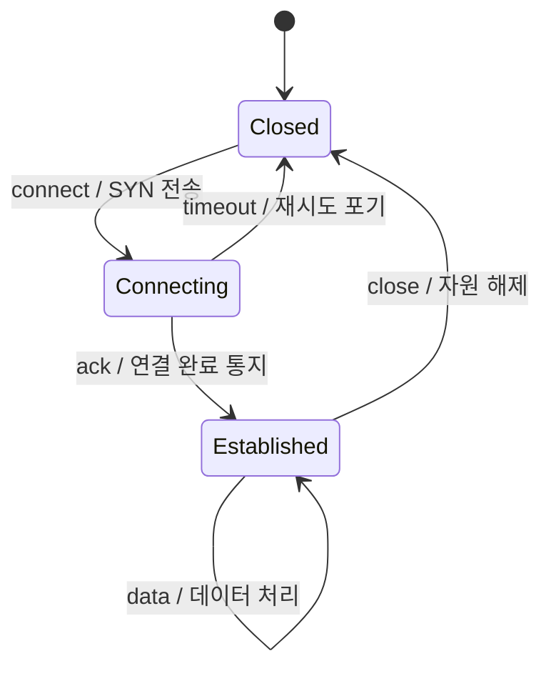

# FSM 유한 상태 기계 — 상태·이벤트·전이 표

> [!NOTE]
> FSM(Finite State Machine, 유한 상태 기계)은 시스템을 "상태 + 이벤트 → 동작 + 다음 상태"로 모델링하는 방법이다. 통신 프로토콜, UI, 게임, 파서처럼 순서가 중요한 로직에 널리 쓴다.

## 핵심 아이디어

- 시스템이 가질 수 있는 **상태가 유한한 개수**로 정해져 있다.
- 어느 한 시점에는 **상태 하나**에만 있다.
- **이벤트(입력)**가 들어오면 "현재 상태 + 이벤트"에 따라 정해진 **동작**을 하고 **다음 상태**로 간다.

```
(현재 상태, 이벤트) → (동작, 다음 상태)
```

## 구성 요소

| 요소 | 뜻 | 예 (연결 관리) |
|---|---|---|
| 상태 집합 | 가질 수 있는 상태 목록 | `Closed`, `Connecting`, `Established` |
| 입력(이벤트) 집합 | 상태를 바꿀 수 있는 사건 | `connect`, `ack`, `close`, `timeout` |
| 전이 함수 | (상태, 이벤트) → 다음 상태 | 표의 한 행 |
| 동작 | 전이할 때 하는 일 | SYN 전송, 소켓 해제 |
| 시작 상태 | 처음 상태 | `Closed` |
| 종료 상태 | 끝나는 상태 (없을 수도 있음) | `Closed` |

## 그림으로 보기



화살표 라벨은 `이벤트 / 동작` 형식이다.

## 표로 보기

상태도를 표로 옮기면 그대로 코드가 된다. **행을 위에서부터 훑어 첫 매칭을 실행**하는 방식이 흔하다.

| 현재 상태 | 이벤트 | 동작 | 다음 상태 |
|---|---|---|---|
| Closed | connect | SYN 전송 | Connecting |
| Connecting | ack | 연결 완료 통지 | Established |
| Connecting | timeout | 재시도 포기 | Closed |
| Established | data | 데이터 처리 | Established |
| Established | close | 자원 해제 | Closed |
| (모든 상태) | 그 외 | 에러 로그 | 유지 또는 Closed |

표에 없는 (상태, 이벤트) 조합은 "정의되지 않은 입력"이다. 이 처리를 마지막 행(any → 에러)으로 한 번에 받는 것이 안전하다.

## 종류

| 구분 | 출력이 정해지는 기준 | 특징 |
|---|---|---|
| Moore 기계 | 현재 **상태** | 상태마다 동작이 정해져 단순 |
| Mealy 기계 | 현재 상태 + **입력** | 같은 상태에서도 입력에 따라 동작이 달라 상태 수가 적음 |

소프트웨어에서는 "전이할 때 동작을 한다"는 Mealy 쪽 사고방식이 흔하다.

## 구현 방식 두 가지

**1. 조건문 방식** : `switch (state)` 안에 `switch (event)`를 중첩한다. 상태가 적을 때는 직관적이지만, 상태·이벤트가 늘면 코드가 길어지고 빠뜨린 조합을 찾기 어렵다.

**2. 표 기반(table-driven) 방식** : 전이를 데이터로 둔다. 실행기는 표를 훑어 맞는 행의 함수를 호출만 한다.

```c
typedef struct {
    int   event;                 /* 이벤트 */
    int   side;                  /* 추가 조건 (출처 등) */
    int (*func)(void *ctx);      /* 동작, 다음 이벤트를 돌려줌 */
    const void *next_state;      /* 다음 상태(표) */
} fsm_row_t;
```

표 기반의 장점은 아래와 같다.
- 상태와 전이가 한눈에 보인다 (문서와 코드가 거의 같은 모양).
- 전이 추가가 행 하나 추가로 끝난다.
- 실행기 하나를 모든 상태가 공유한다.

## 통신 시스템에서 많이 쓰는 이유

- 메시지가 오는 **순서**가 프로토콜의 본질이라서, 어느 상태에서 어떤 메시지가 가능한지를 표로 고정하면 이해하기 쉽다.
- 정의되지 않은 입력을 일괄로 걸러낼 수 있다.
- 3GPP 같은 스펙 문서가 상태도(SDL)로 쓰여 있어 코드로 옮기기 쉽다.
- 요청 하나(대화 하나)마다 **FSM 인스턴스를 하나씩** 두면, 여러 요청이 동시에 와도 각자 자기 상태를 따라 진행한다. 비동기 응답을 기다리는 구조에 잘 맞는다.

## 실무에서 자주 붙는 확장

| 확장 | 이유 |
|---|---|
| 조건(guard) 추가 | 같은 이벤트도 출처나 값에 따라 행을 달리 선택 |
| 핸들러가 돌려준 값을 다음 이벤트로 사용 | 한 번의 호출에서 상태를 연쇄로 이어 처리 |
| 종료 신호(DESTROY, END) | 인스턴스 해제, 연쇄 중단 |
| 시작 상태가 여러 개 | 타이머 만료처럼 처음부터 다른 표로 시작하는 경우 |

이론의 기본형은 "입력 하나에 전이 하나"이고, 위 확장은 구현 편의를 위해 덧붙인 것이다.

## 흔한 함정

- **상태 폭발** : 상태·이벤트·조건을 곱하면 행이 급격히 늘어난다. 상태를 "무엇을 기다리는가" 기준으로 묶으면 줄어든다.
- **정의되지 않은 입력** : 마지막에 any 행이 없으면 조용히 무시되거나 오동작한다.
- **행 순서** : 첫 매칭 방식에서는 조건이 구체적인 행(출처 지정)을 일반 행(any)보다 위에 둬야 한다.
- **동시성** : 인스턴스 하나를 두 스레드가 동시에 돌리면 상태가 깨진다. 인스턴스를 한 스레드에 고정하거나 락을 둔다.
