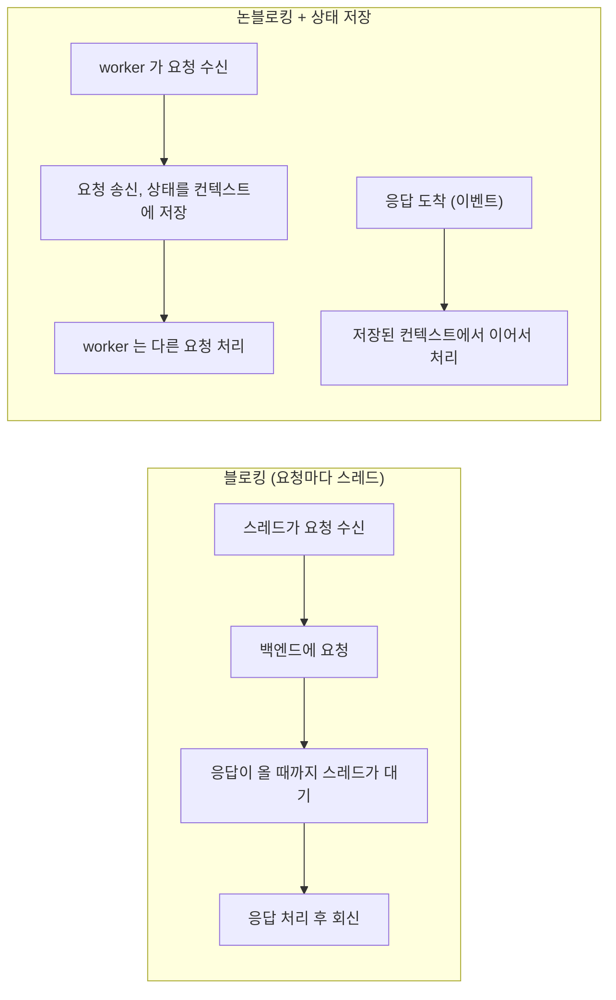
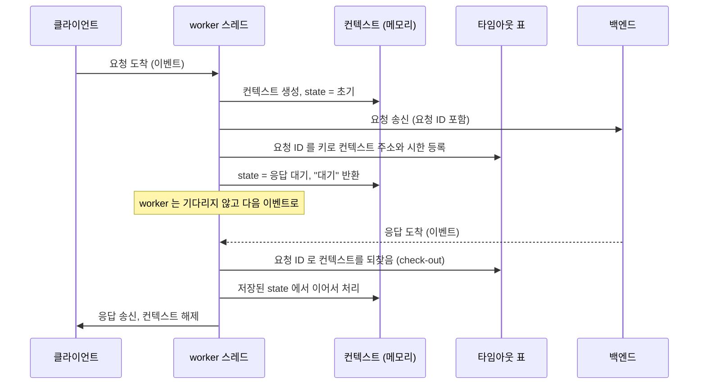

# 이벤트 기반 비동기 서버 — 논블로킹·상태 저장·상관 ID

> [!NOTE]
> 다른 서버에 요청을 보내고 응답을 기다려야 할 때, **스레드를 붙잡아 두지 않고** 요청의 진행 상태를 객체에 저장해 두었다가 응답(또는 시간 초과) 이벤트가 오면 이어서 처리하는 설계다. 통신 서버, 게이트웨이, 프로토콜 스택에서 흔히 쓰고, FSM·큐·상관 ID 같은 패턴이 함께 쓰인다.

## 핵심 아이디어

요청 하나를 처리하는 도중 "다른 곳의 응답을 기다려야 하는 지점"이 생긴다. 이때 두 가지 방식이 있다.



| | 블로킹 | 논블로킹 + 상태 저장 |
|---|---|---|
| 대기 중 "어디까지 했는가" | **스레드 스택**(지역 변수, 실행 위치)이 기억 | **컨텍스트 객체**(상태, 이벤트, 식별자)가 기억 |
| 동시에 기다릴 수 있는 요청 수 | 스레드 수만큼 | 컨텍스트를 둘 메모리가 허용하는 만큼 |
| 코드 모양 | 위에서 아래로 읽힘 | 요청 하나가 여러 핸들러로 쪼개짐 |
| 디버깅 | 스택 트레이스로 흐름이 보임 | 상태·이벤트 로그를 따라가야 함 |

실행 위치를 스택이 아니라 **데이터**로 만든 것이 핵심이다. 그래서 어느 worker든, 언제든 이어받을 수 있다.

## 구성 요소

이 구조는 하나의 패턴이 아니라 여러 패턴의 조합이다.

| 구성 요소 | 하는 일 | 일반 이름 |
|---|---|---|
| 이벤트를 큐로 받아 핸들러 실행 | 요청, 응답, 타임아웃을 모두 "이벤트"로 취급 | 이벤트 기반 (event-driven) |
| 대기 중 상태를 객체에 보관 | `state`, 이벤트, 연결 정보를 담은 컨텍스트 | 세션/컨텍스트 객체, continuation |
| 요청과 응답을 번호로 짝짓기 | 요청마다 ID를 붙이고 응답에서 같은 ID로 컨텍스트를 찾음 | 상관 ID (correlation id) |
| 응답이 안 오는 경우 대비 | 요청 시점에 타이머를 등록 | 타임아웃 테이블 |
| 같은 요청은 같은 스레드로 | 키를 해시해 worker 큐를 선택 | 세션 어피니티, 해시 샤딩 |
| 상태에 따라 동작 결정 | (상태, 이벤트) → 핸들러 | 유한 상태 기계 ([FSM 노트](개발%20%28CS%29/CS%20기초/[CS]%20FSM%20유한%20상태%20기계%20—%20상태·이벤트·전이%20표.md)) |
| 메시지 하나를 끝까지 한 번에 처리 | 핸들러가 "대기" 또는 "끝"을 반환할 때까지 연쇄 처리 | run-to-completion |

FSM이 맡는 것은 "지금 어느 단계이고 이번 이벤트에 무엇을 할지"뿐이다. "대기"가 무엇을 뜻하는지, 기다리는 동안 스레드가 어떻게 되는지는 FSM 이론이 아니라 서버를 비동기로 설계했기 때문에 생기는 규칙이다.

## 흐름



| 이벤트 | 어디서 오나 | 컨텍스트를 찾는 법 |
|---|---|---|
| 새 요청 | 클라이언트 | 새로 만든다 |
| 응답 | 백엔드 | 응답의 요청 ID로 타임아웃 표에서 되찾는다 |
| 타임아웃 | 타이머 | 타이머가 등록할 때 받아 둔 컨텍스트 주소를 돌려준다 |

세 가지 이벤트가 **모두 같은 worker 큐로 합류**해서 한 경로로 처리된다. 이 점이 중요하다. 응답 처리와 타임아웃 처리가 서로 다른 스레드에서 같은 컨텍스트를 동시에 건드리는 일을 막으려면 하나의 큐에 모아 순서대로 처리해야 한다.

### 컨텍스트에 들어가는 것

```c
typedef struct {
    int            state;        /* 지금 어느 단계인가 (FSM 상태) */
    int            last_evt;     /* 마지막 이벤트 */
    unsigned int   req_id;       /* 상관 ID: 응답과 짝짓는 키 */
    int            worker_idx;   /* 어느 worker 큐가 담당하는가 */
    long           conn_id;      /* 최종 응답을 돌려줄 연결 정보 */
    /* ... 요청 본문, 중간 결과 ... */
} ctx_t;
```

"대기" 동안 필요한 것은 전부 컨텍스트에 있어야 한다. 스택 변수에 있던 값은 핸들러가 끝나면 사라지기 때문이다.

## 스레드 모델

| 모델 | 구조 | 특징 |
|---|---|---|
| 단일 이벤트 루프 | 스레드 1개가 모든 이벤트를 처리 (Node.js, nginx worker 하나) | 락이 필요 없지만 한 이벤트가 오래 걸리면 전체가 멈춤 |
| worker 풀 + 공용 큐 | 모든 worker가 하나의 큐를 경쟁해서 꺼냄 | 구현이 단순하지만 같은 요청이 다른 worker로 갈 수 있어 컨텍스트 동기화 필요 |
| worker 풀 + 키별 전용 큐 | `키 % N`으로 큐를 고르고 큐마다 worker 1개 | **같은 요청은 항상 같은 worker가 처리**해서 컨텍스트에 락이 필요 없음 |

세 번째 방식이 통신 서버에서 많이 쓰인다. 자세한 내용은 [스레드별 전용 큐와 해시 샤딩](개발%20%28CS%29/언어/C언어/동시성·스레드/[C]%20스레드별%20전용%20큐와%20해시%20샤딩%20—%20락%20경합%20없는%20고성능%20워커%20패턴.md) 참고.

## 응답이 영원히 안 오면

기다리는 컨텍스트가 메모리에 쌓이지 않도록 **타임아웃을 반드시 등록**한다. 요청을 보낼 때 요청 ID와 시한을 표에 넣고(check-in), 응답이 오면 꺼내며(check-out), 시한이 지나면 타이머가 만료 이벤트를 만들어 같은 큐에 넣는다. 구체적인 구현은 [비동기 요청-응답의 타임아웃 감시 — Check-in과 Check-out 타이머 패턴](개발%20%28CS%29/언어/C언어/동시성·스레드/[C]%20비동기%20요청-응답의%20타임아웃%20감시%20—%20Check-in과%20Check-out%20타이머%20패턴.md) 참고.

응답과 타임아웃이 거의 동시에 도착하는 경쟁이 가장 까다롭다. check-out이 **한 번만 성공**하도록 만들어서, 먼저 꺼낸 쪽만 컨텍스트를 처리하게 하는 것이 일반적인 방어다.

## 장단점

| 장점 | 단점 |
|---|---|
| 스레드 수보다 훨씬 많은 요청이 동시에 대기할 수 있음 | 요청 하나의 로직이 여러 핸들러에 흩어져 읽기 어려움 |
| 대기 중에 CPU와 스레드를 쓰지 않음 | 상태를 직접 저장하고 복원해야 해서 실수하기 쉬움 |
| 스레드 전환·스택 메모리 비용이 작음 | 디버깅할 때 호출 스택이 흐름을 알려 주지 않음 |
| 같은 키를 같은 worker에 고정하면 락이 필요 없음 | worker 안에서 블로킹 호출을 하면 그 worker의 모든 요청이 멈춤 |

## 흔한 함정

- **컨텍스트 누수**: "대기"로 둔 컨텍스트에 응답도 타임아웃도 오지 않으면 영원히 남는다. 타임아웃 등록 누락, 에러 경로에서 해제 누락이 원인이다. 오래된 컨텍스트를 회수하는 경로(주기적 스캔)를 따로 두기도 한다.
- **worker 안의 블로킹**: 핸들러 안에서 동기 DB 호출이나 `sleep`을 하면 비동기의 이점이 사라지고, 그 worker 큐에 쌓인 모든 요청이 지연된다.
- **응답-타임아웃 경쟁**: 위에서 설명한 대로 한 번만 가져가도록 보장해야 한다.
- **같은 키의 순서**: 같은 요청의 메시지가 서로 다른 수신 스레드에 걸리면 큐에 들어가는 순서가 보장되지 않을 수 있다.
- **큐 포화**: 큐가 가득 차면 새 이벤트를 버릴지 막을지 정해 둬야 한다.
- **상태 로그 부재**: 호출 스택이 없으므로 "상태 → 다음 상태 (이벤트)"를 로그로 남겨 두지 않으면 흐름을 추적할 수 없다.

## 같은 구조를 볼 수 있는 곳

- **통신 프로토콜 스택**: SIP, Diameter, 3GPP 시그널링처럼 트랜잭션마다 상태기계 인스턴스를 두는 것이 전통적인 방식이다.
- **Node.js, Netty, nginx**: 이벤트 루프가 요청마다 컨텍스트를 들고 콜백으로 이어 처리한다.
- **Erlang/OTP `gen_statem`**: 프로세스마다 상태를 들고 메시지에 반응한다.
- **async/await**: 컴파일러가 `await` 지점마다 코드를 쪼개 상태기계로 만들어 준다. 이 노트의 구조를 사람이 손으로 쓰는 것과 같다.

## 관련 노트

- [FSM 유한 상태 기계 — 상태·이벤트·전이 표](개발%20%28CS%29/CS%20기초/[CS]%20FSM%20유한%20상태%20기계%20—%20상태·이벤트·전이%20표.md) — 이 구조에서 "상태 + 이벤트 → 동작"을 맡는 부분
- [스레드 동시성 문제 정리](개발%20%28CS%29/CS%20기초/운영체제/[OS]%20스레드%20동시성%20문제%20정리%20-%20race·deadlock·livelock·starvation.md) — 컨텍스트를 여러 스레드가 만질 때의 위험
