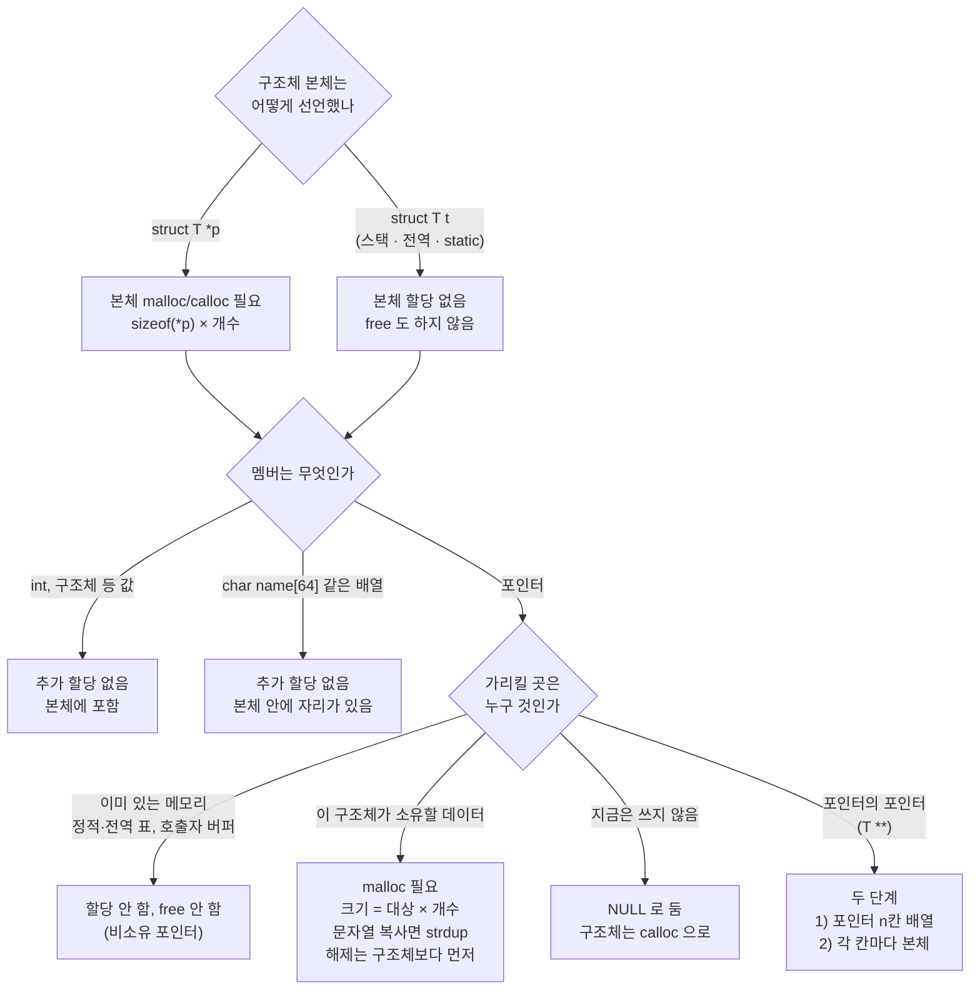
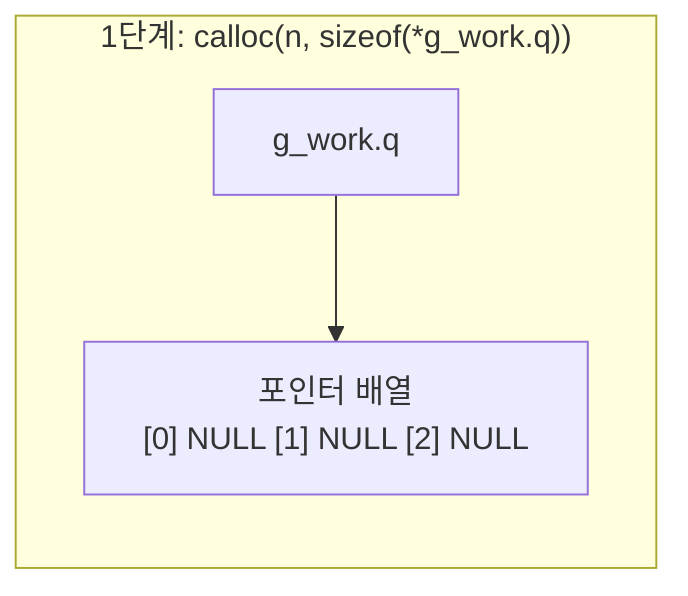
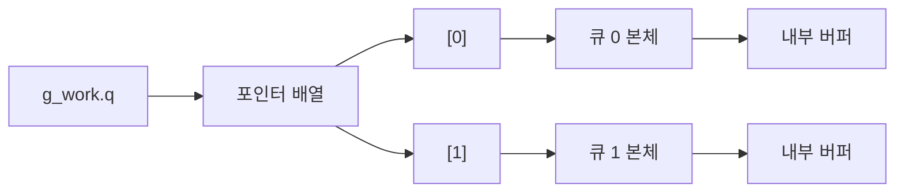

# 동적 할당 소유권 — caller free vs callee create·destroy 쌍

> [!NOTE]
> C엔 소멸자가 없어서 "누가 `malloc`했으면 누가 `free`하는가"를 매번 코드로 결정해야 한다. 대원칙은 **"할당한 계층이 해제도 책임진다"**지만, 실무에서는 이 원칙이 세 가지 다른 모양으로 구현된다. 셋 다 "결국 caller가 해제 호출을 한다"는 점에서 겉보기엔 비슷해 보이지만, 내부 자원 정리·캡슐화·바이너리 경계 안전성에서 결정적으로 다르다.

## 0. 세 가지 패턴

| 패턴 | 할당 | 해제 | 대표 예 |
| --- | --- | --- | --- |
| 1. Caller 할당·Caller 해제 | Caller (스택 또는 힙) | Caller | `snprintf`, `read`, `memcpy` |
| 2. Callee 모듈이 create/destroy 쌍 제공 | Callee 내부 (`_create`) | Callee 전용 함수 (`_destroy`) | 구조체·자료구조 모듈 |
| 3. Callee가 할당, Caller가 `free` | Callee 내부 | Caller가 표준 `free()` 직접 호출 | `strdup`, `asprintf` |

### 패턴 1 — 버퍼는 caller가 들고 있는다

Callee는 포인터와 크기만 받아서 채우기만 한다. 스택/힙 중 뭘 쓸지는 caller가 결정하고, 할당과 해제가 같은 함수 안에 있어서 누수 추적이 가장 쉽다.

```c
void get_user_name(char *out_buf, size_t buf_size);  /* callee */

void caller(void)
{
    char buf[256];               /* 또는 malloc() */
    get_user_name(buf, sizeof(buf));
    /* 사용 후 종료 — malloc을 썼다면 여기서 caller가 free */
}
```

### 패턴 2 — 모듈이 생성·해제를 세트로 제공

```c
/* callee 모듈 */
typedef struct {
    char *name;      /* malloc */
    int  *history;   /* malloc */
    FILE *log_file;  /* fopen */
} user_t;

user_t *user_create(const char *name)
{
    user_t *u = malloc(sizeof(user_t));
    if (u == NULL) return NULL;
    u->name = strdup(name);
    u->history = malloc(sizeof(int) * HISTORY_CAP);
    u->log_file = fopen("user.log", "a");
    return u;
}

void user_destroy(user_t *u)
{
    if (u == NULL) return;
    free(u->name);
    free(u->history);
    if (u->log_file) fclose(u->log_file);
    free(u);
}
```

```c
/* caller */
user_t *user = user_create("Alice");
/* 작업 수행 */
user_destroy(user);   /* free()를 직접 부르지 않는다 */
```

### 패턴 3 — `strdup` 방식 (가능하면 피한다)

```c
char *name = strdup(source);   /* callee 내부에서 malloc */
/* ... */
free(name);                    /* caller가 표준 free()로 직접 해제 */
```

문서나 함수 이름(`create_...`, `alloc_...`, `dup`)으로 소유권 이전을 명확히 드러내지 않으면 caller가 `free()` 호출을 빠뜨리기 쉽고, DLL/공유 라이브러리 경계를 넘을 때는 아래 2절의 힙 불일치 문제까지 겹친다.

## 1. 패턴 2와 3, 뭐가 다른가

둘 다 "callee가 `malloc`하고, 결국 caller가 해제를 호출한다"는 흐름은 같다. 차이는 **caller가 호출하는 것이 표준 `free()`인가, callee가 만든 전용 함수인가**다.

### 1-1. Deep free vs Shallow free — 내부 자원

구조체가 내부에 다른 포인터나 리소스(파일 핸들, 소켓, 추가 동적 할당)를 갖고 있으면:

- **패턴 3처럼 caller가 직접 `free(user)`를 호출하면** — `user` 구조체 자체의 메모리만 해제되고, 내부의 `name`·`history`·`log_file`은 그대로 누수된다 (shallow free).
- **패턴 2의 `user_destroy(user)`를 호출하면** — 모듈 내부에서 `name`·`history`를 `free()`하고 `log_file`을 `fclose()`한 뒤 마지막에 `user`를 해제한다 (deep free). C++ 소멸자가 하는 일을 함수 호출로 흉내 낸 것이다.

### 1-2. 캡슐화 — 할당 방식이 바뀌어도 caller는 몰라도 된다

지금은 `malloc`을 쓰지만 나중에 성능을 위해 메모리 풀이나 정적 캐시로 내부 구현을 바꿀 수 있다.

- caller가 `free(user)`를 직접 호출하면 — 메모리 풀에서 꺼낸 주소를 표준 힙 `free()`에 넘기게 되어 즉시 크래시. caller가 callee의 내부 구현(malloc 여부)까지 알아야 한다.
- `user_destroy(user)`를 호출하면 — 내부에서 `free`를 쓰든 풀로 반환하든 caller는 신경 쓸 필요가 없다.

### 1-3. DLL/공유 라이브러리 힙 경계 — 가장 치명적인 실무 문제

실행 파일(EXE)과 라이브러리(DLL/`.so`)가 서로 다른 C 런타임(CRT)을 링크하면 각자 독립된 힙을 가질 수 있다. DLL 내부에서 `malloc()`한 포인터를 EXE에서 표준 `free()`로 넘기면 다른 힙 관리자에게 해제를 요구하는 셈이 되어 **Heap Corruption 크래시**가 발생한다. 그래서 라이브러리 경계를 넘는 할당은 반드시 그 라이브러리가 제공하는 전용 해제 함수(`xxx_destroy`)를 거쳐, 같은 바이너리 내부에서 `free`가 실행되도록 만들어야 한다.

### 1-4. 책임의 분리 — "언제(When)" vs "어떻게(How)"

| 구분 | Caller가 아는 것 | Callee가 아는 것 |
| --- | --- | --- |
| 패턴 3 (`free` 직접 호출) | "언제" 끝났는지 + "어떻게" 해제해야 하는지(표준 `free`로 충분한지, 서브 자원이 있는지) 둘 다 알아야 함 | 없음 — caller의 가정에 기댄다 |
| 패턴 2 (`_destroy` 호출) | "언제" 끝났는지만 전달 | "어떻게" 해제할지 전담 — 내부가 `malloc`이든 풀이든, 서브 자원이 몇 개든 caller는 안전함 |

## 2. 선택 기준

| 상황 | 권장 패턴 |
| --- | --- |
| 단순 버퍼·문자열·배열 전달 | 1. Caller 할당·Caller 해제 (callee는 포인터+크기만) |
| 동적 객체·구조체 생성 | 2. Callee 모듈이 `_create`/`_destroy` 쌍 제공 |
| Callee가 `malloc`하고 caller가 `free` | 되도록 피한다. 불가피하면 함수 이름(`create_...`, `dup...`)과 문서로 소유권 이전을 명확히 표시 |

1바이트짜리 버퍼 하나를 다루는 정도가 아니라면, 생성 함수와 해제 함수를 세트로 제공하는 패턴 2가 가장 안전하고 견고하다.

## 3. 무엇을 얼마나 할당하나 — 크기 규칙

할당 크기는 **"포인터가 가리키는 대상의 크기 × 개수"**다. 포인터 변수 자체의 크기가 아니다. `sizeof(*ptr)`을 쓰면 타입이 바뀌어도 크기가 따라간다.

```c
struct T *p   = malloc(sizeof(*p));          /* 구조체 1개 */
struct T *arr = calloc(n, sizeof(*arr));     /* 구조체 n개 */
/* malloc(sizeof(p)) 는 틀림: 포인터 크기(보통 8바이트)만 잡힌다 */
```

| 선언 | 1단계에서 할당할 것 | 2단계 |
| --- | --- | --- |
| `struct T *p` | `sizeof(struct T)` × 개수 | 필요 없음 |
| `char **pp` | `sizeof(char *)` × 개수 | 각 `pp[i]`에 문자 버퍼 |
| `struct T **pp` | `sizeof(struct T *)` × 개수 | 각 `pp[i]`에 `struct T` |

이중 포인터는 단계마다 할당하고, 해제는 반대 순서(안쪽 → 바깥)로 한다. 자세한 예시는 [개수 필드 + 포인터의 포인터](개발%20%28CS%29/언어/C언어/메모리·구조체/[C]%20개수%20필드%20+%20포인터의%20포인터%20—%20동적%20문자열%20배열%20만들고%20해제하기.md) 참고.

### malloc 이 필요한 경우의 수 — 한눈에

구조체 본체 → 멤버 순서로 두 번 물어보면 된다.



| 경우 | 본체 | 멤버 | 할당 | 해제 |
| --- | --- | --- | --- | --- |
| 힙 구조체, 값·배열 멤버만 | `malloc` | 없음 | 한 번 | `free(p)` 한 번 |
| 힙 구조체, 소유 포인터 멤버 | `malloc` | `malloc`/`strdup` | 본체 + 멤버 | 멤버 → 본체 순서 |
| 힙 구조체, 비소유 포인터 멤버 | `malloc` | 없음 (주소만 저장) | 본체만 | `free(p)`만. 멤버는 건드리지 않음 |
| 스택·전역 구조체, 소유 포인터 멤버 | 없음 | `malloc`/`strdup` | 멤버만 | 멤버만 `free` |
| 스택·전역 구조체, 값·배열 멤버만 | 없음 | 없음 | 없음 | 없음 |
| 이중 포인터 멤버 | 위 둘 중 하나 | 포인터 배열 + 각 원소 | 2단계 | 각 원소 → 배열 → (본체) |
| 쓰지 않는 포인터 멤버 | 위 둘 중 하나 | `NULL` | 없음 | `free(NULL)`은 안전 |

### 구조체 본체와 멤버는 따로 판단한다

구조체를 `malloc`하는지는 **구조체를 어떻게 선언했는가**로 갈리고, 포인터 멤버를 `malloc`하는지는 그와 별개다.

| 선언 | 구조체 본체 | 포인터 멤버 |
| --- | --- | --- |
| `struct T *p` | `p = malloc(sizeof(*p))` 필요 | 따로 판단 |
| `struct T t` (스택) | 이미 있음 | 따로 판단 |
| `static struct T t` 또는 전역 | 이미 있음 | 따로 판단 |

구조체가 스택이나 전역에 있어도, 멤버가 포인터이고 가리킬 곳이 필요하면 **멤버만** `malloc`한다.

```c
static struct work_mng {          /* 전역: 구조체 본체는 할당하지 않는다 */
    int     cnt;
    queue_t **q;                  /* 포인터 배열이 필요하다 */
} g_work;

void work_init(int n)
{
    g_work.cnt = n;
    g_work.q   = calloc(n, sizeof(*g_work.q));    /* 멤버만 할당 */
    for (int i = 0; i < n; i++)
        g_work.q[i] = queue_create();             /* 2단계: 각 원소 */
}
```

해제할 때도 멤버만 `free`하고 구조체는 `free`하지 않는다. 전역 구조체에 `free(&g_work)`를 하면 힙이 아니라서 크래시한다.

### 이중 포인터는 두 단계 — 1단계는 주소 칸, 2단계가 본체

위 예에서 `calloc(n, sizeof(*g_work.q))`가 실제로 무엇을 할당하는지 타입을 한 겹씩 벗겨 보면 알 수 있다.

```c
queue_t **q;              /* g_work.q 의 타입 */
*g_work.q                 /* * 하나를 뗀 타입: queue_t *  (큐를 가리키는 포인터 1개) */
sizeof(*g_work.q)         /* = 포인터 1개의 크기 (보통 8바이트) */
calloc(n, 8)              /* 포인터 n칸짜리 배열 */
```

`sizeof(*변수)`는 "변수에서 `*` 하나를 뗀 타입"의 크기다. `sizeof`는 타입만 보고 실제로 값을 읽지 않으므로 안전하다. 같은 `sizeof(*q)` 형태라도 `queue_t *q`였다면 `*q`가 `queue_t`라서 구조체 크기가 나온다.



1단계가 준 것은 **큐가 아니라 큐의 주소를 담을 칸 n개**다. `calloc`이라 칸은 `NULL`로 시작한다. 이 상태에서 `g_work.q[i]`를 쓰면 `NULL`을 역참조하게 된다.

```c
for (int i = 0; i < n; i++)
    g_work.q[i] = queue_create(capacity);     /* 2단계: 각 칸이 가리킬 큐 본체 */
```



### 큐 본체와 그 안의 멤버는 누가 할당하나

2단계의 `queue_create()`가 큐 본체와 그 안쪽 자원을 전부 만든다. 호출자는 크기를 몰라도 된다. 앞의 패턴 2(callee가 `_create`, 전용 `_destroy`)와 같은 구조다.

```c
queue_t *queue_create(int capacity)
{
    queue_t *q = calloc(1, sizeof(*q));              /* 1) 큐 구조체 본체 */
    if (q == NULL) return NULL;

    q->buf = calloc(capacity, sizeof(*q->buf));      /* 2) 포인터 멤버가 가리킬 내부 버퍼 */
    if (q->buf == NULL) { free(q); return NULL; }    /* 실패하면 앞에서 잡은 것을 되돌린다 */

    q->capacity = capacity;                          /* 3) 숫자 멤버는 값만 채운다 */
    pthread_mutex_init(&q->lock, NULL);              /* 락 같은 값·배열 멤버는 본체 안에 이미 자리가 있다 */
    return q;
}
```

| 대상 | 누가 할당하나 |
| --- | --- |
| 포인터 배열 (`g_work.q`) | 호출자 |
| 큐 본체 (`queue_t`) | `queue_create()` 안 |
| 큐의 내부 버퍼 (`q->buf`) | `queue_create()` 안 |
| 락·카운터 같은 값·배열 멤버 | 본체에 이미 포함되어 추가 할당 없음 |

해제는 반대 순서로, 각 원소를 `queue_destroy(g_work.q[i])`로 지운 뒤(안에서 `buf` → 본체 순서) 마지막에 포인터 배열 `free(g_work.q)`를 한다. 호출자가 원소에 `free()`를 직접 부르면 내부 버퍼가 누수된다.

라이브러리가 제공하는 큐처럼 소스를 볼 수 없는 경우에도 같은 구조일 것이라 짐작할 뿐이므로, 반드시 그 라이브러리의 해제 함수를 쓰고 문서에서 소유권을 확인한다.

### 배열 멤버와 포인터 멤버는 다르다

```c
struct A { char name[64]; };      /* 배열: sizeof(struct A) 에 64바이트가 들어 있다. 추가 malloc 없음 */
struct B { char *name;    };      /* 포인터: 주소 칸만 있다. 가리킬 버퍼는 따로 malloc */
```

### 문자열을 복사해 소유하기 — strdup

`strdup(s)`는 **문자열을 힙에 복사해서 새 주소를 돌려주는 함수**다. 포인터 멤버에 문자열을 소유시킬 때 `malloc` + 복사를 한 줄로 해 준다.

```c
char *name = strdup("Alice");     /* 힙에 6바이트("Alice" + '\0')를 잡고 복사한다 */
/* 위 한 줄은 아래와 같다 */
char *name2 = malloc(strlen("Alice") + 1);
if (name2 != NULL) strcpy(name2, "Alice");

free(name);                       /* 직접 해제해야 한다 */
```

| 항목 | 내용 |
| --- | --- |
| 헤더 | `<string.h>` |
| 크기 | `strlen(s) + 1` (널 문자 포함)을 내부에서 계산해 `malloc` |
| 실패 | 메모리 부족이면 `NULL`을 돌려준다. 반드시 검사한다 |
| 해제 | 호출자가 `free()`로 한다 (앞의 패턴 3) |
| 표준 | POSIX 함수로 오래 쓰였고, C23부터 표준에 들어왔다. 환경에 따라 `_POSIX_C_SOURCE` 같은 설정이 필요할 수 있다 |
| 변형 | `strndup(s, n)`: 최대 `n`글자만 복사하고 항상 널로 끝낸다. 길이를 제한하고 싶을 때 쓴다 |

구조체의 소유 포인터 멤버에 쓰면 이렇게 된다.

```c
struct user *u = calloc(1, sizeof(*u));
u->name = strdup(src);            /* src 가 사라져도 u 가 자기 복사본을 가진다 */
if (u->name == NULL) { free(u); return NULL; }
...
free(u->name);                    /* 멤버 먼저 */
free(u);
```

**strdup 와 다른 선택지**

| 상황 | 선택 |
| --- | --- |
| 복사본을 구조체가 소유해야 하고 길이가 제각각 | `strdup` |
| 최대 길이가 정해져 있다 | 고정 배열 `char name[64]` + `strlcpy`/`snprintf` (할당·해제 불필요) |
| 원본이 구조체보다 오래 살고 바뀌지 않는다 | 복사하지 않고 주소만 저장 (비소유 포인터) |

**흔한 실수**

- `free`를 빼먹는다. 호출자가 해제해야 하는 함수라는 점이 이름에서 드러나지 않는다.
- **소유 여부가 섞인다.** 같은 멤버에 어떤 경로에서는 `strdup`한 포인터를, 어떤 경로에서는 문자열 리터럴(`"default"`)을 넣으면, 나중에 `free(u->name)`이 리터럴에서 크래시한다. 소유하는 멤버는 항상 `strdup`한 값만 넣거나, 리터럴일 때도 `strdup("default")`로 복사해서 넣는다.
- `strdup(NULL)`은 정의되지 않은 동작이다. 입력이 `NULL`일 수 있으면 먼저 검사한다.
- 멤버에 이미 `strdup`한 포인터가 있는데 다시 `strdup`로 덮어쓰면 앞의 것이 샌다. 덮어쓰기 전에 `free`한다.

## 4. 포인터 멤버가 항상 malloc 대상은 아니다 — 비소유 포인터

포인터 멤버가 **이미 있는 메모리의 주소를 빌려 가리키기만** 하는 경우가 있다. 이때는 `malloc`하지 않고, 구조체를 해제할 때 `free`하지도 않는다.

```c
static const row_t table_idle[] = { ... };    /* 프로그램 전체 기간 동안 존재하는 정적 표 */

struct ctx {
    const row_t *cur;      /* 정적 표를 가리키기만 한다. 복사하지 않는다 */
    void        *usr;      /* 호출자가 할당한 버퍼의 주소만 보관 */
    int        (*cb)(void *);   /* 함수 포인터는 할당 대상이 아니다 */
};

struct ctx *c = calloc(1, sizeof(*c));
c->cur = table_idle;                /* 주소만 저장 */
...
free(c);                            /* c->cur, c->usr 는 free 하지 않는다 */
```

가리킬 대상이 정적·전역이면 수명이 프로그램 전체라서 댕글링 걱정이 없고, 여러 객체가 같은 데이터를 공유하므로 복사할 이유도 없다.

| 상황 | 방식 |
| --- | --- |
| 가리킬 대상이 구조체보다 오래 살고 바뀌지 않는다 | 주소만 저장 (소유하지 않음) |
| 구조체가 데이터를 직접 소유하거나 수정해야 한다 | `malloc`해서 복사본 소유 |
| 지금은 쓰지 않고 나중에 필요할 때만 할당 | `NULL`로 두고 필요할 때 `malloc` |

### 주의

- **`malloc`은 0으로 초기화하지 않는다.** 채우지 않은 포인터 멤버에는 쓰레기 주소가 들어 있어 `free`나 접근에서 크래시한다. 쓰지 않는 멤버가 있으면 `calloc`으로 구조체를 잡아 `NULL`로 시작하게 한다. `free(NULL)`은 안전하다.
- **소유 여부를 모호하게 두지 않는다.** 같은 구조체를 해제하는 코드가 멤버까지 `free`해야 하는지가 불분명하면 이중 해제나 누수가 생긴다. 이름(`p_`, `borrowed_` 접두어)이나 주석으로 구분한다.
- **정적 데이터를 가리키는 포인터는 `const`로 선언한다.** 여러 객체가 같은 표를 공유하므로 한 곳에서 수정하면 모두에게 영향이 간다.
- **구조체 복사(`*b = *a`)는 포인터 멤버의 주소만 복사한다.** 두 구조체가 같은 버퍼를 가리켜서 이중 해제 위험이 생긴다. 소유 포인터가 있으면 깊은 복사 함수를 따로 만든다.
- **비소유 포인터는 가리키는 쪽이 먼저 해제되면 댕글링이 된다.** 정적 데이터가 아니라 힙이나 스택을 가리킨다면 수명을 직접 확인한다.
- 전역·정적 데이터를 여러 스레드가 공유할 때 쓰기가 있으면 별도 동기화가 필요하다. [스레드 동시성 문제 정리](개발%20%28CS%29/CS%20기초/운영체제/[OS]%20스레드%20동시성%20문제%20정리%20-%20race·deadlock·livelock·starvation.md)의 "전역·정적 변수는 읽기 전용만 안전하다" 절 참고.

## 관련 문서

- [리눅스 시스템 함수(System Call) 카테고리별 치트시트](개발%20%28CS%29/언어/C언어/네트워크·시스템%20IO/[C]%20리눅스%20시스템%20함수%28System%20Call%29%20카테고리별%20치트시트%20—%20파일·프로세스·시그널·네트워크·계정정보.md) — `getlogin_r()` 등 `_r` 접미사 POSIX 함수들이 패턴 1(caller 버퍼 할당)을 따르는 실제 예
- [실무 C 코드 관례와 UB 함정 정리](개발%20%28CS%29/언어/C언어/설계%20패턴·코드%20관례/[C]%20실무%20C%20코드%20관례와%20UB%20함정%20정리.md) — A1(생성/소멸 쌍) 항목의 등급 분류와 역순 정리 원칙
- [불투명 포인터(Opaque Pointer) — 헤더는 선언만, 구현은 숨기기](개발%20%28CS%29/언어/C언어/메모리·구조체/[C]%20불투명%20포인터%28Opaque%20Pointer%29%20—%20헤더는%20선언만,%20구현은%20숨기기.md) — `_create`/`_destroy` 쌍을 캡슐화까지 확장한 패턴
- [개수 필드 + 포인터의 포인터 — 동적 문자열 배열 만들고 해제하기](개발%20%28CS%29/언어/C언어/메모리·구조체/[C]%20개수%20필드%20+%20포인터의%20포인터%20—%20동적%20문자열%20배열%20만들고%20해제하기.md) — 다단계 할당의 역순 해제 예시
