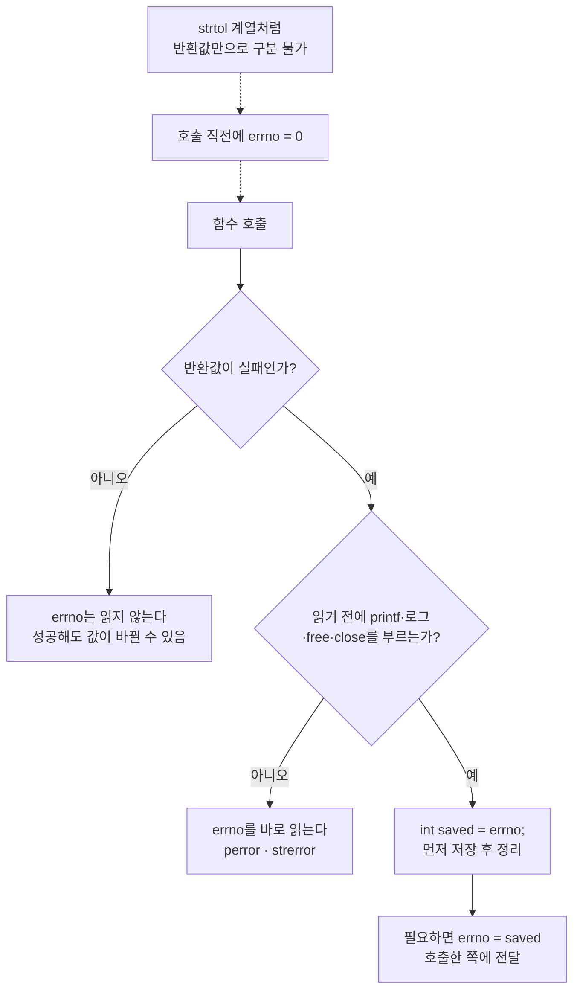

# errno 사용 규칙 — 초기화·저장·검사·설정 패턴

> [!TIP]
> 관련 노트: [에러 처리·API 설계 실습](개발%20%28CS%29/언어/C언어/실습/[C]%20에러%20처리·API%20설계%20실습%20—%20strtol%20my_atoi·snprintf_m·sum_file·conformant%20배열.md) · [환경변수·시그널 실습](개발%20%28CS%29/언어/C언어/실습/[C]%20환경변수·시그널%20실습%20—%20getenv%20복사·atexit와%20sigaction·pselect%20시그널%20카운터.md) · [종합본](개발%20%28CS%29/언어/C언어/실습/[C]%20종합본%20—%20안전한%20C%20코딩%20체크리스트와%20방어%20매크로.md) · 헤더 [`log.h`의 `LOG_ERRNO`](https://github.com/sweetpark/c-playgound/blob/main/common/log.h)

## 📌 한 페이지 요약

`errno`는 "마지막으로 실패한 함수의 이유"를 담는 **스레드별 `int`**다. 믿을 수 있는 순간이 짧아서 아래 규칙으로만 쓴다.



| # | 규칙 | 이유 |
|---|---|---|
| 1 | **실패는 반환값으로 먼저 판단**하고, 그 뒤에 `errno`를 읽는다 | `errno`는 성공한 호출도 바꿀 수 있어서, `errno != 0`만으로는 실패를 알 수 없다 |
| 2 | `errno`로만 실패를 알리는 함수는 호출 **직전에 `errno = 0`** | 자동으로 0이 되지 않아 이전 값이 남는다 |
| 3 | 읽기 **직후가 아니면 저장**한다 (`int saved = errno;`) | 로그·`free`·`fclose`·`close`가 값을 덮을 수 있다 |
| 4 | 시그널 핸들러는 `errno`를 **저장하고 복원**한다 | 핸들러 안의 `write` 등이 main이 보던 값을 바꾼다 |
| 5 | 우리가 만드는 함수는 **실패할 때만** `errno`를 설정한다 | 성공 시 `errno = 0`으로 지우면 호출한 쪽의 이전 값을 망가뜨린다 |
| 6 | 스트림(`printf` 등)의 오류는 `errno`가 아니라 **`ferror`** | 호출이 여러 개면 `errno`가 어느 호출 것인지 알 수 없다 |

---

## 1. 초기화 — `errno = 0`이 필요한 경우 (규칙 2)

> [!NOTE] 요약
> - **문제**: `strtol`처럼 반환값만으로 실패를 구분 못 하는 함수에서 이전 `ERANGE`가 남아 오판 (13-06)
> - **원인**: `errno`는 성공해도 지워지지 않고, 프로그램 시작 때만 0
> - **처방**: 그런 함수는 호출 직전에 `errno = 0`. 반환값(`-1`/`NULL`)으로 구분되는 함수는 반환값만 먼저 본다

> [!INFO]- 상세 보기
> `errno`는 프로그램 시작 때 0이지만 **그 뒤로는 라이브러리가 실패할 때만 바꾸고, 성공해도 지우지 않는다.** 반환값으로 실패를 구분할 수 없는 함수는 호출 전에 직접 0으로 만든다.
>
> ```c
> errno = 0;
> val = strtol(buf, &end, 10);           // 반환값 LONG_MAX/LONG_MIN 이 진짜 값인지 오류인지 구분 불가
> if (errno == ERANGE) { ... }           // errno 로만 구분
> ```
>
> - 해당 함수: `strtol`, `strtoul`, `strtod` 계열, `readdir`의 EOF/오류 구분, `fgetc` 등을 `errno`로 구분하는 경우.
> - `strtoul`을 `errno = 0` 없이 쓰면 **이전에 남은 `ERANGE`** 를 이번 실패로 오판한다 (13-06).
> - 대부분의 함수는 `-1`/`NULL` 같은 반환값으로 실패를 알린다. 그 경우엔 초기화가 필요 없고 **반환값을 먼저** 본다.
>
> ```c
> fd = open(path, O_RDONLY);
> if (fd < 0) { /* 여기서만 errno 가 의미 있다 */ perror("open"); }
> ```

### 함수 종류별로 errno를 쓰는 법 (교육자료 13-6)

> [!INFO]- 함수 종류별 표 (out-of-band / in-band / 미보장 / 표준 차이)
> | 함수 종류 | 예 | `errno = 0` 초기화 | `errno`를 읽는 시점 |
> |---|---|---|---|
> | `errno`를 설정하고 **out-of-band** 값(`NULL`, `-1` 등 정상 결과와 구분되는 값)을 반환 | `open`, `malloc`(POSIX) | **불필요** | 반환값이 에러일 때만 |
> | `errno`를 설정하고 **in-band** 값(에러 값이 정상 결과로도 나올 수 있음)을 반환 | `strtol`, `strtoul` (`LONG_MAX`가 진짜 값일 수도 있음) | **필수** | 호출 직후, 반환값만으로 모호할 때 |
> | `errno` 설정을 **보장하지 않거나 문서화하지 않음** | 일부 C 표준 함수 | — | **읽지 않는다.** 실패 여부는 반환값으로만 |
> | **표준에 따라 동작이 다름** | `fopen` — C 표준은 실패 시 `NULL`만 말하고, POSIX는 `errno`도 설정한다고 명시 | — | POSIX 환경이라고 확실할 때만 읽는다 (이식성이 필요하면 의존하지 않는다) |
>
> > [!NOTE]
> > "`errno`를 0으로 만들 필요가 있는 함수"는 **반환값으로 에러를 구분할 수 없는 함수**라는 한 줄로 외우면 된다. 반환값으로 구분되는 함수 앞에서 `errno = 0`을 습관처럼 넣는 것은 해롭지는 않지만, 규칙을 흐리게 만든다.

---

## 2. 검사 — 판단은 반환값, 이유는 errno (규칙 1, 6)

> [!NOTE] 요약
> - **문제**: `printf` 여러 번 뒤 `errno != 0` 검사, `if (errno = ERANGE)` 대입 오타, 이유를 안 읽는 로그
> - **원인**: 성공한 호출도 `errno`를 바꾸고, `=`는 대입이라 항상 참
> - **처방**: 반환값 확인 → 그 뒤 `errno ==` 비교, 스트림은 `ferror`, 이유는 `perror`/`strerror`

> [!INFO]- 상세 보기
> | 하지 말 것 | 이유 | 대신 |
> |---|---|---|
> | `printf` 여러 번 → `if (errno != 0)` (13-01) | 성공한 호출도 `errno`를 바꿀 수 있고, 어느 호출의 것인지 모른다 | `ferror(stdout)` |
> | `if (errno = ERANGE && ...)` | `=`는 대입이라 항상 참이 되고 `errno`를 덮어쓴다 (`my_atoi` 처음 코드) | `errno == ERANGE` |
> | `if (errno)` 만으로 실패 판단 | 이전 호출의 값이 남아 있을 수 있다 | 반환값 확인 → 그 뒤 `errno` |
> | 이유를 안 읽고 `fdopen` 실패를 `printf("fdopen failed")` | 원인이 가려진다 | `perror("fdopen")` / `strerror(errno)` |

---

## 3. 저장 — 읽기 전에 덮어쓰이는 경우 (규칙 3, 4)

### 정리 코드와 로그 사이에서

> [!NOTE] 요약
> - **문제**: 실패 후 로그·`free`·`fclose`·`close`가 `errno`를 덮어씀
> - **원인**: 정리 함수들이 내부에서 `errno`를 바꿀 수 있음
> - **처방**: 실패 직후 `int saved = errno;`, 필요하면 `errno = saved`로 복원 (`LOG_ERRNO`가 같은 방식)

> [!INFO]- 상세 보기
> ```c
> fp = fopen(path, "r");
> if (fp == NULL) {
> 	int saved = errno;              // 먼저 저장
> 	LOG_ERR("open fail");           // 로그 안의 time()/localtime_r() 이 errno 를 바꿀 수 있다
> 	SAFE_FREE(buf);                 // free 도 errno 를 바꿀 수 있다
> 	errno = saved;                  // 필요하면 복원해서 호출한 쪽에 전달
> 	return RET_IO_ERROR;
> }
> ```
>
> - `goto CLEANUP`으로 `free`/`fclose`/`close`를 부르는 구간에서 `errno`를 쓰려면, **실패 직후에 `ret`이나 지역 변수로 먼저 저장**한다 (동적 메모리 노트의 `errno` 먼저 저장).
> - `log.h`의 `LOG_ERRNO`는 이 규칙을 매크로로 만든 것이다. `int _e = errno;`를 먼저 저장한 뒤 `strerror(_e)`로 출력한다.

### 시그널 핸들러 (규칙 4)

> [!NOTE] 요약
> - **문제**: 핸들러 안의 `write` 등이 main이 읽으려던 `errno`를 바꿈
> - **원인**: 핸들러는 어느 지점에서든 끼어듦
> - **처방**: 핸들러 시작에서 저장, 끝에서 복원. 가장 안전한 것은 flag만 세우기

> [!INFO]- 상세 보기
> ```c
> static void skip_hdlr(int signo){
> 	int saved = errno;              // main 이 읽던 errno 보호
> 	ssize_t r = write(STDOUT_FILENO, "skip signal\n", 12);
> 	(void)r; (void)signo;
> 	errno = saved;                  // 복원
> }
> ```
>
> - 핸들러는 어느 지점에서든 끼어든다. 그 안에서 `errno`를 바꾸는 함수를 부르면, main이 직전에 실패 이유를 읽으려던 `errno`가 바뀐다.
> - 가장 안전한 핸들러는 flag만 세우는 것이다. `write` 등을 부를 때만 저장·복원한다.

---

## 4. 설정 — 우리가 만드는 함수가 errno로 알릴 때 (규칙 5)

> [!NOTE] 요약
> - **문제**: `NULL`/`-1`로만 알리는 우리 함수는 실패 이유를 전달할 곳이 없음
> - **원인**: 반환값에 이유를 담을 수 없음
> - **처방**: 실패할 때만 `errno` 설정 (`EINVAL`/`ERANGE`/...), 성공 시 `errno = 0`으로 지우지 않음. 에러 코드를 반환값으로 돌려주는 방식도 가능

> [!INFO]- 상세 보기
> 반환값이 `NULL`/`-1`이라 이유를 담을 곳이 없으면 `errno`에 **실패한 경우에만** 값을 넣는다.
>
> ```c
> char* improved_strncpy(size_t destcount, char dest[destcount], ...){
> 	if (dest == NULL || src == NULL || destcount == 0) { errno = EINVAL; return NULL; }
> 	...
> 	if (len >= destcount) { errno = ERANGE; return NULL; }
> 	...
> 	return dest;                    // 성공할 때는 errno 를 건드리지 않는다
> }
> ```
>
> - 성공했다고 `errno = 0`을 넣지 않는다. 호출한 쪽이 먼저 저장해 둔 값을 날릴 수 있다.
> - `errno`를 이유로 쓰지 않고 **에러 코드를 반환값으로** 돌려주는 방식도 있다 (`snprintf_m`은 `0`/`EINVAL`/`ERANGE`/`EIO`를 반환). 이 경우 `errno` 전역을 건드리지 않는 것이 깔끔하다.

### 의미를 일관되게 쓰기

> [!INFO]- errno 값별 사용 기준 표
> | 값 | 쓰는 경우 |
> |---|---|
> | `EINVAL` | NULL 인자, 크기 0, 겹치는 영역, 잘못된 형식 |
> | `ERANGE` | 값이 범위를 벗어남, 버퍼가 모자라 **잘림** |
> | `ENOMEM` | 할당 실패 |
> | `EIO` | 입출력/포맷 변환 오류 |
> | `EEXIST` | `O_EXCL`로 이미 있는 파일을 만들려 함 |
> | `ENOENT` | 파일/경로 없음 |
> | `EINTR` | 시그널에 중단됨 → 보통 **재시도** |
> | `EAGAIN`/`EWOULDBLOCK` | non-blocking 호출이 지금은 불가 → **대기 후 재시도** |

---

## 5. 재시도해야 하는 errno (`EINTR`, `EAGAIN`)

> [!NOTE] 요약
> - **문제**: `EINTR`을 오류로 처리해 실패 반환
> - **원인**: 시그널이 호출을 끊었을 뿐 진짜 오류가 아님
> - **처방**: `nanosleep`처럼 남은 시간(`rem`)으로 이어서 호출. `EAGAIN`은 바로 재시도하지 말고 `select`/`poll`로 대기

> [!INFO]- 상세 보기
> ```c
> while (nanosleep(&req, &rem) != 0) {
> 	if (errno != EINTR) return -1;      // 진짜 오류
> 	req = rem;                          // 시그널로 깨어남: 남은 시간만큼 다시 대기
> }
> ```
>
> - `EINTR`은 오류가 아니라 **시그널이 호출을 끊었다**는 뜻이다. 남은 일을 이어서 한다.
> - `EAGAIN`은 바로 재시도하지 말고 `select`/`poll`로 기다리거나 간격을 둔다 (14-04).

---

## 6. 메시지 출력

> [!NOTE] 요약
> - **문제**: `strerror` 반환 버퍼 공유, 라이브러리 함수가 직접 출력
> - **원인**: `strerror`는 스레드 안전하지 않을 수 있음
> - **처방**: `perror` · `strerror_r` · `LOG_ERRNO` 중 선택, 라이브러리 함수는 출력하지 않고 코드로만 알림

> [!INFO]- 상세 보기
> | 방법 | 설명 |
> |---|---|
> | `perror("open")` | `open: No such file or directory` 형태로 stderr에 출력 |
> | `strerror(errno)` | 문자열만 얻음. 반환 버퍼를 공유해 **스레드 안전하지 않을 수 있다** (`strerror_r` 사용) |
> | `LOG_ERRNO("open %s", path)` | `errno`를 저장한 뒤 `message: 이유(값)` 형식으로 로그 |
>
> - 라이브러리 성격의 함수는 메시지를 **출력하지 않고** 코드(반환값 또는 `errno`)로 알린다. 출력은 호출한 쪽이 한다.

---

## ✅ 정리 — errno 점검 체크리스트

> [!INFO]- errno 점검 체크리스트 펼치기
> - [ ] 실패 여부를 **반환값으로 먼저** 판단하고, 그 뒤에 `errno`를 읽는가
> - [ ] 반환값으로 구분할 수 없는 함수(`strtol` 계열 등)는 호출 직전에 `errno = 0`을 넣었는가
> - [ ] `errno`를 읽기 전에 `printf`/로그/`free`/`fclose`/`close`를 부르지 않는가 (필요하면 `saved = errno`)
> - [ ] 시그널 핸들러가 `errno`를 저장·복원하는가 (또는 flag만 세우는가)
> - [ ] 비교는 `==`인가 (`errno = ERANGE` 오타 금지)
> - [ ] 우리 함수는 **실패할 때만** `errno`를 설정하고, 성공 시 지우지 않는가
> - [ ] 스트림 오류는 `ferror`로, `EINTR`/`EAGAIN`은 재시도 정책으로 처리하는가
> - [ ] 이유를 사용자에게 보일 때 `perror`/`strerror(saved)`로 원인을 남기는가 (`"fdopen failed"`만 찍지 않는다)
