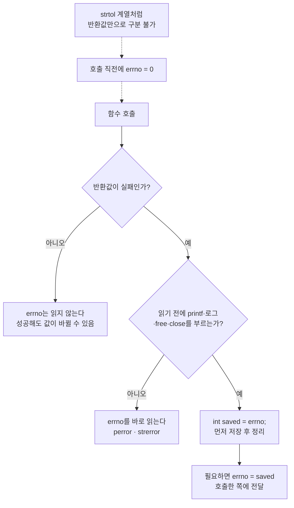

# errno — 초기화·저장·검사·설정

> [!TIP]
> 관련 노트: [에러 처리·API 설계 실습](개발%20%28CS%29/언어/C언어/실습/[C]%20에러%20처리·API%20설계%20실습%20—%20strtol%20my_atoi·snprintf_m·sum_file·conformant%20배열.md) · [환경변수·시그널 실습](개발%20%28CS%29/언어/C언어/실습/[C]%20환경변수·시그널%20실습%20—%20getenv%20복사·atexit와%20sigaction·pselect%20시그널%20카운터.md) · [종합본](개발%20%28CS%29/언어/C언어/실습/[C]%20종합본%20—%20안전한%20C%20코딩%20체크리스트와%20방어%20매크로.md) · 헤더 [`log.h`의 `LOG_ERRNO`](https://github.com/sweetpark/c-playgound/blob/main/drill/common/log.h)

---

## 📌 한눈에 보기 — 주의해야 할 점

`errno` 는 "마지막으로 실패한 함수의 이유"를 담는 **스레드별 `int`** 다. 믿을 수 있는 순간이 짧아서 아래 규칙으로만 쓴다.

| # | 규칙 | 이유 | 상세 |
|---|---|---|---|
| 1 | 실패는 **반환값으로 먼저** 판단, 그 뒤에 `errno` | 성공한 호출도 `errno` 를 바꿀 수 있다 | [§2](#2-검사--판단은-반환값-이유는-errno) |
| 2 | `errno` 로만 실패를 알리는 함수는 호출 **직전에 `errno = 0`** | 자동으로 0이 되지 않아 이전 값이 남는다 | [§1](#1-초기화--errno--0-이-필요한-경우) |
| 3 | 읽기 직후가 아니면 **저장** (`int saved = errno;`) | 로그·`free`·`fclose`·`close` 가 덮어쓴다 | [§3](#3-저장--읽기-전에-덮어쓰이는-경우) |
| 4 | 시그널 핸들러는 `errno` 를 **저장·복원** | 핸들러 안의 `write` 가 main 이 보던 값을 바꾼다 | [§3](#3-저장--읽기-전에-덮어쓰이는-경우) |
| 5 | 내가 만드는 함수는 **실패할 때만** `errno` 설정 | 성공 시 0으로 지우면 호출한 쪽의 값을 망가뜨린다 | [§4](#4-설정--내가-만드는-함수가-errno-로-알릴-때) |
| 6 | 스트림(`printf` 등) 오류는 `errno` 가 아니라 **`ferror`** | 호출이 여러 개면 어느 것의 `errno` 인지 모른다 | [§2](#2-검사--판단은-반환값-이유는-errno) |



---

## 1. 초기화 — errno = 0 이 필요한 경우

- `errno` 는 프로그램 시작 때만 0
	- 그 뒤로는 라이브러리가 **실패할 때만** 바꾸고, 성공해도 **지우지 않는다**
- 반환값으로 실패를 구분할 수 없는 함수는 호출 전에 직접 0으로 만든다

```c
errno = 0;
val = strtol(buf, &end, 10);     /* LONG_MAX 가 진짜 값인지 오류인지 반환값만으로 구분 불가 */
if (errno == ERANGE) { ... }     /* errno 로만 구분 */
```

- 해당 함수: `strtol` · `strtoul` · `strtod` 계열 등
- `errno = 0` 없이 쓰면 **이전에 남은 `ERANGE`** 를 이번 실패로 오판한다
- 반환값(`-1`/`NULL`)으로 구분되는 함수는 초기화 불필요 → **반환값을 먼저** 본다

```c
fd = open(path, O_RDONLY);
if (fd < 0) { perror("open"); }    /* 여기서만 errno 가 의미 있다 */
```

### 함수 종류별로 errno 를 쓰는 법

| 함수 종류 | 예 | `errno = 0` | `errno` 를 읽는 시점 |
|---|---|---|---|
| `errno` 설정 + **out-of-band** 값 (`NULL`, `-1`) 반환 | `open`, `malloc`(POSIX) | 불필요 | 반환값이 에러일 때만 |
| `errno` 설정 + **in-band** 값 반환 (에러 값이 정상 결과로도 나옴) | `strtol`, `strtoul` | **필수** | 호출 직후, 반환값만으로 모호할 때 |
| `errno` 설정을 **보장·문서화하지 않음** | 일부 C 표준 함수 | — | **읽지 않는다** (반환값으로만) |
| **표준마다 다름** | `fopen` (C 는 `NULL` 만, POSIX 는 `errno` 도 설정) | — | POSIX 라고 확실할 때만 |

> [!TIP] 한 줄로 외우기
> `errno = 0` 이 필요한 함수 = **반환값으로 에러를 구분할 수 없는 함수**

→ 연습: [P013 my_atoi](https://github.com/sweetpark/c-playgound/tree/main/drill/P013_my_atoi), [P015 parse_port](https://github.com/sweetpark/c-playgound/tree/main/drill/P015_parse_port)

---

## 2. 검사 — 판단은 반환값, 이유는 errno

| 하지 말 것 | 이유 | 대신 |
|---|---|---|
| `printf` 여러 번 → `if (errno != 0)` | 성공한 호출도 `errno` 를 바꿀 수 있고, 어느 호출의 것인지 모른다 | `ferror(stdout)` |
| `if (errno = ERANGE && ...)` | `=` 는 대입이라 항상 참이 되고 `errno` 를 덮어쓴다 | `errno == ERANGE` |
| `if (errno)` 만으로 실패 판단 | 이전 호출의 값이 남아 있을 수 있다 | 반환값 확인 → 그 뒤 `errno` |
| 이유 없이 `printf("fdopen failed")` | 원인이 가려진다 | `perror("fdopen")` / `strerror(errno)` |

→ 연습: [P034 sum_file](https://github.com/sweetpark/c-playgound/tree/main/drill/P034_sum_file) (`ferror` 와 `feof` 로 종료 이유 구분)

---

## 3. 저장 — 읽기 전에 덮어쓰이는 경우

### 정리 코드와 로그 사이

```diff
  fp = fopen(path, "r");
  if (fp == NULL) {
-     LOG_ERR("open fail");        /* 로그 안의 time()/localtime_r() 이 errno 를 바꿀 수 있다 */
-     SAFE_FREE(buf);              /* free 도 errno 를 바꿀 수 있다 */
-     return errno;                /* 이미 다른 값 */
+     int saved = errno;           /* 실패 직후 먼저 저장 */
+     LOG_ERR("open fail");
+     SAFE_FREE(buf);
+     errno = saved;               /* 필요하면 복원해서 호출한 쪽에 전달 */
+     return RET_IO_ERROR;
  }
```

- `goto CLEANUP` 으로 `free`/`fclose`/`close` 를 부르는 구간도 같다
	- **실패 직후에** `ret` 이나 지역 변수로 먼저 저장
- `log.h` 의 `LOG_ERRNO` 는 이 규칙을 매크로로 만든 것
	- `int _e = errno;` 를 먼저 저장한 뒤 `strerror(_e)` 로 출력

→ 연습: [P014 run_step](https://github.com/sweetpark/c-playgound/tree/main/drill/P014_run_step)

### 시그널 핸들러

```c
static void skip_hdlr(int signo){
    int saved = errno;              /* main 이 읽던 errno 보호 */
    ssize_t r = write(STDOUT_FILENO, "skip signal\n", 12);
    (void)r; (void)signo;
    errno = saved;                  /* 복원 */
}
```

- 핸들러는 어느 지점에서든 끼어든다
	- 그 안에서 `errno` 를 바꾸는 함수를 부르면 main 이 읽으려던 값이 바뀐다
- 가장 안전한 핸들러는 **flag 만 세우는 것**
	- `write` 등을 부를 때만 저장·복원

→ 연습: [P022 sig_counter](https://github.com/sweetpark/c-playgound/tree/main/drill/P022_sig_counter)

---

## 4. 설정 — 내가 만드는 함수가 errno 로 알릴 때

```c
char* improved_strncpy(size_t destcount, char dest[destcount], ...){
    if (dest == NULL || src == NULL || destcount == 0) { errno = EINVAL; return NULL; }
    ...
    if (len >= destcount) { errno = ERANGE; return NULL; }
    ...
    return dest;                    /* 성공할 때는 errno 를 건드리지 않는다 */
}
```

- 반환값이 `NULL`/`-1` 이라 이유를 담을 곳이 없을 때 → **실패한 경우에만** `errno` 설정
- 성공했다고 `errno = 0` 을 넣지 않는다
	- 호출한 쪽이 먼저 저장해 둔 값을 날릴 수 있다
- 대안: **에러 코드를 반환값으로** 돌려주기
	- `snprintf_m` 은 `0` / `EINVAL` / `ERANGE` / `EIO` 를 반환
	- `errno` 전역을 안 건드려 깔끔하다

| 값 | 쓰는 경우 |
|---|---|
| `EINVAL` | NULL 인자, 크기 0, 겹치는 영역, 잘못된 형식 |
| `ERANGE` | 값이 범위를 벗어남, 버퍼가 모자라 **잘림** |
| `ENOMEM` | 할당 실패 |
| `EIO` | 입출력/포맷 변환 오류 |
| `EEXIST` | `O_EXCL` 로 이미 있는 파일을 만들려 함 |
| `ENOENT` | 파일/경로 없음 |
| `EINTR` | 시그널에 중단됨 → 보통 **재시도** |
| `EAGAIN` / `EWOULDBLOCK` | non-blocking 호출이 지금은 불가 → **대기 후 재시도** |

---

## 5. 재시도해야 하는 errno

```c
while (nanosleep(&req, &rem) != 0) {
    if (errno != EINTR) return -1;      /* 진짜 오류 */
    req = rem;                          /* 시그널로 깨어남: 남은 시간만큼 다시 대기 */
}
```

| errno | 의미 | 처리 |
|---|---|---|
| `EINTR` | 오류가 아니라 **시그널이 호출을 끊었다** | 남은 일을 이어서 한다 |
| `EAGAIN` | 지금은 불가 | 바로 재시도(CPU 낭비) 말고 `select` / `poll` 로 대기 |

→ 연습: [P035 write_all](https://github.com/sweetpark/c-playgound/tree/main/drill/P035_write_all)

---

## 6. 메시지 출력

| 방법 | 설명 |
|---|---|
| `perror("open")` | `open: No such file or directory` 형태로 stderr 출력 |
| `strerror(errno)` | 문자열만 얻음. 반환 버퍼를 공유해 **스레드 안전하지 않을 수 있다** → `strerror_r` |
| `LOG_ERRNO("open %s", path)` | `errno` 를 저장한 뒤 `message: 이유(값)` 로 로그 |

- 라이브러리 성격의 함수는 메시지를 **출력하지 않고** 코드(반환값 또는 `errno`)로 알린다
	- 출력은 호출한 쪽이 한다

---

## 7. 실습 문제 (GitHub)

- 풀이·채점은 저장소에서: [c-playgound](https://github.com/sweetpark/c-playgound)
	- `make P013` 처럼 번호만으로 채점
	- 풀고 난 뒤의 해설은 각 폴더의 `NOTE.md`

| 문제 | 다루는 이론 | 링크 |
|---|---|---|
| P013 `my_atoi` | [§1](#1-초기화--errno--0-이-필요한-경우) `errno = 0`, 끝 포인터, 범위 | [폴더](https://github.com/sweetpark/c-playgound/tree/main/drill/P013_my_atoi) |
| P014 `run_step` | [§3](#3-저장--읽기-전에-덮어쓰이는-경우) 실패 직후 저장·복원 | [폴더](https://github.com/sweetpark/c-playgound/tree/main/drill/P014_run_step) |
| P015 `parse_port` | [§1](#1-초기화--errno--0-이-필요한-경우) `strtoul` 의 음수 래핑 | [폴더](https://github.com/sweetpark/c-playgound/tree/main/drill/P015_parse_port) |
| P022 `sig_counter` | [§3](#3-저장--읽기-전에-덮어쓰이는-경우) 핸들러는 flag 만 | [폴더](https://github.com/sweetpark/c-playgound/tree/main/drill/P022_sig_counter) |
| P034 `sum_file` | [§2](#2-검사--판단은-반환값-이유는-errno) `ferror` / `feof` | [폴더](https://github.com/sweetpark/c-playgound/tree/main/drill/P034_sum_file) |
| P035 `write_all` | [§5](#5-재시도해야-하는-errno) `EINTR` · `EAGAIN` | [폴더](https://github.com/sweetpark/c-playgound/tree/main/drill/P035_write_all) |

- 대응 문제: [P014 run_step](https://github.com/sweetpark/c-playgound/tree/main/drill/P014_run_step) · [P015 parse_port](https://github.com/sweetpark/c-playgound/tree/main/drill/P015_parse_port) · [P034 sum_file](https://github.com/sweetpark/c-playgound/tree/main/drill/P034_sum_file) · [P035 write_all](https://github.com/sweetpark/c-playgound/tree/main/drill/P035_write_all)
