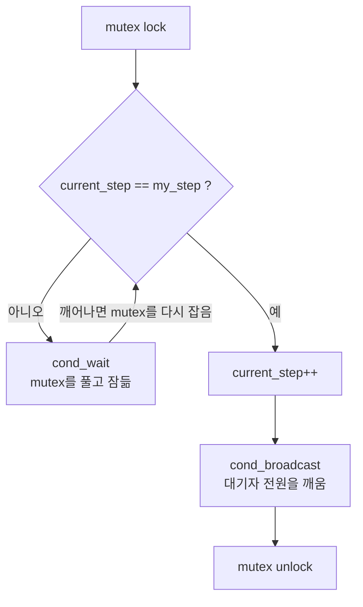
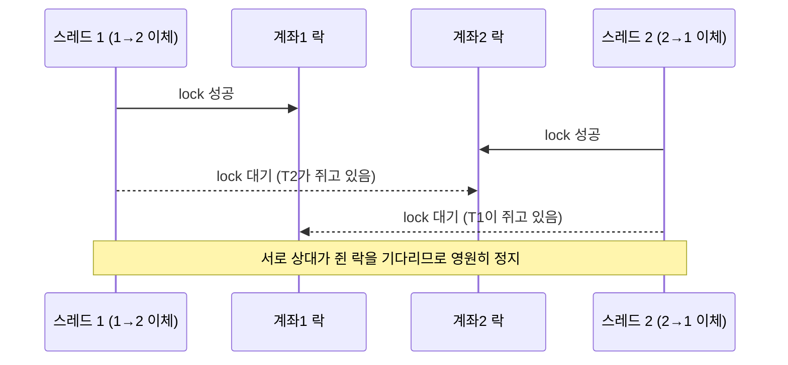
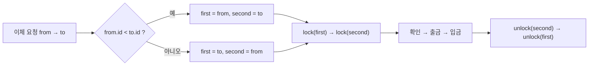
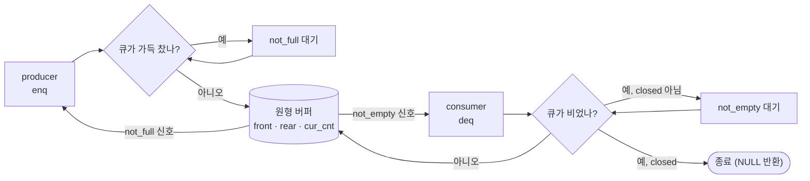
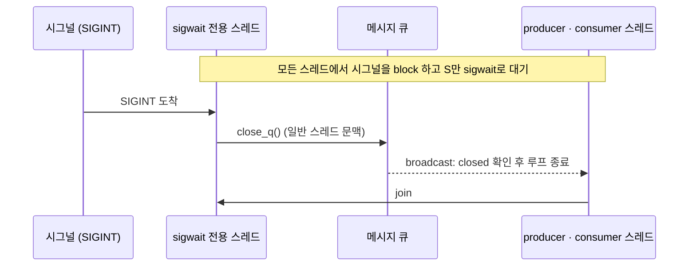
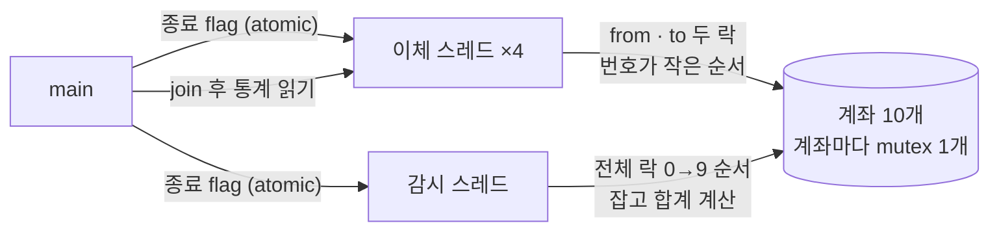

# 동시성·스레드 실습 — mutex 락 범위·데드락·조건변수와 메시지 큐·이체 감시 스레드

> [!IMPORTANT]
> 코드는 컨테이너에서 컴파일·실행해 확인했고, 설명은 AI(Claude)와 함께 코드 리뷰하며 정리했다. 컨테이너의 gcc가 4.8.5로 오래돼서 **ThreadSanitizer(`-fsanitize=thread`)와 valgrind를 쓸 수 없었다**.
>
> 그래서 레이스는 "같은 프로그램을 수백~수천 번 반복 실행해 결과가 어긋나는지" 보는 방식으로 확인했고, 락을 일부러 뺀 **변이 버전**이 실제로 실패하는지도 같이 봤다. 이 방식은 문제를 **발견**할 수는 있어도 문제가 **없음을 증명**하지는 못한다.

> [!TIP]
> **📂 원본 소스 (GitHub)**
> - 강의 코드 15-01 ~ 15-15: [`lecture/conc/`](https://github.com/sweetpark/c-playgound/tree/main/c_basic/lecture/conc)
> - 메시지 큐(15-00): [`conc/msgq/`](https://github.com/sweetpark/c-playgound/tree/main/c_basic/conc/msgq) — `15-00-main.c` · `15-00-q.c` · `15-00-q.h` (원본은 `#else`, 수정본은 `#if MODIFY`)
> - 이체·감시 종합 과제: [`conc/con_ex.c`](https://github.com/sweetpark/c-playgound/blob/main/c_basic/conc/con_ex.c)
> - 빌드: `make -C c_basic` ([README](https://github.com/sweetpark/c-playgound/blob/main/c_basic/README.md)), 메시지 큐는 `build/conc/msgq/15-00`
> - 컨테이너 원본 경로는 `~/coding/15_con/` (접속: `docker exec -it c_app_part1 /bin/bash`)
> - 폴더 이름이 `con`이 아니라 `conc`인 이유: `con`은 Windows의 예약된 장치 이름이라 git이 그 안의 파일을 열지 못한다.
> - `15-04`는 `SomeNetworkFile`(임의의 텍스트 파일)이 필요하고 용량 때문에 저장소에 없다. `15-03`, `15-15`는 컴파일되지 않는 상태라 `make lecture`에서 제외했다.

## 📌 한눈에 보기

| 실습 | 문제 | 처방 | 재현 결과 |
|---|---|---|---|
| 15-01 | `credit()`에만 락이 없음 (같은 변수를 두 함수가 접근) | 변수에 접근하는 **모든 경로**가 같은 락을 잡는다 | 락 제거 변형 5000회 중 6회 어긋남, 수정본 0회 |
| 15-02 | `lock` 1번에 `unlock` 2번 (호출한 함수와 호출된 함수가 둘 다 풂) | **잡은 함수가 푼다** | 3000회 모두 `destroy`가 `EBUSY(16)` |
| 15-03 | `pthread_join` 누락 | 만든 스레드는 `join`(또는 `detach`) | join 없으면 출력 0줄, 있으면 5줄 |
| 15-04 | 파일 I/O까지 락 안에 둠 | 락은 공유 변수 접근 구간만 | (성능 이슈, 측정은 안 함) |
| 15-05 | `return` 뒤에 `unlock`, 읽기/토글에 락 없음 | 값을 담아 두고 `unlock` 후 `return` | 원본은 타입 오류로 빌드가 안 돼 실행은 못 함 (코드상 첫 `get_flag()` 뒤 락이 안 풀림). 수정본 3000회 정상 |
| 15-06 | 관련된 함수 3개가 각자 락 → 합과 곱이 서로 다른 입력 기준 | 락 범위를 **논리적 한 단위**로 넓힘 | 락 제거 3000회 중 455회 불일치, 수정본 0회 |
| 15-07 | `NORMAL` 뮤텍스는 잘못된 unlock을 알려 주지 않음 | `ERRORCHECK`(개발 중) / `RECURSIVE` | NORMAL은 전부 성공, ERRORCHECK는 `EPERM` |
| 15-08 | `destroy` 시점 | 모든 스레드가 `join`된 **뒤** | — |
| 15-09 | `strtok`은 내부 정적 상태를 공유 | `strtok_r` | 2000회 중 1회 합계가 틀림 |
| 15-10 | 지역변수 주소를 스레드에 넘기고 함수가 끝남 | 힙에 복사해 넘기고 스레드가 `free` | `Result: 1`이 `0`으로 출력 |
| 15-11 | 두 계좌 락을 서로 반대 순서로 잡음 | 락 **획득 순서 고정** (id 오름차순) | 원본 20회 중 2회 정지, 시간차를 주면 항상 정지 |
| 15-12 | `cond_signal`은 임의의 대기자 하나만 깨움 | `cond_broadcast` + `while` 조건 | signal 300회 중 1회 정지, broadcast 0회 |
| 15-13 | `detach`한 스레드를 `join` | 한쪽만 선택 | `pthread_join failed` |
| 15-14 | 스레드에서 SIGTERM을 받으려는데 핸들러 없음 | 핸들러 등록 + `join` (또는 `sigwait` 전용 스레드) | 핸들러 없으면 프로세스 전체가 종료(143) |
| 15-15 | `PTHREAD_CANCEL_ASYNCHRONOUS` + 락 | deferred 취소 + cleanup, 또는 flag 종료 | 100회 중 44회 main이 락에서 정지 |
| 15-00 | 큐에 동기화 없음, 폴링, 센티널 | mutex + 조건변수 2개 + `close_q` | 원본 300회 중 5회 크래시·행, 수정본 2100회 0회 |
| 과제 | 이체 4 + 감시 1 + main | 계좌별 락 + 락 순서 고정 + 전체 스냅샷 락 | 10초 실행 합계 10000 유지 |

---

## 1. 락의 기본 규칙 — 15-01, 15-02, 15-04, 15-05, 15-06, 읽기/쓰기 락(§1-4)

### 1-1. 같은 변수는 같은 락으로 (15-01)

> [!NOTE] 요약
> - **문제**: `credit()`에만 락이 없어 잔액 갱신이 유실됨 (15-01)
> - **원인**: 같은 변수를 두 함수가 접근하는데 한쪽만 잠금. `int`/`unsigned` 혼용, 전역 `srand`도 문제
> - **처방**: 변수에 접근하는 **모든 경로**가 같은 락을 잡고, `rc`에 결과를 담아 `unlock`은 한 곳에서. 잔액 타입 통일, `rand_r`
> - **결과**: 락 제거 변형 5000회 중 6회 어긋남, 수정본 0회

> [!INFO]- 상세 보기
> `debit()`만 락을 잡고 `credit()`은 잡지 않았다. 잔액을 읽고 쓰는 것은 두 함수 모두이므로, 한쪽이라도 락이 없으면 락을 쓴 의미가 없다.
>
> ```c
> unsigned int account_balance;                 // int → unsigned 로 통일
> pthread_mutex_t lock = PTHREAD_MUTEX_INITIALIZER;
>
> int credit(unsigned int amount) {
>     int rc = 1;
>     pthread_mutex_lock(&lock);
>     if ((UINT_MAX - account_balance) < amount) rc = -1;
>     else account_balance += amount;
>     pthread_mutex_unlock(&lock);
>     if (rc < 0) printf("balance is large\n");   // I/O 는 락 밖에서
>     return rc;
> }
> ```
>
> 같이 잡은 문제들이다.
>
> | 문제 | 설명 | 처방 |
> |---|---|---|
> | `int`와 `unsigned` 혼용 | `UINT_MAX - account_balance`는 `int` 잔액의 한계(`INT_MAX`)와 달라서, `int`가 먼저 오버플로한다 | 잔액 타입을 `unsigned int`로 통일 |
> | `srand()`를 스레드에서 호출 | 전역 상태라 스레드 안전하지 않고, `rand_r()`만 쓰면서 `srand()`는 의미가 없다 | 스레드마다 다른 seed로 `rand_r()`만 사용 |
> | 모든 스레드가 같은 `time(NULL)` seed | 같은 시간만큼 잠든다 | seed에 스레드 번호를 섞는다 |
> | 락이 여러 return 경로에 흩어짐 | 나중에 한 경로에서 `unlock`을 빼먹기 쉽다 | `rc`에 결과를 담고 `unlock`은 한 곳에서 |
>
> **검증 방법**: 성공한 debit/credit 횟수를 락 안에서 센 뒤, 마지막에 `초기값 + 입금 성공 − 출금 성공 == 최종 잔액`인지 비교했다. 락이 제대로 있으면 항상 같고, 락을 빼면 갱신이 유실되어 어긋난다. `credit`의 락만 뺀 변형은 5000회 중 6회 어긋났고, 수정본은 0회였다.
>
> > [!NOTE]
> > 최종 잔액이 매번 2000이 아닐 수도 있다. debit이 먼저 몰리면 `balance is low`로 실패하는데, 이건 레이스가 아니라 스케줄링 차이다. 그래서 "최종값이 2000이다"가 아니라 "성공 횟수와 일치한다"로 검증해야 한다.

### 1-2. 잡은 함수가 푼다 (15-02)

> [!NOTE] 요약
> - **문제**: `lock` 1번에 `unlock` 2번 (호출된 `verify_balance`와 호출한 `debit`이 둘 다 풂, 15-02)
> - **원인**: `NORMAL` 뮤텍스는 이중 `unlock`을 에러로 알려 주지 않음
> - **처방**: **잡은 함수가 푼다**: `verify_balance`에서 `unlock` 제거. (`return`을 `if` 안에 두는 수정은 오히려 잔액 부족 출금을 허용)
> - **결과**: 3000회 모두 `destroy`가 `EBUSY(16)` → 수정 후 3000회 통과

> [!INFO]- 상세 보기
> `verify_balance()`가 잔액 부족일 때 `unlock`을 하고, 호출한 `debit()`도 `unlock`을 한다. 같은 뮤텍스를 두 번 푼 것이다.
>
> ```c
> // ❌ 호출된 함수가 unlock, 호출한 함수도 unlock
> int verify_balance(int amount) {
>     if (account_balance - amount < MIN_BALANCE) {
>         pthread_mutex_unlock(&mp);   // 여기서 풀고
>         return -1;
>     }
>     return 0;
> }
> void debit(int amount) {
>     pthread_mutex_lock(&mp);
>     if (verify_balance(amount) == -1) {
>         pthread_mutex_unlock(&mp);   // 여기서 또 푼다
>         return;
>     }
>     ...
> }
> ```
>
> 기본 뮤텍스(`NORMAL`)는 이 실수를 에러로 알려 주지 않고 조용히 넘어간다. 대신 내부 상태가 어긋나서 마지막 `pthread_mutex_destroy`가 **`EBUSY(16)`로 실패**했다 (3000회 모두).
>
> 더 위험한 경우는 첫 번째 `unlock` 직후 다른 스레드가 락을 잡았을 때로, 두 번째 `unlock`이 그 스레드의 락을 풀어서 임계구역에 두 스레드가 동시에 들어간다.
>
> > [!WARNING]
> > 처음 생각한 수정이 틀린 사례다. "`return`을 `unlock` 실패 `if` 안에 두면 된다"로 고치면, `unlock`이 **성공했을 때** `return -1`을 건너뛰고 `return 0`으로 가서 잔액이 부족한데도 출금이 진행된다.
> >
> > 실제로 그렇게 고친 변형은 출금 20번이 전부 성공하고 잔액이 0까지 내려갔다. 원래의 `return -1`은 위치가 맞았고, 문제는 **`verify_balance` 안에서 `unlock`한다는 것**이었다.
>
> **처방**: `verify_balance()`에서 `unlock`을 지운다. 락의 소유권은 "잡은 함수 = 푸는 함수"로 둔다. 이렇게 고친 변형은 3000회 모두 통과했다.

### 1-3. 락 범위는 필요한 만큼만 — 너무 넓어도, 너무 좁아도 (15-04, 15-05, 15-06)

> [!NOTE] 요약
> - **문제**: 락 범위가 너무 넓거나(15-04), `unlock`이 `return` 뒤에 있거나(15-05), 너무 좁음(15-06)
> - **원인**: I/O까지 락 안에 둠 / 토글과 읽기를 따로 잠금 / 합·곱을 각각 잠가 서로 다른 입력 기준
> - **처방**: 공유 변수 접근 구간만 잠그고, 논리적 한 단위(확인→변경, 토글→읽기)는 한 번에 잠금. 안쪽 락은 빼거나 `RECURSIVE`(신중히)
> - **결과**: 15-06: 락 제거 3000회 중 455회(약 15%) 불일치, 수정본 0회

> [!INFO]- 상세 보기
> - **15-04**
>   - 범위: 너무 넓음
>   - 문제: 파일을 읽는 I/O 전체를 락 안에 둠 → 다른 스레드가 I/O가 끝날 때까지 대기해 성능이 급격히 떨어짐
>   - 처방: 공유 변수(`g_accessCnt`)를 건드리는 구간만 락
> - **15-05**
>   - 범위: 어긋남
>   - 문제: `get_flag()`에서 `return flag;` **뒤에** `unlock`을 써서 실행되지 않음 → 락이 영원히 안 풀림. `toggle_flag()`에는 락이 없음
>   - 처방: 값을 지역변수에 담고 `unlock`한 뒤 `return`
> - **15-06**
>   - 범위: 너무 좁음
>   - 문제: `set_values` → `get_sum` → `get_product`가 **한 묶음**인데 각각 따로 잠금 → 다른 스레드의 `a`, `b`가 끼어들어 합과 곱이 서로 다른 입력 기준이 됨
>   - 처방: 호출하는 쪽(`multiply_monomials`)에서 한 번에 잠금
>
> 15-05는 한 가지 더 있었다. "토글하고 → 값을 읽는" 두 단계를 따로 락 걸면, 그 사이에 다른 스레드가 또 토글해서 **내가 바꾼 결과가 아닌 값이 출력**된다. 토글 함수가 락 안에서 새 값을 같이 반환하게 바꿨다.
>
> ```c
> bool toggle_flag(void) {
>     bool ret;
>     pthread_mutex_lock(&lock);
>     flag = !flag;
>     ret = flag;                       // 바꾼 값을 같은 임계구역에서 읽는다
>     pthread_mutex_unlock(&lock);
>     return ret;
> }
> ```
>
> 15-06의 검증은 각 스레드가 찍은 `(x+A)(x+B)`와 `x^2 + Sx + P`가 `S = A+B`, `P = A*B`인지 확인하는 방식이었다. 락을 끈 버전은 3000회 중 **455회(약 15%)** 어긋났고, 락 범위를 넓힌 버전은 0회였다.
>
> > [!TIP]
> > 락 범위를 넓히면 안쪽 함수들의 락은 **빼야** 한다. 기본 뮤텍스는 같은 스레드가 다시 `lock`하면 데드락이다.
> >
> > 강의에서는 대안으로 `RECURSIVE` 옵션(같은 스레드의 중복 `lock` 허용)을 소개했는데, 이건 "같은 락을 두 번 잡는 구조"를 숨기는 경우가 많아서 **꼭 필요할 때만** 쓴다.
> >
> > 안쪽 함수가 "락을 잡은 채 호출해야 한다"는 것은 주석이나 `static` 선언으로 남긴다.
> >
> > 교육자료(15-06)의 수정안은 바로 이 `RECURSIVE` 방식이다.
> >
> > `multiply_monomials`가 락을 잡은 채 `set_values`/`get_sum`/`get_product`(각자 같은 락을 다시 잡음)를 부르므로 **`PTHREAD_MUTEX_RECURSIVE`로 초기화해야만** 동작한다 (`pthread_mutexattr_settype` 후 `pthread_mutexattr_destroy`).
> >
> > 다만 수정안에는 `get_sum`/`get_product` 실패 시 **`return -1`만 하고 `unlock`을 안 하는 경로**가 남아 있다. 락을 쥔 채 빠져나가는 경로는 §6-3처럼 정리 코드로 모은다.

### 1-4. 읽는 쪽도 락을 잡아야 한다 — 그리고 읽기가 많다면 rwlock (직접 작성한 예제)

> [!NOTE] 요약
> - **문제**: 한쪽(`writethr`)만 락을 잡고 다른 쪽(`readthr`)은 락 없이 같은 변수에 접근하면 결과가 틀어짐
> - **원인**: 락은 **같은 락을 잡는 스레드끼리만** 서로를 막는다. 락 없는 쪽은 임계구역에 그냥 들어온다
> - **처방**: 접근하는 **모든 경로**(읽기·쓰기 모두)가 같은 락을 잡는다
> - **성능**: 읽기가 대부분이면 mutex 대신 **rwlock**(읽기 동시 허용, 쓰기 단독)으로 원자성과 성능을 같이 얻는다

> [!INFO]- 상세 보기
> 아래는 `-DYESLOCK` 유무로 "한쪽만 락" 상황을 재현하는 코드다. 두 스레드가 `critical`을 10만 번씩 +1 / −1 하므로, 올바르면 최종값은 항상 `0`이다.
>
> ```c
> #define TCOUNT 100000
> pthread_mutex_t lock;
> int critical;
>
> void *readthr(void *varg) {                 // critical -= 1
>     for (int i = 0; i < TCOUNT; i++) {
> #ifdef YESLOCK
>         pthread_mutex_lock(&lock);
> #endif
>         critical -= 1;                      // YESLOCK 없으면 락 없이 접근
> #ifdef YESLOCK
>         pthread_mutex_unlock(&lock);
> #endif
>     }
>     pthread_exit(NULL);
> }
>
> void *writethr(void *varg) {                // critical += 1 (항상 락)
>     for (int i = 0; i < TCOUNT; i++) {
>         pthread_mutex_lock(&lock);
>         critical += 1;
>         pthread_mutex_unlock(&lock);
>     }
>     pthread_exit(NULL);
> }
> ```
>
> | 빌드 | 락 | 기대 결과 |
> |---|---|---|
> | `gcc -pthread` | writer만 | `critical`이 **0이 아니고 실행마다 달라짐** (갱신 유실) |
> | `gcc -pthread -DYESLOCK` | reader·writer 모두 | 항상 `0` |
>
> **왜 틀어지는가**: `critical -= 1`은 한 줄이지만 **load → sub → store** 세 단계다 ([락 없는 카운터](개발%20%28CS%29/언어/C언어/동시성·스레드/[C]%20락%20없는%20카운터%20—%20GCC%20원자적%20연산%20빌트인과%20C11%20atomic.md) 참고). writer가 락을 잡고 있어도 락 없는 reader는 그 사이에 들어와 같은 옛 값을 읽고 덮어쓴다. 락은 "잡는 쪽끼리"만 서로를 막기 때문에, **한쪽이라도 안 잡으면 락을 건 쪽도 보호받지 못한다** (§1-1의 `credit()` 사례와 같은 원리).
>
> > [!NOTE]
> > 이 코드는 컨테이너가 아닌 환경에서 정리한 것이라 **실행 횟수·불일치 비율은 측정하지 않았다**. 위 "기대 결과"는 동작 원리에서 도출한 것이고, §0 방식(수백~수천 회 반복 실행)으로 확인하면 된다. 레이스는 가끔만 드러날 수 있어 한 번 `0`이 나왔다고 안전한 것이 아니다.
>
> **원칙: 읽기든 쓰기든 공유 변수에 닿는 순간 같은 락을 잡는다**
>
> | 상황 | 문제 |
> |---|---|
> | 쓰기만 락, 읽기는 락 없음 | 읽기가 쓰는 도중의 **중간 상태/찢어진 값**을 볼 수 있고, 읽은 값을 기반으로 쓰는 경우 갱신이 유실됨 |
> | 읽기·쓰기 모두 같은 mutex | 안전하지만 **읽기끼리도 한 줄로 서야 해서** 읽기 비중이 크면 느림 |
> | 읽기·쓰기 모두 같은 **rwlock** | 안전하고, 읽기끼리는 **동시에** 들어갈 수 있어 빠름 |
>
> 그래서 "성능을 위해 읽기의 락을 뺀다"는 방법은 틀렸다. 락을 빼는 대신 **읽기 전용 락(공유 락)을 쓴다**. (Java 대응: [읽기/쓰기 락 `ReentrantReadWriteLock`](개발%20%28CS%29/언어/JAVA/동시성·IO·락/[Java]%20세마포어%20&%20뮤텍스%20%28%20JAVA%20LOCK%20%29%20-%20핵심%20개념%20및%20특징%20정리.md))
>
> ```c
> pthread_rwlock_t rw = PTHREAD_RWLOCK_INITIALIZER;
>
> int get_value(void) {                       // 읽기: 여러 스레드가 동시에 진입 가능
>     int v;
>     pthread_rwlock_rdlock(&rw);
>     v = critical;
>     pthread_rwlock_unlock(&rw);
>     return v;
> }
>
> void add_value(int d) {                     // 쓰기: 단독 진입 (읽기도 모두 대기)
>     pthread_rwlock_wrlock(&rw);
>     critical += d;
>     pthread_rwlock_unlock(&rw);
> }
> ```
>
> | 동작 | 읽기 락 `rdlock` | 쓰기 락 `wrlock` |
> |---|---|---|
> | 다른 스레드의 읽기 락과 | **동시 허용** | 대기 |
> | 다른 스레드의 쓰기 락과 | 대기 | 대기 |
>
> > [!WARNING]
> > **위 예제의 `readthr`는 이름과 달리 값을 수정(`-= 1`)한다.** 변수를 바꾸는 코드는 이름이 `read`여도 **쓰기**이므로 rwlock에서는 `rdlock`이 아니라 **`wrlock`** 을 잡아야 한다. `rdlock` 아래에서 값을 바꾸면 읽기 스레드끼리 동시에 수정해 다시 레이스가 된다. `rdlock`은 **진짜로 읽기만 하는** 구간에만 쓴다.
>
> > [!TIP]
> > rwlock이 항상 mutex보다 빠른 것은 아니다.
> > - **읽기가 많고 임계구역이 길 때** 이득이 크다. 임계구역이 `+= 1` 정도로 짧으면 rwlock 자체의 관리 비용이 커서 오히려 mutex보다 느릴 수 있다.
> > - 리더가 계속 들어오면 writer가 굶는 **writer starvation**이 생길 수 있다. 구현마다 정책이 다르다 (glibc는 `pthread_rwlockattr_setkind_np`로 선택).
> > - 변수 **하나**의 단순 증감이라면 락 대신 원자적 연산(`atomic_fetch_add`)이 가장 가볍다. 여러 값의 일관성이 필요하면 mutex/rwlock이다.

---

## 2. 뮤텍스 종류와 에러 검사 — 15-07, 15-08

### 종류별 동작 (컨테이너에서 직접 확인)

> [!NOTE] 요약
> - **문제**: `NORMAL` 뮤텍스는 잘못된 `unlock`을 조용히 통과시켜 버그가 숨음 (15-07)
> - **원인**: 종류별 반응이 다름 (`ERRORCHECK`는 `EPERM`/`EDEADLK`, `RECURSIVE`는 중복 `lock` 허용)
> - **처방**: 개발 중에는 `ERRORCHECK`를 명시하고 `lock`/`unlock` 반환값을 검사. `PTHREAD_MUTEX_INITIALIZER`의 조용한 성공에 의존 금지
> - **결과**: 컨테이너(glibc) 관찰: `NORMAL`은 전부 성공, `ERRORCHECK`는 `EPERM`

> [!INFO]- 상세 보기
> | 상황 | `NORMAL` (기본) | `ERRORCHECK` | `RECURSIVE` |
> |---|---|---|---|
> | 안 잠긴 뮤텍스를 `unlock` | **0(성공)** — 조용히 넘어감 | `EPERM(1)` | `EPERM(1)` |
> | 다른 스레드가 잡은 뮤텍스를 `unlock` | **0(성공)** — 남의 락을 풀어 버림 | `EPERM(1)` | `EPERM(1)` |
> | 같은 스레드가 `lock` 두 번 | 데드락(영원히 대기) | `EDEADLK(35)` | 성공 (횟수만큼 `unlock` 필요) |
> | 이상한 `unlock` 뒤 `destroy` | `EBUSY(16)` | 정상 | 정상 |
>
> - `NORMAL`은 잘못된 사용을 에러로 알려 주지 않아서 **버그가 숨는다**. 15-02의 이중 `unlock`이 에러 없이 지나갔던 이유다.
>
> > [!WARNING]
> > 위 표의 `NORMAL`("조용히 성공")은 **이 컨테이너(glibc)에서 관찰한 동작**이지 표준이 보장하는 동작이 아니다. 교육자료(15-07)가 정리한 표준(POSIX) 기준은 다음과 같다.
> >
> > | 종류 | 같은 스레드가 다시 `lock` | 남의 락/안 잠긴 락을 `unlock` |
> > |---|---|---|
> > | `NORMAL` | 데드락 (감지 안 함) | **정의되지 않은 동작** |
> > | `ERRORCHECK` | 에러 반환 | 에러 반환 |
> > | `RECURSIVE` | 성공 (횟수만큼 `unlock`해야 풀림) | 에러 반환 |
> > | `DEFAULT` (`PTHREAD_MUTEX_INITIALIZER`) | 정의되지 않은 동작 | 정의되지 않은 동작 |
> >
> > `DEFAULT`는 구현이 다른 종류로 매핑해도 되고 보통 `NORMAL`로 매핑되므로, 교육자료는 **`ERRORCHECK` 또는 `RECURSIVE`를 명시적으로 쓰라**고 권고한다.
> >
> > 즉 `PTHREAD_MUTEX_INITIALIZER`로 만든 뮤텍스는 위 "0(성공)" 같은 동작에 의존하면 안 된다. 이체 과제(15-17)도 `ERRORCHECK`를 요구한다 (§8).
> - 개발 중에는 `ERRORCHECK`로 만들어서 `pthread_mutex_lock`/`unlock`의 반환값을 검사하면, 15-02 같은 실수가 바로 `EPERM`으로 드러난다. 성능 비용이 조금 있어서 보통 디버그 빌드에서만 쓴다.
>
> ```c
> pthread_mutexattr_t attr;
> pthread_mutexattr_init(&attr);
> pthread_mutexattr_settype(&attr, PTHREAD_MUTEX_ERRORCHECK);
> pthread_mutex_init(&mp, &attr);
> pthread_mutexattr_destroy(&attr);
> ```

### 뮤텍스 "종류"와 "개수"는 다른 이야기

> [!INFO]- 상세 보기
> - 종류(NORMAL/ERRORCHECK/RECURSIVE)는 **잘못 썼을 때 어떻게 반응하느냐**만 정한다. 뮤텍스는 종류와 상관없이 같은 데이터를 보호하는 모든 스레드가 **하나를 공유**한다.
> - 뮤텍스를 여러 개 만드는 이유는 **보호할 데이터가 여러 개라서**다 (계좌마다 락 하나). 모든 데이터에 락 하나만 쓰면 안전하지만 관련 없는 작업끼리도 줄을 서고, 한 데이터를 여러 락으로 나누면 서로 보호가 안 된다.

### `destroy` 시점 (15-08)

> [!NOTE] 요약
> - **문제**: 스레드가 쓰는 중인 뮤텍스를 `destroy` (15-08)
> - **원인**: 뮤텍스 수명이 사용하는 스레드보다 짧음 (객체 생성·삭제마다 `init`/`destroy`한 장애 사례)
> - **처방**: 모든 스레드를 `join`한 **뒤** `destroy`, 반환값 `!= 0`은 `strerror`로 출력

> [!INFO]- 상세 보기
> `pthread_mutex_destroy`는 그 뮤텍스를 **더 이상 쓰는 스레드가 없을 때**(모든 스레드를 `join`한 뒤) 호출한다.
>
> 강의 코드의 `#if 0` 블록처럼 스레드 함수 안에서 `destroy`하면, 아직 `lock`을 기다리는 다른 스레드가 있는 뮤텍스를 없애게 된다.
>
> `destroy`가 실패하면(`!= 0`) 위에서 본 `EBUSY` 같은 신호이므로, 반환값을 반드시 검사하고 `strerror`로 출력한다. 반환값은 `errno`가 아니라 **에러 번호 자체**이므로 `< 0`이 아니라 `!= 0`으로 검사한다.
>
> 교육자료(15-08)는 이 규칙을 어긴 사내 장애 사례(고객사·티켓 정보는 생략)를 함께 소개한다.
>
> 뮤텍스를 **채널(세션) 생성·삭제 때마다 `init`/`destroy`** 하도록 만들었더니, 삭제 직후에도 다른 스레드가 같은 공유 변수에 접근했고 그때는 이미 락이 없어서 두 스레드가 동시에 변수를 건드려 프로세스가 재기동됐다.
>
> **뮤텍스의 수명은 그것을 쓰는 모든 스레드보다 길어야 한다.** 객체가 사라질 수 있는 구조라면 "객체를 지우는 스레드"가 락을 쥔 채 참조 수를 확인하거나, 뮤텍스를 객체보다 오래 사는 상위 구조(프로세스 전역, 풀)에 둔다.

---

## 3. 스레드 생명주기 — 15-03, 15-10, 15-13, 15-14, 15-15

### 3-1. `join`과 `detach` (15-03, 15-13)

> [!NOTE] 요약
> - **문제**: `join` 누락(15-03), `detach` 후 `join`(15-13)
> - **원인**: `main`이 `join` 없이 끝나면 `sleep` 중인 스레드가 같이 죽고, `join`/`detach`는 한쪽만 가능
> - **처방**: 만든 스레드는 `join` 또는 `detach` 중 하나만
> - **결과**: join 없으면 출력 0줄/있으면 5줄, `detach` 후 `join`은 `pthread_join failed`

> [!INFO]- 상세 보기
> - **`join` 누락 (15-03)**: `main`이 `join` 없이 끝나면 프로세스가 종료되면서 아직 `sleep(1)` 중인 스레드가 같이 죽는다. `This is the Message` 출력이 `join`이 있으면 5줄, 없으면 **0줄**이었다.
>   (강의 코드는 `pthread_join(thr[i])`처럼 인자가 하나라 컴파일 에러(`too few arguments`)부터 난다.)
> - **`detach`**: 스레드가 끝나면 자원이 자동 회수되는 대신 **끝나기를 기다릴 수 없다**. 공통 자원을 정리해야 하는 구조에서는 `detach`한 스레드가 아직 도는 중에 자원을 해제할 위험이 있다.
> - **`detach` 후 `join` (15-13)**: 스레드가 스스로 `pthread_detach(pthread_self())`를 부르고 끝난 뒤 `main`이 `join`하면 **`pthread_join failed`** (종료코드 1). 한 스레드에는 `join`과 `detach` 중 **하나만** 쓴다.
> - **`join`도 `detach`도 안 한 스레드 (15-03)**: 스레드가 끝나면 **스택은 회수되지만 스레드 ID와 종료 상태 같은 자원이 남는다**. 종료 상태가 필요 없어도 `join`이나 `detach` 중 하나는 해야 한다.
> - **표준과 실제 동작**: C 표준은 이미 `join`/`detach`된 스레드를 다시 `join`하거나 `detach`하면 **정의되지 않은 동작**이라고 한다. 컨테이너(glibc 2.17)에서 확인한 결과는 다음과 같았다.
>
>   | 호출 | 결과 |
>   |---|---|
>   | 이미 `detach`된 스레드(실행 중)를 `join` | `EINVAL(22)` |
>   | 이미 `detach`된 스레드(실행 중)를 다시 `detach` | `EINVAL(22)` |
>   | 이미 `detach`되고 **끝난** 스레드를 다시 `detach` | `EINVAL(22)` (스레드 자원이 이미 회수된 상태라 `pthread_t`는 **dangling**이다. 우연히 에러로 끝난 것일 뿐 보장이 아니다) |
>
>   교육자료는 "리눅스 gcc에서 두 번째 `detach`는 성공"이라고 적었는데, 이 환경에서는 재현되지 않았다. 구현·버전마다 다를 수 있으니 **반환값에 기대지 말고 한 번만 호출**한다.

### 3-2. 지역변수 주소를 넘기지 않는다 (15-10)

> [!NOTE] 요약
> - **문제**: 지역변수 주소를 스레드에 넘기고 함수가 끝남 (15-10)
> - **원인**: 함수가 반환되면 `val`의 스택 자리를 다음 호출이 덮어씀
> - **처방**: 힙에 복사해 넘기고 스레드가 `free` (생성 성공이면 스레드, 실패면 만든 쪽이 해제)
> - **결과**: 기대한 `Result: 1 2 3 4 5` 대신 `1`이 빠지고 `0`이 출력

> [!INFO]- 상세 보기
> ```c
> void create_thread(pthread_t *tid, int start) {
>     int val = start + 1;                       // 이 함수가 끝나면 사라지는 스택 변수
>     pthread_create(tid, NULL, child_thread, &val);   // ❌ 주소를 넘김
> }                                              // 스레드가 아직 읽기 전일 수 있음
> ```
>
> `create_thread`가 반환되면 `val`의 스택 자리는 다음 호출이 덮어쓴다. 실제로 기대한 `Result: 1 2 3 4 5` 대신 **`1`이 빠지고 `0`이 출력**됐다. 처방은 힙에 복사해서 넘기고, 스레드 함수가 사용 후 `free`하는 것이다.
>
> (호출한 쪽이 `join`할 때까지 살아 있는 배열을 넘기는 방법도 된다.)
>
> ```c
> int *val = malloc(sizeof(*val));      // 호출한 함수가 끝나도 살아 있다
> if (val == NULL) { /* 에러 처리 */ }
> *val = start + 1;
> if (pthread_create(tid, NULL, child_thread, val) != 0) { free(val); }   // 생성 실패 시 해제
> // child_thread 안에서 사용 후 free(val)
> ```
>
> > [!NOTE]
> > 소유권을 정해 두는 것이 핵심이다. 생성에 **성공**하면 스레드가 해제, **실패**하면 만든 쪽이 해제한다. 15-11의 `free(ptr)`(스레드 함수 끝에서 해제)와 `main`의 `fail_end_1`(생성 못 한 것만 해제)이 같은 규칙이다.

### 3-3. 시그널을 스레드에 보낼 때 (15-14)

> [!NOTE] 요약
> - **문제**: `pthread_kill(SIGTERM)`을 받는 핸들러가 없어 프로세스 전체가 종료 (15-14)
> - **원인**: 시그널 처분은 프로세스 단위, 마스크는 스레드 단위
> - **처방**: 핸들러(flag만) 등록 + `join`, 또는 `sigwait` 전용 스레드(§7-4), `pthread_cancel`
> - **결과**: 핸들러 없으면 종료 코드 143

> [!INFO]- 상세 보기
> `pthread_kill(thread, SIGTERM)`으로 보냈는데 스레드에 핸들러가 등록되어 있지 않으면, **시그널의 기본 동작(프로세스 종료)이 프로세스 전체에 적용**된다. 스레드만 끝나는 것이 아니다. 핸들러 없이 실행하면 종료코드가 **143**(128 + SIGTERM 15)이었다.
>
> - 시그널의 처분(핸들러 지정)은 **프로세스 단위**이고, 마스크(`pthread_sigmask`)는 **스레드 단위**다.
> - 스레드를 정상적으로 끝내려면 `pthread_cancel`을 쓰거나, **flag + 핸들러**를 등록하고 `join`으로 끝나기를 기다린다. 핸들러를 등록하고 `join`하면 `alive...thread` → `main thread end` → `pthread end` 순서로 정상 종료한다.
> - 핸들러 안에서 할 일은 `volatile sig_atomic_t` flag 설정뿐이다 ([환경변수·시그널 실습](개발%20%28CS%29/언어/C언어/실습/[C]%20환경변수·시그널%20실습%20—%20getenv%20복사·atexit와%20sigaction·pselect%20시그널%20카운터.md) 참고).
> - 시그널 처리를 **전용 스레드 하나**에 맡기는 방법(`sigwait`)은 §7-4에서 다룬다.

### 3-4. 비동기 취소와 락 (15-15)

> [!NOTE] 요약
> - **문제**: `PTHREAD_CANCEL_ASYNCHRONOUS` + 락이 락을 쥔 채 취소되어 main이 영원히 대기 (15-15)
> - **원인**: 어느 줄에서나 취소되므로 `unlock`이 실행되지 않음. deferred라도 루프에 취소 지점이 없으면 취소가 안 먹음
> - **처방**: 종료 flag(권장), 또는 deferred + `pthread_testcancel()` / `pthread_cleanup_push(unlock)`
> - **결과**: 100회 중 44회 main이 락에서 정지

> [!INFO]- 상세 보기
> ```c
> pthread_setcanceltype(PTHREAD_CANCEL_ASYNCHRONOUS, &i);   // 아무 지점에서나 취소 가능
> while (1) {
>     pthread_mutex_lock(&global_lock);
>     ...                                  // 여기서 취소되면
>     pthread_mutex_unlock(&global_lock);  // 이 줄이 실행되지 않음 → 락이 영원히 잠긴 채
> }
> ```
>
> `ASYNCHRONOUS`는 스레드가 `lock`을 쥔 채 어느 줄에서나 취소될 수 있어서, 락이 풀리지 않고 스레드가 끝난다. 이후 `main`이 같은 락을 잡으려 하면 영원히 멈춘다. `main`이 `cancel`/`join` 뒤에 락을 잡도록 고친 사본으로 100회 돌렸더니 **44회 멈췄다**.
>
> | 방법 | 설명 |
> |---|---|
> | deferred 취소(기본값) 유지 + **`pthread_testcancel()`** | 취소 지점(`sleep`, `pthread_cond_wait` 등)에서만 취소되어 락 중간에 끊기지 않는다. 단, 루프 안에 `lock`/`unlock`과 계산뿐이라 **취소 지점이 하나도 없으면 취소 요청이 영원히 처리되지 않는다**. 락을 푼 뒤 `pthread_testcancel()`로 취소 지점을 직접 만든다 |
> | `pthread_cleanup_push(unlock, &lock)` | 취소돼도 cleanup 핸들러가 락을 푼다 |
> | **flag로 종료 (권장)** | 취소 대신 종료 flag를 세우고 스레드가 스스로 빠져나오게 한다 (§8 이체 과제) |
>
> `ASYNCHRONOUS`를 빼고 기본값(deferred)으로 돌리면 락 중간에 끊기지는 않지만, 루프에 취소 지점이 없으면 이번에는 **취소가 안 먹는다**.
>
> `lock`/`unlock`과 값 교환만 도는 루프에 `pthread_cancel` + `pthread_join`을 걸었더니, `pthread_testcancel()`이 없는 버전은 5초 제한 안에 `join`이 끝나지 않았고(`timeout` 종료코드 124), 있는 버전은 바로 `joined`가 출력됐다.
>
> `pthread_mutex_lock`/`unlock` 자체는 취소 지점이 아니다.
>
> > [!WARNING]
> > 강의 15-15 코드에는 `pthread_mutex_init`을 쓰는 줄의 괄호가 하나 모자라고, `printf` 줄의 괄호가 어긋나 있어서 그대로는 컴파일되지 않는다.
> >
> > 또 `PTHREAD_MUTEX_INITIALIZER`로 초기화한 뮤텍스를 `pthread_mutex_init`으로 다시 초기화하는 것은 정의되지 않은 동작이다. 한 가지 방법만 쓴다.

---

## 4. 스레드 안전하지 않은 함수 — 15-09

> [!NOTE] 요약
> - **문제**: `strtok`을 여러 스레드에서 호출해 합계가 틀림 (15-09)
> - **원인**: `strtok`이 내부 정적 상태를 공유
> - **처방**: `strtok_r`(상태를 호출자가 보관). `rand`·`localtime`·`strerror`도 `_r` 버전 사용
> - **결과**: 2000회 중 1회 합계가 틀림 (`strtok_r`은 0회)

> [!INFO]- 상세 보기
> `strtok`은 "어디까지 잘랐는지"를 **내부의 정적 변수**에 저장한다. 여러 스레드가 동시에 호출하면 서로의 위치를 덮어쓴다.
>
> ```c
> tok = strtok(msg, "/");              // ❌ 내부 상태 공유
> char *saveptr;
> tok = strtok_r(msg, "/", &saveptr);  // ✅ 상태를 호출자가 들고 있음
> while ((tok = strtok_r(NULL, "/", &saveptr)) != NULL) { ... }
> ```
>
> 5개 스레드가 5개 경로를 쪼개고 토큰 수를 합산하는 코드를 2000회 돌려서, `strtok_r` 결과(33)와 비교했다. `strtok` 버전은 **1회 어긋났다**. 임계구역이 짧아서 잘 안 걸릴 뿐이지 레이스는 실제로 있다.
>
> > [!NOTE]
> > 강의에서는 "`stderr`도 thread safe하지 않다"고 설명했다. glibc의 stdio는 `FILE`마다 락이 있어서 호출 한 번 자체는 안전하다. 문제가 되는 것은 **여러 번의 출력 호출 사이에 다른 스레드의 출력이 끼어드는 것**이다.
> >
> > 그래서 한 줄은 `fprintf` 한 번으로 출력하는 것이 좋다. 이 부분은 강의 설명을 그대로 옮긴 것이 아니라 정리하면서 보탠 내용이다.
>
> 같은 이유로 스레드에서 쓰면 안 되는 함수는 `strtok`, `rand`/`srand`, `localtime`, `strerror`(→ `strerror_r`) 등이다. 대체 함수 이름이 `_r`로 끝나는 것이 많다.

---

## 5. 조건변수 — 15-12

> [!NOTE] 요약
> - **문제**: `cond_signal`이 임의의 대기자 하나만 깨워 차례인 스레드가 영영 못 깸 (15-12)
> - **원인**: 조건 검사를 `if`로 하거나 `signal`을 쓰면 깨어난 스레드가 차례가 아닐 수 있음
> - **처방**: `while`로 조건 재검사 + `cond_broadcast`, `cond_wait`는 mutex를 쥔 채 호출, 에러 경로에서도 `unlock`
> - **결과**: signal 300회 중 1회 정지, broadcast 0회



> [!INFO]- 상세 보기
> 각 스레드가 자기 단계(0, 1, 2…) 차례가 올 때까지 기다렸다가 순서대로 처리하는 코드다.
>
>
> ```c
> pthread_mutex_lock(&mutex);
> while (current_step != my_step) {                 // ① if 가 아니라 while
>     pthread_cond_wait(&cond, &mutex);             // ② 잠들면서 mutex 를 풂, 깨면 다시 잡음
> }
> current_step++;
> pthread_cond_broadcast(&cond);                    // ③ 대기자 전원을 깨움
> pthread_mutex_unlock(&mutex);
> ```
>
> | 규칙 | 이유 |
> |---|---|
> | 조건 검사는 `while` | 깨어났을 때 조건이 이미 바뀌었을 수 있고(다른 스레드가 먼저 처리), 이유 없이 깨어나는 **spurious wakeup**도 있다 |
> | `signal` 대신 `broadcast` | `signal`은 대기자 중 **임의의 하나**만 깨운다. 지금 차례가 아닌 스레드가 깨어나면 다시 잠들고, 정작 차례인 스레드는 영영 깨지 못한다 |
> | `cond_wait`는 반드시 mutex를 잡은 상태에서 호출 | 조건 검사와 대기 시작 사이에 신호를 놓치지 않으려고 |
> | 에러 경로에서도 `unlock` | `cond_wait`/`cond_signal` 실패 시 락을 쥔 채 return 하면 다른 스레드가 멈춘다 |
>
> 실제로 `signal` 버전은 300회 중 **1회 멈췄고**(5초 제한), `broadcast` 버전은 0회였다. 확률은 낮지만 "가끔 멈추는" 전형적인 문제다.
>
> 교육자료(15-12)는 위 규칙을 두 가지 성질로 설명한다.
>
> | 성질 | 요구 | 지키는 방법 |
> |---|---|---|
> | **safety** (일관된 상태) | 신호가 이미 지나간 뒤에 기다리면 **영원히 블록**된다 | `cond_wait` **호출 전에** 조건을 검사한다 (`while`의 첫 검사) |
> | **liveness** (끝까지 진행) | 깨어난 스레드가 조건을 만족한다는 보장이 없다 (엉뚱한 스레드가 깰 수 있다) | `cond_wait`에서 **돌아온 뒤에도** 조건을 다시 검사한다 (`while`) |
>
> `pthread_cond_signal`은 다음 두 조건을 **모두** 만족할 때만 안전하다. 하나라도 어긋나면 `broadcast`를 쓴다.
> 1. 대기 중인 모든 스레드가 신호 하나에 깨어나 **똑같은 일**을 한다 (어느 스레드가 깨도 상관없다)
> 2. 신호 하나에 **한 스레드만** 깨어나야 한다
>
> 또는 스레드마다 **별도의 조건변수**를 쓰면 `signal`도 안전하다. 15-12는 "내 차례인 스레드만 깨어야" 하는 구조라 조건 1을 만족하지 못해서 `signal`이 실패했다.
>
> > [!WARNING]
> > **신호를 보낸 뒤에는 방금 넘긴 객체를 건드리지 않는다.** 교육자료가 소개한 사내 장애 사례(고객사·티켓 정보는 생략): 큐에 메시지를 넣고 `cond_signal`을 보낸 **뒤에** enqueue 스레드가 그 메시지를 로그로 남기려 했는데, 그 사이 dequeue 스레드가 메시지를 꺼내 처리하고 `free`해서 **해제된 메모리를 읽다가** 프로세스가 재기동됐다.
> >
> > 큐에 넣는 순간 소유권은 소비자에게 넘어간다. 로그가 필요하면 **넣기 전에** 찍거나 필요한 값을 지역변수로 복사해 둔다.
>
> > [!TIP]
> > 조건변수는 단독으로 쓰지 않고 **조건(공유 변수) + 뮤텍스 + 조건변수** 세 가지가 한 세트다. `current_step`이 조건이고, `cond`는 "조건이 바뀌었을 수 있으니 다시 확인하라"는 신호일 뿐이다. 신호만으로 상태를 전달하려고 하면 신호가 먼저 도착했을 때(아직 아무도 안 기다릴 때) 사라진다.

---

## 6. 락 획득 순서와 데드락 — 15-11

### 6-0. 데드락이 생기는 4가지 조건

> [!INFO]- 데드락의 4가지 조건 표
> 교육자료(15-11)가 정리한 조건이다. **네 가지가 동시에 성립해야** 데드락이 생기므로, 하나만 깨도 막을 수 있다.
>
> | 조건 | 뜻 | 이 문제에서 |
> |---|---|---|
> | 상호 배제 (Mutual exclusion) | 한 번에 한 스레드만 자원을 쓴다 | 계좌 뮤텍스 |
> | 점유하며 대기 (Hold and wait) | 자원을 쥔 채 다른 자원을 기다린다 | `from` 락을 쥔 채 `to` 락을 기다림 |
> | 비선점 (No preemption) | 쥔 자원을 남이 강제로 뺏을 수 없다 | 뮤텍스는 뺏을 수 없음 |
> | 순환 대기 (Circular wait) | 서로가 서로의 자원을 기다리는 고리가 생긴다 | 1→2 이체와 2→1 이체 |
>
> 앞의 세 조건은 락을 쓰는 이상 거의 피할 수 없어서, **가장 간단한 처방은 순환 대기를 없애는 것** — 락을 항상 미리 정한 순서로 잡는 것이다 (§6-2).

### 6-1. 원인: 두 락을 서로 반대 순서로 잡음

> [!NOTE] 요약
> - **문제**: 두 락을 스레드마다 반대 순서로 잡아 데드락 (15-11)
> - **원인**: 1→2 이체와 2→1 이체가 각자 첫 락을 쥔 채 상대 락을 기다림 (순환 대기)
> - **처방**: (§6-2 참고)
> - **결과**: 원본 20회 중 2회 정지, 첫 락 직후 `sleep(1)`을 넣으면 항상 정지



> [!INFO]- 상세 보기
> ```
> 스레드 1 (1 → 2 이체):  lock(계좌1) ... lock(계좌2)
> 스레드 2 (2 → 1 이체):  lock(계좌2) ... lock(계좌1)
>                          ↑ 둘 다 첫 락을 잡은 뒤 상대가 쥔 락을 기다린다
> ```
>
> 원본은 20회 중 **2회 정지**했다. 첫 락과 둘째 락 사이가 짧아서 대부분은 한 스레드가 먼저 끝까지 가기 때문이다. 첫 락을 잡은 직후에 `sleep(1)`을 넣어서 두 스레드가 엇갈리게 만들면 **항상 정지**한다. "가끔만 걸리는" 데드락은 테스트로는 놓치기 쉽다.

### 6-2. 처방: 획득 순서를 고정한다

> [!NOTE] 요약
> - **원인**: 데드락의 원인은 **획득** 순서이며 해제 순서와 무관
> - **처방**: 항상 id가 작은 계좌를 먼저 잡고 자기 자신에게 이체 금지. 해제는 잡은 역순(관례)
> - **결과**: 시간차를 줘도 `1 -> 2 ok`, `2 -> 1 ok`, 최종 잔액 `995000 / 2005000`



> [!INFO]- 상세 보기
> 이체 방향과 상관없이 **항상 id가 작은 계좌를 먼저** 잡는다.
>
> ```c
> account *first  = (a->id < b->id) ? a : b;
> account *second = (a->id < b->id) ? b : a;
> pthread_mutex_lock(&first->m);
> pthread_mutex_lock(&second->m);
> // ... 잔액 확인 → 출금 → 입금 ...
> pthread_mutex_unlock(&second->m);     // 해제는 잡은 역순
> pthread_mutex_unlock(&first->m);
> ```
>
> 이렇게 고친 사본은 시간차를 줘도 `1 -> 2 ok`, `2 -> 1 ok`로 끝났고 최종 잔액이 `995000 / 2005000`으로 맞았다 (계좌1: 100만 − 1만 + 5천, 계좌2: 200만 + 1만 − 5천).
>
> > [!NOTE]
> > 강의 메모에 "락을 해제할 때는 건 역순, 아니면 데드락"이라고 적었는데, 정확히 구분하면 다음과 같다.
> > - **데드락의 원인은 "획득" 순서**가 스레드마다 다른 것이다. 해제 순서는 데드락과 무관하다.
> > - 해제를 역순으로 하는 것은 **관례**(스택처럼 쓰면 읽기 쉽고 실수가 적다)이고, 락이 여러 개일 때 정리 코드를 짜기 쉽게 해 준다.
> > - 이 원칙의 실천은 두 가지다. ① **같은 순서로 잡는다** ② **자기 자신에게 이체하지 않는다**(같은 락을 두 번 잡으면 데드락).

### 6-3. 에러 경로에서의 락 누락 (15-11의 또 다른 문제)

> [!NOTE] 요약
> - **문제**: `to` 락 획득 실패 시 `from` 락을 풀지 않고 빠져나감
> - **원인**: 락을 둘 이상 잡는 함수에서 단계별 실패 경로의 정리 누락
> - **처방**: `goto CLEANUP`에서 잡은 순서의 역순으로 모두 해제

> [!INFO]- 상세 보기
> `from` 락을 잡은 뒤 `to` 락 획득이 실패하면 `goto end`로 빠지는데, 그 전에 `from` 락을 풀지 않는다 (코드의 `/* from->balance_mutex unlock 필요 */`).
>
> 락을 둘 이상 잡는 함수는 **어느 단계에서 실패해도 지금까지 잡은 락을 모두 푸는** 정리 코드가 필요하다.
>
> `goto CLEANUP`에서 잡은 순서의 역순으로 푸는 패턴이 가장 안전하다 ([동적 메모리 실습](개발%20%28CS%29/언어/C언어/실습/[C]%20동적%20메모리%20실습%20—%20malloc·free%20오류%20패턴과%20유연%20배열%20구조체%20연결리스트.md)의 goto 정리 패턴과 같다).

---

## 7. 메시지 큐 라이브러리 — 15-00

### 7-1. 구조

> [!NOTE] 요약
> - **처방**: `msg_q_t` = 고정 크기(5) 원형 버퍼 + 뮤텍스 1개 + 조건변수 2개(`not_empty`/`not_full`) + `closed` 플래그. 유연 배열 `pbuf[]`는 맨 마지막 멤버



> [!INFO]- 상세 보기
> `msg_q_t`는 고정 크기(5) 원형 버퍼에 **뮤텍스 1개 + 조건변수 2개 + 종료 플래그**를 붙인 것이다.
>
>
> ```c
> typedef struct _msg_q_s_ {
>     int front, rear, cur_cnt;
>     pthread_mutex_t lock;
>     pthread_cond_t  not_empty;     // 데이터가 생겼음 → consumer 를 깨움
>     pthread_cond_t  not_full;      // 자리가 생겼음 → producer 를 깨움
>     bool closed;                   // 종료 신호
>     void *pbuf[];                  // 유연 배열 멤버는 반드시 맨 마지막
> } msg_q_t;
> ```
>
> > [!WARNING]
> > **유연 배열 멤버(`pbuf[]`)는 구조체의 마지막 멤버**여야 한다. 그 뒤에 `pthread_mutex_t` 등을 추가하면 `flexible array member not at end of struct` 에러가 난다. 필드를 추가할 때 가장 먼저 걸리는 함정이다.

### 7-2. 원본은 스레드 안전하지 않다

> [!NOTE] 요약
> - **문제**: 동기화 없는 큐가 크래시·행·double free를 일으킴 (15-00)
> - **원인**: `front`/`rear`/`cur_cnt`를 여러 스레드가 동시에 갱신
> - **처방**: (§7-3)
> - **결과**: consumer 5개 기준 300회 중 5회(1.7%) 크래시 3·abort 1·행 1

> [!INFO]- 상세 보기
> 동기화 없이 `front`/`rear`/`cur_cnt`를 여러 스레드가 갱신한다. consumer 5개, producer 대기 0ms로 300회 돌렸을 때 **5회(1.7%)가 크래시 3·abort 1·행 1**이었다.
>
> 두 consumer가 같은 칸을 동시에 `deq`하면 같은 포인터를 둘 다 `free`하고(double free), 두 `enq`가 같은 칸을 덮으면 데이터가 유실돼서 센티널(`'Q'`)이 모자라 consumer가 영원히 안 끝난다.

### 7-3. 수정: 대기는 조건변수로, 종료는 `close_q`로

> [!NOTE] 요약
> - **문제**: 폴링(`msleep`), 가득 차면 포기하는 센티널 `'Q'`, `msleep` 단위 오류
> - **원인**: 대기를 폴링으로, 종료를 데이터(센티널)로 처리
> - **처방**: `cond_wait` + `while`, 종료는 `close_q`(broadcast), `closed`여도 남은 데이터는 drain 후 `CLOSED` 반환
> - **결과**: 수정본 2100회 0회 실패 (recv 정확히 50줄, a~y 각 2번, 종료 코드 0)

> [!INFO]- 상세 보기
> ```c
> int enq(msg_q_t *q, void *data) {
>     pthread_mutex_lock(&q->lock);
>     while (q->cur_cnt >= MSG_Q_MAX_CNT && !q->closed)       // 가득 차면 대기
>         pthread_cond_wait(&q->not_full, &q->lock);
>     if (q->closed) { pthread_mutex_unlock(&q->lock); return MSGQ_RC_ERR_CLOSED; }
>
>     q->pbuf[q->rear] = data;
>     q->rear = (q->rear + 1) % MSG_Q_MAX_CNT;
>     q->cur_cnt++;
>     pthread_cond_signal(&q->not_empty);
>     pthread_mutex_unlock(&q->lock);
>     return MSGQ_RC_SUCC;
> }
>
> int deq(msg_q_t *q, void **out) {
>     pthread_mutex_lock(&q->lock);
>     while (q->cur_cnt == 0 && !q->closed)                    // 비어 있으면 대기
>         pthread_cond_wait(&q->not_empty, &q->lock);
>     if (q->cur_cnt == 0) {                                   // closed 이고 비었음 → 끝
>         pthread_mutex_unlock(&q->lock);
>         return MSGQ_RC_ERR_CLOSED;
>     }
>     *out = q->pbuf[q->front];  q->pbuf[q->front] = NULL;
>     q->front = (q->front + 1) % MSG_Q_MAX_CNT;
>     q->cur_cnt--;
>     pthread_cond_signal(&q->not_full);
>     pthread_mutex_unlock(&q->lock);
>     return MSGQ_RC_SUCC;
> }
>
> void close_q(msg_q_t *q) {
>     pthread_mutex_lock(&q->lock);
>     q->closed = true;
>     pthread_cond_broadcast(&q->not_empty);    // 대기자 전원을 깨워야 하므로 broadcast
>     pthread_cond_broadcast(&q->not_full);
>     pthread_mutex_unlock(&q->lock);
> }
> ```
>
> | 바꾼 것 | 이유 |
> |---|---|
> | `msleep(1000)` 폴링 → `cond_wait` | 최대 1초 지연과 CPU 낭비 제거 |
> | 센티널 `'Q'` → `close_q` | 큐가 가득 차면 센티널 `enq`가 10번 재시도 후 포기해서 consumer가 안 끝났다 |
> | `closed`여도 **남은 데이터는 꺼낸 뒤** `CLOSED` 반환 (drain) | 이미 들어간 메시지를 버리지 않으려고 |
> | `is_empty_q`/`is_full_q`는 "스냅샷" 용도 | 확인 후 동작(`if (!is_full) enq`)은 확인과 동작 사이에 상태가 바뀐다. `enq`/`deq`는 이 함수를 부르지 않고 락 안에서 직접 판단한다 (일반 뮤텍스는 재진입 불가 → 부르면 데드락) |
> | `msleep` 수정 | `tv_nsec = msec * 1000`은 마이크로초 단위였다. `tv_sec = msec/1000`, `tv_nsec = (msec%1000) * 1000000`으로 분리 |
> | 스레드 생성 실패 처리 | 이미 만든 스레드가 대기 중이므로 `close_q` 후 만든 것만 `join` |
> | `consumer_thr`의 `return NULL` | 반환형이 `void *`인데 값 없이 `return;` |
>
> 검증은 "`recv`가 정확히 50줄이고, 문자 a~y가 각각 정확히 2번이며, 모든 스레드가 start/stop을 출력하고, 종료코드 0"을 기준으로 했다. 수정본은 2100회(consumer 1~5, 대기 0~1ms)에서 **실패 0**, 행 0이었다.

### 7-4. SIGINT로 종료하기 — `sigwait` 전용 스레드

> [!NOTE] 요약
> - **문제**: SIGINT 핸들러에서 `close_q()`를 직접 호출하면 자기 자신과 데드락
> - **원인**: `pthread_mutex_lock`·`cond_broadcast`는 async-signal-safe가 아님
> - **처방**: 시그널을 **받는 전용 스레드**가 `sigwait`로 기다리다 일반 문맥에서 `close_q()`. 스레드 생성 **전에** `pthread_sigmask`



> [!INFO]- 상세 보기
> **핸들러에서 `close_q()`를 직접 부르면 안 된다.** `close_q()`는 `pthread_mutex_lock`과 `pthread_cond_broadcast`를 쓰는데, 둘 다 async-signal-safe가 아니다.
>
> 락을 쥔 스레드(예: `enq` 중인 producer)에 시그널이 전달되면 핸들러가 같은 락을 다시 잡으려다 **자기 자신과 데드락**에 빠진다 (15-02의 "같은 스레드가 같은 락 두 번"과 같은 구조).
>
> 그래서 시그널을 **받는 스레드를 따로 두고**, 그 스레드가 `sigwait`로 기다리다가 일반 스레드 문맥에서 `close_q()`를 호출한다.
>
>
> ```c
> sigset_t g_sigset;  pthread_t sig_thr;
>
> void *sig_thr_func(void *arg) {
>     int sig = 0;
>     int rc = sigwait(&g_sigset, &sig);        // 에러 번호를 반환 (errno 아님)
>     if (rc != 0) { close_q(g_msgq); return NULL; }
>     if (sig == SIGINT || sig == SIGTERM) close_q(g_msgq);
>     return NULL;                               // SIGUSR1 = 정상 종료 때 main 이 깨운 것
> }
>
> // main: 스레드를 만들기 "전에" 시그널을 막는다 → 모든 스레드가 이 마스크를 상속
> sigemptyset(&g_sigset);
> sigaddset(&g_sigset, SIGINT);  sigaddset(&g_sigset, SIGTERM);  sigaddset(&g_sigset, SIGUSR1);
> pthread_sigmask(SIG_BLOCK, &g_sigset, NULL);
> pthread_create(&sig_thr, NULL, sig_thr_func, NULL);
> ...
> // 시그널 없이 정상 종료한 경우: sigwait 에서 기다리는 스레드를 깨워서 join
> pthread_kill(sig_thr, SIGUSR1);
> pthread_join(sig_thr, NULL);
> ```
>
> | 주의 | 이유 |
> |---|---|
> | `pthread_sigmask`는 **스레드를 만들기 전에** | 스레드는 만들 때의 마스크를 상속한다. 늦으면 먼저 만든 스레드가 SIGINT를 그대로 받아 프로세스가 즉시 종료된다 |
> | `sigwait`에 넣은 시그널은 **전부 막혀 있어야** 한다 | `SIGUSR1`을 집합에는 넣고 막지 않으면, 보냈을 때 기본 동작(프로세스 종료)이 먼저 일어난다 |
> | `sigwait`의 반환값 | `errno`가 아니라 에러 번호 자체. `sig`는 `0`으로 초기화해 두고 `rc != 0`을 검사 |
> | 정상 종료 때 `SIGUSR1` + `join` | 안 하면 시그널 스레드가 `sigwait`에서 영원히 대기 |
> | 시그널 스레드 생성 실패 | SIGINT를 이미 막았으므로 Ctrl-C가 안 먹는다 → consumer를 만들지 않고 `close_q` 후 종료 |
> | `destroy_q`보다 **먼저** 시그널 스레드를 `join` | 시그널 스레드가 `g_msgq`를 쓰고 있을 수 있다 |
> | 핸들러(`signal`/`sigaction`)는 등록하지 않는다 | `sigwait` 방식에서는 필요 없다 |
>
> > [!WARNING]
> > 직접 작성한 코드에서 겪은 버그다.
> >
> > 시그널 스레드도 `created++`로 세어서 `created == consumer_cnt`가 **항상 거짓**이 됐고(producer가 실행되지 않음), `join` 루프가 `thr[consumer_cnt]`를 만든 적이 없는데도 `join`해서 **세그폴트(139)**가 났다.
> >
> > 스레드를 종류별로 따로 센다 (`consumer` 수 / `sig_created`).
>
> producer가 `CLOSED`를 받으면(시그널로 종료된 경우) `enq fail` 메시지 없이 조용히 빠져나가게 했다. 수정본으로 시그널 없이 200회, 실행 중 무작위 시점에 SIGINT를 보낸 300회, SIGTERM 1회를 돌렸고, 모두 행 없이 `Process Done!!!`과 종료코드 0으로 끝났다.
>
> > [!NOTE]
> > 아직 하지 않은 것: 현재 producer는 고정 횟수(2회)만 돌고 스스로 끝난다. 요구사항의 "SIGINT가 올 때까지 계속 실행"으로 바꾸려면 producer를 무한 루프로 두고 `enq`가 `CLOSED`를 반환할 때만 종료해야 한다.

---

## 8. 종합 과제 — 계좌 이체 + 감시 스레드 (`con_ex.c`)

### 요구사항

> [!INFO]- 요구사항과 교육자료 대조 (15-17)
> 1. 계좌 10개, 잔액 1000으로 초기화. 계좌마다 자기를 보호하는 mutex를 가진다
> 2. 이체 스레드 4개: 출금·입금 계좌와 금액을 임의로 골라 반복 이체. 잔액이 부족하면 이체하지 않고 **실패 횟수만** 증가
> 3. 감시 스레드 1개: 1초마다 전체 합계가 초기 합계(10000)와 같은지 확인하고 출력
> 4. main: 10초 뒤 종료 flag를 설정하고, 모든 스레드가 끝나면 **스레드별** 성공/실패 횟수와 최종 합계를 출력
>
> 교육자료(15-17)의 "구현 시 지켜야 할 사항"과 `con_ex.c`를 대조한 결과다.
>
> - **확인·출금·입금을 하나의 atomic 연산으로 (출금 함수 + 입금 함수를 차례로 부르는 방식 금지)**
>   - `con_ex.c`: ✅
>   - 비고: `transfer_once` 한 구간
> - **두 락을 계좌 번호 오름차순으로, 출금=입금도 처리**
>   - `con_ex.c`: ✅
> - **감시 스레드는 섞이지 않은 합계, 락을 쥔 채 `printf` 금지**
>   - `con_ex.c`: ✅
>   - 비고: 전체 락 → 합계 → 해제 → 출력
> - **mutex를 `PTHREAD_MUTEX_ERRORCHECK` 로 생성**
>   - `con_ex.c`: ✅
>   - 비고: `pthread_mutexattr_settype`으로 계좌 mutex 10개를 ERRORCHECK로 `init` (초기에는 기본 종류였다가 교육자료 대조 후 반영)
> - **모든 pthread 함수의 반환값 검사**
>   - `con_ex.c`: ✅
>   - 비고: `lock`·`init`·`create`·`join` 검사
> - **스레드 인자·통계는 수명이 충분한 storage duration**
>   - `con_ex.c`: ✅
>   - 비고: `main`의 지역 배열(`tstat[]`, `mstat`)을 넘기되, `main`이 모든 스레드를 `join`한 뒤에 끝나므로 수명이 충분하다 (15-10의 `create_thread` 지역변수와 다른 점)
> - **스레드별 seed `rand_r`**
>   - `con_ex.c`: ✅
> - **종료는 `cancel`/`kill`이 아니라 flag, flag 경쟁 없음**
>   - `con_ex.c`: ✅
>   - 비고: `__atomic_*`
> - **모든 스레드 `join` 후 `destroy`**
>   - `con_ex.c`: ✅
> - **여러 번 반복 실행해 합계 불일치 0, 데드락 없이 종료**
>   - `con_ex.c`: ✅
>   - 비고: 짧은 실행 반복 + 변이 테스트 (아래)
>
> > [!NOTE]
> > `ERRORCHECK` 적용 후에도 결과는 같았다 (2초 실행 5회 모두 합계 10000 유지, 불일치 0). 락 순서·해제 짝이 맞게 짜여 있어서 `EPERM`/`EDEADLK`가 한 번도 나오지 않은 것이다. 나중에 잘못된 `unlock`이 생기면 조용히 지나가지 않고 반환값으로 드러난다.

### 처음 작성한 코드의 문제

> [!INFO]- 문제 표 (7가지)
> | 문제 | 설명 |
> |---|---|
> | 락을 한 번도 안 잡음 | 이체와 감시 모두 락 없이 `balance`를 읽고 씀 |
> | 이체가 한 계좌에 고정 | `accounts[0] → accounts[1]` 고정, 랜덤 선택 없음 |
> | 합계를 안 초기화 | 감시 스레드의 `sum`이 매 주기 누적됨 |
> | 성공/실패가 전역 하나 | 요구사항의 "스레드별 횟수"를 낼 수 없음 |
> | 스레드 생성 로직이 꼬임 | `i == 4`일 때 이체 스레드를 만든 뒤 `thr[4]`를 감시 스레드로 덮어씀, 생성 실패한 것도 `join` |
> | 종료 flag가 일반 `int` | 최적화로 값이 레지스터에 캐싱되면 루프를 못 빠져나올 수 있음 |
> | 컴파일 에러 여러 개 | `typedef _account{`, 구조체 안 초기화(`int balance = 1000;`), 정의 전 매크로 사용, 오타(`money`, `init_total_cnt`, `account[i]`) |

### 설계

> [!NOTE] 요약
> - **처방**: 계좌마다 mutex, 이체는 번호 오름차순으로 두 락, 감시는 전체 락 0→9 순서로 합계, 스레드별 통계·seed, 종료는 atomic flag, 출력은 락 밖
> - **결과**: (아래 결과)



> [!INFO]- 상세 보기
> | 항목 | 결정 | 이유 |
> |---|---|---|
> | 락 단위 | 계좌마다 mutex 1개 | 서로 다른 계좌끼리의 이체는 동시에 진행 |
> | 이체 | 두 계좌 락을 **번호가 작은 순서**로 잡음 | 반대 순서면 데드락 (§6) |
> | 출금 = 입금 | 다시 뽑는다 | 같은 락을 두 번 잡으면 데드락 |
> | 감시 | **전체 10개 락을 0→9 순서로 모두 잡고** 합계 계산 | 락 없이 하나씩 읽으면 이체 도중의 돈(출금됐고 입금은 아직)이 빠져서 합계가 틀려 보임. 이체 스레드와 같은 순서라 데드락 없음 |
> | 통계 | 스레드별 구조체 | 각 스레드가 자기 것만 쓰므로 락이 필요 없고, main은 `join` 후 읽음 |
> | 종료 flag | `__atomic_load_n` / `__atomic_store_n` | 컴파일러 최적화에도 안전. 감시 스레드는 0.1초씩 쪼개서 flag를 확인(`sleep(1)` 한 번이면 종료가 최대 1초 지연) |
> | 난수 | 스레드별 seed + `rand_r` | `rand()`는 전역 상태 |
> | 출력 | 락 밖에서 | 락을 쥔 채 I/O하지 않음 |
>
> ```c
> // 이체 한 번: 락 순서 고정 + 확인 → 출금 → 입금이 끊기지 않게
> first  = (from < to) ? from : to;
> second = (from < to) ? to : from;
> pthread_mutex_lock(&g_accounts[first].lock);
> pthread_mutex_lock(&g_accounts[second].lock);
> if (g_accounts[from].balance < amount) st->fail++;
> else { g_accounts[from].balance -= amount; g_accounts[to].balance += amount; st->success++; }
> pthread_mutex_unlock(&g_accounts[second].lock);
> pthread_mutex_unlock(&g_accounts[first].lock);
> ```

### 결과 (10초 실행)

> [!INFO]- 10초 실행 결과
> ```
> [monitor  0s] total=10000 == init(10000) : OK
>   ... (1초마다 10회)
> transfer total     : success=99788489, fail=24608782
> monitor            : checks=10, mismatch=0
> final total balance: 10000 (init 10000) : OK
> ```

### 변이 테스트 — 락을 뺀 버전이 실제로 실패하는가

> [!NOTE] 요약
> - **문제**: 락을 뺀 버전이 실제로 실패하는지 확인
> - **처방**: 이체 락 제거 / 락 순서 고정 제거 / 감시 락 제거 변형을 각각 시험
> - **결과**: 이체 락 제거는 5회 모두 합계 틀림, 순서 제거는 5회 모두 데드락, 감시 락 제거는 10초 실행에서 불일치 감지

> [!INFO]- 상세 보기
> | 변형 | 결과 |
> |---|---|
> | 이체 락 제거 | 5회 모두 최종 합계가 틀림 (28474, 30973, 43093, 70840 …) |
> | 락 순서를 이체 방향대로 (순서 고정 제거) | 5회 모두 데드락 (15초 안에 안 끝남) |
> | 감시 스레드가 락 없이 합계 계산 | 10초 실행 한 번에서 10회 중 1회 불일치 감지 (2초 실행은 검사가 2번뿐이라 못 잡음) |
>
> > [!TIP]
> > "락 없이도 한 번은 통과"한 것은 아무것도 증명하지 못한다. 변이 버전이 **반드시 실패하는 검증**인지를 먼저 확인해야, 수정본이 통과한 것이 의미를 갖는다. 감시 변형처럼 검사 횟수가 적으면 놓칠 수도 있다.

---

## 9. 정리 — 동시성 체크리스트

### 락 사용

> [!INFO]- 락 사용 체크리스트
> - [ ] 같은 공유 변수에 접근하는 **모든 경로**가 같은 락을 쓰는가 (읽기도 포함)
> - [ ] 서로 관련된 여러 단계는 **하나의 임계구역**으로 묶었는가 (확인 → 변경, 토글 → 읽기)
> - [ ] 락 안에서 I/O·`sleep`·긴 연산을 하지 않는가
> - [ ] 락을 **잡은 함수가 푸는가**, 모든 return·에러 경로에서 `unlock`하는가 (`rc`에 담고 한 곳에서 해제)
> - [ ] 락을 둘 이상 잡을 때 **획득 순서가 모든 스레드에서 같은가**, 자기 자신과의 작업(같은 락 두 번)을 막았는가
> - [ ] 락·`destroy` 반환값을 `!= 0`으로 검사했는가 (`< 0` 아님)
> - [ ] 개발 중에는 `ERRORCHECK` 뮤텍스로 잘못된 `unlock`을 잡아 보았는가 (`DEFAULT`/`NORMAL`의 "조용히 성공"은 표준 보장이 아님)
> - [ ] 뮤텍스의 수명이 그것을 쓰는 **모든 스레드보다 긴가** (객체 생성·삭제마다 `init`/`destroy` 하지 않았는가)

### 스레드 수명

> [!INFO]- 스레드 수명 체크리스트
> - [ ] 만든 스레드는 **`join` 또는 `detach` 중 하나만**, `destroy`는 `join` 뒤에
> - [ ] 스레드 인자는 **스레드가 끝날 때까지 살아 있는 것**인가 (지역변수 주소 금지), 해제 책임자가 정해져 있는가
> - [ ] 스레드를 종류별로 **따로 세어** 생성 실패 시 만든 것만 `join`하는가
> - [ ] 종료는 `pthread_cancel`(async)이 아니라 **flag**로, flag는 atomic으로 읽는가 (`cancel`을 쓴다면 deferred + `pthread_testcancel()` 지점이 있는가)
> - [ ] 시그널은 `sigwait` 전용 스레드로 받고, `pthread_sigmask`는 스레드 생성 **전에** 거는가

### 조건변수·함수 선택

> [!INFO]- 조건변수·함수 선택 체크리스트
> - [ ] `cond_wait`는 `while`로 감싸고, 상태를 바꾸는 쪽은 **같은 뮤텍스 안에서** 바꾸는가
> - [ ] 여러 대기자가 있고 조건이 서로 다르면 `broadcast`를 쓰는가 (`signal`은 "누가 깨도 같은 일을 하고 하나만 깨야 할 때"만)
> - [ ] 신호를 보낸 **뒤에** 큐에 넘긴 객체를 읽거나 쓰지 않는가 (소비자가 이미 `free`했을 수 있다)
> - [ ] 종료 신호는 `close` 플래그 + `broadcast`로 보내고, 남은 데이터는 **drain**하는가
> - [ ] `strtok`·`rand`·`localtime` 대신 `_r` 버전을 쓰는가

### 검증

> [!INFO]- 검증 체크리스트
> - [ ] 변이(락 제거) 버전이 **실제로 실패하는** 검증 기준을 만들었는가
> - [ ] 반복 실행으로 확인했다면, 도구(TSan/helgrind)로 한 번 더 확인할 계획이 있는가

---

## 관련 노트

- [환경변수·시그널 실습](개발%20%28CS%29/언어/C언어/실습/[C]%20환경변수·시그널%20실습%20—%20getenv%20복사·atexit와%20sigaction·pselect%20시그널%20카운터.md) — 핸들러는 flag만, `sigaction`, `pselect`
- [errno 사용 규칙](개발%20%28CS%29/언어/C언어/실습/[C]%20errno%20사용%20규칙%20—%20초기화·저장·검사·설정%20패턴.md) — 스레드 함수의 반환값(에러 번호)과 `errno` 구분
- [동적 메모리 실습](개발%20%28CS%29/언어/C언어/실습/[C]%20동적%20메모리%20실습%20—%20malloc·free%20오류%20패턴과%20유연%20배열%20구조체%20연결리스트.md) — 유연 배열 구조체, `goto` 정리 패턴
- [종합본](개발%20%28CS%29/언어/C언어/실습/[C]%20종합본%20—%20안전한%20C%20코딩%20체크리스트와%20방어%20매크로.md) — 사고 패턴 → 규칙 종합표
- [(C) 배열 기반 원형 큐(Ring Buffer)](개발%20%28CS%29/언어/C언어/동시성·스레드/[C]%20배열%20기반%20원형%20큐%28Ring%20Buffer%29%20—%20front·back%20인덱스로%20만드는%20큐.md) — 15-00 큐의 `front`·`rear` 인덱스 원리
- [(C) 락 없는 카운터](개발%20%28CS%29/언어/C언어/동시성·스레드/[C]%20락%20없는%20카운터%20—%20GCC%20원자적%20연산%20빌트인과%20C11%20atomic.md) — 락 대신 원자적 연산을 쓰는 방법 (종료 flag의 `__atomic`)
- 교육 정리 원본: c_basic #3
