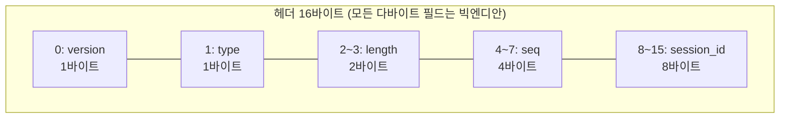

# 바이트 순서·메시지 헤더·컴파일러 경고 실습 — htonll·enc_dec와 size_t·switch 함정

> [!NOTE]
> C 기초 강의의 기타 실습(16-01 ~ 16-05, "컴파일러가 경고를 주는 경우")에서 만난 오류 패턴을 정리하고, 이어서 **64비트 바이트 순서 변환 함수**(`byteorder.c`)와 **16바이트 메시지 헤더 encode/decode 모듈**(`enc_dec.h`·`enc_dec.c`·`enc_dec_test.c`), **TLV 파서 코드 리뷰**(`tag_length_value.c`)를 다룬다.
>
> 환경은 Docker Desktop의 Linux 컨테이너(`c_app_part1`), `gcc -Wall -Wextra`.

> [!IMPORTANT]
> 코드는 컨테이너에서 컴파일·실행해 확인했고, 설명은 AI(Claude)와 함께 코드 리뷰하며 정리했다. 컨테이너는 x86이라 **리틀엔디안**이며, 빅엔디안 호스트에서의 동작은 실행해 보지 못했다 (엔디안에 의존하지 않도록 시프트로 구현했지만 확인한 것은 아니다).

> [!TIP]
> **📂 원본 소스 (GitHub)**
> - 강의 코드 16-01 ~ 16-05, TLV 리뷰 과제: [`lecture/msc/`](https://github.com/sweetpark/c-playgound/tree/main/c_basic/lecture/msc) (`tag_length_value.c`는 컴파일되지 않는 상태라 `make lecture`에서 제외)
> - 64비트 바이트 순서: [`msc/byteorder.c`](https://github.com/sweetpark/c-playgound/blob/main/c_basic/msc/byteorder.c)
> - 헤더 encode/decode: [`msc/enc_dec.h`](https://github.com/sweetpark/c-playgound/blob/main/c_basic/msc/enc_dec.h) · [`msc/enc_dec.c`](https://github.com/sweetpark/c-playgound/blob/main/c_basic/msc/enc_dec.c) · 테스트 [`msc/enc_dec_test.c`](https://github.com/sweetpark/c-playgound/blob/main/c_basic/msc/enc_dec_test.c)
> - 빌드/실행: `make -C c_basic` 후 `./c_basic/build/msc/enc_dec_test` ([README](https://github.com/sweetpark/c-playgound/blob/main/c_basic/README.md))
> - 컨테이너 원본 경로는 `~/coding/16_msc/` (접속: `docker exec -it c_app_part1 /bin/bash`)

## 📌 한눈에 보기

| 실습 | 문제 | 처방 |
|---|---|---|
| 16-01 | `size_t`로 `enum`을 순회, `switch`에 `default`가 없어 범위 밖 값에서 `return` 누락 | 순회는 `enum` 타입(또는 `int`)으로, `switch`는 `default`에서 에러 처리 |
| 16-02 | 도달할 수 없는 `if (s)` (dead code) | 죽은 분기를 지우고 흐름을 단순화 |
| 16-03 | `p2` 대입이 쓰이지 않음, `baz()`가 항상 같은 값 | 쓰이지 않는 값·상수 함수는 의도를 의심 |
| 16-04 | `size_t i <= SIZE_MAX`가 항상 참 + `i += step` 랩어라운드 → **무한 루프** | 증가시키기 **전에** 남은 범위를 검사 |
| 16-05 | `sizeof(배열)`(바이트 수)을 원소 수로 넘김, 반복문 뒤 `return` 없음 | `sizeof(a)/sizeof(a[0])`, 모든 경로에 `return` |
| byteorder | 마스크 `&`보다 시프트가 먼저, 시프트 양 오류, 결과를 버림 | `(n & 마스크) << k` + 바이트별 이동량 표로 검산 |
| enc_dec | 구조체 통째 `memcpy`는 엔디안·패딩이 새어 나옴 | 필드 단위 시프트 변환, 검증 후에만 출력 |
| TLV | 종료 조건·반환·부호 없는 비교·타입 오타 등 | 코드 리뷰 체크리스트 (§4) |

---

## 1. 컴파일러 경고가 알려주는 결함 — 16-01 ~ 16-05

> 컴파일러가 warning을 주는 경우. 경고 자체를 "없애는" 것이 아니라, **경고가 가리키는 설계 결함**을 고치는 것이 목적이다.

### 16-00. 경고는 가장 높은 수준으로 켜고, 남기려면 이유를 쓴다

> [!NOTE] 요약
> - **문제**: 경고를 끄거나 무시하고, 최적화가 의도한 코드를 지움
> - **원인**: `-Wall`은 모든 경고가 아니며, 읽는 곳이 없는 `memset` 같은 dead store는 `-O2`에서 제거됨
> - **처방**: `-Wall -Wextra`(필요하면 `-Wswitch-enum` 등)로 컴파일하고 남기는 경고는 이유를 주석으로. 민감값은 `explicit_bzero`·`memset_s`·`volatile`로 지움
> - **결과**: gcc 4.8.5: `-O0` 호출 1개, `-O2` 0개

> [!INFO]- 상세 보기
> 교육자료(16-0)의 원칙은 두 가지다.
> - **가장 높은 경고 수준으로 컴파일하고 경고를 모두 없앤다.** 코드가 옳은데도 경고가 나올 수 있다. 그럴 때는 고치는 것을 권하되, 고치지 않는다면 **고치지 않는 이유를 주석**으로 남긴다.
> - **최적화 옵션은 주의해서 쓴다.** 컴파일러는 "쓸모없다"고 판단한 코드를 마음대로 지운다. 프로그래머가 의도한 코드도 포함될 수 있다.
>
> > [!WARNING]
> > 교육자료는 "gcc는 `-Wall`로 가장 높은 경고 수준을 쓸 수 있다"고 적었지만, `-Wall`은 **모든 경고가 아니다**.
> >
> > 이 노트에서는 `-Wall -Wextra`를 기본으로 쓰고, `default`가 있는 `switch`에서 빠진 `enum` 값을 잡으려면 `-Wswitch-enum`을 따로 켜야 했다 (§1의 16-01).
> >
> > `-Wpedantic`, `-Wconversion` 등은 필요에 따라 더한다.
>
> "의도한 코드가 지워지는" 대표적인 예를 컨테이너(gcc 4.8.5)에서 확인했다. 비밀번호를 담은 지역 버퍼를 쓰고 나서 `memset(pw, 0, sizeof(pw))`로 지우는 코드다.
>
> | 컴파일 옵션 | 생성된 어셈블리의 `memset` 호출 |
> |---|---|
> | `-O0` | 1개 |
> | `-O2` | **0개** (이후 읽는 곳이 없는 쓰기(dead store)라 통째로 제거됨) |
>
> 즉 "민감한 값을 지웠다"는 의도가 최적화 빌드에서는 **조용히 사라진다**.
>
> 지워야 하는 값은 `memset_s`(C11 Annex K), `explicit_bzero`(glibc 2.25+), 또는 `volatile` 포인터로 쓰는 직접 구현처럼 컴파일러가 제거할 수 없는 방식을 쓴다.
>
> 디버그 빌드(`-O0`)에서만 시험하면 이 문제는 보이지 않는다.

### 16-01. `size_t`로 `enum` 순회 + `default` 없는 `switch`

> [!NOTE] 요약
> - **문제**: `size_t`로 `enum`을 순회하고, `default` 없는 `switch`가 범위 밖 값에서 `return` 없이 끝남
> - **원인**: 범위 밖 `enum` 값 처리 누락, 부호 있는 `enum`을 `size_t`로 암묵 변환
> - **처방**: 순회는 `enum`/`int`와 `COLOR_MAX`, `switch`는 모든 case + `default`(미정의 값용). 누락 탐지는 `-Wswitch-enum`
> - **결과**: `default`를 넣으면 `-Wall`이 빠진 case를 더는 알려 주지 않음

> [!INFO]- 상세 보기
> ```c
> typedef enum { Red, Green, Blue } Color;
> const char *f(Color c) {
>     switch (c) {
>         case Red:   return "Red";
>         case Green: return "Green";
>         case Blue:  return "Blue";
>     }                                  // ❌ 범위 밖 값이면 return 없이 끝남 (-Wreturn-type)
> }
> void g() {
>     size_t i;
>     for (i = Red; i <= Blue; i++)      // ❌ size_t 로 enum 순회
>         puts(f(i));
> }
> ```
>
> - **`switch`가 모든 case를 다뤄도 `default`가 없으면**
>   - 설명: `c`가 `3`처럼 `enum`에 없는 값일 때 `return` 없이 함수가 끝난다 (정의되지 않은 동작). 컴파일러는 `control reaches end of non-void function`으로 경고
>   - 처방: 마지막에 `default:` 또는 `switch` 밖에서 `return "UNKNOWN"`
> - **`size_t`(부호 없음)로 순회**
>   - 설명: `enum` 초기값이 **음수**이면 `size_t`로 변환되면서 매우 큰 수가 되어 순회 범위가 깨진다. 지금은 0부터라 우연히 돈다
>   - 처방: 순회 변수는 `enum` 타입 또는 `int`, 상한은 `COLOR_MAX` 같은 마지막 값으로
> - **`size_t`를 `Color`로 암묵 변환**
>   - 설명: 의도를 숨긴다
>   - 처방: 명시적으로 `(Color)i` 하거나 타입을 맞춘다
>
> > [!WARNING]
> > **`default`를 넣으면 컴파일러가 빠진 `case`를 더 이상 알려 주지 않는다.** `enum`에 값이 추가돼도 `switch`를 고치는 것을 잊기 쉽다. 직접 확인했다.
> > ```c
> > typedef enum { A, B, C } e_t;
> > f1: switch(e){ case A: case B: default: ... }   // C 누락, default 있음 → -Wall 은 경고 없음
> > f2: switch(e){ case A: case B: }                // C 누락, default 없음 → -Wswitch 경고
> > ```
> > `-Wall`에서는 `default`가 없는 `f2`만 경고가 나고, `default`가 있는 `f1`은 `-Wswitch-enum`을 켜야 경고가 난다.
> >
> > 그래서 **`enum`을 `switch`할 때는 모든 case를 나열하고 `default`는 "정의되지 않은 값" 처리용으로만** 두며, `-Wswitch-enum`을 켜 두는 것이 좋다.

### 16-02. dead code

> [!NOTE] 요약
> - **문제**: 항상 거짓인 `if (s)` 분기 (dead code)
> - **원인**: 앞에서 `return`해서 이 경로의 `s`는 초기값 `NULL`
> - **처방**: 죽은 분기를 지우고 흐름을 단순화. `a == b;`, `*p++;`처럼 효과 없는 코드는 의도 확인

> [!INFO]- 상세 보기
> ```c
> char *s = NULL;
> if (condition) {
>     s = malloc(10);
>     ...
>     free(s);
>     return 0;
> }
> if (s) {                                   // ❌ 여기 오는 경로에서는 s 가 항상 NULL
>     printf("???? confusion:%s\n", s);      //    → 실행될 수 없는 코드
> }
> ```
>
> `condition`이 참이면 앞에서 `return`하고, 거짓이면 `s`는 초기값 `NULL` 그대로이므로 `if (s)`는 **항상 거짓**이다.
>
> 이런 코드는 읽는 사람을 혼란스럽게 하고(`confusion`이라는 메시지가 그 증거), 나중에 코드를 바꿀 때 "여기도 처리돼야 하나?"라는 잘못된 가정을 만든다. 지운다.
>
> 교육자료(16-2)가 함께 보여 준 "아무 효과가 없는 코드"의 전형들이다. 대부분의 컴파일러가 경고를 내지만, **의도를 틀리게 적은 흔적**이므로 경고를 지우는 데서 멈추지 말고 의도를 확인한다.
>
> | 코드 | 실제 동작 | 의도했을 법한 코드 |
> |---|---|---|
> | `a == b;` | 비교만 하고 버린다 | `a = b;` |
> | `*p++;` | 포인터만 증가하고 `*p` 값은 쓰이지 않는다 (`++`가 `*`보다 먼저) | `++p;` 또는 `(*p)++;` |
> | `for (i = 0; i < len; i++) { if (s[i] == '\0') {...} }` (`len = strlen(s)`) | 조건이 **항상 거짓**이라 안쪽이 실행되지 않는다 | 끝을 보려면 `s[i+1] == '\0'` 등 의도를 다시 정한다 |

### 16-03. 쓰이지 않는 값과 상수 함수

> [!NOTE] 요약
> - **문제**: 쓰이지 않는 대입(`p2`)과 항상 같은 값을 주는 `baz()`
> - **원인**: `static` 변수가 어디서도 바뀌지 않아 `if (baz())`는 항상 거짓, `return p1;`은 도달 불가
> - **처방**: 쓰이지 않는 값은 로직 오류의 신호이므로 찾아서 정리. 버리는 반환값은 `(void)` 캐스트로 의도를 표시

> [!INFO]- 상세 보기
> - `static` 지역변수는 함수가 끝나도 값이 유지되어서 `foo()`는 호출마다 1, 2, 3, 4를 돌려주지만, `baz()`의 `static int i`는 **어디서도 바뀌지 않아** 항상 `0 % 2 = 0`이다.
> - 그래서 `if (baz())`는 항상 거짓이고 `return p1;`은 **도달 불가**. `p2 = bar();`의 결과도 곧바로 `p2 = p1;`으로 덮여 쓰이지 않는다. 출력은 항상 `g()=1, 2, 3, 4`다.
> - 교육자료(16-3)의 정리는 "쓰이지 않는 값은 로직 오류의 신호"이므로 찾아서 지우는 것이다. 수정안은 `p2`를 없애고 `p1 = foo(); (void) bar(); (void) baz(); return p1;`로 줄였다.
>   **`(void)` 캐스트는 "반환값을 일부러 버린다"는 표시**라서 경고를 없애면서 의도를 남긴다. 다만 이 수정안은 `if (baz())` 분기(도달 불가)까지 함께 정리한 결과이므로, 원래 로직이 정말 그렇게 의도된 것인지 먼저 확인해야 한다.
> - 같은 이름 `i`라도 `foo`/`bar`/`baz`의 `static`은 **서로 다른 변수**다 (스코프가 함수 안).
> - `static` 지역변수는 모든 스레드가 공유한다. 스레드에서 쓰면 [동시성 실습](개발%20%28CS%29/언어/C언어/실습/[C]%20동시성·스레드%20실습%20—%20mutex%20락%20범위·데드락·조건변수와%20메시지%20큐·이체%20감시%20스레드.md)의 락 규칙이 적용된다 (스레드마다 따로 두려면 `__thread`).

### 16-04. 부호 없는 정수의 랩어라운드와 항상 참인 조건

> [!NOTE] 요약
> - **문제**: `size_t i <= SIZE_MAX`가 항상 참이고 `i += step` 랩어라운드로 무한 루프
> - **원인**: 부호 없는 정수는 최댓값을 넘으면 0쪽으로 돌아옴
> - **처방**: 증가시키기 **전에** `SIZE_MAX - i < step` 검사. 종료 조건은 `!=`보다 `<`/`<=`
> - **결과**: `%zu`로 출력해야 값이 맞게 보임

> [!INFO]- 상세 보기
> ```c
> void f(size_t begin, size_t step) {
>     size_t i;
>     for (i = begin; i <= SIZE_MAX; i += step) {     // ❌ i <= SIZE_MAX 는 항상 참
>         printf("i=%u\n", i);                        // ❌ size_t 는 %zu
>     }
> }
> f(SIZE_MAX - 10, 12);
> ```
>
> `size_t`는 `SIZE_MAX`를 넘으면 0쪽으로 **돌아온다**(랩어라운드). `SIZE_MAX - 10`에서 12씩 더하면 `SIZE_MAX + 2`가 아니라 `1`이 되고, `i <= SIZE_MAX`는 어떤 `size_t`든 참이라 **무한 루프**다.
>
> 실행하면 `4294967285`(`%u`로 잘린 값) → `1` → `13` → ... 으로 계속 찍힌다.
>
> ```c
> // ✅ 더하기 "전에" 남은 범위를 검사한다
> for (i = begin; ; i += step) {
>     printf("i=%zu\n", i);
>     if (SIZE_MAX - i < step) break;      // 다음 증가가 넘치면 종료
> }
> ```
>
> > [!NOTE]
> > 오버플로 검사는 **하기 전에**.
> >
> > 더한 뒤에는 이미 값이 돌아와 있어서 확인할 수 없다 ([에러 처리·API 실습](개발%20%28CS%29/언어/C언어/실습/[C]%20에러%20처리·API%20설계%20실습%20—%20strtol%20my_atoi·snprintf_m·sum_file·conformant%20배열.md)의 `total > LONG_MAX - num`과 같은 원칙).
> >
> > `%u`로 `size_t`를 출력하면 상위 32비트가 잘려 값이 틀리게 보인다.
>
> **루프 종료 조건은 `==`/`!=`보다 관계 연산자(`<`, `<=`, `>`, `>=`)를 쓴다** (교육자료 16-4).
>
> | 패턴 | 문제 | 고침 |
> |---|---|---|
> | `for (i = 1; i != 10; i += 2)` | `i`는 1, 3, 5, 7, 9, 11… 이라 **10이 될 수 없다** → 무한 루프 | `i <= 10` |
> | `for (i = begin; i != end; ++i)` | `begin > end`면 끝없이 증가해 랩어라운드 후에야 만난다 | `i < end` |
> | `for (i = begin; i <= SIZE_MAX; i += step)` | 타입의 최댓값과 직접 비교하면 **항상 참** (위 설명) | `i <= SIZE_MAX - step`(단 `step > 0`을 먼저 확인) 또는 위의 "더하기 전 검사" |
>
> 증가가 `1`이고 시작값이 종료값 이하일 때(또는 감소가 `1`이고 시작값이 종료값 이상일 때)만 `!=`를 써도 된다.
>
> > [!WARNING]
> > 교육자료의 마지막 수정안은 `int i`로 선언해서 `i <= SIZE_MAX - step`을 `size_t` 범위와 비교하게 만든다. `int`로는 `SIZE_MAX - step` 근처의 값을 담을 수 없으므로 반드시 **`size_t i`** 로 선언한다. 자료의 코드도 그대로 믿지 않는다.

### 16-05. `sizeof`는 원소 수가 아니라 바이트 수

> [!NOTE] 요약
> - **문제**: `sizeof(배열)`(바이트 수)을 원소 수로 넘기고, 반복문 뒤 `return` 누락
> - **원인**: `delim`이 없으면 배열 뒤 메모리를 읽고, 반환값이 쓰레기라 `data[i]`가 범위 밖 쓰기
> - **처방**: `sizeof(a)/sizeof(a[0])`, 모든 경로에 `return`(못 찾음은 에러 코드 + `*out`), 반환값 검사 후에만 접근
> - **결과**: `delim=2`처럼 찾으면 **정상처럼 보여서** 경고 없이는 놓침

> [!INFO]- 상세 보기
> ```c
> size_t getlen(const int *input, size_t maxlen, int delim) {
>     size_t i;
>     for (i = 0; i < maxlen; ++i)
>         if (input[i] == delim) return i;
>     // ❌ 못 찾으면 return 없이 끝남 (-Wreturn-type)
> }
> int data[] = {1, 2, 5};
> i = getlen(data, sizeof(data), delim);   // ❌ sizeof(data) = 12 (바이트), 원소는 3개
> data[i] = userdata;                      // ❌ delim 이 없으면 i 가 쓰레기 값 → 범위 밖 쓰기
> ```
>
> | 문제 | 설명 | 처방 |
> |---|---|---|
> | `sizeof(data)` | 배열의 **바이트 수**(12)를 `maxlen`으로 넘겨서, `delim`이 없으면 배열(3칸) 뒤 메모리를 최대 12칸까지 읽는다 | `sizeof(data) / sizeof(data[0])` (매크로 `ARRAY_SIZE`) |
> | 반복문 뒤 `return` 없음 | `if` 안에서만 반환하고 끝나면 반환값이 정해지지 않는다. 호출한 쪽은 그 쓰레기 값으로 `data[i]`에 쓴다 | 못 찾음을 나타내는 반환 방식을 정한다 (에러 코드 + `*out` 인자) |
> | 반환값을 인덱스로 바로 사용 | 못 찾은 경우를 구분하지 않음 | `rc`를 검사한 뒤에만 `data[idx]` 접근 |
>
> `delim=2`로 호출하면 `data[1]`이 `100`으로 바뀌어 `1, 100, 5`가 출력되어서 **정상처럼 보인다**. 못 찾는 입력(`delim=9` 등)에서만 터지는 종류라서 경고가 없으면 발견하기 어렵다.
>
> > [!TIP]
> > 이 실습들의 공통점은 "**우연히 정상 동작**"이다. 경고를 꺼 두거나 무시하면 입력이 달라지는 순간에만 터지는 결함을 놓친다. 빌드 옵션은 `-Wall -Wextra`를 기본으로 하고, 새 경고가 나면 코드를 고친다.

---

## 2. 바이트 순서 — `byteorder.c`

### 2-1. 개념

> [!INFO]- 용어·메모리 배치·한 줄 정리·`my_ntohl`
> | 용어 | 뜻 |
> |---|---|
> | 네트워크 바이트 순서 | **빅엔디안** — 상위 바이트가 낮은 주소 |
> | x86·대부분의 ARM | **리틀엔디안** — 하위 바이트가 낮은 주소 |
> | PowerPC·MIPS·s390x 등 | 전통적으로 **빅엔디안**. 다만 교육자료의 "PowerPC는 빅엔디안"은 절반만 맞다: PowerPC·ARM·MIPS는 **양쪽을 지원(bi-endian)** 하고, 리눅스의 `ppc64le`처럼 리틀엔디안으로 돌리는 구성도 흔하다. 그래서 CPU 이름으로 추측하지 말고 항상 변환 함수를 쓴다 |
> | `ntohl`/`ntohs` | network → host (32/16비트) |
> | `htonl`/`htons` | host → network |
> | 64비트 | 표준 함수가 없어 직접 작성 (`htonll`/`ntohll`, glibc에는 `htobe64`/`be64toh`) |
>
> `0x0102030405060708`이 메모리에 놓이는 모양:
>
> | 호스트 | +0 | +1 | +2 | +3 | +4 | +5 | +6 | +7 |
> |---|---|---|---|---|---|---|---|---|
> | 빅엔디안(네트워크) | 01 | 02 | 03 | 04 | 05 | 06 | 07 | 08 |
> | 리틀엔디안(x86) | 08 | 07 | 06 | 05 | 04 | 03 | 02 | 01 |
>
> 변환 로직은 둘로 갈린다.
> - **호스트가 빅엔디안**: 이미 네트워크 순서라서 값을 그대로 돌려준다.
> - **호스트가 리틀엔디안**: 바이트 순서를 뒤집는다. `host → network`와 `network → host`는 같은 연산(뒤집기)이라 두 번 적용하면 원래 값이다.
>
> > [!IMPORTANT]
> > **한 줄 정리**
> > - `ntohl` = network → host. 네트워크는 **빅엔디안**이고, 호스트가 리틀엔디안이면 "빅엔디안 → 리틀엔디안"으로 바이트를 뒤집는다.
> > - `htonl` = host → network. 리틀엔디안 호스트에서는 "리틀엔디안 → 빅엔디안"으로 뒤집는다.
> > - 네트워크 통신은 빅엔디안으로 하기로 정해져 있다(네트워크 바이트 순서). 그리고 x86/x86-64를 쓰는 Linux·Windows와 대부분의 ARM 환경은 리틀엔디안이라서, 흔히 "리틀 ↔ 빅 변환"이라고 외운다.
> >
> > **정확히 하려면 두 가지를 같이 기억한다.**
> > 1. 엔디안은 **OS가 아니라 CPU 아키텍처**가 정한다. Linux도 빅엔디안 CPU(예: IBM s390x, 일부 PowerPC·MIPS) 위에서 돌아간다. 그래서 함수 이름이 "리틀→빅"이 아니라 **"host ↔ network"** 인 것이다.
> >
> > 호스트가 이미 빅엔디안이면 `htonl`/`ntohl`은 값을 그대로 돌려준다(아무 일도 안 함).
> > 2. 코드에서는 호스트 엔디안을 가정하지 않고 항상 `htonl`/`ntohl`(또는 시프트로 직접 쓰는 `put_be*`/`get_be*`)을 써야, 어느 CPU에서 빌드해도 같은 바이트가 나간다. 컨테이너는 x86이라 리틀엔디안이었고, 빅엔디안 호스트에서는 실행해 보지 못했다.
>
> 32비트 `ntohl`은 이렇게 쓴다.
>
> ```c
> uint32_t my_ntohl(uint32_t n) {
>     return ((n & 0x000000FF) << 24) | ((n & 0x0000FF00) << 8) |
>            ((n & 0x00FF0000) >>  8) | ((n & 0xFF000000) >> 24);
> }
> ```
>
> 실제 libc는 호스트 엔디안을 **컴파일 시점**(`<endian.h>` 매크로)에 정하고, 리틀엔디안이면 `__builtin_bswap32`로 CPU 명령어 하나(`bswap`)로 바꾼다.

### 2-2. 64비트 구현과 원본의 실수

> [!NOTE] 요약
> - **문제**: 64비트 `htonll`/`ntohll` 첫 구현의 6가지 실수
> - **원인**: `<stdint.h>` 누락, 결과 버림, 시프트가 `&`보다 먼저, 시프트 양 오류(40을 32로), `%x`, 반복 패턴 테스트 값
> - **처방**: `(n & 마스크) << k`와 이동량 표 `(7−2i)×8`로 검산, `PRIx64`, `0x0102030405060708`처럼 바이트마다 다른 값

> [!INFO]- 상세 보기
> ```c
> static uint64_t swap64(uint64_t n) {
>     return ((n & 0x00000000000000FFULL) << 56) |
>            ((n & 0x000000000000FF00ULL) << 40) |
>            ((n & 0x0000000000FF0000ULL) << 24) |
>            ((n & 0x00000000FF000000ULL) <<  8) |
>            ((n & 0x000000FF00000000ULL) >>  8) |
>            ((n & 0x0000FF0000000000ULL) >> 24) |
>            ((n & 0x00FF000000000000ULL) >> 40) |
>            ((n & 0xFF00000000000000ULL) >> 56);
> }
> uint64_t htonll(uint64_t n) { return is_little_endian() ? swap64(n) : n; }
> uint64_t ntohll(uint64_t n) { return is_little_endian() ? swap64(n) : n; }
> ```
>
> 바이트 `i`(0이 최하위)는 `7 − i` 위치로 가므로 이동량은 `(7 − 2i) × 8`비트다.
>
> | 바이트 | 0 | 1 | 2 | 3 | 4 | 5 | 6 | 7 |
> |---|---|---|---|---|---|---|---|---|
> | 이동 | `<< 56` | `<< 40` | `<< 24` | `<< 8` | `>> 8` | `>> 24` | `>> 40` | `>> 56` |
>
> 처음 작성한 코드의 실수:
>
> - **`<stdint.h>` 누락**
>   - 설명: `uint64_t`를 모르는 타입으로 취급 → 연쇄 에러
>   - 처방: 헤더 include
> - **결과를 버림**
>   - 설명: `(a) | (b) | ...;`는 값을 어디에도 대입하지 않아 `return n`이 입력을 그대로 반환
>   - 처방: `n = ...` 또는 바로 `return`
> - **우선순위**
>   - 설명: `n & 0xFF << 56`은 `n & (0xFF << 56)`으로 계산된다. **시프트가 `&`보다 먼저**라서 마스크만 시프트되고, `0xFF`는 `int`라서 `<< 56`은 오버플로(정의되지 않은 동작)이기도 하다
>   - 처방: `(n & 마스크) << 56`처럼 괄호
> - **시프트 양 오류**
>   - 설명: 두 번째 바이트를 `<< 32`, 일곱 번째를 `>> 32`로 씀 (정답은 40)
>   - 처방: 위 이동량 표로 검산
> - **`printf("%02x", n)`**
>   - 설명: 64비트 값을 `%x`로 찍으면 값이 잘린다
>   - 처방: `PRIx64` (`<inttypes.h>`)
> - **테스트 값 `0x1234567812345678`**
>   - 설명: 반복 패턴이라 이동량이 틀려도 눈으로 알아채기 어렵다
>   - 처방: `0x0102030405060708`처럼 **바이트마다 다른 값**

### 2-3. 검증

> [!NOTE] 요약
> - **처방**: 메모리 바이트 확인 + 왕복 + `__builtin_bswap64` 비교 + 경계 값 7개
> - **결과**: 7개 모두 PASS, 시프트 두 곳을 `32`로 바꾼 변이는 7개 중 4개만 통과 (검증이 버그를 잡음)

> [!INFO]- 상세 보기
> | 검증 | 방법 |
> |---|---|
> | 네트워크 순서 | `htonll` 결과를 **메모리 바이트**로 읽어 `p[k] == (v >> 8*(7-k)) & 0xFF`인지 (호스트 엔디안과 무관한 정의 그대로의 검사) |
> | 왕복 | `ntohll(htonll(v)) == v` |
> | 내장 함수 비교 | 리틀엔디안이면 `htonll(v) == __builtin_bswap64(v)` (gcc 전용) |
> | 값 | `0`, 전부 1, `0xFF`(최하위만), `0xFF00…`(최상위만), `0x8000…01`(최상위 비트 — 오른쪽 시프트의 부호 확장 확인) |
>
> 7개 값 모두 PASS(`0x0102030405060708` → `0x0807060504030201`). 시프트 양 두 군데를 원본처럼 `32`로 바꾼 변형은 **7개 중 4개만 통과**해서 테스트가 실수를 잡는다.
>
> > [!NOTE]
> > 마스크 상수의 `ULL` 접미사는 이 형태(`(n & 마스크) << k`)에서는 필수는 아니다. `n`이 `uint64_t`라서 `&`의 결과가 이미 64비트다. 오버플로는 **마스크 자체를 시프트**하는 원본의 형태에서만 생긴다. `ULL`은 "64비트 상수"라는 표시로 남겼다.

---

## 3. 메시지 헤더 encode / decode — `enc_dec`

### 3-1. 요구사항과 와이어 포맷



> [!INFO]- 요구사항과 와이어 포맷 표
> - `hdr_encode()` — 헤더를 network byte order 16바이트로 `buf`에 저장. **구조체를 통째로 `memcpy` 하지 말고 필드 단위로 변환 저장**
> - `hdr_decode()` — `buf`의 16바이트를 host byte order 구조체로
> - 두 함수 모두 성공 시 0, 실패 시 **원인별 음수**
> - `msg_type_str()` — `switch`로 type 이름 문자열, 정의되지 않으면 `UNKNOWN`
>
>
> | offset | size | 필드 | 값 |
> |---|---|---|---|
> | 0 | 1 | version | 1만 유효 |
> | 1 | 1 | type | 1:REQUEST 2:RESPONSE 3:NOTIFY |
> | 2 | 2 | length | body 길이 (빅엔디안) |
> | 4 | 4 | seq | (빅엔디안) |
> | 8 | 8 | session_id | (빅엔디안) |

### 3-2. 설계 결정

> [!NOTE] 요약
> - **문제**: 헤더 16바이트를 network byte order로 encode/decode
> - **원인**: 구조체 `memcpy`는 엔디안·패딩이 새어 나옴
> - **처방**: 필드 단위 시프트 변환(`put_be*`/`get_be*`), 에러는 원인별 음수, 검증 후에만 출력(실패 시 출력 불변), `decode`도 version/type 검증

> [!INFO]- 상세 보기
> | 결정 | 이유 |
> |---|---|
> | **구조체 `memcpy` 금지, 필드 단위 변환** | 구조체는 호스트 엔디안으로 저장되고 필드 사이에 **패딩**이 들어갈 수 있다. 컴파일러·플랫폼마다 달라서 상대방이 다르게 해석한다 |
> | `htons`/`htonl` 대신 **시프트로 한 바이트씩** | 변환한 값을 `buf`에 넣으려면 `memcpy`가 필요하고, `buf + 4`를 `uint32_t *`로 캐스팅하면 **정렬(alignment) 문제**가 생긴다. 시프트는 값 기준이라 엔디안과 정렬에 무관하다 |
> | 에러 코드를 원인별로 | `-1` 잘못된 인자(NULL) · `-2` 버퍼 부족 · `-3` version · `-4` type |
> | 검사 순서 | 인자 → 버퍼 크기 → version → type |
> | **실패하면 출력 불변** | `encode`는 검증을 다 통과한 뒤에만 `buf`에 쓴다. `decode`는 임시 구조체에 읽고 검증한 뒤 복사한다 |
> | `decode`도 version/type 검증 | 네트워크에서 온 데이터는 믿지 않는다 |
> | `buf_len > 16`이면 정상 | body가 뒤에 붙은 경우로 보고 앞 16바이트만 읽고 쓴다 |
>
> ```c
> static void put_be32(uint8_t *p, uint32_t v) {
>     p[0] = (uint8_t)(v >> 24);   // 최상위 바이트가 가장 낮은 주소로
>     p[1] = (uint8_t)(v >> 16);
>     p[2] = (uint8_t)(v >> 8);
>     p[3] = (uint8_t)(v);
> }
> static uint32_t get_be32(const uint8_t *p) {
>     // uint8_t 는 int 로 승격되므로 시프트 전에 uint32_t 로 캐스팅
>     return ((uint32_t)p[0] << 24) | ((uint32_t)p[1] << 16) | ((uint32_t)p[2] << 8) | p[3];
> }
>
> int hdr_encode(const msg_hdr_t *hdr, uint8_t *buf, size_t buf_size) {
>     int rc;
>     if (hdr == NULL || buf == NULL)  return HDR_RC_ERR_INVALID_PARAM;
>     if (buf_size < MSG_HDR_SIZE)     return HDR_RC_ERR_BUF_SMALL;
>     if ((rc = hdr_validate(hdr->version, hdr->type)) != HDR_RC_SUCC) return rc;
>
>     buf[0] = hdr->version;
>     buf[1] = hdr->type;
>     put_be16(buf + 2, hdr->length);
>     put_be32(buf + 4, hdr->seq);
>     put_be64(buf + 8, hdr->session_id);
>     return HDR_RC_SUCC;
> }
> ```
>
> > [!NOTE]
> > 요구사항에 있던 구조체 인자 이름 `msg_hdlr_t`는 오타라서 `msg_hdr_t`로 썼다. 구조체와 enum, 함수 선언, 반환 코드는 `enc_dec.h`에 두었고, 테스트용 `main`은 별도 프로세스(`enc_dec_test`)로 분리했다.

### 3-3. 테스트 프로그램 (34개 검사)

> [!NOTE] 요약
> - **처방**: byte 순서·왕복·에러·`msg_type_str` 4구분 34개 검사 + 변이 테스트
> - **결과**: 34개 모두 통과, 일부러 넣은 버그 6종이 모두 실패로 잡힘

> [!INFO]- 상세 보기
> | 구분 | 확인 내용 |
> |---|---|
> | ① byte 순서 | `{1, 2, 0x0304, 0x05060708, 0x090A0B0C0D0E0F10}`를 encode → `01 02 03 04 05 06 07 08 09 0A 0B 0C 0D 0E 0F 10`이 출력되는지 (요구사항의 "01020304 → 01 02 03 04") |
> | ② 왕복 | 0, 최댓값, 최상위 비트가 켜진 값 등 4종과 32바이트 버퍼(16바이트 이후는 건드리지 않음) |
> | ③ 에러 | version 0·2, type 0·4·255, 버퍼 15·0, NULL 4가지, **실패 시 `buf`·`hdr`가 변경되지 않음** |
> | ④ `msg_type_str` | 1~3은 이름, 0·4·255는 `UNKNOWN` |
>
> 34개 모두 통과했다. **변이 테스트**로 이 검증이 실제로 버그를 잡는지도 확인했다.
>
> | 일부러 넣은 버그 | 결과 |
> |---|---|
> | seq를 리틀엔디안 순서로 저장 | 실패 (30/34) |
> | `encode`의 버퍼 크기 검사 제거 | 실패 (32/34) |
> | version 검사 제거 | 실패 (28/34) |
> | `decode`의 검증만 제거 | 실패 (29/34) |
> | 검증 **전에** `buf[0]`에 쓰기 | 실패 (33/34, "실패 시 buf 불변" 검사에서) |
> | type 4 허용 | 실패 (30/34) |
>
> > [!TIP]
> > 변이 테스트를 만들 때 `sed` 한 줄이 아무것도 바꾸지 못한 "무효 변이"가 있었다 (원본과 똑같이 통과). **변이가 실제로 코드를 바꿨는지** `diff`로 먼저 확인해야 한다. 통과했다고 테스트가 약한 것인지, 변이가 무효인지 구분할 수 없기 때문이다.

---

## 4. 코드 리뷰 — TLV 파서 (`tag_length_value.c`)

> [!INFO]- 결함 목록 (TLV 파서 9가지)
> 8바이트 헤더(`buf[0]`은 상태, `buf + 4`부터 seq 4바이트)와 그 뒤의 **(tag, value) 쌍**으로 이루어진 메시지를 파싱하는 코드를 읽고 결함을 찾는 과제다. 현재 파일에는 컴파일 에러(`state_t` 오타: 선언은 `stat_t`)가 남아 있다. 아래는 리뷰에서 찾은 항목이다.
>
> - **`parse`**
>   - 결함: `size_t body_len = len - HDR_LEN; if (body_len < 0)`
>   - 설명 / 처방: 부호 없는 정수는 **음수가 될 수 없어서** 조건이 항상 거짓이고, `len < HDR_LEN`이면 `len - HDR_LEN`이 거대한 값으로 **언더플로**한다. 뺄셈 **전에** `if (len < HDR_LEN)`
> - **`parse`**
>   - 결함: `memcpy(&seq, buf + 4, 4)` 후 그대로 사용
>   - 설명 / 처방: 네트워크 바이트 순서(빅엔디안)인 값을 **변환 없이** 호스트 값처럼 사용. `ntohl()` 또는 `get_be32()`가 필요
> - **`parse`**
>   - 결함: `(*rx_count)++` 앞의 주석 "연산자 우선순위"
>   - 설명 / 처방: `*rx_count++`는 **포인터를 증가**시키고(후위 `++`가 `*`보다 먼저), 가리키는 값은 안 바뀐다. 괄호로 `(*rx_count)++`
> - **`parse`**
>   - 결함: `st = (state_t)buf[0]`
>   - 설명 / 처방: 범위 검사 없이 `enum`으로 캐스팅. 정의되지 않은 값이 들어올 수 있다
> - **`find_tag`**
>   - 결함: 반복 조건 `i != len || i > len`
>   - 설명 / 처방: `i`가 `len`을 건너뛰면(`i += 2`이고 홀수 길이) 영영 같지 않아 **범위를 넘어 읽는다**. `i + 1 < len`처럼 **쌍이 완전히 들어 있는지** 검사
> - **`find_tag`**
>   - 결함: 못 찾으면 `return` 없이 끝남
>   - 설명 / 처방: 정의되지 않은 값 반환. "못 찾음"을 나타내는 방법 필요 (에러 코드 + `*out` 인자)
> - **`find_tag`**
>   - 결함: 반환형 `int`에 `uint8_t` value
>   - 설명 / 처방: 못 찾음(`-1` 등)과 value를 구분할 수 없는 **in-band** 에러 지시자 ([에러 처리·API 실습](개발%20%28CS%29/언어/C언어/실습/[C]%20에러%20처리·API%20설계%20실습%20—%20strtol%20my_atoi·snprintf_m·sum_file·conformant%20배열.md) 참고)
> - **`state_name`**
>   - 결함: `case ST_CLOSED` 누락 + `default` 존재
>   - 설명 / 처방: `default`가 있으면 `-Wall`이 누락을 알려 주지 않는다 (§1의 16-01 참고). 모든 case 나열 + `-Wswitch-enum`
> - **전체**
>   - 결함: 길이 필드가 없는 고정 길이 (`i += 2`)
>   - 설명 / 처방: **TLV는 value 길이를 담은 `length` 필드**가 있는 형식이다. 쌍을 2바이트로 가정하면 실제 TLV를 해석할 수 없고, 길이를 무시한 채 건너뛰는 코드는 위험하다
>
> > [!NOTE]
> > 이 파일은 "찾아야 할 결함이 심어진 코드"다. 그래서 일부러 고치지 않고, 어떤 패턴이 있는지만 위 표로 정리했다. 위 항목 중 부호 없는 정수의 뺄셈(`len - HDR_LEN`)·변환 없는 네트워크 순서 값·`*p++` 우선순위는 이 노트의 앞부분(16-04, 바이트 순서)과 같은 뿌리에서 나온 실수들이다.

---

## 5. 정리 — 체크리스트

> [!INFO]- 체크리스트 펼치기

### 정수·경계
- [ ] `size_t`(부호 없음) 뺄셈은 **빼기 전에** 대소 비교 (`len < HDR_LEN`), `< 0` 비교는 항상 거짓
- [ ] 증가시키는 루프는 **증가 전에** 오버플로(랩어라운드)를 검사하고, `i <= SIZE_MAX` 같은 항상 참인 조건을 쓰지 않는다
- [ ] `sizeof(배열)`은 바이트 수. 원소 수는 `sizeof(a)/sizeof(a[0])`
- [ ] 반복문 뒤나 `switch` 뒤에도 **모든 경로가 `return`** 하는가 (`-Wreturn-type`)
- [ ] `size_t`는 `%zu`, 64비트는 `PRIx64`

### switch·enum
- [ ] `enum`을 `switch`할 때 모든 case를 나열하고, `default`는 "정의되지 않은 값" 처리용으로만 둔다
- [ ] `-Wswitch-enum`을 켜서 `default`에 가려진 누락을 잡는다
- [ ] 외부에서 온 값을 `enum`으로 캐스팅하기 **전에** 범위를 검사한다

### 바이트 순서·직렬화
- [ ] 네트워크로 보내는 정수는 **필드 단위로** 변환한다 (구조체 통째 `memcpy` 금지: 엔디안·패딩)
- [ ] 시프트 변환(`put_be*`/`get_be*`)은 정렬에 무관하고, `get`은 시프트 **전에** 넓은 타입으로 캐스팅
- [ ] `(n & 마스크) << k` — 시프트가 `&`보다 먼저이므로 괄호
- [ ] 외부에서 받은 헤더는 `decode` 후 **version·type·길이를 검증**하고, 실패하면 출력 구조체를 건드리지 않는다
- [ ] 에러는 **원인별 음수**로 구분한다

### 코드 상태
- [ ] 도달할 수 없는 코드(dead code)와 쓰이지 않는 대입이 없는가
- [ ] 빌드는 `-Wall -Wextra`, 새 경고는 코드로 해결 (억제하지 않는다)
- [ ] 변이(일부러 넣은 버그)가 **코드를 실제로 바꿨고**, 테스트가 그것을 잡는지 확인했는가

---

## 관련 노트

- [동시성·스레드 실습](개발%20%28CS%29/언어/C언어/실습/[C]%20동시성·스레드%20실습%20—%20mutex%20락%20범위·데드락·조건변수와%20메시지%20큐·이체%20감시%20스레드.md) — 락 범위·데드락·조건변수·메시지 큐
- [에러 처리·API 설계 실습](개발%20%28CS%29/언어/C언어/실습/[C]%20에러%20처리·API%20설계%20실습%20—%20strtol%20my_atoi·snprintf_m·sum_file·conformant%20배열.md) — in-band 에러, 합산 오버플로, 반환값 설계
- [종합본](개발%20%28CS%29/언어/C언어/실습/[C]%20종합본%20—%20안전한%20C%20코딩%20체크리스트와%20방어%20매크로.md) — 사고 패턴 → 규칙 종합표
- [(C) 엔디안(바이트 순서)과 인터넷 체크섬](개발%20%28CS%29/언어/C언어/비트·바이트·정수/[C]%20엔디안%28바이트%20순서%29과%20인터넷%20체크섬%20—%20LSB·MSB와%20htons를%20직접%20만들어보기.md) — `htons`를 직접 만들어 보는 개념 노트
- 교육 정리 원본: c_basic #3
