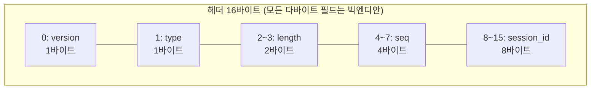

# 바이트 순서·메시지 헤더·컴파일러 경고 — htonll, enc_dec, size_t·switch 함정

> [!TIP]
> - 대응 문제: [P029 be64](https://github.com/sweetpark/c-playgound/tree/main/drill/P029_be64) · [P030 hdr_codec](https://github.com/sweetpark/c-playgound/tree/main/drill/P030_hdr_codec) · [P031 count_steps](https://github.com/sweetpark/c-playgound/tree/main/drill/P031_count_steps) · [P032 level_table](https://github.com/sweetpark/c-playgound/tree/main/drill/P032_level_table)
> - 컨테이너는 x86 = **리틀엔디안**. 빅엔디안 호스트에서의 동작은 실행해 보지 못했다.

---

## 📌 한눈에 보기 — 주의해야 할 점

| # | 주의 | 왜 | 처방 | 상세 |
|---|---|---|---|---|
| 1 | 경고는 **가장 높은 수준**으로, 남기려면 이유를 쓴다 | `-Wall` 은 모든 경고가 아니다. `-O2` 는 의도한 `memset` 도 지운다 | `-Wall -Wextra` (+`-Wswitch-enum`), 민감값은 `explicit_bzero` | [§1](#1-컴파일러-경고가-알려-주는-결함) |
| 2 | `switch` 의 `default` 는 **미정의 값용**으로만 | `default` 가 있으면 `-Wall` 이 빠진 case 를 안 알려 줌 | 모든 case 나열 + `-Wswitch-enum` | [§1](#1-컴파일러-경고가-알려-주는-결함) |
| 3 | `enum` 을 `size_t` 로 순회 금지 | 부호 변환·범위 | `int` / `enum` 타입 + `*_MAX` | [§1](#1-컴파일러-경고가-알려-주는-결함) |
| 4 | 부호 없는 정수는 **증가 전에** 검사 | 랩어라운드, `i <= SIZE_MAX` 는 항상 참 | `SIZE_MAX - i < step` 이면 종료 | [§1](#1-컴파일러-경고가-알려-주는-결함) |
| 5 | `sizeof(배열)` 은 **바이트 수** | 원소 수로 넘기면 범위 밖 | `sizeof(a) / sizeof(a[0])` | [§1](#1-컴파일러-경고가-알려-주는-결함) |
| 6 | 모든 경로에 `return` | 못 찾은 경우 쓰레기 값 | 에러 코드 + `*out` 인자 | [§1](#1-컴파일러-경고가-알려-주는-결함) |
| 7 | 시프트는 `&` 보다 **먼저** 계산된다 | `n & 0xFF << 56` = `n & (0xFF << 56)` | `(n & 마스크) << k`, 이동량 표로 검산 | [§2](#2-바이트-순서) |
| 8 | 네트워크 정수는 **필드 단위**로 변환 | 구조체 `memcpy` 는 엔디안·패딩이 샌다 | `put_be*` / `get_be*` (시프트) | [§3](#3-메시지-헤더-encode--decode) |
| 9 | 외부에서 온 헤더는 **검증 후에만** 출력 | 믿을 수 없는 값 | 실패하면 출력 불변, 원인별 음수 | [§3](#3-메시지-헤더-encode--decode) |

---

## 1. 컴파일러 경고가 알려 주는 결함

경고를 "없애는" 것이 아니라 **경고가 가리키는 설계 결함**을 고치는 것이 목적이다.

### 16-00 · 경고 수준과 최적화

- 교육자료의 원칙 둘
	- **가장 높은 경고 수준**으로 컴파일하고 경고를 모두 없앤다 (고치지 않는다면 **이유를 주석**으로)
	- 최적화는 주의: 컴파일러는 "쓸모없다"고 본 코드를 지운다 (의도한 코드도)
- `-Wall` 은 **모든 경고가 아니다**
	- 기본은 `-Wall -Wextra`, `default` 가 있는 `switch` 의 누락 enum 은 `-Wswitch-enum`
	- 필요하면 `-Wpedantic`, `-Wconversion`

| 컴파일 옵션 | `memset(pw, 0, sizeof(pw))` 호출 (gcc 4.8.5) |
|---|---|
| `-O0` | 1개 |
| `-O2` | **0개** (이후 읽는 곳이 없는 쓰기(dead store)라 통째로 제거) |

- "민감한 값을 지웠다"는 의도가 최적화 빌드에서 **조용히 사라진다**
- 지우려면 `memset_s`(C11 Annex K) · `explicit_bzero`(glibc 2.25+) · `volatile` 포인터 직접 구현
- 디버그 빌드(`-O0`)에서만 시험하면 안 보인다

### 16-01 · size_t 로 enum 순회 + default 없는 switch

```diff
  typedef enum { Red, Green, Blue, COLOR_MAX } Color;
  const char *f(Color c) {
      switch (c) {
          case Red:   return "Red";
          case Green: return "Green";
          case Blue:  return "Blue";
-     }                                  /* 범위 밖 값이면 return 없이 끝남 (-Wreturn-type) */
+         default:    return "UNKNOWN";  /* 정의되지 않은 값 */
+     }
  }
- size_t i;  for (i = Red; i <= Blue; i++) puts(f(i));      /* size_t 로 enum 순회 */
+ int i;     for (i = Red; i < COLOR_MAX; i++) puts(f((Color)i));
```

- `default` 없는 `switch` : `c` 가 `3` 같은 값이면 `return` 없이 끝남 (UB)
- `size_t`(부호 없음)로 순회 : enum 초기값이 **음수**면 큰 수로 변환되어 범위가 깨진다
- `size_t` → `Color` 암묵 변환은 의도를 숨긴다 → `(Color)i`

> [!WARNING] `default` 를 넣으면 컴파일러가 빠진 case 를 더 이상 알려 주지 않는다
> ```c
> typedef enum { A, B, C } e_t;
> f1: switch(e){ case A: case B: default: ... }   /* C 누락, default 있음 → -Wall 경고 없음 */
> f2: switch(e){ case A: case B: }                /* C 누락, default 없음 → -Wswitch 경고 */
> ```
> - `enum` 을 `switch` 할 때는 **모든 case 를 나열**하고 `default` 는 "정의되지 않은 값" 처리용으로만
> - `-Wswitch-enum` 을 켜 둔다

→ 연습: [P032 level_table](https://github.com/sweetpark/c-playgound/tree/main/drill/P032_level_table)

### 16-02 · dead code

```c
char *s = NULL;
if (condition) { s = malloc(10); ...; free(s); return 0; }
if (s) {                              /* 여기 오는 경로에서는 s 가 항상 NULL → 실행될 수 없는 코드 */
    printf("???? confusion:%s\n", s);
}
```

- 읽는 사람을 혼란스럽게 하고 "여기도 처리돼야 하나?"라는 잘못된 가정을 만든다 → 지운다
- 아무 효과 없는 코드의 전형 (경고를 지우는 데서 멈추지 말고 **의도를 다시 정한다**)

| 코드 | 실제 동작 | 의도했을 법한 코드 |
|---|---|---|
| `a == b;` | 비교만 하고 버린다 | `a = b;` |
| `*p++;` | 포인터만 증가 (`++` 가 `*` 보다 먼저) | `++p;` 또는 `(*p)++;` |
| `for (i = 0; i < len; i++) { if (s[i] == '\0') … }` (`len = strlen(s)`) | 조건이 **항상 거짓** | 끝을 보려면 `s[i+1] == '\0'` 등 의도를 다시 정한다 |

### 16-03 · 쓰이지 않는 값과 상수 함수

- `static` 지역변수는 함수가 끝나도 유지 → `foo()` 는 1, 2, 3, 4
	- `baz()` 의 `static int i` 는 **어디서도 안 바뀌어** 항상 `0 % 2 = 0`
- 그래서 `if (baz())` 는 항상 거짓, `return p1;` 은 **도달 불가**, `p2 = bar();` 는 곧 덮여 쓰이지 않음
- 정리: 쓰이지 않는 값은 **로직 오류의 신호** → 찾아서 지운다
	- 버리는 반환값은 `(void)` 캐스트로 **의도를 표시**
	- 같은 이름 `i` 라도 함수별 `static` 은 서로 다른 변수
	- `static` 지역변수는 모든 스레드가 공유 → [동시성 실습](개발%20%28CS%29/언어/C언어/실습/[C]%20동시성·스레드%20실습%20—%20mutex%20락%20범위·데드락·조건변수와%20메시지%20큐·이체%20감시%20스레드.md)

### 16-04 · 부호 없는 정수의 랩어라운드

```diff
- for (i = begin; i <= SIZE_MAX; i += step) printf("i=%u\n", i);   /* i <= SIZE_MAX 는 항상 참, %u 는 잘림 */
+ for (i = begin; ; i += step) {
+     printf("i=%zu\n", i);
+     if (SIZE_MAX - i < step) break;                /* 더하기 "전에" 남은 범위 검사 */
+ }
```

- `size_t` 는 `SIZE_MAX` 를 넘으면 0쪽으로 **돌아온다**
	- `SIZE_MAX - 10` 에서 12씩 더하면 `SIZE_MAX + 2` 가 아니라 `1` → 무한 루프
	- 실행하면 `4294967285`(`%u` 로 잘린 값) → `1` → `13` → …
- 오버플로 검사는 **하기 전에** (더한 뒤엔 이미 돌아와 있다)
- `size_t` 는 `%zu` (`%u` 는 상위 32비트가 잘림)

**루프 종료 조건은 `==` / `!=` 보다 관계 연산자**

| 패턴 | 문제 | 고침 |
|---|---|---|
| `for (i = 1; i != 10; i += 2)` | 1, 3, 5, 7, 9, 11… **10이 될 수 없다** | `i <= 10` |
| `for (i = begin; i != end; ++i)` | `begin > end` 면 랩어라운드 후에야 만난다 | `i < end` |
| `for (i = begin; i <= SIZE_MAX; i += step)` | 최댓값과 직접 비교 → **항상 참** | `i <= SIZE_MAX - step` (`step > 0` 먼저) 또는 "더하기 전 검사" |

- 증가가 `1` 이고 시작값이 종료값 이하일 때만 `!=` 허용

> [!WARNING]
> 교육자료의 마지막 수정안은 `int i` 로 선언해 `i <= SIZE_MAX - step` 을 `size_t` 범위와 비교한다. `int` 로는 `SIZE_MAX - step` 근처를 담을 수 없으므로 반드시 **`size_t i`**.

→ 연습: [P031 count_steps](https://github.com/sweetpark/c-playgound/tree/main/drill/P031_count_steps)

### 16-05 · sizeof 는 원소 수가 아니라 바이트 수

```diff
  int data[] = {1, 2, 5};
- i = getlen(data, sizeof(data), delim);                     /* sizeof = 12 (바이트), 원소는 3개 */
+ i = getlen(data, sizeof(data) / sizeof(data[0]), delim);   /* ARRAY_SIZE */
```

| 문제 | 설명 | 처방 |
|---|---|---|
| `sizeof(data)` | `delim` 이 없으면 배열(3칸) 뒤 메모리를 12칸까지 읽음 | `sizeof(data) / sizeof(data[0])` |
| 반복문 뒤 `return` 없음 | 못 찾으면 반환값이 쓰레기 → `data[i]` 범위 밖 쓰기 | 못 찾음을 나타내는 반환 방식 (에러 코드 + `*out`) |
| 반환값을 인덱스로 바로 사용 | 못 찾은 경우 구분 안 함 | `rc` 검사 후에만 `data[idx]` 접근 |

- `delim=2` 로 호출하면 `1, 100, 5` 로 **정상처럼 보인다** → 못 찾는 입력에서만 터진다
	- 경고를 꺼 두거나 무시하면 입력이 달라지는 순간에만 터지는 결함을 놓친다 (**우연히 정상 동작**)

→ 연습: [P002 sizeof_macros](https://github.com/sweetpark/c-playgound/tree/main/drill/P002_sizeof_macros)

---

## 2. 바이트 순서

### 2-1. 개념

| 용어 | 뜻 |
|---|---|
| 네트워크 바이트 순서 | **빅엔디안**: 상위 바이트가 낮은 주소 |
| x86 · 대부분의 ARM | **리틀엔디안**: 하위 바이트가 낮은 주소 |
| PowerPC · MIPS · s390x | 전통적으로 빅엔디안. 단 PowerPC·ARM·MIPS 는 **양쪽 지원(bi-endian)**, 리눅스 `ppc64le` 는 리틀 |
| `ntohl` / `ntohs` | network → host (32/16비트) |
| `htonl` / `htons` | host → network |
| 64비트 | 표준 함수가 없다 → 직접 작성 (`htonll`/`ntohll`), glibc 는 `htobe64` / `be64toh` |

`0x0102030405060708` 의 메모리 배치

| 호스트 | +0 | +1 | +2 | +3 | +4 | +5 | +6 | +7 |
|---|---|---|---|---|---|---|---|---|
| 빅엔디안 (네트워크) | 01 | 02 | 03 | 04 | 05 | 06 | 07 | 08 |
| 리틀엔디안 (x86) | 08 | 07 | 06 | 05 | 04 | 03 | 02 | 01 |

- 호스트가 **빅엔디안** → 이미 네트워크 순서 → 그대로 반환
- 호스트가 **리틀엔디안** → 바이트를 뒤집는다 (`host→network` 와 `network→host` 는 같은 연산, 두 번 하면 원래 값)

> [!IMPORTANT] 정확히 하려면 두 가지
> 1. 엔디안은 **OS 가 아니라 CPU 아키텍처**가 정한다 → 함수 이름이 "리틀→빅"이 아니라 **host ↔ network**
> 2. 코드는 호스트 엔디안을 **가정하지 않고** `htonl` / `ntohl` (또는 시프트 `put_be*` / `get_be*`) 만 쓴다 → 어느 CPU 에서 빌드해도 같은 바이트

```c
uint32_t my_ntohl(uint32_t n) {
    return ((n & 0x000000FF) << 24) | ((n & 0x0000FF00) << 8) |
           ((n & 0x00FF0000) >>  8) | ((n & 0xFF000000) >> 24);
}
```

- 실제 libc 는 호스트 엔디안을 **컴파일 시점**(`<endian.h>`)에 정하고 `__builtin_bswap32` 로 `bswap` 명령어 하나로 바꾼다

### 2-2. 64비트 구현과 원본의 실수

```c
static uint64_t swap64(uint64_t n) {
    return ((n & 0x00000000000000FFULL) << 56) | ((n & 0x000000000000FF00ULL) << 40) |
           ((n & 0x0000000000FF0000ULL) << 24) | ((n & 0x00000000FF000000ULL) <<  8) |
           ((n & 0x000000FF00000000ULL) >>  8) | ((n & 0x0000FF0000000000ULL) >> 24) |
           ((n & 0x00FF000000000000ULL) >> 40) | ((n & 0xFF00000000000000ULL) >> 56);
}
```

- 바이트 `i`(0 이 최하위) 는 `7 − i` 위치로 → 이동량 `(7 − 2i) × 8`

| 바이트 | 0 | 1 | 2 | 3 | 4 | 5 | 6 | 7 |
|---|---|---|---|---|---|---|---|---|
| 이동 | `<< 56` | `<< 40` | `<< 24` | `<< 8` | `>> 8` | `>> 24` | `>> 40` | `>> 56` |

| 처음 코드의 실수 | 설명 | 처방 |
|---|---|---|
| `<stdint.h>` 누락 | `uint64_t` 를 모르는 타입으로 취급 → 연쇄 에러 | 헤더 include |
| 결과를 버림 | `(a) \| (b) \| …;` 를 대입하지 않아 `return n` 이 입력 그대로 | `n = …` 또는 바로 `return` |
| 우선순위 | `n & 0xFF << 56` = `n & (0xFF << 56)`. **시프트가 먼저**, `0xFF` 는 `int` 라 `<< 56` 은 UB | `(n & 마스크) << 56` |
| 시프트 양 오류 | 두 번째 바이트 `<< 32`, 일곱 번째 `>> 32` (정답 40) | 위 표로 검산 |
| `printf("%02x", n)` | 64비트를 `%x` 로 찍으면 잘림 | `PRIx64` (`<inttypes.h>`) |
| 테스트 값 `0x1234567812345678` | 반복 패턴이라 이동량이 틀려도 모름 | `0x0102030405060708` 처럼 **바이트마다 다른 값** |

### 2-3. 검증

| 검증 | 방법 |
|---|---|
| 네트워크 순서 | 결과를 **메모리 바이트**로 읽어 `p[k] == (v >> 8*(7-k)) & 0xFF` (호스트 엔디안과 무관한 정의 그대로) |
| 왕복 | `ntohll(htonll(v)) == v` |
| 내장 함수 비교 | 리틀엔디안이면 `htonll(v) == __builtin_bswap64(v)` (gcc 전용) |
| 값 | `0`, 전부 1, `0xFF`(최하위만), `0xFF00…`(최상위만), `0x8000…01`(오른쪽 시프트의 부호 확장 확인) |

- 7개 값 모두 PASS (`0x0102030405060708` → `0x0807060504030201`)
- 시프트 양 두 곳을 `32` 로 바꾼 변형은 **7개 중 4개만 통과** → 테스트가 실수를 잡는다
- 마스크 `ULL` 접미사는 `(n & 마스크) << k` 형태에서는 필수가 아니다 (`n` 이 `uint64_t`). 오버플로는 **마스크 자체를 시프트**하는 원본 형태 때문

→ 연습: [P029 be64](https://github.com/sweetpark/c-playgound/tree/main/drill/P029_be64)

---

## 3. 메시지 헤더 encode / decode

### 3-1. 요구사항과 와이어 포맷



| offset | size | 필드 | 값 |
|---|---|---|---|
| 0 | 1 | version | 1 만 유효 |
| 1 | 1 | type | 1:REQUEST 2:RESPONSE 3:NOTIFY |
| 2 | 2 | length | body 길이 (빅엔디안) |
| 4 | 4 | seq | 빅엔디안 |
| 8 | 8 | session_id | 빅엔디안 |

- `hdr_encode()` : 구조체 → network byte order 16바이트 (**구조체 통째 `memcpy` 금지**)
- `hdr_decode()` : 16바이트 → host byte order 구조체
- 둘 다 성공 0, 실패는 **원인별 음수**
- `msg_type_str()` : `switch` 로 이름, 정의되지 않으면 `UNKNOWN`

### 3-2. 설계 결정

| 결정 | 이유 |
|---|---|
| 구조체 `memcpy` 금지, **필드 단위** 변환 | 호스트 엔디안으로 저장되고 필드 사이에 **패딩**이 들어갈 수 있다. 컴파일러·플랫폼마다 달라 상대 쪽에서 해석이 어긋난다 |
| `htons` / `htonl` 대신 **시프트로 한 바이트씩** | 변환한 값을 `buf` 에 넣으려면 `memcpy` 가 필요하고, `buf + 4` 를 `uint32_t *` 로 캐스팅하면 **정렬(alignment) 문제** |
| 에러 코드를 원인별로 | `-1` 잘못된 인자(NULL) · `-2` 버퍼 부족 · `-3` version · `-4` type |
| 검사 순서 | 인자 → 버퍼 크기 → version → type |
| **실패하면 출력 불변** | `encode` 는 검증을 다 통과한 뒤에만 `buf` 에 쓴다. `decode` 는 임시 구조체에 읽고 검증한 뒤 복사 |
| `decode` 도 version/type 검증 | 네트워크에서 온 데이터는 믿지 않는다 |
| `buf_len > 16` 이면 정상 | body 가 뒤에 붙은 경우 → 앞 16바이트만 |

```c
static void put_be32(uint8_t *p, uint32_t v) {
    p[0] = (uint8_t)(v >> 24);   /* 최상위 바이트가 가장 낮은 주소로 */
    p[1] = (uint8_t)(v >> 16);
    p[2] = (uint8_t)(v >> 8);
    p[3] = (uint8_t)(v);
}
static uint32_t get_be32(const uint8_t *p) {
    /* uint8_t 는 int 로 승격되므로 시프트 전에 uint32_t 로 캐스팅 */
    return ((uint32_t)p[0] << 24) | ((uint32_t)p[1] << 16) | ((uint32_t)p[2] << 8) | p[3];
}

int hdr_encode(const msg_hdr_t *hdr, uint8_t *buf, size_t buf_size) {
    int rc;
    if (hdr == NULL || buf == NULL)  return HDR_RC_ERR_INVALID_PARAM;
    if (buf_size < MSG_HDR_SIZE)     return HDR_RC_ERR_BUF_SMALL;
    if ((rc = hdr_validate(hdr->version, hdr->type)) != HDR_RC_SUCC) return rc;

    buf[0] = hdr->version;                 /* 검증을 모두 통과한 뒤에만 쓴다 */
    buf[1] = hdr->type;
    put_be16(buf + 2, hdr->length);
    put_be32(buf + 4, hdr->seq);
    put_be64(buf + 8, hdr->session_id);
    return HDR_RC_SUCC;
}
```

- 요구사항의 구조체 이름 `msg_hdlr_t` 는 오타 → `msg_hdr_t`

### 3-3. 테스트 (34개 검사)

| 구분 | 확인 내용 |
|---|---|
| ① byte 순서 | `{1, 2, 0x0304, 0x05060708, 0x090A0B0C0D0E0F10}` encode → `01 02 03 04 05 06 07 08 09 0A 0B 0C 0D 0E 0F 10` |
| ② 왕복 | 0, 최댓값, 최상위 비트가 켜진 값 등 4종, 32바이트 버퍼(16바이트 이후 불변) |
| ③ 에러 | version 0·2, type 0·4·255, 버퍼 15·0, NULL 4가지, **실패 시 `buf` · `hdr` 불변** |
| ④ `msg_type_str` | 1~3 은 이름, 0·4·255 는 `UNKNOWN` |

**변이 테스트**: 일부러 넣은 버그 6종이 모두 실패로 잡혔다

| 일부러 넣은 버그 | 결과 |
|---|---|
| seq 를 리틀엔디안으로 저장 | 실패 (30/34) |
| `encode` 의 버퍼 크기 검사 제거 | 실패 (32/34) |
| version 검사 제거 | 실패 (28/34) |
| `decode` 의 검증만 제거 | 실패 (29/34) |
| 검증 **전에** `buf[0]` 에 쓰기 | 실패 (33/34, "실패 시 buf 불변" 검사) |
| type 4 허용 | 실패 (30/34) |

> [!TIP]
> 변이를 만들 때 `sed` 한 줄이 아무것도 바꾸지 못한 "무효 변이"가 있었다. **변이가 실제로 코드를 바꿨는지** `diff` 로 먼저 확인한다.

→ 연습: [P030 hdr_codec](https://github.com/sweetpark/c-playgound/tree/main/drill/P030_hdr_codec)

---

## 4. 코드 리뷰 — TLV 파서

- 과제: 8바이트 헤더(`buf[0]` 상태, `buf + 4` 부터 seq 4바이트) 뒤의 (tag, value) 쌍을 파싱하는 코드에서 결함 찾기
- 일부러 고치지 않고 패턴만 정리 (파일은 컴파일되지 않는 상태)

| 위치 | 결함 | 설명 / 처방 |
|---|---|---|
| `parse` | `size_t body_len = len - HDR_LEN; if (body_len < 0)` | 부호 없는 정수는 음수가 될 수 없어 조건이 **항상 거짓**, `len < HDR_LEN` 이면 거대한 값으로 **언더플로**. 뺄셈 **전에** 비교 |
| `parse` | `memcpy(&seq, buf + 4, 4)` 후 그대로 사용 | 빅엔디안 값을 변환 없이 사용 → `ntohl()` / `get_be32()` |
| `parse` | `*rx_count++` | **포인터를 증가**시킨다 (`++` 가 `*` 보다 먼저) → `(*rx_count)++` |
| `parse` | `st = (state_t)buf[0]` | 범위 검사 없이 `enum` 캐스팅 |
| `find_tag` | 반복 조건 `i != len \|\| i > len` | `i += 2` 이고 홀수 길이면 영영 같지 않아 **범위를 넘어 읽는다** → `i + 1 < len` (쌍이 완전히 들어 있는지) |
| `find_tag` | 못 찾으면 `return` 없이 끝남 | 정의되지 않은 값 → 에러 코드 + `*out` |
| `find_tag` | 반환형 `int` 에 `uint8_t` value | 못 찾음(-1)과 value 를 구분 못 하는 **in-band** 지시자 ([에러 처리·API 설계](개발%20%28CS%29/언어/C언어/실습/[C]%20에러%20처리·API%20설계%20실습%20—%20strtol%20my_atoi·snprintf_m·sum_file·conformant%20배열.md)) |
| `state_name` | `case ST_CLOSED` 누락 + `default` 존재 | `-Wall` 이 누락을 안 알려 줌 → 모든 case + `-Wswitch-enum` |
| 전체 | 고정 길이(`i += 2`) | **TLV 는 value 길이를 담은 `length` 필드**가 있는 형식. 길이를 무시하고 건너뛰는 코드는 실제 TLV 를 해석 못 한다 |

→ 이어지는 연습(d5 TLV): [P043 d5_tlv](https://github.com/sweetpark/c-playgound/tree/main/drill/P043_d5_tlv)

---

## 5. 실습 문제 (GitHub)

- 풀이·채점은 저장소에서: [c-playgound](https://github.com/sweetpark/c-playgound)
	- `make P029` 처럼 번호만으로 채점
	- 풀고 난 뒤의 해설은 각 폴더의 `NOTE.md`

| 문제 | 다루는 이론 | 링크 |
|---|---|---|
| P002 `sizeof_macros` | [§1](#1-컴파일러-경고가-알려-주는-결함) 16-05 `sizeof` 바이트 vs 원소 수 | [폴더](https://github.com/sweetpark/c-playgound/tree/main/drill/P002_sizeof_macros) |
| P029 `be64` | [§2](#2-바이트-순서) 시프트·마스크·우선순위 | [폴더](https://github.com/sweetpark/c-playgound/tree/main/drill/P029_be64) |
| P030 `hdr_codec` | [§3](#3-메시지-헤더-encode--decode) 필드 단위 변환, 검증 후 출력 | [폴더](https://github.com/sweetpark/c-playgound/tree/main/drill/P030_hdr_codec) |
| P031 `count_steps` | [§1](#1-컴파일러-경고가-알려-주는-결함) 16-04 랩어라운드 | [폴더](https://github.com/sweetpark/c-playgound/tree/main/drill/P031_count_steps) |
| P032 `level_table` | [§1](#1-컴파일러-경고가-알려-주는-결함) 16-01 `switch` · `default` | [폴더](https://github.com/sweetpark/c-playgound/tree/main/drill/P032_level_table) |

---

## 관련 노트

- [동시성·스레드 실습](개발%20%28CS%29/언어/C언어/실습/[C]%20동시성·스레드%20실습%20—%20mutex%20락%20범위·데드락·조건변수와%20메시지%20큐·이체%20감시%20스레드.md) — 락 범위·데드락·조건변수·메시지 큐
- [에러 처리·API 설계 실습](개발%20%28CS%29/언어/C언어/실습/[C]%20에러%20처리·API%20설계%20실습%20—%20strtol%20my_atoi·snprintf_m·sum_file·conformant%20배열.md) — in-band 에러, 합산 오버플로, 반환값 설계
- [종합본](개발%20%28CS%29/언어/C언어/실습/[C]%20종합본%20—%20안전한%20C%20코딩%20체크리스트와%20방어%20매크로.md) — 사고 패턴 → 규칙 종합표
- [(C) 엔디안(바이트 순서)과 인터넷 체크섬](개발%20%28CS%29/언어/C언어/비트·바이트·정수/[C]%20엔디안%28바이트%20순서%29과%20인터넷%20체크섬%20—%20LSB·MSB와%20htons를%20직접%20만들어보기.md) — `htons` 를 직접 만들어 보는 개념 노트
