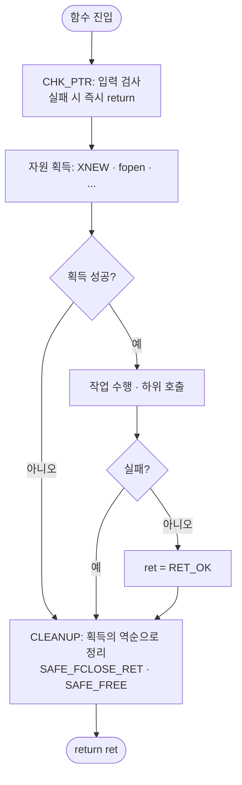

# 종합본 — 안전한 C 코딩 체크리스트와 방어 매크로

> [!NOTE]
> 실습 노트(문자열·동적 메모리·파일 I/O·환경변수·시그널·에러 처리·API 설계·동시성·바이트 순서·컴파일러 경고)에서 반복해서 나온 **사고 패턴**을 한곳에 모으고, 이를 막는 **규칙과 방어 매크로**로 연결한 종합본이다. 교육 내용이 추가될 때마다 §2 표와 §5 체크리스트에 행을 더하는 방식으로 갱신한다.

> [!TIP]
> **📂 템플릿 원본 — [템플릿 체화 드릴 저장소 `c-playgound`](https://github.com/sweetpark/c-playgound)의 `common/`**
> 이 종합본의 매크로는 모두 아래 헤더를 기준으로 한다. 드릴(D0)에서 이 헤더들을 반복해서 치고, 바뀐 점은 여기 §3에 반영한다.
> - [`common.h`](https://github.com/sweetpark/c-playgound/blob/main/common/common.h) — `ret_t` 리턴코드, `ret_str()`, `ARRAY_SIZE`, `UNUSED`
> - [`log.h`](https://github.com/sweetpark/c-playgound/blob/main/common/log.h) — `LOG_ERR/WRN/INF/DBG`, `LOG_ERRNO`
> - [`guard.h`](https://github.com/sweetpark/c-playgound/blob/main/common/guard.h) — `CHK_*` 가드 매크로
> - [`safe.h`](https://github.com/sweetpark/c-playgound/blob/main/common/safe.h) — `SAFE_*` 정리 매크로
> - [`mem.h`](https://github.com/sweetpark/c-playgound/blob/main/common/mem.h) — `XNEW`, `XNEWN`, `XREALLOC`, `MUL_OVERFLOW`
> - [`strx.h`](https://github.com/sweetpark/c-playgound/blob/main/common/strx.h) — `str_copy`, `str_chomp`
> - 사용 예: [`d0_warmup/main.c`](https://github.com/sweetpark/c-playgound/blob/main/d0_warmup/main.c) (`take_ptr`, `take_res`)
> - 드릴 스펙: T0. 워밍업 — 규약 백지 쓰기와 빌드 스텁 · 규약 원본: 3. 네이밍·에러·로그·자원해제 규약 · [템플릿 체화 드릴 (블로그)](https://sweetpark.github.io/개발-(cs)/언어/c언어/실습/템플릿-체화-드릴/템플릿-체화-드릴-목록)

## 📌 한 페이지 요약

C에서 사고가 나는 지점은 결국 네 가지다.

1. **경계** — 버퍼 크기, 널 문자, off-by-one, 정수 오버플로
2. **수명** — 할당·해제·닫기의 짝, 해제 후 사용, 이중 해제
3. **실패 처리** — 반환값을 안 보거나, 실패 경로에서 자원을 흘림
4. **동시성** — 공유 데이터를 서로 다른 락(또는 락 없이)으로 만지거나, 락을 잡는 순서·범위가 어긋남

| 원칙 | 한 줄 규칙 |
|---|---|
| 입력은 믿지 않는다 | 함수 진입부에서 NULL·범위·길이를 먼저 검사한다 |
| 쓰기 전에 검사한다 | 크기 검사는 쓰고 나서가 아니라 **쓰기 전에** |
| 크기 = 글자 수 + 1 | 널 문자 자리를 항상 포함한다 |
| 반환값은 전부 본다 | `malloc`·`fopen`·`fseek`·`fclose`·`rename` 모두 |
| 자원은 한 곳에서 풀어준다 | 획득 후에는 `goto CLEANUP` 단일 출구 |
| 풀면 NULL로 | `free`·`fclose` 직후 포인터를 NULL로 (`SAFE_*`) |
| 같은 데이터는 같은 락 | 접근하는 **모든 경로**가 같은 락을 잡고, 락은 잡은 함수가 푼다 |
| 락 순서를 고정한다 | 두 개 이상 잡을 땐 모든 스레드가 **같은 순서**로 (데드락 방지) |
| 부호 없는 수는 하기 전에 검사 | 뺄셈·증가는 언더플로/랩어라운드 **전에** 비교 |

---

## 1. 함수 작성의 기본 골격

자원을 **잡기 전**과 **잡은 후**에 쓰는 가드가 다르다.



```c
static int do_work(const char *path) {
    int ret = RET_FAIL;
    char *buf = NULL;
    FILE *fp = NULL;

    CHK_PTR(path);                       // ① 자원 획득 전: 즉시 return

    XNEW(buf);                           // calloc(1, sizeof(*buf)) + 실패 로그
    CHK_ALLOC_GOTO(buf, ret, CLEANUP);   // ② 획득 후: goto로 정리 구간으로 (NO_MEM)

    fp = fopen(path, "r");
    CHK_COND_GOTO(fp != NULL, RET_IO_ERROR, ret, CLEANUP);

    CHK_RET_GOTO(other_func(), ret, CLEANUP);   // ③ 하위 호출 실패도 전파
    ret = RET_OK;

CLEANUP:                                 // ④ 획득의 역순으로 정리
    SAFE_FCLOSE_RET(fp, ret);            // 닫고 NULL로. 쓰기 파일이면 fclose 실패도 ret에 반영
    SAFE_FREE(buf);
    return ret;
}
```

- 초기값을 모두 `NULL`로 잡아 두어야, 어느 단계에서 점프해 와도 `SAFE_*`가 안전하다.
- 가드 매크로는 **함수가 아니라 텍스트 치환**이라 `ret`을 포인터로 넘기지 않아도 지역변수가 바뀐다. 대신 `goto`는 다른 함수의 라벨로 못 가므로 함수로 만들 수 없다.

---

## 2. 사고 유형 → 원인 → 방어 (핵심 표)

> [!INFO]- 사고 유형 → 원인 → 방어 전체 표 펼치기
> - **문자열** · 널 문자 누락
>   - 원인: `strncpy`는 원본이 `n` 이상이면 `\0`을 안 붙임
>   - 방어 규칙 / 매크로: `str_copy()`(잘림 감지) 또는 `SAFE_CPY`
>   - 상세 노트: [문자열 8-01][str]
> - **문자열** · 버퍼 오버플로
>   - 원인: 쓰기 전 크기 검사 없음
>   - 방어 규칙 / 매크로: 크기 = 글자 수 + 1, 쓰기 **전** 검사
>   - 상세 노트: [문자열 8-05][str]
> - **문자열** · off-by-one
>   - 원인: 널 문자 자리를 크기에서 빼먹음
>   - 방어 규칙 / 매크로: 루프 상한에 `+1` 포함 여부를 명시
>   - 상세 노트: [문자열 8-05-a][str]
> - **문자열** · 리터럴 수정
>   - 원인: 리터럴은 읽기 전용 영역
>   - 방어 규칙 / 매크로: `const char *`로 받고 필요 시 배열로 복사
>   - 상세 노트: [문자열 8-03][str]
> - **문자열** · 무제한 입력
>   - 원인: `getchar` 루프에 상한 없음
>   - 방어 규칙 / 매크로: `fgets` 또는 버퍼 끝 검사
>   - 상세 노트: [문자열 8-05-b][str]
> - **문자열** · 루프 속 `strlen(dst)`
>   - 원인: 변하는 값을 조건에 사용
>   - 방어 규칙 / 매크로: 루프 전에 길이를 변수로 고정
>   - 상세 노트: [문자열 §5][str]
> - **메모리** · double free
>   - 원인: 해제 책임자가 둘
>   - 방어 규칙 / 매크로: 책임자 1곳, `SAFE_FREE`
>   - 상세 노트: [메모리 9-01][mem]
> - **메모리** · 해제 후 참조
>   - 원인: `free(p)` 뒤에 `p->next` 사용
>   - 방어 규칙 / 매크로: 다음 노드를 **먼저** 저장
>   - 상세 노트: [메모리 9-08][mem]
> - **메모리** · 누수
>   - 원인: 에러 경로마다 해제가 흩어짐
>   - 방어 규칙 / 매크로: `goto CLEANUP` 단일 출구
>   - 상세 노트: [메모리 9-07][mem], [9-09][mem]
> - **메모리** · 잘못된 크기 할당
>   - 원인: `sizeof(포인터)`, 다른 타입 크기
>   - 방어 규칙 / 매크로: `malloc(sizeof(*p))`
>   - 상세 노트: [메모리 9-03][mem], [9-11][mem]
> - **메모리** · 곱셈 오버플로
>   - 원인: `calloc(n, size)`·`n*size`
>   - 방어 규칙 / 매크로: `XNEWN`(내부에서 `MUL_OVERFLOW` 검사)
>   - 상세 노트: [메모리 9-05][mem]
> - **메모리** · 미초기화 읽기
>   - 원인: `malloc`은 초기화 안 함
>   - 방어 규칙 / 매크로: `calloc` / `memset`, 읽는 크기 ≤ 할당 크기
>   - 상세 노트: [메모리 9-06][mem]
> - **메모리** · `realloc` 실패 시 원본 손실
>   - 원인: 반환값을 원래 포인터에 바로 대입
>   - 방어 규칙 / 매크로: `XREALLOC`(임시 포인터로 받아 확인 후 대입)
>   - 상세 노트: [메모리 §5][mem]
> - **메모리** · 유연 배열 구조체 복사
>   - 원인: 대입은 헤더만 복사, 스택 선언·값 전달 불가
>   - 방어 규칙 / 매크로: `memcpy` 전체 크기, 포인터로 전달
>   - 상세 노트: [메모리 9-10][mem]
> - **파일** · 기존 파일 덮어쓰기 / 경쟁 상태
>   - 원인: 존재 확인 후 열기 (TOCTOU)
>   - 방어 규칙 / 매크로: `"wx"` / `O_EXCL`
>   - 상세 노트: [파일 10-01][fio]
> - **파일** · `fseek`·`fclose` 실패 무시
>   - 원인: 반환값 미검사, `rewind`는 성공 여부 불명
>   - 방어 규칙 / 매크로: 반환값 검사, 쓰기 파일은 `SAFE_FCLOSE_RET`
>   - 상세 노트: [파일 10-03][fio], [§5-3][fio]
> - **파일** · 개행 제거 오류
>   - 원인: `buf[strlen-1]='\0'` 가정
>   - 방어 규칙 / 매크로: `str_chomp()` (`strcspn` 방식)
>   - 상세 노트: [파일 10-04][fio]
> - **파일** · 저장 중 손상
>   - 원인: 원본에 바로 덮어씀
>   - 방어 규칙 / 매크로: 임시파일 → `fsync` → `rename`
>   - 상세 노트: [파일 §5-2][fio]
> - **파일** · fd 누수·이중 close
>   - 원인: 에러 경로 정리 누락, `fdopen` 뒤 `close` 중복
>   - 방어 규칙 / 매크로: `SAFE_CLOSE` / `SAFE_FCLOSE`, `fdopen` 후엔 `fclose`만
>   - 상세 노트: [파일 §5-3][fio]
> - **파일** · `open` 접근 모드 누락, 실패 검사 오류
>   - 원인: `O_CREAT|O_EXCL`만 주면 `O_RDONLY`로 열려 `fdopen("w")`이 NULL, `open`은 실패 시 **-1**인데 `== 0`으로 검사
>   - 방어 규칙 / 매크로: `O_WRONLY` 등 명시, `fd < 0` / `fdopen == NULL` 검사 후 `close(fd)`
>   - 상세 노트: [환경·시그널 §2][env], [§5][env]
> - **환경변수** · 고정 배열에 `getenv` 값 복사
>   - 원인: 외부 값의 길이를 가정
>   - 방어 규칙 / 매크로: 길이 검사 후 `snprintf`, 또는 `strlen+1` 만큼 `malloc`, NULL 검사
>   - 상세 노트: [환경·시그널 11-01][env]
> - **환경변수** · `getenv` 반환 문자열 수정
>   - 원인: 환경 영역을 직접 바꿈
>   - 방어 규칙 / 매크로: `strdup` 복사본에서 수정
>   - 상세 노트: [환경·시그널 11-02][env]
> - **환경변수** · `strtok`으로 `a::b` 분리
>   - 원인: 연속 구분자를 건너뛰어 **빈 항목 소실**
>   - 방어 규칙 / 매크로: `strchr`/`strsep`로 직접 분리, 항목 수 = 구분자 수 **+ 1**
>   - 상세 노트: [환경·시그널 §3][env]
> - **종료** · `atexit` 핸들러·버퍼 정리 누락
>   - 원인: `_Exit()`/`abort()` 사용(`atexit` 건너뜀, stdio flush는 구현 의존: glibc 2.17은 `abort`만 flush), 핸들러 안 `exit()`는 정의되지 않은 동작
>   - 방어 규칙 / 매크로: `return`/`exit`로 종료, 정리는 `atexit`(등록의 **역순** 실행)
>   - 상세 노트: [환경·시그널 11-03][env], [에러·API 13-03][err]
> - **시그널** · 핸들러 안 `printf`/`free`, 공유 객체 접근
>   - 원인: async-signal-safe 아님(C 표준은 `abort`·`_Exit`·`quick_exit`·`signal`만 보장), 락 교착, 해제된 메모리 접근
>   - 방어 규칙 / 매크로: 핸들러는 `volatile sig_atomic_t` flag만, 처리는 main (로그가 필요하면 `write`)
>   - 상세 노트: [환경·시그널 12-03, 12-04][env]
> - **시그널** · 시그널 유실·중첩, `signal()` 이식성
>   - 원인: 시점에 따라 무시, 구현마다 핸들러 유지 여부가 다름, 핸들러 안 재등록은 기본 동작 구간이 생김
>   - 방어 규칙 / 매크로: `sigaction` + `sigprocmask` (1회용이면 `SA_RESETHAND`)
>   - 상세 노트: [환경·시그널 12-01, 12-02][env]
> - **시그널** · `sleep`이 시그널에 깨어나 카운터가 빨라짐, 대기 직전 시그널 지연
>   - 원인: `sleep`/`nanosleep`은 `EINTR`로 일찍 반환
>   - 방어 규칙 / 매크로: 절대 시각 + `pselect`(마스크 해제와 대기를 한 번에), `nanosleep`은 남은 시간으로 재대기
>   - 상세 노트: [환경·시그널 §6][env]
> - **에러** · in-band 에러 지시자
>   - 원인: `sprintf`의 반환값이 길이이자 에러
>   - 방어 규칙 / 매크로: 에러는 반환값, 값은 인자 (`snprintf_m`), `vsnprintf`로 `va_list` 전달
>   - 상세 노트: [에러·API 13-02, §3][err]
> - **에러** · `atoi`가 에러를 숨김
>   - 원인: `abc`도 0
>   - 방어 규칙 / 매크로: `strtol` + `endptr` + `ERANGE` (`my_atoi`), `int`로 줄이기 전에 범위 검사
>   - 상세 노트: [에러·API 13-05, §2][err]
> - **에러** · 합산 오버플로
>   - 원인: 더한 **뒤** 검사
>   - 방어 규칙 / 매크로: 더하기 **전에** `total > LONG_MAX - num`
>   - 상세 노트: [에러·API §4][err]
> - **에러** · `errno` 오용
>   - 원인: 초기화 누락, 중간에 덮어쓰임, `=` 오타, `errno != 0`로 실패 판단
>   - 방어 규칙 / 매크로: **[errno 사용 규칙][errno]** (0 초기화·저장·검사·설정)
>   - 상세 노트: [errno][errno], [에러·API 13-01, 13-06][err]
> - **API** · 크기 없는 버퍼 인자, off-by-one
>   - 원인: 받는 쪽 크기를 모름, `dstend = dst + size`에 널 문자 쓰기
>   - 방어 규칙 / 매크로: `size_t dst_size` 인자, `dstend = dst + size - 1`
>   - 상세 노트: [에러·API 14-02][err]
> - **API** · 배열 인자의 크기 표현
>   - 원인: 포인터는 크기를 모름
>   - 방어 규칙 / 매크로: conformant `size_t n, char p[n]` (+ NULL·크기 검사)
>   - 상세 노트: [에러·API 14-03, §6][err]
> - **API** · 인자·읽기 종료 이유
>   - 원인: 진입부 검사 없음, `fgets` 종료 이유 구분 안 함
>   - 방어 규칙 / 매크로: 선제적 인자 검사, `ferror`/`feof`
>   - 상세 노트: [에러·API 14-01][err]
> - **API** · non-blocking 재시도
>   - 원인: `EAGAIN`에 대기 없이 재시도, partial write
>   - 방어 규칙 / 매크로: 재시도 간격(`select`/`poll`), `write_len` 누적
>   - 상세 노트: [에러·API 14-04][err]
> - **동시성** · 일부 경로에만 락 (`credit`에 락 없음), 락 안에서 읽기/토글 분리
>   - 원인: 같은 공유 변수를 어떤 함수는 락 없이 접근, "토글 → 읽기" 사이에 다른 스레드 끼어듦
>   - 방어 규칙 / 매크로: 접근하는 **모든 경로**가 같은 락, 관련 단계는 하나의 임계구역 (토글 함수가 새 값을 같이 반환)
>   - 상세 노트: [동시성 15-01, 15-05][conc]
> - **동시성** · 락 이중 해제, `return` 뒤 `unlock`, 에러 경로 `unlock` 누락
>   - 원인: 호출한 함수와 호출된 함수가 둘 다 `unlock`, 반환 뒤 코드는 실행 안 됨, 락 둘 중 하나만 풀고 `goto`
>   - 방어 규칙 / 매크로: **잡은 함수가 푼다**, `rc`에 결과를 담고 `unlock`은 한 곳, 개발 중엔 `ERRORCHECK`(잘못된 `unlock`이 `EPERM`)
>   - 상세 노트: [동시성 15-02, 15-05, §2, §6-3][conc]
> - **동시성** · 락 범위 오류
>   - 원인: 너무 좁음(관련 함수 3개가 각자 락 → 합과 곱이 다른 입력 기준, 455/3000 불일치), 너무 넓음(락 안 I/O → 성능 저하)
>   - 방어 규칙 / 매크로: 논리적 한 단위로 묶고 안쪽 락은 제거, I/O·`sleep`은 락 밖
>   - 상세 노트: [동시성 15-04, 15-06][conc]
> - **동시성** · 데드락 (락 획득 순서)
>   - 원인: 1→2 이체와 2→1 이체가 반대 순서로 락, 자기 자신 이체(같은 락 두 번)
>   - 방어 규칙 / 매크로: 항상 **id 작은 쪽부터** 획득, 같은 계좌는 제외. 원인은 획득 순서이고 해제 역순은 관례
>   - 상세 노트: [동시성 15-11, §6, §8][conc]
> - **동시성** · 조건변수
>   - 원인: `if`로 검사, `signal`로 하나만 깨움 → 가끔 영원히 대기(300회 중 1회)
>   - 방어 규칙 / 매크로: `while` + `broadcast`, 상태 변경은 같은 뮤텍스 안에서
>   - 상세 노트: [동시성 15-12, §5][conc]
> - **동시성** · 스레드 수명
>   - 원인: `join` 누락(출력 0줄), `detach` 후 `join`, 지역변수 주소를 넘김(값 깨짐)
>   - 방어 규칙 / 매크로: 한 스레드에 `join`/`detach` 중 하나, 힙에 복사해 넘기고 해제 책임자 지정, `destroy`는 `join` 뒤
>   - 상세 노트: [동시성 15-03, 15-10, 15-13, §3][conc]
> - **동시성** · 취소·시그널로 종료
>   - 원인: `PTHREAD_CANCEL_ASYNCHRONOUS` + 락(100회 중 44회 정지), 핸들러 없는 `pthread_kill` → 프로세스 종료, 핸들러에서 `close_q`(락)
>   - 방어 규칙 / 매크로: **종료 flag**(atomic), 시그널은 `sigwait` 전용 스레드에서 처리 (`pthread_sigmask`는 스레드 생성 **전**)
>   - 상세 노트: [동시성 15-14, 15-15, §7-4][conc]
> - **동시성** · 스레드 안전하지 않은 함수
>   - 원인: `strtok`·`rand`·`srand`·`localtime`은 내부 정적 상태 공유
>   - 방어 규칙 / 매크로: `strtok_r`·`rand_r`·`localtime_r`
>   - 상세 노트: [동시성 15-09, §4][conc]
> - **동시성** · 종료 신호·큐
>   - 원인: 센티널이 큐가 가득 차면 유실, 폴링 대기
>   - 방어 규칙 / 매크로: `close` 플래그 + `broadcast`, 남은 데이터는 drain, 대기는 `cond_wait`
>   - 상세 노트: [동시성 15-00, §7][conc]
> - **정수** · 부호 없는 수의 랩어라운드·언더플로
>   - 원인: `i <= SIZE_MAX`는 항상 참, `len - HDR_LEN`이 `len < HDR_LEN`일 때 거대한 값, `body_len < 0`은 항상 거짓
>   - 방어 규칙 / 매크로: 증가·뺄셈 **전에** 비교 (`SIZE_MAX - i < step`, `len < HDR_LEN`)
>   - 상세 노트: [바이트·경고 16-04, §4][msc]
> - **동시성** · 뮤텍스 종류·수명
>   - 원인: `NORMAL`/`DEFAULT`의 잘못된 `unlock`은 표준상 정의되지 않은 동작(glibc는 조용히 성공), 객체 생성·삭제마다 `init`/`destroy`하면 삭제 후 다른 스레드가 접근
>   - 방어 규칙 / 매크로: `ERRORCHECK`/`RECURSIVE` 명시, 뮤텍스 수명 > 모든 사용자 스레드, 신호를 보낸 뒤 넘긴 객체 접근 금지
>   - 상세 노트: [동시성 §2, §5][conc]
> - **동시성** · `pthread_cancel`로 종료
>   - 원인: async 취소는 락 중간에 끊김, deferred라도 루프에 취소 지점이 없으면 취소가 안 먹음(`join` 무한 대기)
>   - 방어 규칙 / 매크로: 종료 flag, 또는 deferred + `pthread_testcancel()`
>   - 상세 노트: [동시성 §3-4][conc]
> - **정수** · `sizeof(배열)`을 원소 수로 사용
>   - 원인: 바이트 수(12)를 길이(3)로 넘김 → 범위 밖 읽기
>   - 방어 규칙 / 매크로: `sizeof(a) / sizeof(a[0])`
>   - 상세 노트: [바이트·경고 16-05][msc]
> - **컴파일러** · 최적화가 "의도한 코드"를 지움
>   - 원인: 읽는 곳이 없는 `memset` 등 dead store는 `-O2`에서 제거됨 (gcc 4.8.5 확인: `-O0` 호출 1개, `-O2` 0개)
>   - 방어 규칙 / 매크로: `explicit_bzero`·`memset_s`·`volatile` 쓰기, 릴리스 옵션(`-O2`)으로도 시험
>   - 상세 노트: [바이트·경고 16-00][msc]
> - **정수** · 루프 종료 조건에 `==`/`!=`
>   - 원인: `i != 10`(2씩 증가)·`begin > end`는 무한 루프
>   - 방어 규칙 / 매크로: 관계 연산자 `<`, `<=`
>   - 상세 노트: [바이트·경고 16-04][msc]
> - **컴파일러** · `switch`의 `default`·`return` 누락
>   - 원인: `default`가 없으면 범위 밖 값에서 반환 없이 끝남, 있으면 누락된 `enum` case를 `-Wall`이 못 잡음
>   - 방어 규칙 / 매크로: 모든 case 나열 + `-Wswitch-enum`, 모든 경로 `return`
>   - 상세 노트: [바이트·경고 16-01, §4][msc]
> - **직렬화** · 구조체 통째 `memcpy`
>   - 원인: 호스트 엔디안과 패딩이 와이어 포맷에 새어 나옴
>   - 방어 규칙 / 매크로: **필드 단위**로 시프트 변환 (`put_be*`/`get_be*`), 실패 시 출력 불변, 외부 입력은 version·type·길이 검증
>   - 상세 노트: [바이트·경고 §3][msc]
> - **직렬화** · 시프트·우선순위 실수
>   - 원인: `n & 0xFF << 56`은 시프트가 먼저, 변환 없이 네트워크 값 사용
>   - 방어 규칙 / 매크로: `(n & 마스크) << k`, `ntohl`/`get_be32`로 변환 후 사용
>   - 상세 노트: [바이트·경고 §2][msc]
> - **공통** · 반환값 무시
>   - 원인: 실패를 모르고 진행
>   - 방어 규칙 / 매크로: `CHK_RET` / `CHK_RET_GOTO`로 전파
>   - 상세 노트: [문자열][str] · [메모리][mem] · [파일][fio] · [에러·API][err]

---

## 3. 매크로 레퍼런스

### 3-1. 가드 매크로 (`guard.h`)

> [!INFO]- 가드 매크로 표 펼치기
> 원본: [`guard.h`](https://github.com/sweetpark/c-playgound/blob/main/common/guard.h)
>
> | 매크로 | 용도 | 동작 |
> |---|---|---|
> | `CHK_PTR(p)` | 인자 NULL 검사 | NULL이면 로그 + `return RET_INVALID_ARG` |
> | `CHK_ALLOC(p)` | 할당 결과 검사 | NULL이면 로그 + `return RET_NO_MEM` |
> | `CHK_RANGE(v,min,max)` | 범위 검사 | 벗어나면 로그 + `return RET_INVALID_ARG` |
> | `CHK_STR(s)` | NULL 또는 빈 문자열 | 로그 + `return RET_INVALID_ARG` |
> | `CHK_RET(expr)` | 하위 호출 실패 전파 | `RET_OK`가 아니면 로그 + 그 값을 `return` |
> | `CHK_PTR_GOTO(p,rv,label)` | 획득 후 NULL 검사 | `rv = RET_INVALID_ARG` 후 `goto label` |
> | `CHK_ALLOC_GOTO(p,rv,label)` | 획득 후 할당 검사 | `rv = RET_NO_MEM` 후 `goto label` |
> | `CHK_RANGE_GOTO(v,min,max,rv,label)` | 획득 후 범위 검사 | `rv = RET_INVALID_ARG` 후 `goto label` |
> | `CHK_STR_GOTO(s,rv,label)` | 획득 후 빈 문자열 검사 | `rv = RET_INVALID_ARG` 후 `goto label` |
> | `CHK_RET_GOTO(expr,rv,label)` | 획득 후 하위 호출 검사 | `rv = expr`, 실패면 `goto label` |
> | `CHK_COND_GOTO(cond,code,rv,label)` | 임의 조건 검사 | 거짓이면 `rv = code` 후 `goto label` |
>
> - `_rv`에는 **대입 가능한 변수**만 넘긴다. 값이나 함수 호출은 컴파일 에러.
> - `CHK_*` 계열은 로그에 `#_expr`, `__func__`, `__LINE__`을 찍어 **어디서 실패했는지** 바로 보인다.
> - `guard.h`는 `safe.h`를 함께 include하므로 `#include "guard.h"` 하나로 `CHK_*`와 `SAFE_*`를 모두 쓴다.
> - 할당 실패는 `CHK_PTR*`(INVALID_ARG)가 아니라 `CHK_ALLOC*`(NO_MEM)로 구분한다.

### 3-2. 정리 매크로 (`safe.h`)

> [!INFO]- 정리 매크로 표 펼치기
> 원본: [`safe.h`](https://github.com/sweetpark/c-playgound/blob/main/common/safe.h)
>
> | 매크로 | 동작 |
> |---|---|
> | `SAFE_FREE(p)` | NULL이 아니면 `free` 후 `p = NULL` |
> | `SAFE_FCLOSE(fp)` | NULL이 아니면 `fclose` 후 `fp = NULL` |
> | `SAFE_FCLOSE_RET(fp,rv)` | 위와 같고, `fclose` 실패 시 `rv = RET_IO_ERROR` (이미 실패한 `rv`는 보존). **쓰기 파일용** |
> | `SAFE_CLOSE(fd)` | `fd >= 0`이면 `close` 후 `fd = -1` (초기값을 `-1`로 잡을 것) |
> | `SAFE_CPY(dst,src)` | `snprintf(dst, sizeof(dst), "%s", src ? src : "")`. `dst`가 포인터면 **컴파일 에러** |
> | `IS_ARRAY(a)` | 배열이면 1, 포인터면 0 (`SAFE_CPY`가 내부에서 사용) |

### 3-3. 메모리·문자열 보조 헤더

> [!INFO]- 메모리·문자열 보조 헤더 표 펼치기
> 원본: [`mem.h`](https://github.com/sweetpark/c-playgound/blob/main/common/mem.h) · [`strx.h`](https://github.com/sweetpark/c-playgound/blob/main/common/strx.h)
>
> | 항목 | 용도 | 동작 |
> |---|---|---|
> | `XNEW(p)` | 객체 1개 할당 | `p = calloc(1, sizeof(*p))` — 타입 크기 실수 방지, 0 초기화, 실패 시 로그 |
> | `XNEWN(p,n)` | 배열 할당 | `MUL_OVERFLOW` 검사 후 `calloc(n, sizeof(*p))`. 오버플로면 `p = NULL` |
> | `XREALLOC(p,sz,rv)` | 크기 변경 | 임시 포인터로 받아 성공 시에만 `p` 갱신, 실패해도 원본 유지 (`rv = RET_NO_MEM`) |
> | `MUL_OVERFLOW(a,b)` | 곱셈 오버플로 | `size_t` 기준 `a * b`가 넘치면 참 |
> | `str_copy(dst,sz,src)` | 안전 복사 | 항상 널 종료. 잘리면 `RET_TOO_SMALL` (잘린 결과는 남음) |
> | `str_chomp(s)` | 개행 제거 | `s[strcspn(s,"\r\n")] = '\0'` |
>
> ```c
> XNEW(buf);
> CHK_ALLOC_GOTO(buf, ret, CLEANUP);   // 할당 실패는 NO_MEM
> ```

### 3-4. 매크로 사용 시 함정

> [!INFO]- 사용 시 함정 펼치기
> | 함정 | 설명 | 대처 |
> |---|---|---|
> | 인자 이중 평가 | `SAFE_FREE(p++)`처럼 부작용이 있는 식을 넘기면 여러 번 실행됨 (`MUL_OVERFLOW`의 인자도 두 번 평가) | 매크로 인자에는 **단순 변수만** |
> | `SAFE_CPY`의 `sizeof(_dst)` | 포인터면 `sizeof`가 8이 되어 조용히 잘림 | **해결됨**: 포인터를 넘기면 컴파일 에러. 잘림 여부가 필요하면 `str_copy()` |
> | 컴파일러의 잘림 경고 | 리터럴이 `dst`보다 긴 게 확실하면 `-Werror=format-truncation`이 `SAFE_CPY`에서 터짐 | 정상 동작. 크기를 키우거나 `str_copy()`로 잘림을 처리 |
> | `fclose` 반환값 | `SAFE_FCLOSE`는 반환값을 버림 | 쓰기 파일은 `SAFE_FCLOSE_RET` ([파일 §5-3][fio]) |
> | `realloc` 실패 | 반환값을 원래 포인터에 바로 대입하면 원본 유실 | `XREALLOC` |
> | 할당 실패의 에러코드 | `CHK_PTR*`는 `INVALID_ARG`라 원인이 섞임 | `CHK_ALLOC*`(`NO_MEM`) |
> | `errno` 덮어쓰기 | 로그 함수 안의 `time`/`localtime_r`이 `errno`를 바꿀 수 있음 | `LOG_ERRNO`는 먼저 저장한 뒤 출력 |
> | 컴파일 옵션 | `-std=c11`만 쓰면 `localtime_r`이 선언되지 않음 | `-D_POSIX_C_SOURCE=200809L` (루트 `Makefile`에 반영) |
> | 이식성 | `IS_ARRAY`의 `__builtin_types_compatible_p`·`__typeof__`는 GCC/Clang 전용 | MSVC에서는 쓸 수 없음 (WSL/macOS 기준) |
> | 단일 출구 vs 가독성 | 가드가 많으면 로그가 중복될 수 있음 | 하위 함수가 이미 로그를 남기면 상위는 전파만 |

### 3-5. 매크로 vs 함수

> [!INFO]- 매크로 vs 함수 펼치기
> - `goto`/`return`을 **호출한 함수 안에서** 실행해야 하면 매크로 (`CHK_*`, `SAFE_*`).
> - 값을 계산해서 돌려주면 되는 일은 `static inline` 함수 (`str_copy`, `str_chomp`). 타입 검사가 되고 디버깅이 쉽다.
> - `malloc` 자체를 감싸는 `#define MALLOC`류는 **크기 계산 실수 방지 + 위치 로그**를 한 번에 줄 때만 이득이다. 그래서 `XNEW`/`XNEWN`처럼 `sizeof(*p)`를 강제하는 형태로 만든다.

---
## 4. 매크로로 못 막는 것 — 규칙으로 기억할 것

> [!INFO]- 규칙으로 기억할 것 펼치기
> | 항목 | 이유 | 규칙 |
> |---|---|---|
> | 경계 계산 실수 | 매크로는 크기를 대신 계산해 주지 않음 | 크기 = 글자 수 + 1, 쓰기 전 검사 |
> | 정수 오버플로·부호 | `int`↔`size_t` 변환, `size_t` 뺄셈 언더플로 | 크기는 `size_t`, 뺄셈 전에 대소 비교 |
> | 포인터 산술 | 범위를 벗어나도 컴파일은 통과 | 인덱스 상한을 항상 같이 들고 다닌다 |
> | TOCTOU | 확인과 사용 사이에 상태가 바뀜 | 확인 후 열기 대신 원자적 플래그 (`O_EXCL`) |
> | 논리적 해제 책임 | 누가 free할지는 설계 문제 | 할당한 쪽이 해제, 문서화 |
> | 로그에 민감정보 | `LOG_*`가 인자를 그대로 출력 | 비밀번호·키는 로그에 남기지 않는다 |
> | 시그널 타이밍(race) | flag 확인과 대기 시작 사이에 오는 시그널은 매크로로 못 막음 | 평소엔 `sigprocmask`로 block, 대기 구간에서만 `pselect`로 해제 |
> | 시그널 동시 도착 | 같은 번호의 시그널은 대기 중이면 **한 번으로 합쳐짐** | 횟수가 중요하면 flag가 아니라 별도 큐/카운터 설계 |
> | `errno` 보존 | 로그·`free`·`close`가 값을 덮음 | 실패 직후 `saved = errno` ([errno 규칙][errno]) |
> | 영역 겹침 | `memcpy`는 `dest`/`src`가 겹치면 미정의 동작 | 겹침 검사(`overlap`) 또는 `memmove` |
> | 락 범위·소유권 | 어디까지가 하나의 논리 단위인지, 누가 풀지는 설계 | 관련 단계를 한 임계구역으로, "락을 잡고 호출해야 함"을 주석·`static`으로 표시 |
> | 락 획득 순서 | 매크로는 순서를 강제하지 못함 | 스레드 전체에서 **같은 순서**(예: id 오름차순), 같은 락을 두 번 잡지 않기 |
> | 레이스는 테스트로 증명 안 됨 | 반복 실행에서 한 번 통과한 것은 레이스가 없다는 뜻이 아님 | 락을 뺀 **변이 버전이 실제로 실패**하는 검증 기준을 먼저 만들고, 가능하면 TSan/helgrind로 한 번 더 |
> | 종료 flag 가시성 | 일반 `int`는 컴파일러가 레지스터에 캐싱 | `__atomic_load_n`/`__atomic_store_n` (또는 C11 `atomic`) |
>
> 가능하면 매크로보다 **`static inline` 함수**가 낫다. 타입 검사가 되고 디버깅이 쉽다. 매크로를 쓰는 이유는 `goto`/`return`을 호출 함수 안에서 실행해야 할 때뿐이다.

---

## 5. 통합 점검 체크리스트

### 입력·인자

> [!INFO]- 체크리스트 펼치기
> - [ ] 포인터 인자 NULL 검사 (`CHK_PTR`)
> - [ ] 숫자 인자 범위 검사 (`CHK_RANGE`), 크기는 `size_t`
> - [ ] 읽기 전용 인자에 `const`

### 문자열

> [!INFO]- 체크리스트 펼치기
> - [ ] 버퍼 크기 = 글자 수 + 1, 쓰기 **전** 검사
> - [ ] `strncpy` 뒤 널 종료 보장 (또는 `snprintf`)
> - [ ] 루프 조건에 변하는 값(`strlen(dst)`)을 넣지 않았는가
> - [ ] 리터럴 수정 금지, 입력 루프에 길이 상한

### 메모리

> [!INFO]- 체크리스트 펼치기
> - [ ] `malloc(sizeof(*p))`, 곱셈 오버플로 검사
> - [ ] 모든 할당 반환값 NULL 검사
> - [ ] `realloc`은 임시 포인터, 호출자 포인터 갱신은 이중 포인터
> - [ ] 해제는 **한 번만**, 해제 후 NULL (`SAFE_FREE`)
> - [ ] 해제한 포인터의 멤버를 읽지 않는가

### 파일

> [!INFO]- 체크리스트 펼치기
> - [ ] 열기 조건이 의도와 맞는가 (`"wx"` / `O_EXCL`)
> - [ ] `fseek`·`fwrite`·`fflush`·`fclose`·`rename` 반환값 검사
> - [ ] 읽기 루프는 `fgets`/`fgetc` 반환값으로 판단 (`feof` 루프 금지)
> - [ ] 중요한 저장은 임시파일 → `fsync` → `rename`
> - [ ] `fdopen` 이후엔 `fclose`만, `close` 중복 금지

### 환경변수·시그널

> [!INFO]- 체크리스트 펼치기
> - [ ] `getenv` 값은 NULL·길이 검사 후 **복사본**으로 쓰고 직접 수정하지 않는다
> - [ ] 구분자로 쪼갤 때 빈 항목이 의미 있으면 `strtok` 대신 `strchr`/`strsep`, 항목 수 = 구분자 + 1
> - [ ] `open`에 접근 모드를 줬고 `open`은 `< 0`, `fdopen`은 `NULL`을 검사하는가
> - [ ] 종료는 `return`/`exit` (`_Exit`·`abort`는 `atexit`를 건너뛰고 stdio flush는 구현마다 다름, 핸들러 안에서 `exit()` 금지)
> - [ ] `signal()` 대신 `sigaction`, 핸들러는 `volatile sig_atomic_t` flag만
> - [ ] 시그널은 평소 block, 대기는 `pselect`/절대 시각, 깨어나면 남은 시간만 다시 대기
> - [ ] 설정 값은 `strtol`로 검증하고, 실패하면 에러를 출력하되 기존 값을 유지

### 에러 처리·API

> [!INFO]- 체크리스트 펼치기
> - [ ] 에러는 반환값으로, 값은 인자로 (in-band 지시자 금지)
> - [ ] 문자열→숫자는 `strtol` + `endptr` + `ERANGE`, 합산은 **하기 전에** 한계 검사
> - [ ] 모든 경로에서 `return`하고, 실패하면 출력 인자(`*out`, `*sum`)를 바꾸지 않는다
> - [ ] 라이브러리 함수는 메시지를 출력하지 않는다 (코드로 알림)
> - [ ] 받는 쪽 버퍼 크기를 인자로 받고 널 문자 1바이트까지 계산, 크기는 배열 앞에 (conformant)
> - [ ] 가변 인자 함수는 `va_start(…, fmt)`, `vsnprintf`, 모든 경로 `va_end`
> - [ ] non-blocking 재시도에는 대기를 두고 partial write를 누적 처리

### 동시성·스레드

> [!INFO]- 체크리스트 펼치기
> - [ ] 같은 공유 변수에 접근하는 **모든 경로**(읽기 포함)가 같은 락을 쓰는가
> - [ ] 서로 관련된 단계(확인 → 변경, 토글 → 읽기, 함수 3개)는 하나의 임계구역으로 묶었는가
> - [ ] 락 안에서 I/O·`sleep`을 하지 않는가
> - [ ] 락은 **잡은 함수가 푸는가**, 모든 `return`·에러 경로에서 `unlock`하는가 (`rc`에 담고 한 곳에서 해제)
> - [ ] 락을 둘 이상 잡을 때 **획득 순서가 모든 스레드에서 같은가**, 같은 락을 두 번 잡지 않는가
> - [ ] `lock`·`unlock`·`destroy` 반환값을 `!= 0`으로 검사했고, 개발 중에는 `ERRORCHECK`로 확인했는가
> - [ ] 만든 스레드는 `join` 또는 `detach` **하나만**, `destroy`는 `join` 뒤, 스레드 인자는 스레드가 끝날 때까지 살아 있는가
> - [ ] 스레드를 종류별로 따로 세어서 생성 실패 시 만든 것만 `join`하는가
> - [ ] 종료는 `pthread_cancel`(async)이 아니라 **flag**(atomic)로, 시그널은 `sigwait` 전용 스레드에서 받는가
> - [ ] `cond_wait`는 `while`로 감싸고 `broadcast`로 깨우며, 종료는 `close` 플래그 + drain인가
> - [ ] `strtok`·`rand`·`localtime` 대신 `_r` 버전을 쓰는가
> - [ ] 락을 뺀 변이 버전이 **실제로 실패**하는 검증을 만들었는가 (반복 실행 + TSan 가능하면)

### 정수·직렬화·컴파일러 경고

> [!INFO]- 체크리스트 펼치기
> - [ ] 부호 없는 수의 뺄셈·증가는 **하기 전에** 비교 (`len < HDR_LEN`, `SIZE_MAX - i < step`)
> - [ ] 배열 원소 수는 `sizeof(a)/sizeof(a[0])`, `size_t`는 `%zu`, 64비트는 `PRIx64`
> - [ ] `enum` `switch`는 모든 case 나열 + `-Wswitch-enum`, 모든 경로에서 `return`
> - [ ] 네트워크로 보내는 정수는 **필드 단위**로 변환 (구조체 통째 `memcpy` 금지), `(n & 마스크) << k`처럼 괄호
> - [ ] 외부에서 받은 헤더는 version·type·길이를 검증하고, 실패하면 출력 구조체를 건드리지 않는가
> - [ ] 빌드는 `-Wall -Wextra`(`-Wall`이 전부가 아님), 새 경고는 억제하지 말고 코드로 해결 (dead code·쓰이지 않는 대입 제거). 남기는 경고는 **이유를 주석**으로
> - [ ] 루프 종료 조건은 `<`/`<=` 등 관계 연산자, `size_t` 최댓값과의 직접 비교 금지
> - [ ] "지우는" 코드(`memset` 등)가 `-O2`에서도 남는지 확인했는가 (`explicit_bzero` 등)

### 실패 처리

> [!INFO]- 체크리스트 펼치기
> - [ ] 자원 획득 후의 실패는 `goto CLEANUP`
> - [ ] 정리는 획득의 역순, 초기값은 모두 NULL / -1
> - [ ] `errno`는 실패 직후 저장 (상세: [errno 사용 규칙][errno])
> - [ ] 하위 함수 실패는 `CHK_RET*`로 전파, 로그에 위치가 남는가

---

## 6. 교육 일정별 추가 기록

> [!INFO]- 교육 일정별 기록 펼치기
> 새 교육 내용이 생기면 §2 표에 행을 추가하고 아래에 한 줄을 남긴다.
>
> - **2026-10-13** · 문자열·동적 메모리·파일 I/O
>   - 추가된 패턴: §2의 초기 항목 전체
>   - 노트: 아래 노트 링크
> - **2026-10-14** · 템플릿 헤더 보강 (`common/`)
>   - 추가된 패턴: `CHK_ALLOC*`, `CHK_RANGE_GOTO`, `CHK_STR_GOTO`, `SAFE_FCLOSE_RET`, `SAFE_CPY` 배열 검사, `LOG_ERRNO`, `mem.h`, `strx.h`
>   - 노트: [템플릿 원본](https://github.com/sweetpark/c-playgound/tree/main/common)
> - **2026-10-14** · 환경변수·시그널·에러 처리·API (`c_basic #2`, 11~14번 실습)
>   - 추가된 패턴: §2의 환경변수·종료·시그널·에러·API 행, §5의 해당 체크리스트
>   - 노트: [환경·시그널][env], [에러·API][err]
> - **2026-10-14** · errno 사용 규칙
>   - 추가된 패턴: 초기화·저장·검사·설정 6규칙
>   - 노트: [errno][errno]
> - **2026-10-15** · 동시성·스레드 (`c_basic #3`, 15번 실습 + 메시지 큐·이체 감시 과제)
>   - 추가된 패턴: §2의 동시성 행(락 경로·이중 해제·범위·획득 순서·조건변수·스레드 수명·취소/시그널·`_r` 함수·큐 종료), §4의 락 설계·변이 검증, §5의 동시성 체크리스트
>   - 노트: [동시성][conc]
> - **2026-10-15** · 컴파일러 경고·바이트 순서·헤더 직렬화 (`c_basic #3`, 16번 실습 + `byteorder.c`·`enc_dec`·TLV 리뷰)
>   - 추가된 패턴: §2의 정수·컴파일러·직렬화 행, §5의 정수·직렬화·경고 체크리스트
>   - 노트: [바이트·경고][msc]
> - **2026-10-15** · 교육자료(C어플리케이션 개발 Part2 v1.2)와 노트 대조
>   - 추가된 패턴: 정정: `abort()` 버퍼 flush·뮤텍스 종류의 표준/구현 구분·`detach` 재호출 결과·핸들러 `strcpy` 설명. 추가: 취소 지점(`testcancel`)·데드락 4조건·`cond_signal` 안전 조건·`signal()` 지속성(`SA_RESETHAND`)·errno 함수 분류·루프 종료 조건·최적화와 dead store·`clearerr`
>   - 노트: 각 노트
> - **(예정)** · 

### 교육자료 과제와 노트의 대응

> [!INFO]- 과제 대응 표 펼치기
> 교육자료 뒤쪽의 과제 목록을 이 노트들의 실습과 맞춰 본 표다. "구현함"은 해당 노트에 코드와 검증 결과가 있다는 뜻이다.
>
> | 과제 | 내용 | 상태 | 노트 |
> |---|---|---|---|
> | 8-6 | `make_filename`, `my_strncpy`, `my_strncat` | 구현함 | [문자열][str] |
> | 8-7 | `parse_kv`, `read_line` | **미구현** (요구사항 정리만) | [문자열][str] |
> | 9-12 | 문자열 append 라이브러리 (`realloc`) | 구현함 | [메모리][mem] |
> | 9-13 | 가변 길이 메시지 연결리스트 (유연 배열 노드 · `goto` 체인 · 이중 포인터 해제) | 연결리스트 구현함. 교육자료의 요구사항 항목별 대조는 하지 않음 | [메모리][mem] |
> | 10-5, 10-6 | 공백 제거 복사, 줄 번호 붙여 저장 | 구현함 | [파일][fio] |
> | 11-4, 11-5 | 환경변수 로거, `which` | 구현함 | [환경·시그널][env] |
> | 12-6, 12-7 | SIGTERM/SIGINT 카운터, 시그널로 운용하는 카운터 | 구현함 | [환경·시그널][env] |
> | 13-7, 13-8 | `snprintf_m`, `sum_file` | 구현함 | [에러·API][err] |
> | 14-5 | conformant 배열 `improved_strncpy/strncat` | 구현함 | [에러·API][err] |
> | 14-6 | TBCD ↔ 숫자 문자열 | **미구현** (요구사항 정리만) | [에러·API][err] |
> | 15-0, 15-16 | 스레드 안전 메시지 큐 + SIGINT 종료 | 큐·`sigwait` 종료는 구현함. 교육자료의 "producer가 SIGINT까지 계속 실행"은 **미반영**(고정 2회) | [동시성 §7][conc] |
> | 15-17 | 이체 + 감시 스레드 | 구현함 (`ERRORCHECK` 뮤텍스 적용 완료) | [동시성 §8][conc] |
> | 16-7, 16-8 | `htonll`/`ntohll`, 메시지 헤더 encode/decode | 구현함 | [바이트·경고][msc] |
> | 16-9 | TLV 파서 코드 리뷰 | 결함 목록 정리 (코드는 의도적으로 수정하지 않음) | [바이트·경고 §4][msc] |

## 노트 링크

- [(C) 문자열 함수 실습](개발%20%28CS%29/언어/C언어/실습/[C]%20문자열%20함수%20실습%20—%20strncpy·strncat%20직접%20구현과%20오버플로%20함정.md)
- [(C) 동적 메모리 실습](개발%20%28CS%29/언어/C언어/실습/[C]%20동적%20메모리%20실습%20—%20malloc·free%20오류%20패턴과%20유연%20배열%20구조체%20연결리스트.md)
- [(C) 파일 입출력 실습](개발%20%28CS%29/언어/C언어/실습/[C]%20파일%20입출력%20실습%20—%20fopen·open%20오류%20패턴과%20임시파일%20+%20rename%20안전%20저장.md)
- [(C) 환경변수·시그널 실습][env]
- [(C) 에러 처리·API 설계 실습][err]
- [(C) errno 사용 규칙][errno]
- [(C) 동시성·스레드 실습][conc]
- [(C) 바이트 순서·메시지 헤더·컴파일러 경고 실습][msc]
- 교육 정리 원본: c_basic #1 · c_basic #2 · c_basic #3

[str]: <[C] 문자열 함수 실습 — strncpy·strncat 직접 구현과 오버플로 함정.md>
[mem]: <[C] 동적 메모리 실습 — malloc·free 오류 패턴과 유연 배열 구조체 연결리스트.md>
[fio]: <[C] 파일 입출력 실습 — fopen·open 오류 패턴과 임시파일 + rename 안전 저장.md>
[env]: <[C] 환경변수·시그널 실습 — getenv 복사·atexit와 sigaction·pselect 시그널 카운터.md>
[err]: <[C] 에러 처리·API 설계 실습 — strtol my_atoi·snprintf_m·sum_file·conformant 배열.md>
[errno]: <[C] errno 사용 규칙 — 초기화·저장·검사·설정 패턴.md>
[conc]: <[C] 동시성·스레드 실습 — mutex 락 범위·데드락·조건변수와 메시지 큐·이체 감시 스레드.md>
[msc]: <[C] 바이트 순서·메시지 헤더·컴파일러 경고 실습 — htonll·enc_dec와 size_t·switch 함정.md>
