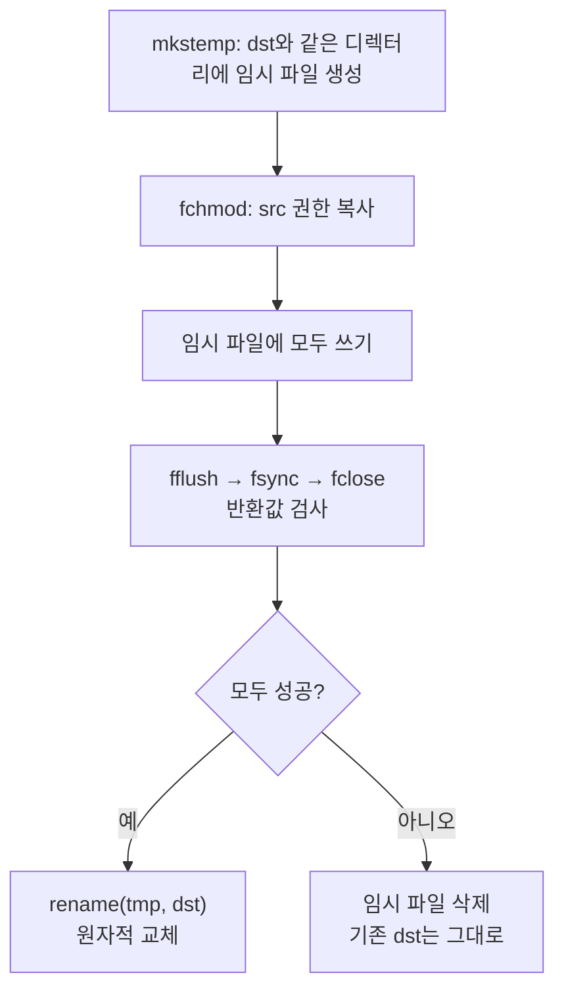

# 파일 입출력 — 열기·읽기·줄 끝 처리·안전 저장

> [!TIP]
> 원본 소스: [`fio/fio_ex.c`](https://github.com/sweetpark/c-playgound/blob/main/c_basic/fio/fio_ex.c) (안전 저장) · [`fio/fio_ex2.c`](https://github.com/sweetpark/c-playgound/blob/main/c_basic/fio/fio_ex2.c) (줄 번호) · [`lecture/fio/`](https://github.com/sweetpark/c-playgound/tree/main/c_basic/lecture/fio) (10-01 ~ 10-04)

---

## 📌 한눈에 보기 — 주의해야 할 점

| # | 주의 | 왜 | 처방 | 상세 |
|---|---|---|---|---|
| 1 | `"w"` 는 기존 파일을 **조용히 지운다** | 존재 확인 후 열기는 그 사이에 바뀜 (TOCTOU) | `"wx"` / `O_EXCL` 로 원자적으로 | [§1](#1-파일-열기) |
| 2 | `rewind` 는 실패를 알 수 없다 | 반환값이 없음 | `fseek(...) != 0` 검사 | [§2](#2-읽은-뒤) |
| 3 | `fseek` 의 반환값 ≠ errno | 성공 0 / 실패 **-1**, 원인은 `errno` | `if (ret != 0) perror(...)` | [§2](#2-읽은-뒤) |
| 4 | `buf[strlen(buf)-1] = 0` 금지 | 개행이 없으면 멀쩡한 글자 삭제, 빈 줄이면 `buf[-1]` | `buf[strcspn(buf, "\n")] = 0` | [§3](#3-줄-끝-처리) |
| 5 | 바이너리는 `fgets` / `strlen` 금지 | 데이터 중간 `\0` | `fread` + 읽은 바이트 수 | [§3](#3-줄-끝-처리) |
| 6 | 쓰기 오류는 `fwrite` 가 아니라 **`fclose`** 에서 드러난다 | 디스크가 꽉 차도 버퍼에는 써짐 | `fflush` · `fsync` · `fclose` 반환값 검사 | [§5](#5-안전하게-저장하기) |
| 7 | 중요한 파일은 직접 덮어쓰지 않는다 | 도중 실패·전원 차단 시 반쯤 쓰인 파일 | 임시 파일 → `fsync` → `rename` | [§5](#5-안전하게-저장하기) |
| 8 | 열었으면 **모든 경로에서** 닫는다 | 에러 경로 fd 누수 | `goto CLEAN` 한 곳, 열린 것만 닫기 | [§4](#4-공백-제거-복사), [§5](#5-안전하게-저장하기) |

---

## 1. 파일 열기

### 10-01 · 존재 여부를 따로 확인하지 않는다

```diff
- fp = fopen(file_name, "w");                 /* 이미 있으면 내용이 지워진다 (경고 없음) */
+ fp = fopen(file_name, "wx");                /* C11: 이미 있으면 실패, 없으면 생성 */
+ if (fp == NULL) {
+     if (errno == EEXIST) printf("already file create\n");
+     else                 printf("error file create\n");
+ }
```

- 확인(`lstat`) 후 열기는 그 사이에 파일이 바뀐다 → **TOCTOU**
- 열기 자체에 **원자적 조건**을 건다
	- `fopen(path, "wx")`
	- 또는 `open(path, O_WRONLY | O_CREAT | O_EXCL, 0644)` (권한까지 지정)
- 유효한 `fopen` 모드는 `r w a r+ w+ a+` + `b`, `x` 뿐 (`"rw"` 는 없다)
	- 존재하지 않는 파일에 `"r"` → `NULL`

→ 연습: [P016 create_new](https://github.com/sweetpark/c-playgound/tree/main/drill/P016_create_new)

---

## 2. 읽은 뒤

### 10-03 · rewind 와 fclose

```diff
- rewind(fp);                              /* 반환값이 없어 실패를 알 수 없다 */
+ if (fseek(fp, 0L, SEEK_SET) != 0) {      /* 성공 0, 실패 -1 */
+     perror("fseek");
+     return -1;
+ }
```

- `rewind(fp)` = `fseek(fp, 0, SEEK_SET)` + 에러/EOF 플래그 초기화
- `fgetc` 의 반환값은 **`int`** (`char` 면 `EOF(-1)` 와 구분 안 됨)
- 열었으면 **모든 경로에서 `fclose`** (정상인데 `return 1` 하며 `fclose` 를 빼먹는 실수)

### fseek 의 반환값은 errno 가 아니다

```diff
- ret_val = fseek(src_fp, 0L, SEEK_SET);
- if (ret_val == EBADF || ret_val == EINVAL) { ... }     /* 반환값이 9 나 22 일 때만 참 → 실패를 영원히 못 잡음 */
+ if (ret_val != 0) { perror("fseek"); goto CLEAN; }
```

- `fseek` 는 성공 `0`, 실패 **`-1`**, 원인은 `errno` (`EBADF`, `EINVAL`, 파이프라면 `ESPIPE`)
- 파이프 입력(`cat file | ./a.out /dev/stdin ...`)으로 실행하면 `fseek: Illegal seek` 가 나와 수정이 동작함을 확인

→ 연습: [P018 count_lines](https://github.com/sweetpark/c-playgound/tree/main/drill/P018_count_lines) (루프가 끝난 이유를 `ferror` 로 구분)

---

## 3. 줄 끝 처리

```diff
- fgets(buf, sizeof(buf), fp);
- buf[strlen(buf) - 1] = '\0';            /* "마지막 글자 = 개행" 이라고 가정 */
+ buf[strcspn(buf, "\n")] = '\0';         /* 개행이 있으면 그 자리, 없으면 끝(\0)에 대입 — 항상 안전 */
```

이 한 줄에는 숨은 가정이 세 개 있다.

| # | 가정 | 깨질 때 |
|---|---|---|
| 1 | 마지막 글자가 `'\n'` | 마지막 줄에 개행이 없거나 입력이 버퍼보다 길어 잘림 → **멀쩡한 글자를 지운다** |
| 2 | `strlen(buf) > 0` | 길이 0 이면 `buf[-1]` (`size_t` 언더플로) |
| 3 | 텍스트 파일 | `"rb"` 바이너리는 중간 `\0` 때문에 `strlen` 이 읽은 길이와 다름 → `fread` + **읽은 바이트 수** 관리 |

- 10-04-b(`get_name`) 같은 사용자 입력: 입력이 `size-1` 보다 길면 남은 글자가 입력 버퍼에 남는다
	- 개행이 없었는지로 판단해 남은 입력도 처리

→ 연습: [P017 chomp](https://github.com/sweetpark/c-playgound/tree/main/drill/P017_chomp), [P006 read_line](https://github.com/sweetpark/c-playgound/tree/main/drill/P006_read_line)

---

## 4. 공백 제거 복사

- 요구: `src` 의 공백·탭·개행을 모두 제거해 `dst` 에 저장

| 처음 코드 | 문제 | 고친 코드 |
|---|---|---|
| `open(src, O_CREATE \| O_EXCL)` | 오타(`O_CREAT`), 읽을 파일에 `O_EXCL`, 접근 모드·mode 인자 누락 | `open(src, O_RDONLY)` / `open(dst, O_WRONLY\|O_CREAT\|O_EXCL, 0644)` |
| `fgetc(buffer)` | `FILE*` 이 아닌 배열 전달 | `fgetc(src_fp)` |
| `buffer[i] = c` 에 상한 없음 | 큰 파일에서 스택 오버플로 | 꽉 차면 파일에 쓰고 `i = 0` 후 이어서 읽기 |
| `fwrite(buffer, 1, strlen(buffer), …)` | 널 종료가 없는 버퍼에 `strlen` | 모은 길이 `i` 만큼 `fwrite` |
| `fdopen`·`fwrite`·`fclose` 반환값 무시 | 실패를 모름 | 모두 검사 |
| 에러 경로에서 fd 정리 안 함 | fd 누수 | 정리 구간 한 곳 |

```c
while ((c = fgetc(src_fp)) != EOF) {
    if (c == ' ' || c == '\t' || c == '\n') continue;

    if (i >= sizeof(buffer)) {                       /* 꽉 차면 파일에 쓰고 비운다 */
        if (fwrite(buffer, 1, i, dst_fp) != i) goto CLEAN;
        i = 0;
    }
    buffer[i++] = c;
}
if (i > 0 && fwrite(buffer, 1, i, dst_fp) != i) goto CLEAN;   /* 남은 만큼 */
```

- **쓰고 비우고 계속 읽는** 구조라 파일 크기 제한이 없다
- 입력 크기 0 · 1023 · 1024 · 1025 · 3000 바이트 모두 출력 크기 일치

> [!TIP] `fwrite(ptr, size, nmemb, fp)`
> - 2번째 인자 = 원소 하나의 **크기**, 3번째 = **개수**, 반환값 = 쓴 **원소 개수**
> - 바이트 버퍼는 `size = 1` 로 두는 것이 관례
> - `fwrite(buf, 100, 1, fp)` 는 50바이트만 써져도 `0` 을 반환해 얼마나 썼는지 알 수 없다

---

## 5. 안전하게 저장하기

- 조건
	1. 인자로 `src`, `dst` 를 받는다
	2. 파일 상태를 확인하고 디렉터리면 에러
	3. **임시 파일에 쓴 뒤 `rename`** 으로 교체
	4. 반환값을 모두 검사
	5. 에러 처리는 `goto` 한 곳
	6. **`fclose` 시 버퍼를 비우며 생기는 오류**도 처리

### 5-1. 파일 상태 확인 — stat

```c
if (stat(src_file_name, &src_st) != 0) { perror("stat src"); goto CLEAN; }
if (S_ISDIR(src_st.st_mode)) { /* 디렉터리 */ goto CLEAN; }
if (!S_ISREG(src_st.st_mode)) { /* 일반 파일 아님 */ goto CLEAN; }

if (stat(dst_file_name, &dst_st) == 0) {
    if (S_ISDIR(dst_st.st_mode)) goto CLEAN;
    if (src_st.st_dev == dst_st.st_dev && src_st.st_ino == dst_st.st_ino) goto CLEAN;   /* 같은 파일 */
} else if (errno != ENOENT) { perror("stat dst"); goto CLEAN; }                       /* 없는 것 외 이유 */
```

- `dst` 가 **없는 건 정상** (새로 만든다), 그 외 이유로 `stat` 실패는 에러
- `st_dev` + `st_ino` 가 같으면 **같은 파일** (경로가 달라도, 하드링크여도)

### 5-2. 임시 파일 + rename



- 도중에 실패하면 **기존 `dst` 는 그대로**, 임시 파일만 지운다
- 임시 파일을 **`dst` 와 같은 디렉터리**에 만드는 이유 = `rename` 은 같은 파일시스템 안에서만 원자적
- 이미 있는 일반 파일은 `rename` 이 덮어쓴다 (막으려면 `dst` 존재 시 에러 처리)

### 5-3. goto 정리와 fclose 의 반환값

```c
    n = fclose(tmp_fp);
    tmp_fp = NULL;                 /* 실패해도 이미 닫힌 상태라 다시 닫지 않도록 */
    if (n != 0) { perror("fclose tmp"); goto CLEAN; }
    if (rename(tmp_name, dst_file_name) != 0) { perror("rename"); goto CLEAN; }
    tmp_created = 0;  ret = 0;

CLEAN:
    if (src_fp != NULL) { if (fclose(src_fp) != 0) { perror("fclose src"); ret = -1; } }
    else if (src_fd >= 0) close(src_fd);
    if (tmp_fp != NULL) { if (fclose(tmp_fp) != 0) perror("fclose tmp"); ret = -1; }
    else if (tmp_fd >= 0) close(tmp_fd);
    if (tmp_created) unlink(tmp_name);       /* 실패했으면 임시 파일 삭제 */
    return ret;
```

- **쓰기 오류는 `fwrite` 가 아니라 `fflush` · `fsync` · `fclose` 에서 드러날 수 있다**
	- 디스크가 꽉 차도 `fwrite` 는 버퍼에만 쓰고 성공 → 비우는 시점의 반환값을 확인
- `fdopen` 성공 뒤에는 `fclose` 가 **내부 fd 까지 닫는다** → `close(fd)` 를 또 부르면 안 된다
	- `fdopen` 성공 직후 `fd = -1`
- 정리 구간에서는 **열려 있는 것만** 닫는다 (모든 포인터를 `NULL` / `-1` 로 초기화)

### 5-4. 테스트 결과

| 시나리오 | 결과 |
|---|---|
| 정상 | 공백이 모두 제거된 출력, 권한 `644` |
| 기존 `dst` 가 있음 | 내용 교체 |
| 인자 없음 / `src` 없음 | 에러 메시지, 종료 코드 `255` |
| `src` 가 디렉터리 / `dst` 가 디렉터리 | 에러 메시지 |
| `src` 와 `dst` 가 같은 파일 | 에러 메시지 |
| `dst` 의 디렉터리가 없음 | `mkstemp: No such file or directory` |
| 3000바이트 입력 | 출력도 3000바이트 |
| 실패한 모든 경우 | 임시 파일이 남지 않음 |

> [!NOTE] POSIX vs ISO C
> - `stat` · `open` · `mkstemp` · `fsync` · `fchmod` · `fdopen` · `unlink` = **POSIX**
> - `rename` · `fopen` · `fflush` = ISO C
> - Linux 에서는 그대로 빌드되지만 순수 표준 C 환경이나 MSVC 에서는 일부를 바꿔야 한다

→ 연습: [P019 save_atomic](https://github.com/sweetpark/c-playgound/tree/main/drill/P019_save_atomic)

---

## 6. 줄 번호 붙여 저장

- 요구: 전체 줄 수와 가장 긴 줄의 길이를 헤더에 쓰고, 각 줄 앞에 **자릿수 정렬된 줄 번호**
- 구조: **두 번 읽는다**
	- 첫 읽기에서 줄 수·최대 길이 → `fseek(src_fp, 0L, SEEK_SET)` → 두 번째 읽기에서 번호 붙여 쓰기

| 문제 | 설명 |
|---|---|
| 루프 조건이 반대 | `while ((out = fgetc(fp)) == EOF)` 는 **EOF 일 때만** 도는 루프 → `!= EOF` |
| `char out` | `fgetc` 는 `int` 반환 |
| 줄 수 계산 | 문자마다 `body_len++` 는 **문자 수**. `'\n'` 만났을 때만 증가 |
| 최대 길이 | 줄이 끝날 때마다 현재 길이를 0 으로 리셋하고 최댓값 갱신 |
| 마지막 줄 | 개행 없이 끝나면 EOF 이후 한 번 더 반영 |
| 두 번째 읽기 | 처음으로 되돌리는 `fseek` 누락 |
| 줄 번호 | `0` 이 아니라 **1부터**, 폭은 전체 줄 수의 자릿수로 `%*d` |
| 번호 위치 | "줄의 첫 글자일 때만" 찍어 마지막 개행 뒤에 빈 번호가 안 생기게 |
| 열기 | `src` 에 `O_CREAT\|O_EXCL` 쓰던 것을 `O_RDONLY` 로 |
| 마무리 | `fclose` · `fflush` · `ferror` 검사 누락 |

```c
width = 1;
for (out = total_lines; out >= 10; out /= 10) width++;     /* 자릿수 계산 */

at_line_start = 1;
while ((out = fgetc(src_fp)) != EOF) {
    if (at_line_start) {                                   /* 줄의 첫 글자일 때만 번호 */
        fprintf(dst_fp, "%*d : ", width, current_line++);
        at_line_start = 0;
    }
    fputc(out, dst_fp);
    if (out == '\n') at_line_start = 1;
}
```

---

## 💡 보너스 — man 페이지에서 C 함수 찾기

| 섹션 | 내용 |
|---|---|
| 1 | 쉘 명령어 |
| 2 | 시스템 콜 (`stat(2)`, `open(2)`) |
| 3 | C 라이브러리 함수 (`fopen(3)`) |

- `man stat` 은 쉘 명령어(섹션 1)를 먼저 보여준다 → `man 2 stat`, `man 3 fopen`
- vim: 단어 위에서 `Shift+K` = `man <단어>`, **`2K` / `3K`** = 해당 섹션
- gdb 디버깅은 `gcc -g -O0 ...` (자세한 내용은 [문자열 함수 실습](개발%20%28CS%29/언어/C언어/실습/[C]%20문자열%20함수%20실습%20—%20strncpy·strncat%20직접%20구현과%20오버플로%20함정.md))

---

## 7. 실습 문제 (GitHub)

- 풀이·채점은 저장소에서: [c-playgound](https://github.com/sweetpark/c-playgound)
	- `make P016` 처럼 번호만으로 채점
	- 풀고 난 뒤의 해설은 각 폴더의 `NOTE.md`

| 문제 | 다루는 이론 | 링크 |
|---|---|---|
| P016 `create_new` | [§1](#1-파일-열기) `"wx"` 원자적 생성, `EEXIST` | [폴더](https://github.com/sweetpark/c-playgound/tree/main/drill/P016_create_new) |
| P017 `chomp` | [§3](#3-줄-끝-처리) 개행은 있을 때만 | [폴더](https://github.com/sweetpark/c-playgound/tree/main/drill/P017_chomp) |
| P018 `count_lines` | [§2](#2-읽은-뒤) 종료 이유 구분, 작은 버퍼 | [폴더](https://github.com/sweetpark/c-playgound/tree/main/drill/P018_count_lines) |
| P019 `save_atomic` | [§5](#5-안전하게-저장하기) 임시 파일 + `rename` | [폴더](https://github.com/sweetpark/c-playgound/tree/main/drill/P019_save_atomic) |
| P006 `read_line` | [§3](#3-줄-끝-처리) 길이 상한·EOF | [폴더](https://github.com/sweetpark/c-playgound/tree/main/drill/P006_read_line) |
| P034 `sum_file` | [§2](#2-읽은-뒤) `ferror` / `feof` | [폴더](https://github.com/sweetpark/c-playgound/tree/main/drill/P034_sum_file) |
