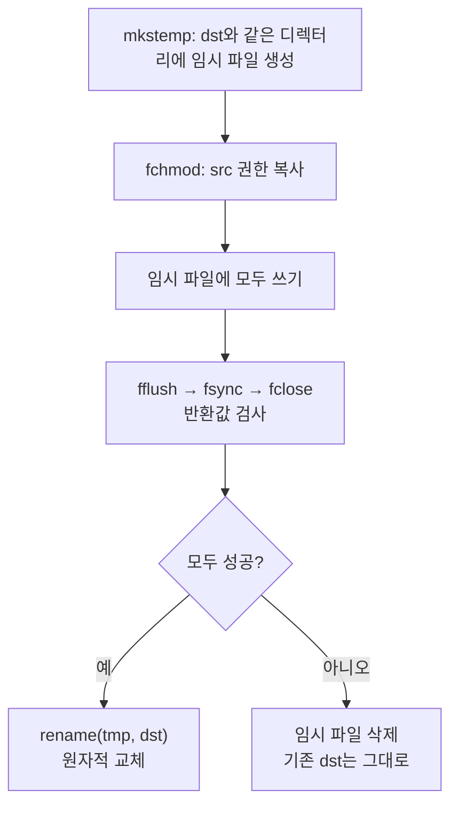

# 파일 입출력 실습 — fopen·open 오류 패턴과 임시파일 + rename 안전 저장

> [!IMPORTANT]
> 코드는 컨테이너에서 컴파일·실행해 확인했고, 설명은 AI(Claude)와 함께 코드 리뷰하며 정리했다.

> [!TIP]
> **📂 원본 소스 (GitHub)**
> - 안전 저장(`stat` 검사 + 임시파일 + `rename`): [`fio/fio_ex.c`](https://github.com/sweetpark/c-playgound/blob/main/c_basic/fio/fio_ex.c) — 본문 5장의 `fio_ex_v2`가 이 파일이다
> - 줄 번호 붙여 저장: [`fio/fio_ex2.c`](https://github.com/sweetpark/c-playgound/blob/main/c_basic/fio/fio_ex2.c)
> - 테스트 입력: [`fio/sample/src.txt`](https://github.com/sweetpark/c-playgound/blob/main/c_basic/fio/sample/src.txt)
> - 강의 코드 10-01 ~ 10-04: [`lecture/fio/`](https://github.com/sweetpark/c-playgound/tree/main/c_basic/lecture/fio)
> - 빌드: `make -C c_basic` ([README](https://github.com/sweetpark/c-playgound/blob/main/c_basic/README.md))

## 📌 한눈에 보기

| 실습 | 문제 | 처방 |
|---|---|---|
| 10-01 | 이미 존재하는 파일을 덮어씀 / 존재 확인 후 열기의 경쟁 상태 | `fopen(…, "wx")` 또는 `open(…, O_EXCL)` |
| 10-03 | `rewind`는 성공 여부를 알 수 없음, `fclose` 누락 | `fseek` 반환값 검사, 모든 경로에서 `fclose` |
| 10-04-a | 바이너리로 연 파일에 `buf[strlen-1]='\0'` | 개행 확인 후 제거, 바이너리는 `fread`+바이트 수 |
| 10-04-b | 입력이 버퍼보다 길면 마지막 글자를 잘못 지움 | 개행 위치를 `strcspn`으로 찾기 |

---

## 1. 파일 열기 — 10-01

### 존재 여부를 따로 확인하지 않는다

> [!NOTE] 요약
> - **문제**: `fopen(path, "w")`가 기존 파일을 경고 없이 지움 (10-01)
> - **원인**: 존재 확인 후 열기는 그 사이에 파일이 바뀌는 TOCTOU
> - **처방**: `fopen(path, "wx")`(C11) 또는 `open(O_WRONLY|O_CREAT|O_EXCL, 0644)`로 확인과 생성을 원자적으로
> - **결과**: 이미 있으면 `errno == EEXIST`로 실패

> [!INFO]- 상세 보기
> ```c
> fp = fopen(file_name, "w");     // 이미 있으면 내용이 지워진다 (경고 없음)
> ```
>
> "파일이 없으면 만들고, 있으면 실패"가 필요하다면 `lstat()` 등으로 먼저 확인하는 방식은 확인과 열기 사이에 파일이 바뀔 수 있어(**TOCTOU**) 지양한다. 열기 자체에 **원자적 조건**을 건다.
>
> ```c
> fp = fopen(file_name, "wx");               // C11: 이미 있으면 실패, 없으면 생성
> if (fp == NULL) {
> 	if (errno == EEXIST) printf("already file create\n");
> 	else                 printf("error file create\n");
> 	return NULL;
> }
> ```
>
> `open()`을 직접 쓰면 권한까지 정할 수 있다.
>
> ```c
> int fd = open(path, O_WRONLY | O_CREAT | O_EXCL, 0644);
> ```
>
> > [!TIP]
> > 유효한 `fopen` 모드는 `r w a r+ w+ a+`와 여기에 붙는 `b`, `x`뿐이다. `"rw"`는 없다. 존재하지 않는 파일에 `"r"`을 쓰면 `NULL`이 된다.

---

## 2. 읽고 나서 — 10-03

> [!NOTE] 요약
> - **문제**: `rewind` 성공 여부를 알 수 없고 `fclose` 누락 (10-03)
> - **원인**: `rewind`는 반환값이 없음. `fgetc` 결과를 `char`로 받으면 `EOF`와 구분 불가
> - **처방**: `fseek(fp, 0L, SEEK_SET) != 0`으로 검사, `fgetc`는 `int`로 받기, 모든 경로에서 `fclose`

> [!INFO]- 상세 보기
> ```c
> int prt_file_content(FILE *fp) {
> 	int ch;
> 	while ((ch = fgetc(fp)) != EOF) putchar(ch);
> 	rewind(fp);                  // 반환값이 없어 실패를 알 수 없다
> 	return 1;
> }
>
> int main(void) {
> 	FILE *fp = fopen("./10-03.txt", "r");
> 	...
> 	return 1;                    // fclose 누락 + 정상인데 1 반환
> }
> ```
>
> - `rewind(fp)`는 **`fseek(fp, 0, SEEK_SET)`에 에러/EOF 플래그 초기화**를 더한 것이다. 성공 여부를 반환하지 않으므로 `fseek`를 쓴다.
> - `fgetc`의 반환값은 `char`가 아니라 **`int`** 로 받아야 `EOF(-1)`와 구분된다.
> - 열었으면 **모든 경로에서 `fclose`**.
>
> ```c
> if (fseek(fp, 0L, SEEK_SET) != 0) {      // 성공 0, 실패 -1
> 	perror("fseek");
> 	return -1;
> }
> ```

### fseek의 반환값은 errno가 아니다

> [!NOTE] 요약
> - **문제**: `ret_val == EBADF || ret_val == EINVAL` 조건이 실패를 영원히 못 잡음
> - **원인**: `fseek`는 성공 0 / 실패 -1을 반환하고, 원인은 `errno`에 담김
> - **처방**: `if (ret_val != 0) { perror("fseek"); goto CLEAN; }`
> - **결과**: 파이프 입력으로 실행하면 `fseek: Illegal seek`가 출력됨

> [!INFO]- 상세 보기
> 실습 중에 아래처럼 쓴 코드를 발견했다.
>
> ```c
> ret_val = fseek(src_fp, 0L, SEEK_SET);
> if (ret_val == EBADF || ret_val == EINVAL) { ... }   // 반환값과 errno를 혼동
> ```
>
> `fseek`는 성공하면 `0`, 실패하면 **`-1`** 을 반환하고 원인은 `errno`(`EBADF`, `EINVAL`, 파이프라면 `ESPIPE`)에 담긴다. 위 조건은 반환값이 `9`나 `22`일 때만 참이라 **실패를 영원히 잡지 못한다**.
>
> ```c
> if (ret_val != 0) { perror("fseek"); goto CLEAN; }
> ```
>
> 파이프 입력(`cat file | ./a.out /dev/stdin …`)으로 실행하면 `fseek: Illegal seek`가 출력되는 것으로 수정이 제대로 동작함을 확인했다.

---

## 3. 줄 끝 처리 — 10-04

> [!NOTE] 요약
> - **문제**: `buf[strlen(buf) - 1] = '\0'`가 멀쩡한 글자를 지움 (10-04)
> - **원인**: 마지막 글자가 개행·길이가 0 아님·텍스트 파일이라는 세 가지 숨은 가정
> - **처방**: `buf[strcspn(buf, "\n")] = '\0'`, 바이너리는 `fread`와 읽은 바이트 수
> - **결과**: 개행이 없었다면 입력이 길어 잘린 것이므로 남은 입력도 처리

> [!INFO]- 상세 보기
> ```c
> fgets(buf, sizeof(buf), fp);
> buf[strlen(buf) - 1] = '\0';       // "마지막 글자 = 개행"이라고 가정
> ```
>
> 이 한 줄에는 세 가지 가정이 숨어 있다.
>
> 1. **마지막 글자가 `'\n'`이라는 가정** — 마지막 줄에 개행이 없거나, 입력이 버퍼보다 길어 중간에 잘린 경우에는 **멀쩡한 글자를 지운다**.
> 2. **`strlen(buf) > 0`이라는 가정** — 길이가 0이면 `buf[-1]`(`size_t` 언더플로)에 쓴다.
> 3. **바이너리 파일** (`"rb"`) — 데이터 중간에 `\0`이 있으면 `strlen`이 읽은 길이와 달라진다. 바이너리는 `fgets`가 아니라 `fread`로 읽고 **읽은 바이트 수**를 따로 관리한다.
>
> ```c
> buf[strcspn(buf, "\n")] = '\0';    // 개행이 있으면 그 자리, 없으면 끝(\0)에 대입 — 항상 안전
> ```
>
> 10-04-b(`get_name`)처럼 사용자 입력을 받는 경우, 입력이 `size-1`보다 길면 남은 글자가 입력 버퍼에 남는다는 점도 처리해야 한다 (개행이 없었는지로 판단).

---

## 4. 응용 1 — 공백 제거 복사 (fio_ex)

> [!NOTE] 요약
> - **문제**: 공백·탭·개행을 제거해 복사하는 `fio_ex`의 6가지 오류
> - **원인**: `O_CREATE` 오타, 읽기 파일에 `O_EXCL`, `fgetc(buffer)`, 버퍼 상한 없음, `strlen(buffer)`, 반환값 무시
> - **처방**: 버퍼가 차면 쓰고 비우고 계속 읽기, 모은 길이 `i`만큼 `fwrite`, 모든 반환값 검사, 정리 구간 한 곳
> - **결과**: 입력 크기 0·1023·1024·1025·3000바이트 모두 출력 크기 일치

> [!INFO]- 상세 보기
> `src`의 **공백·탭·개행을 모두 제거**해 `dst`에 저장하는 프로그램이다.
>
> 처음 짠 코드에서 고친 점들은 다음과 같다.
>
> | 처음 코드 | 문제 | 고친 코드 |
> |---|---|---|
> | `open(src, O_CREATE \| O_EXCL)` | 오타(`O_CREAT`), 읽을 파일에 `O_EXCL`, 접근 모드·mode 인자 누락 | `open(src, O_RDONLY)` / `open(dst, O_WRONLY\|O_CREAT\|O_EXCL, 0644)` |
> | `fgetc(buffer)` | `FILE*`이 아닌 배열을 전달 | `fgetc(src_fp)` |
> | `buffer[i] = c`에 상한 없음 | 큰 파일에서 스택 오버플로 | 꽉 차면 파일에 쓰고 `i = 0` 후 이어서 읽기 |
> | `fwrite(buffer, 1, strlen(buffer), …)` | 널 종료가 없는 버퍼에 `strlen` | 모은 길이 `i`만큼 `fwrite` |
> | `fdopen`·`fwrite`·`fclose` 반환값 무시 | 실패를 모름 | 모두 검사 |
> | 에러 경로에서 fd 정리 안 함 | fd 누수 | 정리 구간 한 곳으로 |
>
> `buffer`가 가득 차면 **쓰고 비우고 계속 읽는** 구조라 파일 크기 제한이 없다.
>
> ```c
> while ((c = fgetc(src_fp)) != EOF) {
> 	if (c == ' ' || c == '\t' || c == '\n') continue;
>
> 	if (i >= sizeof(buffer)) {                       // 꽉 차면 파일에 쓰고 비운다
> 		if (fwrite(buffer, 1, i, dst_fp) != i) goto CLEAN;
> 		i = 0;
> 	}
> 	buffer[i++] = c;
> }
> if (i > 0 && fwrite(buffer, 1, i, dst_fp) != i) goto CLEAN;   // 남은 만큼
> ```
>
> 입력 크기 0, 1023, 1024, 1025, 3000바이트 경계 케이스에서 모두 출력 크기가 입력과 일치했다.
>
> > [!TIP]
> > `fwrite(ptr, size, nmemb, fp)`의 **2번째 인자는 원소 하나의 크기**, 3번째는 개수다. 반환값은 쓴 **원소 개수**라서, 바이트 버퍼는 `size = 1`로 두는 것이 관례다. `fwrite(buf, 100, 1, fp)`는 50바이트만 써져도 `0`을 반환해 얼마나 썼는지 알 수 없다.

---

## 5. 응용 2 — 안전하게 저장하기 (fio_ex_v2)

조건을 추가해 다시 만들었다.

1. **인자로** `src`, `dst`를 받는다
2. `src`/`dst`의 **파일 상태를 확인**하고, 디렉터리면 에러
3. **임시 파일에 쓴 뒤 `rename`** 으로 교체
4. **반환값을 모두 검사**해서 예외 처리
5. 에러 처리는 **`goto`로 한 곳**에 모으기
6. **`fclose` 시 버퍼를 비우며 생기는 오류**도 처리

### 5-1. 파일 상태 확인 — stat

> [!NOTE] 요약
> - **문제**: `src`/`dst`가 디렉터리·특수 파일·같은 파일일 수 있음
> - **원인**: `dst`가 없는 것은 정상, 그 외 이유의 `stat` 실패는 오류
> - **처방**: `stat` + `S_ISDIR`/`S_ISREG`, `st_dev`+`st_ino`가 같으면 같은 파일

> [!INFO]- 상세 보기
> ```c
> if (stat(src_file_name, &src_st) != 0) { perror("stat src"); goto CLEAN; }
> if (S_ISDIR(src_st.st_mode)) { fprintf(stderr, "src is a directory\n"); goto CLEAN; }
> if (!S_ISREG(src_st.st_mode)) { fprintf(stderr, "src is not a regular file\n"); goto CLEAN; }
>
> if (stat(dst_file_name, &dst_st) == 0) {
> 	if (S_ISDIR(dst_st.st_mode)) { /* dst가 디렉터리 */ goto CLEAN; }
> 	if (!S_ISREG(dst_st.st_mode)) { /* 장치 파일 등 */ goto CLEAN; }
> 	if (src_st.st_dev == dst_st.st_dev && src_st.st_ino == dst_st.st_ino) {
> 		/* src와 dst가 같은 파일 */ goto CLEAN;
> 	}
> } else if (errno != ENOENT) {          // 없는 것 외의 이유(권한 등)로 실패
> 	perror("stat dst"); goto CLEAN;
> }
> ```
>
> - `dst`가 **없는 건 정상**이다(새로 만든다). 그 외 이유로 `stat`이 실패하면 에러.
> - `st_dev` + `st_ino`가 같으면 **같은 파일**이다(경로가 달라도, 하드링크여도).

### 5-2. 임시 파일 + rename

> [!NOTE] 요약
> - **문제**: 저장 중 실패하거나 전원이 나가면 반쯤 쓰인 `dst`가 생김
> - **원인**: `dst`에 직접 쓰기 때문
> - **처방**: `dst`와 같은 디렉터리에 `mkstemp` → 쓰기 → `fflush`·`fsync`·`fclose` → `rename`
> - **결과**: 기존 `dst`는 그대로, 임시 파일만 삭제



> [!INFO]- 상세 보기
> ```c
> n = snprintf(tmp_name, sizeof(tmp_name), "%s.tmpXXXXXX", dst_file_name);   // dst와 같은 디렉터리
> tmp_fd = mkstemp(tmp_name);       // 0600, O_EXCL로 생성하고 tmp_name을 실제 이름으로 바꿈
> tmp_created = 1;
> fchmod(tmp_fd, src_st.st_mode & 0777);     // src와 같은 권한으로
>
> /* ... 임시 파일에 모두 쓴다 ... */
>
> fflush(tmp_fp);
> fsync(fileno(tmp_fp));            // 디스크 반영
> fclose(tmp_fp);                   // 반환값 검사
> rename(tmp_name, dst_file_name);  // 같은 파일시스템이므로 원자적 교체
> tmp_created = 0;
> ```
>
> - 도중에 실패하면 **기존 `dst`는 그대로**이고 임시 파일만 지운다. 쓰다가 전원이 나가도 반쯤 쓰인 `dst`가 생기지 않는다.
> - 임시 파일을 **`dst`와 같은 디렉터리**에 만드는 이유는 `rename`이 같은 파일시스템 안에서만 원자적이기 때문이다.
> - 이미 있는 일반 파일은 `rename`이 덮어쓴다. 덮어쓰기를 막으려면 `dst`가 존재하는 순간 에러로 처리하면 된다.

### 5-3. goto 정리와 fclose의 반환값

> [!NOTE] 요약
> - **문제**: 쓰기 오류가 `fwrite`가 아니라 `fflush`·`fsync`·`fclose`에서 드러남, `fdopen` 뒤 `close(fd)` 중복
> - **원인**: 디스크가 꽉 차도 `fwrite`는 버퍼에만 쓰고 성공할 수 있음
> - **처방**: 비우는 시점의 반환값 검사, `fdopen` 성공 직후 `fd = -1`, 열려 있는 것만 닫는 `CLEAN` 구간

> [!INFO]- 상세 보기
> ```c
> 	/* ... 중간에 실패하면 goto CLEAN ... */
> 	n = fclose(tmp_fp);
> 	tmp_fp = NULL;                 // 실패해도 이미 닫힌 상태라 다시 닫지 않도록
> 	if (n != 0) { perror("fclose tmp"); goto CLEAN; }
>
> 	if (rename(tmp_name, dst_file_name) != 0) { perror("rename"); goto CLEAN; }
> 	tmp_created = 0;
> 	ret = 0;
>
> CLEAN:
> 	if (src_fp != NULL) { if (fclose(src_fp) != 0) { perror("fclose src"); ret = -1; } }
> 	else if (src_fd >= 0) close(src_fd);
>
> 	if (tmp_fp != NULL) { if (fclose(tmp_fp) != 0) perror("fclose tmp"); ret = -1; }
> 	else if (tmp_fd >= 0) close(tmp_fd);
>
> 	if (tmp_created) unlink(tmp_name);       // 실패했으면 임시 파일 삭제
> 	return ret;
> ```
>
> - **쓰기 오류는 `fwrite`가 아니라 `fflush`·`fsync`·`fclose`에서 드러날 수 있다.** 디스크가 꽉 찬 경우 `fwrite`는 버퍼에만 쓰고 성공할 수 있기 때문에, 비우는 시점의 반환값을 반드시 확인한다.
> - `fdopen`에 성공한 뒤에는 `fclose`가 **내부 fd까지 닫으므로** `close(fd)`를 또 부르면 안 된다. 그래서 `fdopen` 성공 직후 `fd = -1`로 되돌려 놓는다.
> - 정리 구간에서는 **열려 있는 것만** 닫는다 (모든 포인터를 `NULL`/`-1`로 초기화).

### 5-4. 테스트 결과

> [!INFO]- 테스트 시나리오 표
> | 시나리오 | 결과 |
> |---|---|
> | 정상 | 공백이 모두 제거된 출력, 권한 `644` |
> | 기존 `dst`가 있음 | 내용 교체 |
> | 인자 없음 / `src` 없음 | 에러 메시지, 종료 코드 `255` |
> | `src`가 디렉터리 / `dst`가 디렉터리 | 에러 메시지 |
> | `src`와 `dst`가 같은 파일 | 에러 메시지 |
> | `dst`의 디렉터리가 없음 | `mkstemp: No such file or directory` |
> | 3000바이트 입력 | 출력도 3000바이트 |
> | 실패한 모든 경우 | 임시 파일이 남지 않음 |
>
> > [!NOTE]
> > `stat`·`open`·`mkstemp`·`fsync`·`fchmod`·`fdopen`·`unlink`는 **POSIX 함수**다. `rename`·`fopen`·`fflush`는 ISO C 표준이다. 그래서 이 코드는 Linux에서는 그대로 빌드되지만, 순수 표준 C 환경이나 MSVC에서는 일부를 바꿔야 한다.

---

## 6. 응용 3 — 줄 번호 붙여 저장 (fio_ex2)

> [!NOTE] 요약
> - **문제**: 줄 번호를 붙여 저장하는 `fio_ex2`의 10가지 오류
> - **원인**: `while (… == EOF)` 반대 조건, `char out`, 문자 수를 줄 수로 셈, `fseek` 누락 등
> - **처방**: 첫 읽기에서 줄 수·최대 길이 → `fseek`로 되감기 → 두 번째 읽기에서 `%*d`로 번호 정렬

> [!INFO]- 상세 보기
> `src`를 읽어 **전체 줄 수와 가장 긴 줄의 길이**를 헤더에 쓰고, 각 줄 앞에 **자릿수에 맞춰 정렬된 줄 번호**를 붙여 `dst`에 저장한다.
>
> ```
> 전체 줄 수 : 12, 가장 긴 줄 수 : 11
>
>  1 : line 1 abc
>  2 : line 2 abc
>  ...
> 10 : line 10 abc
> 12 : line 12 abc
> ```
>
> **두 번 읽는 구조**이므로 첫 번째 읽기에서 줄 수·최대 길이를 구하고, `fseek(src_fp, 0L, SEEK_SET)`으로 처음으로 돌아가 한 번 더 읽는다.
>
> 처음 짠 코드에서 고친 점들은 다음과 같다.
>
> | 문제 | 설명 |
> |---|---|
> | 루프 조건이 반대 | `while ((out = fgetc(fp)) == EOF)`는 **EOF일 때만** 도는 루프. `!= EOF` |
> | `char out` | `fgetc`는 `int`를 반환한다. `char`면 `EOF`와 구분되지 않을 수 있음 |
> | 줄 수 계산 | 문자마다 `body_len++`는 줄 수가 아니라 **문자 수**. `'\n'`을 만났을 때만 증가 |
> | 최대 길이 | 줄이 끝날 때마다 현재 길이를 **항상 0으로 리셋**하고 최댓값만 갱신 |
> | 마지막 줄 | 개행 없이 끝나면 EOF 이후 한 번 더 반영 |
> | 두 번째 읽기 | 처음으로 되돌리는 `fseek` 누락 |
> | 줄 번호 | `0`이 아니라 **1부터**, 폭은 전체 줄 수의 자릿수로 `%*d` |
> | 번호 위치 | 개행 **뒤**가 아니라 "줄의 첫 글자일 때만" 찍어 마지막 개행 뒤에 빈 번호가 안 생기게 |
> | 열기 | `src`에 `O_CREAT\|O_EXCL`을 쓰던 것을 `O_RDONLY`로 |
> | 마무리 | `fclose`·`fflush`·`ferror` 검사 누락 |
>
> ```c
> width = 1;
> for (out = total_lines; out >= 10; out /= 10) width++;     // 자릿수 계산
>
> at_line_start = 1;
> while ((out = fgetc(src_fp)) != EOF) {
> 	if (at_line_start) {                                   // 줄의 첫 글자일 때만 번호
> 		fprintf(dst_fp, "%*d : ", width, current_line++);
> 		at_line_start = 0;
> 	}
> 	fputc(out, dst_fp);
> 	if (out == '\n') at_line_start = 1;
> }
> ```

---

## 💡 보너스 — man 페이지에서 C 함수 찾기

> [!INFO]- 상세 보기 (man 섹션, vim K)
> `stat`·`rename`은 **쉘 명령어**도 있고 **C 함수**도 있다. `man stat`은 섹션 번호가 낮은 쉘 명령어(1)를 먼저 보여준다.
>
> | 섹션 | 내용 |
> |---|---|
> | 1 | 쉘 명령어 |
> | 2 | 시스템 콜 (`stat(2)`, `open(2)`) |
> | 3 | C 라이브러리 함수 (`fopen(3)`) |
>
> ```bash
> man 2 stat      # 시스템 콜
> man 3 fopen     # C 라이브러리
> ```
>
> vim에서는 단어 위에 커서를 두고 `Shift+K`를 누르면 `man <단어>`가 열리는데, 이때 **앞에 숫자를 붙여 `숫자 + Shift+K`** (예: `2K`)를 누르면 해당 섹션의 man 페이지가 열린다.
>
> 그냥 `K`는 쉘 명령어(섹션 1)만 보여주므로, C 함수를 볼 때는 `2K`(시스템 콜), `3K`(라이브러리 함수)를 쓴다.
>
> > [!TIP]
> > gdb로 디버깅하려면 gcc에 **`-g` 옵션**을 주고 빌드해야 한다 (`gcc -g -O0 ...`). 자세한 내용은 문자열 함수 실습 노트의 "실습 환경 팁" 참고.

---

## ✅ 정리 — 파일 I/O 점검 체크리스트

> [!INFO]- 체크리스트 펼치기
> - [ ] **열기 조건**이 의도와 맞는가 (`"w"`는 덮어쓰기, 새 파일만 필요하면 `"wx"` / `O_EXCL`)
> - [ ] 반환값을 모두 검사했는가 (`fopen`·`fdopen`·`fseek`·`fwrite`·`fflush`·`fclose`·`rename`)
> - [ ] `fseek`의 실패는 **반환값 -1**, 원인은 **errno**로 구분하는가
> - [ ] 읽기 함수의 반환값(`fgetc`→`int`, `fgets`→`NULL`)으로 루프를 판단하는가 (`feof` 루프 금지)
> - [ ] `fgets` 후 개행 제거는 `strcspn`으로, 바이너리는 `fread`로 하는가
> - [ ] **쓰기 오류는 `fclose`에서 드러날 수 있음**을 고려해 그 반환값도 확인하는가
> - [ ] 중요한 파일은 **임시 파일 → `fsync` → `rename`** 으로 교체하는가
> - [ ] 모든 에러 경로에서 fd·`FILE*`·임시 파일이 정리되는가 (`goto CLEAN`)
> - [ ] `fdopen` 이후에는 `fclose`만 하고 `close(fd)`를 중복 호출하지 않는가
