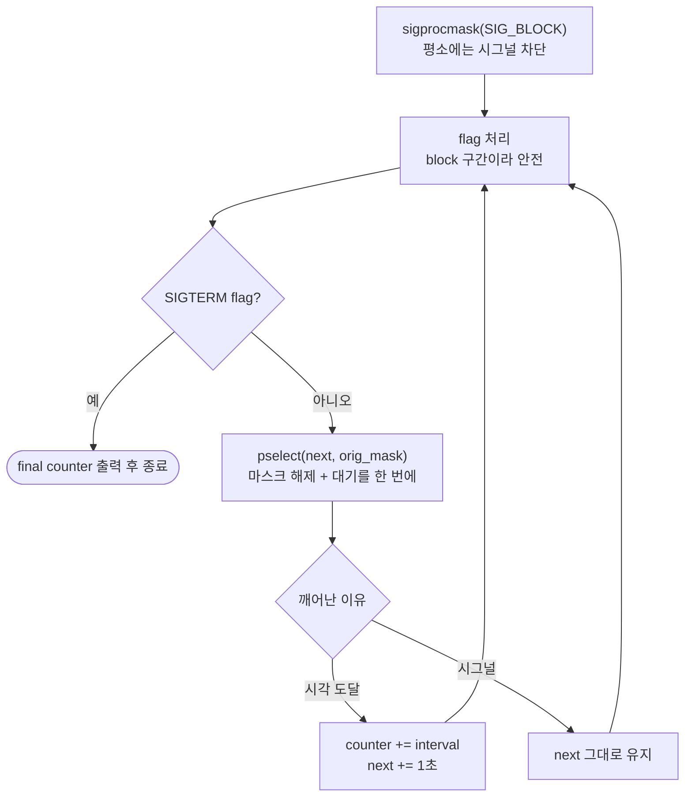

# 환경변수·시그널 — getenv 복사, atexit, sigaction, pselect

> [!TIP]
> - 대응 문제: [P020 env_copy](https://github.com/sweetpark/c-playgound/tree/main/drill/P020_env_copy) · [P021 parse_kv](https://github.com/sweetpark/c-playgound/tree/main/drill/P021_parse_kv) · [P022 sig_counter](https://github.com/sweetpark/c-playgound/tree/main/drill/P022_sig_counter) · [P023 wait_signal](https://github.com/sweetpark/c-playgound/tree/main/drill/P023_wait_signal)
> - 시그널 보내기: `kill -HUP <PID>` (종류: `HUP` `USR1` `USR2` `INT` `TERM`)

---

## 📌 한눈에 보기 — 주의해야 할 점

| # | 주의 | 왜 | 처방 | 상세 |
|---|---|---|---|---|
| 1 | `getenv` 결과를 고정 버퍼에 `strcpy` 금지 | 환경변수 길이는 **외부 값** | `NULL` 검사 → 길이 확인 후 복사 | [§1](#1-환경변수) |
| 2 | `getenv` 반환 문자열을 **수정하지 않는다** | 환경 영역을 가리킴 | `strdup` 복사본에서 수정 | [§1](#1-환경변수) |
| 3 | `strtok` 은 빈 항목(`a::b`)을 건너뛴다 | 연속 구분자를 하나로 취급 | `strchr` / `strsep` 로 직접 | [§3](#3-path-탐색기) |
| 4 | 종료는 `return` / `exit` | `_Exit` / `abort` 는 `atexit` 미실행, 버퍼 flush 는 구현마다 다름 | 핸들러는 등록의 **역순** 실행 | [§1](#1-환경변수) |
| 5 | `signal()` 대신 `sigaction` | 구현마다 핸들러 유지 여부가 다름 | 유지/1회를 코드로 명시 | [§4](#4-시그널) |
| 6 | 핸들러는 **flag 만** 세운다 | `printf`·`malloc` 은 async-signal-safe 가 아님 → 교착 | `volatile sig_atomic_t`, 로그는 `write(2, ...)` | [§4](#4-시그널) |
| 7 | `sleep` 은 시그널에 **일찍 깨어난다** | 대기가 짧아져 카운터가 빨라짐 | `EINTR` → 남은 시간(`rem`)으로 재대기 | [§5](#5-1초-카운터) |
| 8 | 평소엔 시그널을 막고 **대기 중에만** 푼다 | flag 확인과 `sleep` 사이에 온 시그널을 놓침 | `sigprocmask` + `pselect` | [§6](#6-시그널-카운터) |
| 9 | 설정 값은 `strtol` 로 검증, 실패하면 **기존 값 유지** | `atoi` 는 `abc` → 0, 음수 interval 은 카운터 정지 | `val > 0` 확인 | [§6](#6-시그널-카운터) |

---

## 1. 환경변수

### 11-01 · 길이가 정해지지 않은 외부 값

```diff
- char path[32];
- strcpy(path, getenv("PATH"));            /* PATH 가 32자를 넘으면 스택 오버플로 */
+ const char *e = getenv("PATH");
+ if (e == NULL) return -1;                 /* 없으면 NULL */
+ if (strlen(e) + 1 > sizeof(path)) return -2;     /* 길이 확인 후 복사 */
+ memcpy(path, e, strlen(e) + 1);
```

- 환경변수는 **프로그램 밖에서 들어오는 값** → 길이도 내용도 믿을 수 없다
- 길이를 모르면 `malloc(strlen(env) + 1)` 로 크기를 구해 복사

→ 연습: [P020 env_copy](https://github.com/sweetpark/c-playgound/tree/main/drill/P020_env_copy)

### 11-02 · 반환 문자열은 수정하지 않는다

- `getenv` 가 돌려주는 포인터 = 환경 영역 → 수정 금지, **복사본**을 만들어 바꾼다
- 강의 코드의 `trstr` 도 `strncpy(buf, c_str, 1024)` 로 복사한 뒤 `buf` 를 바꿨는데
	- `strncpy` 는 널 문자를 보장하지 않고
	- 결과 `buf` 를 호출한 쪽에 돌려주지도 않아서 **바꾼 결과가 사라진다**

### 11-03 · atexit

```c
atexit(exit1);
atexit(exit2);
if (argc != 1) { _Exit(1); }      /* 핸들러가 실행되지 않는다 */
return 0;                          /* exit2 → exit1 순으로 실행 (LIFO) */
```

| 방법 | `atexit` 핸들러 | stdio 버퍼 |
|---|---|---|
| `return`(main) / `exit()` | 실행 (등록의 **역순**) | 비움 |
| `_Exit()` | **실행 안 함** | 구현 의존 |
| `abort()` | **실행 안 함** | 구현 의존 |

- `atexit` 핸들러 안에서 `exit()` 호출, 시그널 핸들러 안에서 `exit()` 호출 = **정의되지 않은 동작**
	- 핸들러에서 끝내려면 `_Exit()` (async-signal-safe)
- 측정 (glibc 2.17): `fprintf` 한 줄 뒤 종료 방법만 바꿔 파일 크기 확인
	- `exit()` **13바이트**, `abort()` **13바이트**, `_Exit()` **0바이트**
	- glibc 2.27 이후 `abort()` 는 스트림을 비우지 않는 것으로 알려짐 (이 환경에서는 미확인)
	- → **`abort()` 에 flush 를 기대하면 안 된다**

---

## 2. 로그 기록기

- 요구: `LOG_PATH` 환경변수로 로그 파일(없으면 `default.log`), 입력한 줄 기록, `q`/`quit` 종료, 종료 시 `atexit(clean_up)` 에서 `Program terminated normally` 기록

### 처음 겪은 segfault

```c
fd = open(buf, O_CREAT | O_EXCL, 0644);   /* 접근 모드가 없어서 O_RDONLY(0)로 열림 */
fp = fdopen(fd, "w");                      /* 읽기 전용 fd 에 "w" → 실패, NULL (EINVAL) */
fwrite(message, 1, strlen(message), fp);   /* fp 가 NULL → segfault */
```

- `open` 은 `O_RDONLY` / `O_WRONLY` / `O_RDWR` 중 하나가 **반드시** 필요
- `fdopen` 이 NULL 인데 검사하지 않아 한참 뒤 `fwrite` 에서 터졌다

### 고친 점

| 처음 코드 | 문제 | 고친 코드 |
|---|---|---|
| `O_CREAT \| O_EXCL` | 접근 모드 없음, 파일이 있으면 `open` 실패 | `O_WRONLY \| O_CREAT \| O_APPEND` |
| `fdopen` 반환값 미검사 | NULL 로 `fwrite` → segfault | NULL 이면 `perror`, **`close(fd)`**, 종료 |
| `strcmp(message, "quit")` | `fgets` 는 개행 포함이라 `"quit\n"` 과 불일치 | `message[strcspn(message, "\r\n")] = '\0'` |
| `fgets` 반환값 미검사 | Ctrl+D(EOF) 에서 무한 루프 | `NULL` 이면 `break` |
| 종료 시 `fclose` 없음 | 버퍼 안 비워지고 종료 문구도 없음 | `atexit(clean_up)` + 전역(static) `g_fp`, `g_buf` |
| `LOG_PATH` 없으면 즉시 종료 | 요구는 `default.log` | 없으면 `default.log` |

```c
static void clean_up(void){
    if(g_fp != NULL){
        fprintf(g_fp, "Program terminated normally\n");
        if(fclose(g_fp) != 0){ perror("fclose"); }   /* 쓰기 오류는 fclose 에서 드러난다 */
        g_fp = NULL;
    }
    free(g_buf);
    g_buf = NULL;
}
```

> [!WARNING] `fprintf(fp, message)` 금지
> - 입력을 포맷 자리에 넣으면 사용자가 `%s`, `%n` 을 입력했을 때 위험 → 반드시 `fprintf(fp, "%s\n", message)`
> - 바이트 덩어리를 그대로 쓸 때만 `fwrite`

---

## 3. PATH 탐색기

- 요구: `which` 와 비슷하게 PATH 디렉토리를 순서대로 검색, `-a` 면 일치하는 모든 경로
	- **`getenv` 문자열 수정 금지**, 길이는 모두 동적 할당, **빈 항목은 현재 디렉토리**
	- `atexit` 로 해제와 "검색한 디렉토리 개수" 출력
	- 종료 코드: 찾음 0 / 못 찾음 1 / 인자 오류 2

### 처음 코드의 문제

| 처음 코드 | 문제 | 처방 |
|---|---|---|
| `path_list` 를 NULL 로 둔 채 사용 | 배열을 할당하지 않음 → segfault | 항목 수를 센 뒤 `malloc` |
| `getenv` 결과에 `strtok` | 원본 환경 문자열 수정 | `strdup` 복사본에서 쪼갬 |
| `strtok` 로 `a::b` 분리 | **연속 구분자를 건너뛰어 빈 항목이 사라짐** → `"."` 처리 불가 | `strchr` 로 직접 / `strsep` |
| `:` 개수 `n` 만큼만 `malloc` | 항목 수는 `n + 1` → 마지막 누락, `:` 없으면 `malloc(0)` 에 씀 | `n = ':' 개수 + 1` |
| 고정 10개 반복 | PATH 길이 가정 | 쪼갠 개수만큼 |

### 고친 구조

```c
static char  *g_path_copy = NULL;   /* strdup 한 PATH (원본은 읽기만) */
static char **g_dirs      = NULL;   /* g_path_copy 안을 가리키는 포인터 배열 */
static size_t g_searched  = 0;      /* 실제로 검색한 디렉토리 개수 */

g_dirs[i] = (*p == '\0') ? "." : p;   /* ':' 마다 '\0' 으로 끊고, 빈 항목은 "." */
```

- `g_dirs` 는 문자열이 아니라 **포인터 n개**의 배열 (`malloc(sizeof(*g_dirs) * n)`)
	- 해제: `free(g_dirs)`, `free(g_path_copy)`
- 경로 길이 = `dir + '/' + command + '\0'`
- `access(full, X_OK)` 만으로는 **디렉토리도 통과** → `stat` + `S_ISREG`
- 핸들러 등록 순서: `atexit(free_all)` → `atexit(report_searched)`
	- 실행은 반대 → **개수 출력 후 해제**
- 인자는 `cmd -a`, `-a cmd` 모두 허용

| 실행 | 결과 | 종료 코드 |
|---|---|---|
| `ls` | `/usr/bin/ls` (4개 검색) | 0 |
| `-a ls` | `/usr/bin/ls`, `/bin/ls` (6개) | 0 |
| 없는 명령어 | 출력 없음 | 1 |
| 인자 없음 / 모르는 옵션 / 명령어 2개 | usage | 2 |
| `PATH` 없음 | `PATH is not set` | 2 |
| `PATH="/nonexistent::/usr/bin:"` | 빈 항목 2개가 `.` 로 처리 | 0 |

> [!WARNING]
> `exit` 핸들러는 `return` / `exit` 로 끝날 때만 실행된다. 어떤 경로로 끝나도 실행하라는 요구라면 `_Exit()`, `abort()` 를 쓰지 않는다.

→ 연습: [P021 parse_kv](https://github.com/sweetpark/c-playgound/tree/main/drill/P021_parse_kv) (위치로 자르고 복사), [P028 split_words](https://github.com/sweetpark/c-playgound/tree/main/drill/P028_split_words)

---

## 4. 시그널

### 12-01 · 시점에 따라 무시된다

```c
void handler(int signum) {
    if (signum == SIGUSR1) { sig1 = 1; }
    else if (sig1)         { sig2 = 1; }       /* SIGUSR1 이 먼저 처리돼 있어야만 SIGUSR2 를 인정 */
}
```

- 의도: `SIGUSR1 → SIGUSR2` 순서 → 핸들러 실행 중 같은 종류가 또 오면 일부가 사라진다
	- 같은 번호의 시그널은 대기 중이면 **한 번으로 합쳐진다**
- `sigaction` + `sa_mask` / `sigprocmask` 로 처리 중 끼어들 시그널을 막는다

### 12-02 · signal() 의 이식성

| 원하는 동작 | `signal()` | `sigaction()` |
|---|---|---|
| 핸들러 **유지** | 구현마다 다름 (Linux 유지 / Windows 1회 후 기본 동작 복구). 핸들러 안 재등록은 복구와 재등록 **사이에 경합** | 기본 |
| **1회만** | `#ifndef WINDOWS` 로 핸들러 안에서 `signal(signum, SIG_DFL)` | `sa_flags = SA_RESETHAND` |

- 유지/1회를 코드가 **명시**한다
- `sigaction` 은 C 표준이 아니라 POSIX → Windows 에서는 못 쓴다 (이식성은 `signal`, 명확함은 `sigaction`)
- 핸들러 안에서 `signal()` 을 불러도 안전한 경우: `SIG_IGN` 등록 / `SIG_DFL` 복구 / **다른** 핸들러로 교체

### 12-03 · 12-04 · 핸들러 안에서 하면 안 되는 것

```c
void handler(int signum) {
    log_message();      /* fputs(info, stderr) → stdio 락을 쓴다 */
    free(info);         /* main 이 같은 포인터를 쓰는 도중에 해제될 수 있다 */
    info = NULL;
}
```

- 핸들러는 어디서든 끼어든다 → main 이 `fputs` / `malloc` 안에서 잡은 락을 핸들러가 또 요구하면 **교착**
- `printf` · `fputs` · `malloc` · `free` 는 **async-signal-safe 가 아니다**
- 12-04: 핸들러가 전역 버퍼에 쓰면
	- `free` 이후에 시그널 → **해제된 메모리에 씀**
	- main 이 쓰는 도중에 시그널 → 두 쓰기가 섞임
	- 문제는 `strcpy` 라는 함수가 아니라 **핸들러에서 공유 객체를 건드린다는 것**

```c
static volatile sig_atomic_t g_stop = 0;
static void stop_hdlr(int signo){ (void)signo; g_stop = 1; }   /* 이게 전부 */
```

> [!NOTE] 핸들러 안에서 호출해도 되는 함수
> - **C 표준** 보장: `abort()` `_Exit()` `quick_exit()` `signal()` 네 개뿐
> - **POSIX**: `man 7 signal-safety` 목록 (`write` `_exit` `kill` `sigaction` `sigprocmask` `pselect` `sem_post` `open` `close` `read` …)
>   - 개정마다 늘어나므로 **대상 플랫폼 man 으로 확인**
> - 목록에 없는 `printf` · `fputs` · `malloc` · `free` 는 금지, 로그가 꼭 필요하면 `write(2, ...)`
> - `volatile sig_atomic_t` 읽기/쓰기를 제외한 다른 객체 접근은 UB
> - `sa_mask` 로 처리 중 시그널을 막아도 async-signal-safe 하지 않은 함수는 금지

→ 연습: [P022 sig_counter](https://github.com/sweetpark/c-playgound/tree/main/drill/P022_sig_counter)

---

## 5. 1초 카운터

- 요구: 무한 루프에서 count 증가, 1초 뒤 파일 저장, `SIGINT` 는 무시(메시지만), `SIGTERM` 에만 종료

### v1 의 문제

| 처음 코드 | 문제 | 처방 |
|---|---|---|
| `while(g_stop_sig){ count++; }` | 1초 대기 없는 busy loop (CPU 100%) | 1초 대기 후 증가 |
| `int count` | 금방 signed 오버플로 (UB) | `unsigned long` |
| 종료할 때만 파일 저장 | `SIGKILL`·크래시 시 값이 사라짐 | 1초마다 저장 |
| `if(fd == 0)` | `open` 실패는 `-1` → `fdopen(-1)` 실패 | `if(fd < 0)` + `perror` |
| 핸들러 안 `printf` | async-signal-safe 아님 | `write(STDOUT_FILENO, ...)` |
| `signal()` | 이식성 | `sigaction` |
| `fdopen` 실패 시 `close(fd)` 없음 | fd 누수 | `close(fd)` |

> [!NOTE]
> 파일이 있으면 새로 만들고 싶을 때는 `O_TRUNC` (`fopen` 의 `"w"` 와 같다). `O_EXCL` 은 반대로 **있으면 실패**. 단 `O_TRUNC` 는 기존 내용을 바로 지우므로 중요한 파일에는 주의.

### v2 의 핵심 — sleep 이 시그널에 깨어난다

```c
static int wait_one_sec(void){
    struct timespec req = { 1, 0 }, rem = { 0, 0 };
    while(nanosleep(&req, &rem) != 0){
        if(errno != EINTR) return -1;
        if(g_stop) return 0;           /* SIGTERM 이면 대기를 중단 */
        req = rem;                     /* SIGINT 등은 남은 시간만큼 다시 대기 */
    }
    return 0;
}
```

- `SIGINT` 를 무시해도 `sleep` / `nanosleep` 은 **일찍 깨어난다** → 카운터가 빨라짐 → `nanosleep` 이 돌려주는 **남은 시간**으로 다시 잔다
- `SA_RESTART` 를 쓰지 않아 대기가 시그널에 깨어나고, 핸들러는 flag 만
- 쓰기: `fseek(fp, 0, SEEK_SET)` → `fprintf` → `fflush` 로 같은 파일에 최신 값 덮어쓰기 (값이 커지기만 해서 truncate 불필요)
- 종료 시 `fclose` 반환값 확인
- 결과: `SIGINT` 2번에도 생존, 5.3초 시점에 `count.txt` = 5, `SIGTERM` 은 마지막 값 저장 후 종료 코드 0

---

## 6. 시그널 카운터

- 요구: 1초마다 카운터를 `interval` 씩 증가
	- `SIGHUP`: 설정파일(`12-07.conf`)에서 interval 다시 읽기
	- `SIGUSR1`: 카운터·interval·시그널별 처리 횟수 출력
	- `SIGUSR2`: 카운터 0 으로
	- `SIGTERM`: 최종값 출력 후 종료
	- `SIGINT`: 무시
	- sleep 중 시그널은 **바로 처리하되 카운터는 1초에 한 번만**, 설정이 없거나 잘못되면 에러 출력 후 **기존 값 유지**

### 첫 구현의 문제

| 처음 코드 | 문제 | 처방 |
|---|---|---|
| `char *g_buffer[MAX_SIZE]` | 문자 버퍼가 아니라 **포인터 배열** | `char g_buffer[MAX_SIZE]` |
| 시작 때 `open(..., O_TRUNC)` | **설정파일을 빈 파일로 만들어 버림**, 쓰기 전용 fd 에 `fdopen(fd, "r")` 실패 | SIGHUP 이 올 때마다 `fopen(path, "r")` |
| 파일을 열어 둔 채 `fgets` 1회 | 두 번째 HUP 부터 EOF | 매번 새로 열고 닫음 |
| `if / else if` 사슬 | 동시에 온 시그널은 하나만 처리 | 각각 독립된 `if`, flag 는 **처리 직전에 먼저 0 으로** |
| `while(!s_TERM_f)` 안의 `else if(s_TERM_f)` | 도달 불가 → 종료 시 최종값 출력 안 됨 | 루프 밖에서 `final counter` 출력 |
| `atoi(g_buffer)` | `abc` 는 0, 0·음수 interval 이면 카운터 정지 | `strtol` + 끝 문자 + `val > 0`, 실패 시 **기존 값 유지** |
| 핸들러 인자 `signo` 미사용 | `-Wextra` 경고 | `(void)signo;` |

```c
val = strtol(g_buffer, &end, 10);
if(end == g_buffer || (*end != '\n' && *end != '\0') || errno == ERANGE || val <= 0 || val > INT_MAX){
    fprintf(stderr, "%s: invalid interval\n", path);
    return -1;                      /* 호출한 쪽이 기존 interval 을 유지 */
}
```

### v2 — 마스크와 pselect 로 "즉시 반응, 증가는 1초에 한 번"

- 문제
	- `sleep(1)` 이 시그널마다 깨어 **시그널마다 카운터가 올라간다**
	- flag 확인 **직후** 온 시그널은 `sleep` 이 끝나는 1초 뒤에야 처리
- 해결
	- 다섯 시그널을 `sigprocmask` 로 **평소엔 막아 두고**, 대기하는 동안에만 `pselect` 로 푼다
	- `pselect` 는 "마스크 해제 + 대기 시작"이 **원자적** → 그 사이 시그널을 놓치지 않는다
	- 다음 증가 시각을 `CLOCK_MONOTONIC` 절대 시각으로 관리



```c
sigprocmask(SIG_BLOCK, &block_mask, &orig_mask);     /* 평소엔 시그널 block */

while(1){
    /* flag 처리 (block 구간이라 안전하게 읽고 지울 수 있다) */
    if(s_TERM_f){ break; }

    rc = wait_until(&next, &orig_mask);   /* pselect(…, &remain, orig_mask) */
    if(rc == 1){                          /* 시각에 도달했을 때만 증가 */
        current_cnt += interval;
        next.tv_sec += 1;
    }
    /* rc == 0 이면 시그널로 깨어남: next 는 그대로, flag 만 처리하고 남은 시간만 다시 대기 */
}
```

| 시험 | 결과 |
|---|---|
| `USR1` 을 0.05초 간격으로 5번 | 지연 없이 즉시 출력, current 는 0 유지 |
| 약 1.9초 시점의 `USR1` | current 1 (틱 1번 경과) |
| `INT` 10번 | `skip` 10번, 이후 카운터 정상 (빨라지지 않음) |
| `HUP(5)` · `USR2` · `USR1` 동시 | 모두 처리, 이후 틱마다 +5 |
| `SIGTERM` | 약 14ms 만에 종료, `final counter` 출력 |

> [!NOTE]
> 한꺼번에 온 시그널은 **코드에 쓴 `if` 순서**대로 처리된다 (HUP → USR1 → USR2 → INT). USR2 와 USR1 이 같이 오면 USR1 은 리셋 전 값을 출력한다.

→ 연습: [P023 wait_signal](https://github.com/sweetpark/c-playgound/tree/main/drill/P023_wait_signal)

---

## 7. 실습 문제 (GitHub)

- 풀이·채점은 저장소에서: [c-playgound](https://github.com/sweetpark/c-playgound)
	- `make P020` 처럼 번호만으로 채점
	- 풀고 난 뒤의 해설은 각 폴더의 `NOTE.md`

| 문제 | 다루는 이론 | 링크 |
|---|---|---|
| P020 `env_copy` | [§1](#1-환경변수) 외부 값은 복사해서, 길이 확인 | [폴더](https://github.com/sweetpark/c-playgound/tree/main/drill/P020_env_copy) |
| P021 `parse_kv` | [§3](#3-path-탐색기) 위치 기반 파싱, 원본 불변 | [폴더](https://github.com/sweetpark/c-playgound/tree/main/drill/P021_parse_kv) |
| P022 `sig_counter` | [§4](#4-시그널) `sigaction`, `volatile sig_atomic_t` | [폴더](https://github.com/sweetpark/c-playgound/tree/main/drill/P022_sig_counter) |
| P023 `wait_signal` | [§6](#6-시그널-카운터) 막고 기다리기 (`sigtimedwait`) | [폴더](https://github.com/sweetpark/c-playgound/tree/main/drill/P023_wait_signal) |
| P028 `split_words` | [§3](#3-path-탐색기) `strtok` 의 함정, `strtok_r` | [폴더](https://github.com/sweetpark/c-playgound/tree/main/drill/P028_split_words) |
