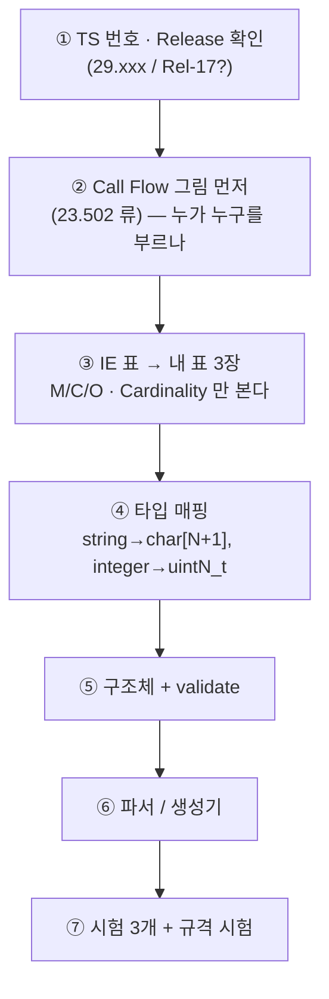

# D8. 3GPP — IE 표 한 장을 끝까지

> **쓰는 템플릿**: [6. 3GPP 규격 → C 코드 변환 골격](개발%20%28CS%29/언어/C언어/코드%20골격/[골격]%206.%203GPP%20규격%20→%20C%20코드%20변환%20골격.md)
>
> **목표 시간**: 1회차 120분 / 2회차 70분 / **3회차 45분**
>
> **D2 + D4 + D5 를 통과한 뒤에.**
> 이 드릴은 새 기술이 아니라 **앞의 것을 규격서 앞에서 하는 것**이다.

> [!NOTE] 이 드릴의 문서 구성 (D0~D9 공통)
> ① **요구사항서** — 무엇을 만드나, 표로 확정한다.
> ② **pseudo code 템플릿** — 보고 치는 뼈대이고, 회차마다 가린다.
> ③ **테스트 코드** — 이게 통과하면 끝이다.
> ④ 자주 하는 실수
> ⑤ 모범답안 — 맨 뒤에 접어 둔다.
>
> 변형 A/B/C 는 **문제가 바뀌는 게 아니라 같은 모양을 다른 소재로 다시 치는 것**이다.
> 각 변형마다 ①②③이 모두 준비되어 있다.

> [!WARNING] 이 노트의 IE 표는 **연습용으로 단순화한 것**이다
> 실제 TS 의 표와 필드·조건·타입이 다를 수 있다.
> 목적은 **표를 읽고 옮기는 절차**를 손에 붙이는 것.
> 실물 작업을 할 때는 **반드시 해당 TS 의 표를 직접 펴고** 표 3장을 다시 만든다.
> 노트를 규격서 대용으로 쓰지 않는다.

---

## 0. 이 드릴로 체화할 것

| 반사 | 규칙 |
| :--- | :--- |
| IE 표를 보면 | **5칸만 본다**: 이름 / P(M·C·O) / Cardinality / Type / Description |
| **M** (Mandatory) | 구조체에 그냥 넣고, `validate` 에서 **없으면 실패** |
| **C** (Conditional) | `has_` 플래그 + **조건을 주석으로 규격 문구 그대로** 남긴다 |
| **C 가 여럿** | **원문 단어부터 읽는다.** `oneOf` = **정확히 하나** → tagged union / `anyOf` = **하나 이상** → 각자 `has_` (**union 금지**) |
| **O** (Optional) | `has_` 플래그. 없어도 정상 |
| Cardinality `1..N` | 배열 + 개수. **N 을 `#define` 으로** |
| 모르는 필드 | **버리지 않는다.** 원문 보존 후 응답에 그대로 반영 |
| 에러 | 내 `ret_t` → **HTTP status → cause** 3단 매핑을 **한 함수**에 모은다 |

### 회차별 진행

| 회차 | 변형 | 보는 것 | 순서 |
| :--- | :--- | :--- | :--- |
| **1회차** | **A** JSON 형 API (확장 포함) | ① 요구사항서<br>② pseudo code **전체** | 1. 표 3장과 C 판단표를 **먼저** 채운다.<br>2. pseudo 를 한 줄씩 코드로 바꾼다.<br>3. ③ 테스트를 실행한다. |
| **2회차** | **B** 바이너리 IE | ① 요구사항서<br>② pseudo code 의 **번호와 제목만** (Level 2) | 1. 판단표를 채운다.<br>2. 번호만 보고 쓴다.<br>3. ③ 테스트를 실행한다. |
| **3회차** | **C** 버전 공존 | ① 요구사항서만 | 1. ③ 테스트를 **먼저 읽는다.**<br>2. 백지에서 친다. |

> 1회차에 막히면 같은 변형을 한 번 더 친다.
> 3회차를 통과하면 A 를 백지로 다시 친다.

---

## 1. 요구사항서

### 1-A. 변형 A — 가입자 AM 데이터 조회 (SBI 흉내)

> [!QUOTE] 연습용 규격 (단순화)
> **`GET /subscriber-data/{supi}/am-data?plmn-id={plmn}&supported-features={feat}`**
>
> **요청 IE**
>
> | IE | P | Cardinality | Type | 설명 |
> | :--- | :--- | :--- | :--- | :--- |
> | `supi` | **M** | 1 | string | `imsi-` + 숫자 15자 |
> | `plmnId` | **C** | 0..1 | object | **로밍 가입자면 필수**. `{mcc:3자리, mnc:2~3자리}` |
> | `supportedFeatures` | O | 0..1 | string | 16진수 문자열, 비트 단위 기능 협상 |
>
> **응답 IE (200 OK)**
>
> | IE | P | Cardinality | Type | 설명 |
> | :--- | :--- | :--- | :--- | :--- |
> | `gpsi` | O | 0..1 | string | `msisdn-` + 숫자 |
> | `subscribedUeAmbr` | **C** | 0..1 | object | **가입자가 정지 상태가 아니면 필수**. `{uplink, downlink}` (`"100 Mbps"` 형식) |
> | `nssai` | **M** | 1 | object | `{defaultSingleNssais: 1..8, singleNssais: 0..8}` |
> | `ratRestrictions` | O | 0..8 | array(enum) | `NR` / `EUTRA` / `WLAN` |
> | `supportedFeatures` | **C** | 0..1 | string | **요청에 왔으면 필수** |
>
> **에러 응답 (ProblemDetails)**
>
> | 상황 | HTTP | cause |
> | :--- | :--- | :--- |
> | 필수 IE 없음 | 400 | `MANDATORY_IE_MISSING` |
> | 형식 위반 | 400 | `INVALID_MSG_FORMAT` |
> | 가입자 없음 | 404 | `USER_NOT_FOUND` |
> | 내부 오류 | 500 | `INTERNAL_ERROR` |
> | 미지원 기능 | 501 | `UNSUPPORTED_FEATURE` |

### 미션

1. 요청·응답 **표 3장**을 직접 다시 만든다 (위 표를 그대로 베끼지 말고 **내 양식**으로).
2. `am_data_req_t` / `am_data_rsp_t` 구조체 (D2 규칙 그대로).
3. `"100 Mbps"` 같은 **문자열 비트레이트**를 `uint64_t bps` 로 변환하는 함수 + 역변환.
   단위: `Kbps`/`Mbps`/`Gbps`.
4. `mcc`/`mnc` 문자열 → `plmn_t` (mnc 2자리·3자리 **둘 다** 처리).
5. `am_data_validate()` — **C(Conditional) 조건을 규격 문구 주석과 함께** 검사.
6. `ret_to_problem()` — `ret_t` → `{status, cause}` 매핑 **한 곳**.
7. 모르는 최상위 필드는 **원문 보존**해서 응답에 echo.

### 확장 요구사항 — **C 가 여럿인 IE** (규격 개정 2, 응답에 이어 붙인다)

> [!QUOTE] 연습용 규격 (단순화) — 응답 IE 추가
>
> | IE | P | Cardinality | Type | 설명 |
> | :--- | :--- | :--- | :--- | :--- |
> | `accessType` | **M** | 1 | enum | `3GPP_ACCESS` / `NON_3GPP_ACCESS` |
> | `gnbInfo` | **C** | 0..1 | object | **`accessType == 3GPP_ACCESS` 일 때 present.** `{gnbId: uint32, tac: uint16}` |
> | `wlanInfo` | **C** | 0..1 | object | **`accessType == NON_3GPP_ACCESS` 일 때 present.** `{ssid: 1~32자, bssid: 17자}` |
> | `ueIdentity` | **M** | 1 | **oneOf** | `{"supi": string}` **또는** `{"gpsi": string}` — **정확히 하나** |
> | `ueIpv4` | **C** | 0..1 | string | **`anyOf`** (아래 `ueIpv6` 와) — **둘 중 하나 이상** present |
> | `ueIpv6` | **C** | 0..1 | string | 위와 동일. 둘 다 와도 정상 |

### 미션 (이어서)

8. **C 판단표**부터 채운다 (코드 치기 전).
   위 5개 C 필드를 **독립 / 배타(oneOf) / 최소하나(anyOf) / 묶음** 중 무엇인지 분류하고, **원문 단어**(`oneOf`, `anyOf`, "일 때")를 근거 칸에 적는다.
9. `access_info_t` — **판별자가 표에 이미 있는** 배타 C. `accessType` 을 **태그로 재사용**하는 tagged union.
10. `ue_identity_t` — **판별자가 표에 없는** `oneOf`.
    `kind` enum 을 **새로 만든다.** 파싱은 "어느 키가 왔나"로 태그를 정하고 **0개·2개 이상 모두 400.**
11. `ue_ip` — `anyOf`.
    **union 이 아니라** 각자 `has_` + `has_v4 + has_v6 >= 1`.
    **왜 union 이면 안 되는지 시험으로 증명**한다 (둘 다 온 요청이 둘 다 살아 있어야 한다).
12. 생성(직렬화)도 **태그로 갈라서** — `kind == NONE` 인 채로 응답을 만들려 하면 `RET_INVALID_ARG`.

> [!DANGER] `oneOf` 와 `anyOf` 를 **원문 단어로** 구분한다
> 둘 다 "C 가 두 개" 처럼 보이지만 **동시에 올 수 있는지**가 반대다.
> `anyOf` 를 union 에 넣으면 둘째를 파싱하는 순간 첫째가 **에러 없이 지워진다.**
> 헷갈리면 `has_` 로 두는 쪽이 안전하다.
> → [6번 템플릿 2-4](개발%20%28CS%29/언어/C언어/코드%20골격/[골격]%206.%203GPP%20규격%20→%20C%20코드%20변환%20골격.md), [2번 템플릿 2-8](개발%20%28CS%29/언어/C언어/코드%20골격/[골격]%202.%20데이터%20모델%20골격%20—%20규격서%20I·O%20표를%20구조체로.md)

### C 판단표 — 채우고 시작한다

| 필드 | 조건 / 원문 단어 | 다른 C 와 **동시에** 올 수 있나 | 패턴 | 표현 |
| :--- | :--- | :--- | :--- | :--- |
| `gnbInfo` |  |  |  |  |
| `wlanInfo` |  |  |  |  |
| `ueIdentity` (`supi` / `gpsi`) |  |  |  |  |
| `ueIpv4` |  |  |  |  |
| `ueIpv6` |  |  |  |  |

**공통 타입 `am_types.h` (A, B, C 가 같이 쓴다)**

| 이름 | 모양 |
| :--- | :--- |
| 상수 | `SUPI_SIZE` 24, `GPSI_SIZE` 24, `SSID_LEN_MAX` 32, `BSSID_SIZE` 18, `IPV4_STR_SIZE` 16, `IPV6_STR_SIZE` 46, `NSSAI_NUM_MAX` 8 |
| `plmn_t` | `char mcc[4]`, `char mnc[4]`, `uint8_t mnc_len` (2 또는 3) |
| `problem_t` | `int status`, `const char *cause` |
| `am_data_req_t` | `char supi[SUPI_SIZE]`, `bool has_plmn` + `plmn_t plmn`, `bool has_features` + `char features[17]` |
| `am_data_rsp_t` | `bool suspended`(내부 상태), `has_gpsi` + `gpsi`, `has_ue_ambr` + `ue_ambr {uint64_t ul_bps, dl_bps}`, `nssai {default_num, default_sst[8], single_num, single_sst[8]}`, `rat_num` + `rat[8]` (D2 의 `rat_type_t`: `RAT_NR` / `RAT_EUTRA` / `RAT_WLAN`), `has_features` + `features[17]`, `unknown[8]` + `unknown_num` (`{char key[32]; char raw[256];}`), (확장) `access_info_t access`, `ue_identity_t ue_id`, `ue_ip_t ue_ip` |

**함수 (A)**

| 함수 | 요구사항 |
| :--- | :--- |
| `int am_req_parse(const char *url, am_data_req_t *out)` | `/subscriber-data/{supi}/am-data?plmn-id={plmn}&supported-features={feat}` 를 파싱한다.<br>`supi` 는 `imsi-` + 숫자 15자.<br>`plmn-id` 는 숫자 5~6자 (mcc 3 + mnc 2~3).<br>`supported-features` 는 16진수 문자열 (최대 16자).<br>**없는 쿼리는 `has_` 를 끈다.** |
| `int am_req_validate(const am_data_req_t *req, bool roaming)` | `roaming` 인데 `plmnId` 가 없으면 `RET_INVALID_ARG` |
| `int am_rsp_parse(json_t *root, am_data_rsp_t *out)` | 응답 JSON → 구조체.<br>`nssai` 가 없으면 `RET_INVALID_ARG`, 타입이 틀리면 `RET_BAD_FORMAT`.<br>**모르는 최상위 키는 `unknown[]` 에 원문(JSON 문자열)으로 보관**한다 (8개 초과는 WRN 후 버림). |
| `int am_rsp_build(const am_data_rsp_t *in, json_t **out)` | 구조체 → JSON.<br>**보관한 모르는 키를 그대로 되돌려 넣는다 (echo).**<br>`subscribedUeAmbr` 는 `"100 Mbps"` 형식으로 쓴다. |
| `int am_data_rsp_validate(const am_data_rsp_t *rsp, const am_data_req_t *req)` | C 조건을 **규격 문구 주석**과 함께 검사한다. |
| `int bitrate_from_str(const char *s, uint64_t *bps)` | `"100 Mbps"` / `"1.5 Gbps"` / `"64 Kbps"` / `"10 bps"` → bps.<br>단위는 **대소문자 무시**, 실패하면 `*bps = 0`. |
| `int bitrate_to_str(uint64_t bps, char *buf, size_t n)` | 역변환.<br>**1000 이상이면 가장 큰 단위**로, 소수는 필요한 만큼만 (`1.5 Gbps`, `64 Kbps`), 1000 미만은 `"999 bps"`.<br>버퍼가 모자라면 `RET_TOO_SMALL`. |
| `int plmn_parse(const char *mcc, const char *mnc, plmn_t *out)` | mnc 가 **2자리·3자리 둘 다** 가능.<br>`mnc_len` 을 따로 보관한다 (`"01"` 과 `"001"` 은 다른 사업자). |
| `int plmn_to_strs(const plmn_t *p, char mcc[4], char mnc[4])` | 앞자리 0 을 **그대로** 되돌린다. |
| `problem_t ret_to_problem(int ret)` | `ret_t` → `{status, cause}` 매핑 **한 곳** |
| `int features_from_hex(const char *s, uint32_t *out)` | 16진수 문자열 → 마스크 (최대 8자리).<br>빈 문자열·16진수가 아닌 문자 → `RET_BAD_FORMAT` |
| `int features_to_hex(uint32_t v, char *buf, size_t n)` | 소문자, 앞의 0 없음 (`0` 은 `"0"`) |
| `uint32_t features_negotiate(uint32_t peer, uint32_t mine)` | `peer & mine` — **상대가 모르는 비트는 끈다.** |

**에러 코드 → HTTP 매핑 (한 함수에만)**

| `ret_t` | HTTP | cause |
| :--- | :--- | :--- |
| `RET_OK` | 200 | (NULL) |
| `RET_INVALID_ARG` | 400 | `MANDATORY_IE_MISSING` |
| `RET_BAD_FORMAT` | 400 | `INVALID_MSG_FORMAT` |
| `RET_NOT_FOUND` | 404 | `USER_NOT_FOUND` |
| `RET_NOT_SUPPORTED` | 501 | `UNSUPPORTED_FEATURE` |
| `RET_TIMEOUT` | 504 | `TIMEOUT` |
| 그 밖의 모든 값 | 500 | `INTERNAL_ERROR` |

**확장 함수 (A, C 변형 요구사항 5개 C 필드)**

| 함수 | 요구사항 |
| :--- | :--- |
| `int access_info_parse(json_t *root, access_info_t *out)` | `accessType` 이 **태그**.<br>`accessType` 이 없으면 `RET_INVALID_ARG`, 모르는 값이면 `RET_BAD_FORMAT`.<br>**조건 참인데 해당 arm 이 없으면 `RET_INVALID_ARG`**.<br>반대편 arm 이 같이 오면 **무시 + WRN**. |
| `int ue_identity_parse(json_t *obj, ue_identity_t *out)` | `oneOf` — **정확히 하나**.<br>0개도 2개도 `RET_BAD_FORMAT`.<br>`kind` 는 **새로 만든다** (`UEID_NONE=0` / `SUPI` / `GPSI`). |
| `int ue_identity_build(const ue_identity_t *id, json_t *obj)` | `kind == NONE` 이면 `RET_INVALID_ARG` (규격 위반 응답을 만들지 않는다). |
| `int ue_ip_validate(const ue_ip_t *p)` | `anyOf` — **하나 이상**.<br>0개만 `RET_BAD_FORMAT`, **둘 다 와도 정상**이고 **둘 다 보존**한다. |

### 1-B. 변형 B — 바이너리 IE (D5 연계)

같은 데이터를 **IEI + TLV / TV 형식**으로 받는다.
**`oneOf` 는 어느 IEI 가 왔나로 태그를 정한다** (키 이름이 없다).

| IEI | 형식 | 이름 | 값 | P / 조건 |
| :--- | :--- | :--- | :--- | :--- |
| `0x10` | **TV** | accessType | 1옥텟: `1` = 3GPP_ACCESS, `2` = NON_3GPP_ACCESS | **M** |
| `0x11` | TLV | gnbInfo | 6바이트: `gnbId`(u32 BE) + `tac`(u16 BE) | **C** — `accessType == 3GPP` |
| `0x12` | TLV | wlanInfo | `ssid_len`(1) + `ssid` + `bssid`(6바이트).<br>`L == 1 + ssid_len + 6` | **C** — `accessType == NON_3GPP` |
| `0x21` | TLV | supi | 문자열 1 ~ 23자 | **oneOf** (`0x21` / `0x22`) |
| `0x22` | TLV | gpsi | 문자열 1 ~ 23자 | **oneOf** |
| `0x31` | TLV | ueIpv4 | 4바이트 | **anyOf** (`0x31` / `0x32`) |
| `0x32` | TLV | ueIpv6 | 16바이트 | **anyOf** |
| 그 외 | TLV 로 가정 | (미지원) | | **건너뛴다** (전방 호환) |

**함수**: `int ue_ctx_bin_parse(const uint8_t *buf, size_t len, ue_ctx_t *out);`

`ue_ctx_t` 는 `{ access_info_t access; ue_identity_t id; ue_ip_t ip; }` 이다.

**규칙**

1. `0x10` 은 TV 라서 `IEI(1) + 값(1)` 이다 (L 이 없다).
   나머지는 `IEI(1) + L(1) + V` 이다.
2. **IE 마다 길이 일치 검사**를 한다.
   `ueIpv4` L≠4, `gnbInfo` L≠6, `wlanInfo` 가 `1 + ssid_len + 6` 과 다름 → `RET_BAD_FORMAT`.
3. **순서가 보장되지 않으므로** `oneOf` / `anyOf` / 배타 C 검사는 **순회가 끝난 뒤 한 곳**에서 한다.
4. 문자열은 널 종단을 **내가 붙인다.**
   `bssid` 는 `"aa:bb:cc:dd:ee:ff"`, IPv4 는 `"10.0.0.1"`, IPv6 는 `inet_ntop` 형식으로 저장한다.
5. 경계를 넘으면 `RET_BAD_FORMAT`.

**에러 코드 규칙 (B)**

| 상황 | 리턴코드 |
| :--- | :--- |
| `buf` / `out` 이 NULL | `RET_INVALID_ARG` |
| `accessType` 없음, 조건 참인데 `gnbInfo` / `wlanInfo` 없음 | `RET_INVALID_ARG` (→ 400 `MANDATORY_IE_MISSING`) |
| `accessType` 이 1·2 가 아님, `oneOf` 0개·2개, `anyOf` 0개, 길이 불일치, 경계 초과 | `RET_BAD_FORMAT` |
| 반대편 arm 이 같이 옴 | `RET_OK` (**무시 + WRN**) |
| 모르는 IEI | `RET_OK` |

### 1-C. 변형 C — 버전 공존 (기능 협상)

`supportedFeatures` 의 **비트가 켜져야** 새 필드를 보낸다.
**구버전은 `ueIdentity` 대신 `supi` 만 보낸다** (조건부 arm 허용).

| 비트 | 뜻 | 켜졌을 때 |
| :--- | :--- | :--- |
| 비트 0 (`0x01`) | `ratRestrictions` 지원 | 응답에 `ratRestrictions` 배열을 **포함**한다 (`rat_num > 0` 일 때) |
| 비트 1 (`0x02`) | `ueIdentity` 지원 | 응답에 `ueIdentity` 객체(`{"supi":..}` 또는 `{"gpsi":..}`)를 쓴다 |
| 그 밖의 비트 | 내가 모름 | **끄고** 응답한다 |

**함수**: `int am_rsp_build_v(const am_data_rsp_t *in, uint32_t negotiated, json_t **out);`

**규칙**

1. `negotiated` 는 **`& 0x03` 으로 먼저 걸러서** 쓴다 (모르는 비트는 무시).
2. 비트 0 이 꺼져 있으면 `rat_num` 이 있어도 **`ratRestrictions` 를 보내지 않는다.**
3. 비트 1 이 꺼져 있으면 **최상위 `"supi"` 문자열만** 보내고 `ueIdentity` 는 보내지 않는다.
   이때 `kind == GPSI` 이면 구버전이 표현할 수 없으므로 `RET_NOT_SUPPORTED` 이다.
4. 비트 1 이 켜져 있으면 `ueIdentity` 객체만 보내고 최상위 `"supi"` 는 보내지 않는다.
5. `kind == NONE` 이면 `RET_INVALID_ARG`.
6. 실패하면 `*out` 은 NULL 이다.
7. 공통 필드(`nssai`, `subscribedUeAmbr`, 모르는 키 echo)는 A 의 `am_rsp_build` 와 같다.

**에러 코드 규칙 (C)**

| 상황 | 리턴코드 |
| :--- | :--- |
| `in` / `out` 이 NULL, `kind == NONE` | `RET_INVALID_ARG` |
| 구버전(비트 1 꺼짐)인데 `kind == GPSI` | `RET_NOT_SUPPORTED` |
| 할당 실패 | `RET_NO_MEM` |

---

## 2. pseudo code 템플릿 — 보고 쳐서 익힌다

> **사용법**
> 변형별로 아래 pseudo code 를 `d8_3gpp/src/*.h` / `*.c` 에 **주석만 복사**한다.
> 코드는 주석을 보고 **내가 쓴다.**
> 다 쓰면 `[ ]` 를 `x` 로 바꾼다.
> 막히면 §5 모범답안의 해당 단계만 본다.

### 2-A. Level 1 (1회차, 전부 본다)

```c
/* am_types.h  — 표 3장을 구조체로 (D2 규칙) */
/* [ ] 1. 상수 #define (N 은 전부 #define)
 * [ ] 2. plmn_t { mcc[4], mnc[4], mnc_len }                    ← mnc_len 을 잃으면 복원 불가
 * [ ] 3. access_type_t (UNKNOWN = 0 / 3GPP / NON_3GPP / END)    ← 표에 판별자가 있으니 태그로 재사용
 *        access_info_t { type; union { gnb_info_t gnb; wlan_info_t wlan; } u; }
 * [ ] 4. ue_id_kind_t (NONE = 0 / SUPI / GPSI / END)            ← 표에 판별자가 없으니 새로 만든다
 *        ue_identity_t { kind; union { char supi[..]; char gpsi[..]; } u; }
 * [ ] 5. ue_ip_t { has_v4 + v4, has_v6 + v6 }                   ← anyOf 라서 union 이 아니다
 * [ ] 6. am_data_req_t / am_data_rsp_t / problem_t */

/* features.c / bitrate.c / plmn.c / problem.c */
/* [ ] 1. bitrate_from_str
 *        가드(CHK_STR, CHK_PTR) → *bps = 0
 *        sscanf("%lf %7s")   ← 폭 제한을 꼭 둔다
 *        단위: strcasecmp 로 bps / Kbps / Mbps / Gbps → 배수
 *        val < 0 이거나 너무 크면 BAD_FORMAT, 곱해서 대입 */
/* [ ] 2. bitrate_to_str: 단위 고르기 → 소수 필요한 만큼만 → snprintf (잘리면 TOO_SMALL) */
/* [ ] 3. plmn_parse: mcc 는 숫자 3자리, mnc 는 숫자 2 또는 3자리 → 문자열 그대로 복사 + mnc_len
 *        plmn_to_strs: 그대로 되돌린다 */
/* [ ] 4. ret_to_problem: switch 한 곳, default 는 500 */
/* [ ] 5. features_from_hex (strtoul 쓰지 말고 한 글자씩) / features_to_hex / features_negotiate */

/* am_req.c */
/* [ ] 1. am_req_parse(url, out)
 *        가드 → memset
 *        접두 "/subscriber-data/" 확인 → supi 구간 추출 → "/am-data" 확인
 *        supi 구간이 비었으면 INVALID_ARG, 형식("imsi-" + 숫자 15자)이 아니면 BAD_FORMAT
 *        '?' 뒤를 '&' 로 나눠 key=value 처리 (plmn-id, supported-features, 모르는 키는 무시)
 *        plmn-id: 숫자 5~6자 → mcc 3 + mnc 나머지 → plmn_parse
 *        supported-features: features_from_hex 로 검증 후 문자열 보관 */
/* [ ] 2. am_req_validate: roaming && !has_plmn → INVALID_ARG */

/* am_rsp.c */
/* [ ] 1. am_data_rsp_validate (규격 문구를 주석으로 박는다)
 *        M  : nssai.default_num 이 1~8
 *        C  : "정지 상태가 아니면 subscribedUeAmbr 필수"
 *        C  : "요청에 supportedFeatures 가 있었으면 응답에도 필수"
 *        O  : gpsi 가 있으면 "msisdn-" 접두 확인 */
/* [ ] 2. am_rsp_parse
 *        nssai 없으면 INVALID_ARG, 타입이 틀리면 BAD_FORMAT
 *        알려진 키는 구조체로, 그 밖의 키는 json_dumps 로 원문 문자열 보관 (8개 초과는 WRN) */
/* [ ] 3. am_rsp_build: 구조체 → JSON, 보관한 키를 그대로 되돌린다, ambr 는 bitrate_to_str */

/* access.c */
/* [ ] 1. access_info_parse
 *        accessType 문자열 → 없으면 INVALID_ARG
 *        "3GPP_ACCESS"      : gnbInfo 가 없으면 INVALID_ARG / wlanInfo 가 같이 오면 WRN 후 무시
 *        "NON_3GPP_ACCESS"  : 반대
 *        그 외 문자열       : BAD_FORMAT
 *        태그(type)를 정하고 그 arm 만 채운다 */
/* [ ] 2. ue_identity_parse: n_hit = (supi 있음) + (gpsi 있음), n_hit != 1 이면 BAD_FORMAT → 온 쪽만 길이 검사 후 복사, kind 설정 */
/* [ ] 3. ue_identity_build: switch (kind) — SUPI / GPSI, default 는 INVALID_ARG */
/* [ ] 4. ue_ip_validate: has_v4 + has_v6 < 1 이면 BAD_FORMAT */
```

### 2-B. Level 2 (2회차, 번호와 제목만 본다)

```c
/* ue_ctx_bin.c */
/* [ ] 1. 순회 골격 (D5): while (off < len) / NEED / 확장 없음 */
/* [ ] 2. IEI 로 갈라서 형식 결정: 0x10 은 TV, 나머지는 TLV */
/* [ ] 3. IE 별 길이 일치 검사와 값 해석 (gnb: BE 읽기, wlan: ssid_len 검사, bssid → 문자열, IP → 문자열) */
/* [ ] 4. 모르는 IEI 는 건너뛴다 */
/* [ ] 5. 순회가 끝난 뒤 한 곳: accessType 필수, 배타 C 검사, oneOf 개수, anyOf 개수 */
```

### 2-C. Level 3 (3회차, 백지)

```c
/* 아무것도 안 본다.
 * §1-C 요구사항서와 §3-C 테스트만 보고 만든다.
 *
 * 막히면 세 가지만 찾아본다.
 *   - 협상 결과를 & 0x03 으로 거르는 위치 (함수 맨 앞)
 *   - 구버전과 신버전 출력이 서로 배타라는 점 (supi 최상위 vs ueIdentity)
 *   - 실패했을 때 *out 을 NULL 로 두는 방법 (단일 출구) */
```

> [!TIP] 막혔을 때 찾는 순서
> 1. 컴파일 에러가 나면 에러 문구를 본다.
>    `unknown type name` / `implicit declaration` 이면 include 누락이다.
> 2. `man 3 <함수>` 로 SYNOPSIS 맨 위의 `#include` 를 확인한다.
> 3. 로직이 막히면 **§3 테스트의 기대값**을 먼저 읽는다.
> 4. 그래도 안 되면 모범답안의 해당 단계 **하나만** 본다.

### 2-D. 순서 — 규격서 앞에서 하는 10분 루틴



> [!IMPORTANT] ①을 건너뛰면 전부 다시 한다
> Release 가 다르면 **같은 IE 가 없거나 조건이 다르다.** 문서 첫 장의 버전을 **표 위에 적어두고** 시작한다.

---

## 3. 테스트 코드 — 이게 통과하면 끝

```text
d8_3gpp/src/am_types.h                 공통 타입 (구조체·상수)
d8_3gpp/src/am_api.h                   함수 선언 (시험이 `am_types.h` 와 함께 include 한다)
d8_3gpp/src/bitrate.c plmn.c problem.c features.c   변환 함수들
d8_3gpp/src/am_req.c am_rsp.c access.c               변형 A
d8_3gpp/src/ue_ctx_bin.c                             변형 B
d8_3gpp/src/am_build_v.c                             변형 C
d8_3gpp/test/test_am.c                 변형 A 시험 (3-0 매크로 + 3-A + main)
d8_3gpp/test/test_bin.c                변형 B 시험 (3-0 매크로 + 3-B + main)
d8_3gpp/test/test_ver.c                변형 C 시험 (3-0 매크로 + 3-C + main)
```

> [!IMPORTANT] 시험의 형태 (D1~D9 공통)
> **정상** 한 가지, **경계** 여러 가지, **NULL / 실패** 경로를 확인한다.
> D8 은 여기에 **규격 시험**(C 조건·`oneOf` 0개/2개·`anyOf` 둘 다·태그 `NONE`)이 붙는다.
>
> JSON 은 `jansson` 을 쓴다 (`libjansson-dev` 필요).
> 빌드할 때 `LDLIBS="-pthread -ljansson"` 을 넘긴다.

### 3-0. 공통 매크로

```c
#include <stdio.h>
#include <stdlib.h>
#include <string.h>
#include <jansson.h>
#include "common.h"
#include "log.h"
#include "am_types.h"
#include "am_api.h"                     /* 함수 선언 (bitrate_* / plmn_* / am_* / access_* …) */

log_level_t g_log_level = LOG_LV_ERR;

static int g_fail = 0;

#define T_EQ_INT(_got, _exp)                                            \
    do {                                                                \
        long long _g = (long long)(_got), _e = (long long)(_exp);       \
        if (_g != _e) { g_fail++;                                       \
            printf("  X %s:%d  got=%lld exp=%lld\n",                    \
                   __func__, __LINE__, _g, _e); }                       \
    } while (0)

#define T_EQ_STR(_got, _exp)                                            \
    do {                                                                \
        if (strcmp((_got), (_exp)) != 0) { g_fail++;                    \
            printf("  X %s:%d  got=\"%s\" exp=\"%s\"\n",                \
                   __func__, __LINE__, (_got), (_exp)); }               \
    } while (0)

static json_t *J(const char *text)               /* 시험용: 문자열 → JSON (실패하면 시험 실패) */
{
    json_error_t e;
    json_t      *r = json_loads(text, 0, &e);

    if (r == NULL) { g_fail++; printf("  X bad json in test: %s\n", e.text); }
    return r;
}
```

### 3-A. 변형 A 시험

아래 표의 **번호**가 규격 시험 번호다.
(1 ~ 3 은 일반 시험, 4 ~ 12 가 규격 시험이다.)

| # | 시험 | 기대 | 시험 함수 |
| :--- | :--- | :--- | :--- |
| 1 | 정상 요청 | `RET_OK`, 200 | `test_req` |
| 2 | `supi` 없음 | `RET_INVALID_ARG` → **400 MANDATORY_IE_MISSING** | `test_req` |
| 3 | NULL 인자 | `RET_INVALID_ARG` | `test_req` |
| 4 | **C 조건 위반** — 정지 아님 + `ueAmbr` 없음 | 400 | `test_validate` |
| 5 | **모르는 필드 포함** 요청 | `RET_OK` + 응답에 **원문 그대로 echo** | `test_unknown_echo` |
| 6 | `mnc="01"` 왕복 | 파싱→생성 후 **`"01"` 유지** | `test_plmn` |
| 7 | `supportedFeatures` 비트 협상 | 상대가 모르는 비트는 **꺼서** 응답 | `test_features` |
| 8 | **`oneOf` 0개** | `RET_BAD_FORMAT` → 400 | `test_oneof` |
| 9 | **`oneOf` 2개** | `RET_BAD_FORMAT` → 400 (**하나만 채택하고 통과시키면 실패**) | `test_oneof` |
| 10 | **`anyOf` 둘 다** | `RET_OK` + **둘 다 보존** (union 이면 실패) | `test_anyof` |
| 11 | **배타 C 위반** — `3GPP_ACCESS` 인데 `gnbInfo` 없음 | `RET_INVALID_ARG` → 400 `MANDATORY_IE_MISSING` | `test_access` |
| 12 | **태그 NONE 으로 생성** | `RET_INVALID_ARG` | `test_oneof` |

```c
static void test_req(void)
{
    am_data_req_t r;
    const char   *base = "/subscriber-data/imsi-450051234567890/am-data";
    char          url[256];

    T_EQ_INT(am_req_parse("/subscriber-data/imsi-450051234567890/am-data"
                          "?plmn-id=45005&supported-features=3", &r), RET_OK);
    T_EQ_STR(r.supi, "imsi-450051234567890");
    T_EQ_INT(r.has_plmn, 1);   T_EQ_STR(r.plmn.mcc, "450");   T_EQ_STR(r.plmn.mnc, "05");
    T_EQ_INT(r.plmn.mnc_len, 2);
    T_EQ_INT(r.has_features, 1);   T_EQ_STR(r.features, "3");
    T_EQ_INT(ret_to_problem(RET_OK).status, 200);                     /* 1 */

    T_EQ_INT(am_req_parse(base, &r), RET_OK);                         /* 쿼리가 없다 */
    T_EQ_INT(r.has_plmn, 0);   T_EQ_INT(r.has_features, 0);

    snprintf(url, sizeof(url), "%s?plmn-id=310260", base);
    T_EQ_INT(am_req_parse(url, &r), RET_OK);
    T_EQ_STR(r.plmn.mnc, "260");   T_EQ_INT(r.plmn.mnc_len, 3);

    T_EQ_INT(am_req_parse("/subscriber-data//am-data", &r), RET_INVALID_ARG);       /* 2: supi 없음 */
    T_EQ_STR(ret_to_problem(RET_INVALID_ARG).cause, "MANDATORY_IE_MISSING");
    T_EQ_INT(am_req_parse("/subscriber-data/imsi-45005123456789/am-data", &r), RET_BAD_FORMAT);   /* 14자리 */
    T_EQ_INT(am_req_parse("/subscriber-data/imsi-45005123456789A/am-data", &r), RET_BAD_FORMAT);
    snprintf(url, sizeof(url), "%s?plmn-id=4505", base);
    T_EQ_INT(am_req_parse(url, &r), RET_BAD_FORMAT);                  /* mnc 1자리 */
    snprintf(url, sizeof(url), "%s?plmn-id=4500567", base);
    T_EQ_INT(am_req_parse(url, &r), RET_BAD_FORMAT);                  /* mnc 4자리 */
    snprintf(url, sizeof(url), "%s?supported-features=zz", base);
    T_EQ_INT(am_req_parse(url, &r), RET_BAD_FORMAT);

    T_EQ_INT(am_req_parse(NULL, &r), RET_INVALID_ARG);                /* 3 */
    T_EQ_INT(am_req_parse(base, NULL), RET_INVALID_ARG);

    am_req_parse(base, &r);
    T_EQ_INT(am_req_validate(&r, true), RET_INVALID_ARG);             /* 로밍인데 plmnId 없음 (C) */
    T_EQ_INT(am_req_validate(&r, false), RET_OK);
}

static void test_problem(void)
{
    T_EQ_INT(ret_to_problem(RET_OK).cause == NULL, 1);
    T_EQ_INT(ret_to_problem(RET_INVALID_ARG).status, 400);
    T_EQ_STR(ret_to_problem(RET_BAD_FORMAT).cause, "INVALID_MSG_FORMAT");
    T_EQ_INT(ret_to_problem(RET_NOT_FOUND).status, 404);
    T_EQ_STR(ret_to_problem(RET_NOT_FOUND).cause, "USER_NOT_FOUND");
    T_EQ_INT(ret_to_problem(RET_NOT_SUPPORTED).status, 501);
    T_EQ_INT(ret_to_problem(RET_TIMEOUT).status, 504);
    T_EQ_INT(ret_to_problem(RET_FAIL).status, 500);
    T_EQ_STR(ret_to_problem(-999).cause, "INTERNAL_ERROR");           /* 모르는 값도 500 */
}

static void test_validate(void)
{
    am_data_rsp_t r;
    am_data_req_t q;

    memset(&q, 0x00, sizeof(q));
    memset(&r, 0x00, sizeof(r));
    r.nssai.default_num = 1;  r.has_ue_ambr = true;
    T_EQ_INT(am_data_rsp_validate(&r, &q), RET_OK);

    r.has_ue_ambr = false;                                            /* 4: 정지 아님 + ambr 없음 */
    T_EQ_INT(am_data_rsp_validate(&r, &q), RET_BAD_FORMAT);
    r.suspended = true;                                               /* 정지 상태면 ambr 없어도 정상 */
    T_EQ_INT(am_data_rsp_validate(&r, &q), RET_OK);

    r.suspended = false;  r.has_ue_ambr = true;
    q.has_features = true;                                            /* 요청에 있었으면 응답에도 필수 */
    T_EQ_INT(am_data_rsp_validate(&r, &q), RET_BAD_FORMAT);
    r.has_features = true;
    T_EQ_INT(am_data_rsp_validate(&r, &q), RET_OK);

    r.has_gpsi = true;  snprintf(r.gpsi, sizeof(r.gpsi), "tel-1234");
    T_EQ_INT(am_data_rsp_validate(&r, &q), RET_BAD_FORMAT);           /* gpsi 접두 */
    snprintf(r.gpsi, sizeof(r.gpsi), "msisdn-821012345678");
    T_EQ_INT(am_data_rsp_validate(&r, &q), RET_OK);

    r.nssai.default_num = 0;
    T_EQ_INT(am_data_rsp_validate(&r, &q), RET_BAD_FORMAT);           /* 경계: 0 */
    r.nssai.default_num = 9;
    T_EQ_INT(am_data_rsp_validate(&r, &q), RET_BAD_FORMAT);           /* 경계: 9 */
    r.nssai.default_num = 8;
    T_EQ_INT(am_data_rsp_validate(&r, &q), RET_OK);

    T_EQ_INT(am_data_rsp_validate(NULL, &q), RET_INVALID_ARG);
    T_EQ_INT(am_data_rsp_validate(&r, NULL), RET_INVALID_ARG);
}

static void test_bitrate(void)
{
    uint64_t bps = 1;
    char     buf[32];
    int      i = 0;
    uint64_t samples[] = { 0, 1, 999, 64000, 100000000ULL, 1500000000ULL };

    T_EQ_INT(bitrate_from_str("100 Mbps", &bps), RET_OK);  T_EQ_INT(bps == 100000000ULL, 1);
    T_EQ_INT(bitrate_from_str("1.5 Gbps", &bps), RET_OK);  T_EQ_INT(bps == 1500000000ULL, 1);
    T_EQ_INT(bitrate_from_str("64 Kbps", &bps), RET_OK);   T_EQ_INT(bps == 64000ULL, 1);
    T_EQ_INT(bitrate_from_str("10 bps", &bps), RET_OK);    T_EQ_INT(bps == 10ULL, 1);
    T_EQ_INT(bitrate_from_str("100 mbps", &bps), RET_OK);  T_EQ_INT(bps == 100000000ULL, 1);   /* 대소문자 무시 */

    T_EQ_INT(bitrate_from_str("100", &bps), RET_BAD_FORMAT);
    T_EQ_INT(bps == 0, 1);                                            /* ★ 실패하면 0 */
    T_EQ_INT(bitrate_from_str("abc Mbps", &bps), RET_BAD_FORMAT);
    T_EQ_INT(bitrate_from_str("100 Tbps", &bps), RET_BAD_FORMAT);
    T_EQ_INT(bitrate_from_str("-1 Mbps", &bps), RET_BAD_FORMAT);
    T_EQ_INT(bitrate_from_str("100 Mbpsxxxxxxxxxxxxxxxx", &bps), RET_BAD_FORMAT);   /* 단위 폭 초과 */
    T_EQ_INT(bitrate_from_str("", &bps), RET_INVALID_ARG);
    T_EQ_INT(bitrate_from_str(NULL, &bps), RET_INVALID_ARG);
    T_EQ_INT(bitrate_from_str("1 Mbps", NULL), RET_INVALID_ARG);

    T_EQ_INT(bitrate_to_str(100000000ULL, buf, sizeof(buf)), RET_OK);  T_EQ_STR(buf, "100 Mbps");
    T_EQ_INT(bitrate_to_str(64000, buf, sizeof(buf)), RET_OK);         T_EQ_STR(buf, "64 Kbps");
    T_EQ_INT(bitrate_to_str(1500000000ULL, buf, sizeof(buf)), RET_OK); T_EQ_STR(buf, "1.5 Gbps");
    T_EQ_INT(bitrate_to_str(999, buf, sizeof(buf)), RET_OK);           T_EQ_STR(buf, "999 bps");
    T_EQ_INT(bitrate_to_str(0, buf, sizeof(buf)), RET_OK);             T_EQ_STR(buf, "0 bps");
    T_EQ_INT(bitrate_to_str(100000000ULL, buf, 4), RET_TOO_SMALL);     /* 한 칸 모자람이 아니라 한참 모자람 */

    for (i = 0; i < 6; i++) {                                         /* 왕복 */
        T_EQ_INT(bitrate_to_str(samples[i], buf, sizeof(buf)), RET_OK);
        T_EQ_INT(bitrate_from_str(buf, &bps), RET_OK);
        T_EQ_INT(bps == samples[i], 1);
    }
}

static void test_plmn(void)
{
    plmn_t p;
    char   mcc[4], mnc[4];

    T_EQ_INT(plmn_parse("450", "05", &p), RET_OK);
    T_EQ_INT(p.mnc_len, 2);
    T_EQ_INT(plmn_to_strs(&p, mcc, mnc), RET_OK);
    T_EQ_STR(mcc, "450");
    T_EQ_STR(mnc, "05");                                              /* 6: ★ "5" 가 아니다 */

    T_EQ_INT(plmn_parse("450", "005", &p), RET_OK);
    T_EQ_INT(p.mnc_len, 3);
    T_EQ_INT(plmn_to_strs(&p, mcc, mnc), RET_OK);
    T_EQ_STR(mnc, "005");                                             /* "05" 와 다른 사업자 */

    T_EQ_INT(plmn_parse("45", "05", &p), RET_BAD_FORMAT);
    T_EQ_INT(plmn_parse("450", "5", &p), RET_BAD_FORMAT);
    T_EQ_INT(plmn_parse("450", "0005", &p), RET_BAD_FORMAT);
    T_EQ_INT(plmn_parse("450", "0a", &p), RET_BAD_FORMAT);
    T_EQ_INT(plmn_parse("4a0", "05", &p), RET_BAD_FORMAT);
    T_EQ_INT(plmn_parse(NULL, "05", &p), RET_INVALID_ARG);
    T_EQ_INT(plmn_parse("450", "05", NULL), RET_INVALID_ARG);
}

static void test_features(void)
{
    uint32_t v = 0;
    char     buf[16];

    T_EQ_INT(features_from_hex("3", &v), RET_OK);          T_EQ_INT(v, 3);
    T_EQ_INT(features_from_hex("0A", &v), RET_OK);         T_EQ_INT(v, 10);
    T_EQ_INT(features_from_hex("ffffffff", &v), RET_OK);   T_EQ_INT(v == 0xFFFFFFFFu, 1);
    T_EQ_INT(features_from_hex("", &v), RET_BAD_FORMAT);
    T_EQ_INT(features_from_hex("xyz", &v), RET_BAD_FORMAT);
    T_EQ_INT(features_from_hex("123456789", &v), RET_BAD_FORMAT);     /* 9자리 */

    T_EQ_INT(features_to_hex(3, buf, sizeof(buf)), RET_OK);    T_EQ_STR(buf, "3");
    T_EQ_INT(features_to_hex(0, buf, sizeof(buf)), RET_OK);    T_EQ_STR(buf, "0");
    T_EQ_INT(features_to_hex(255, buf, sizeof(buf)), RET_OK);  T_EQ_STR(buf, "ff");

    T_EQ_INT(features_negotiate(0xFF, 0x03), 0x03);           /* 7: 상대가 모르는 비트는 끈다 */
    T_EQ_INT(features_negotiate(0x00, 0x03), 0x00);
    T_EQ_INT(features_negotiate(0x02, 0x03), 0x02);
}

static void test_unknown_echo(void)
{
    const char    *txt = "{\"nssai\":{\"defaultSingleNssais\":[{\"sst\":1}],\"singleNssais\":[]},"
                         "\"subscribedUeAmbr\":{\"uplink\":\"100 Mbps\",\"downlink\":\"1 Gbps\"},"
                         "\"x-vendor\":{\"a\":1}}";
    json_t        *root = J(txt), *out = NULL, *bad = NULL;
    am_data_rsp_t  rsp;

    T_EQ_INT(am_rsp_parse(root, &rsp), RET_OK);
    T_EQ_INT(rsp.nssai.default_num, 1);
    T_EQ_INT(rsp.has_ue_ambr, 1);
    T_EQ_INT(rsp.ue_ambr.ul_bps == 100000000ULL, 1);
    T_EQ_INT(rsp.ue_ambr.dl_bps == 1000000000ULL, 1);
    T_EQ_INT(rsp.unknown_num, 1);                                     /* 5: 모르는 키 보관 */
    T_EQ_STR(rsp.unknown[0].key, "x-vendor");

    T_EQ_INT(am_rsp_build(&rsp, &out), RET_OK);
    T_EQ_INT(json_equal(json_object_get(out, "x-vendor"),
                        json_object_get(root, "x-vendor")), 1);       /* ★ 원문 그대로 echo */
    T_EQ_STR(json_string_value(json_object_get(json_object_get(out, "subscribedUeAmbr"), "uplink")),
             "100 Mbps");
    json_decref(out);
    json_decref(root);

    bad = J("{}");
    T_EQ_INT(am_rsp_parse(bad, &rsp), RET_INVALID_ARG);               /* nssai 는 M */
    json_decref(bad);
    bad = J("{\"nssai\":5}");
    T_EQ_INT(am_rsp_parse(bad, &rsp), RET_BAD_FORMAT);                /* 타입 불일치 */
    json_decref(bad);
    T_EQ_INT(am_rsp_parse(NULL, &rsp), RET_INVALID_ARG);
}

static void test_access(void)
{
    access_info_t a;
    json_t       *j = NULL;

    j = J("{\"accessType\":\"3GPP_ACCESS\",\"gnbInfo\":{\"gnbId\":17,\"tac\":300}}");
    T_EQ_INT(access_info_parse(j, &a), RET_OK);
    T_EQ_INT(a.type, ACCESS_3GPP);
    T_EQ_INT(a.u.gnb.gnb_id, 17);   T_EQ_INT(a.u.gnb.tac, 300);
    json_decref(j);

    j = J("{\"accessType\":\"NON_3GPP_ACCESS\",\"wlanInfo\":{\"ssid\":\"abc\",\"bssid\":\"00:11:22:33:44:55\"}}");
    T_EQ_INT(access_info_parse(j, &a), RET_OK);
    T_EQ_INT(a.type, ACCESS_NON_3GPP);
    T_EQ_STR(a.u.wlan.ssid, "abc");
    json_decref(j);

    j = J("{\"accessType\":\"3GPP_ACCESS\"}");                        /* 11: 조건 참인데 gnbInfo 없음 */
    T_EQ_INT(access_info_parse(j, &a), RET_INVALID_ARG);
    json_decref(j);

    j = J("{\"accessType\":\"3GPP_ACCESS\",\"gnbInfo\":{\"gnbId\":1,\"tac\":2},"
          "\"wlanInfo\":{\"ssid\":\"x\",\"bssid\":\"00:11:22:33:44:55\"}}");
    T_EQ_INT(access_info_parse(j, &a), RET_OK);                       /* 반대편이 같이 오면 무시 + WRN */
    T_EQ_INT(a.type, ACCESS_3GPP);
    json_decref(j);

    j = J("{\"accessType\":\"WIRED\"}");
    T_EQ_INT(access_info_parse(j, &a), RET_BAD_FORMAT);               /* 모르는 값: M 이라 반려 */
    json_decref(j);
    j = J("{}");
    T_EQ_INT(access_info_parse(j, &a), RET_INVALID_ARG);              /* accessType 이 M */
    json_decref(j);
    T_EQ_INT(access_info_parse(NULL, &a), RET_INVALID_ARG);
}

static void test_oneof(void)
{
    ue_identity_t id;
    json_t       *j = NULL, *obj = json_object();

    j = J("{}");
    T_EQ_INT(ue_identity_parse(j, &id), RET_BAD_FORMAT);              /* 8: 0개 */
    json_decref(j);
    j = J("{\"supi\":\"imsi-450051234567890\",\"gpsi\":\"msisdn-1\"}");
    T_EQ_INT(ue_identity_parse(j, &id), RET_BAD_FORMAT);              /* 9: ★ 2개를 통과시키면 실패 */
    json_decref(j);

    j = J("{\"supi\":\"imsi-450051234567890\"}");
    T_EQ_INT(ue_identity_parse(j, &id), RET_OK);
    T_EQ_INT(id.kind, UEID_SUPI);   T_EQ_STR(id.u.supi, "imsi-450051234567890");
    json_decref(j);
    j = J("{\"gpsi\":\"msisdn-821012345678\"}");
    T_EQ_INT(ue_identity_parse(j, &id), RET_OK);
    T_EQ_INT(id.kind, UEID_GPSI);   T_EQ_STR(id.u.gpsi, "msisdn-821012345678");
    json_decref(j);

    memset(&id, 0x00, sizeof(id));                                    /* kind == NONE */
    T_EQ_INT(ue_identity_build(&id, obj), RET_INVALID_ARG);           /* 12 */
    T_EQ_INT(json_object_size(obj), 0);                               /* 아무것도 쓰지 않았다 */
    id.kind = UEID_SUPI;  snprintf(id.u.supi, sizeof(id.u.supi), "imsi-1");
    T_EQ_INT(ue_identity_build(&id, obj), RET_OK);
    T_EQ_STR(json_string_value(json_object_get(obj, "supi")), "imsi-1");
    json_decref(obj);
}

static void test_anyof(void)
{
    ue_ip_t p;

    memset(&p, 0x00, sizeof(p));
    T_EQ_INT(ue_ip_validate(&p), RET_BAD_FORMAT);                     /* 0개만 위반 */

    p.has_v4 = true;  snprintf(p.v4, sizeof(p.v4), "10.0.0.1");
    T_EQ_INT(ue_ip_validate(&p), RET_OK);

    p.has_v6 = true;  snprintf(p.v6, sizeof(p.v6), "2001:db8::1");    /* 10: 둘 다 */
    T_EQ_INT(ue_ip_validate(&p), RET_OK);
    T_EQ_STR(p.v4, "10.0.0.1");                                       /* ★ 둘째를 채운 뒤에도 첫째가 살아 있다 */
    T_EQ_STR(p.v6, "2001:db8::1");                                    /*   union 이었다면 v4 가 v6 의 바이트로 덮였을 것 */

    T_EQ_INT(ue_ip_validate(NULL), RET_INVALID_ARG);
}

int main(void)
{
    test_req();
    test_problem();
    test_validate();
    test_bitrate();
    test_plmn();
    test_features();
    test_unknown_echo();
    test_access();
    test_oneof();
    test_anyof();

    printf(g_fail ? "FAIL %d\n" : "PASS\n", g_fail);
    return g_fail ? 1 : 0;
}
```

### 3-B. 변형 B 시험 — `ue_ctx_bin_parse`

`main()` 은 3-A 와 같은 모양이다.
바이트 매크로로 IE 를 조립한다.

```c
#define ACC_3GPP  0x10, 0x01                                      /* TV: accessType = 3GPP_ACCESS */
#define ACC_NON   0x10, 0x02                                      /* TV: accessType = NON_3GPP_ACCESS */
#define GNB       0x11, 0x06, 0x00, 0x00, 0x00, 0x11, 0x01, 0x2C  /* gnbId = 17, tac = 300 */
#define WLAN      0x12, 0x0A, 0x03, 'a', 'b', 'c', 0xAA, 0xBB, 0xCC, 0xDD, 0xEE, 0xFF   /* L = 1 + 3 + 6 */
#define SUPI      0x21, 0x03, 'a', 'b', 'c'
#define GPSI      0x22, 0x02, 'x', 'y'
#define IP4       0x31, 0x04, 10, 0, 0, 1
#define IP6       0x32, 0x10, 0x20, 0x01, 0x0D, 0xB8, 0, 0, 0, 0, 0, 0, 0, 0, 0, 0, 0, 1

static void test_normal(void)
{
    const uint8_t a[] = { ACC_3GPP, GNB, SUPI, IP4 };
    const uint8_t b[] = { ACC_NON, WLAN, GPSI, IP6 };
    ue_ctx_t      c;

    T_EQ_INT(ue_ctx_bin_parse(a, sizeof(a), &c), RET_OK);
    T_EQ_INT(c.access.type, ACCESS_3GPP);
    T_EQ_INT(c.access.u.gnb.gnb_id, 17);   T_EQ_INT(c.access.u.gnb.tac, 300);
    T_EQ_INT(c.id.kind, UEID_SUPI);        T_EQ_STR(c.id.u.supi, "abc");
    T_EQ_INT(c.ip.has_v4, 1);              T_EQ_STR(c.ip.v4, "10.0.0.1");
    T_EQ_INT(c.ip.has_v6, 0);

    T_EQ_INT(ue_ctx_bin_parse(b, sizeof(b), &c), RET_OK);
    T_EQ_INT(c.access.type, ACCESS_NON_3GPP);
    T_EQ_STR(c.access.u.wlan.ssid, "abc");
    T_EQ_STR(c.access.u.wlan.bssid, "aa:bb:cc:dd:ee:ff");
    T_EQ_INT(c.id.kind, UEID_GPSI);        T_EQ_STR(c.id.u.gpsi, "xy");
    T_EQ_INT(c.ip.has_v6, 1);              T_EQ_STR(c.ip.v6, "2001:db8::1");
}

static void test_rules(void)                                      /* 규격 시험: 순서가 바뀌어도 같은 결과 */
{
    const uint8_t order1[] = { SUPI, IP4, GNB, ACC_3GPP };            /* accessType 이 맨 뒤 */
    const uint8_t no_acc[] = { GNB, SUPI, IP4 };                      /* accessType 없음 */
    const uint8_t no_gnb[] = { ACC_3GPP, SUPI, IP4 };                 /* 조건 참인데 gnbInfo 없음 */
    const uint8_t one_0[]  = { ACC_3GPP, GNB, IP4 };                  /* oneOf 0개 */
    const uint8_t one_2[]  = { ACC_3GPP, GNB, SUPI, GPSI, IP4 };      /* oneOf 2개 */
    const uint8_t any_0[]  = { ACC_3GPP, GNB, SUPI };                 /* anyOf 0개 */
    const uint8_t any_2[]  = { ACC_3GPP, GNB, SUPI, IP4, IP6 };       /* anyOf 둘 다 */
    const uint8_t cross[]  = { ACC_3GPP, GNB, WLAN, SUPI, IP4 };      /* 반대편 arm 이 같이 옴 */
    const uint8_t unk[]    = { ACC_3GPP, GNB, 0x99, 0x02, 0xAA, 0xBB, SUPI, IP4 };   /* 모르는 IEI */
    ue_ctx_t c;

    T_EQ_INT(ue_ctx_bin_parse(order1, sizeof(order1), &c), RET_OK);   /* ★ 순회 도중 판정이면 여기서 오탐 */
    T_EQ_INT(ue_ctx_bin_parse(no_acc, sizeof(no_acc), &c), RET_INVALID_ARG);
    T_EQ_INT(ue_ctx_bin_parse(no_gnb, sizeof(no_gnb), &c), RET_INVALID_ARG);
    T_EQ_INT(ue_ctx_bin_parse(one_0, sizeof(one_0), &c), RET_BAD_FORMAT);
    T_EQ_INT(ue_ctx_bin_parse(one_2, sizeof(one_2), &c), RET_BAD_FORMAT);        /* 하나만 채택하면 실패 */
    T_EQ_INT(ue_ctx_bin_parse(any_0, sizeof(any_0), &c), RET_BAD_FORMAT);
    T_EQ_INT(ue_ctx_bin_parse(any_2, sizeof(any_2), &c), RET_OK);
    T_EQ_INT(c.ip.has_v4, 1);   T_EQ_INT(c.ip.has_v6, 1);                          /* ★ 둘 다 보존 */
    T_EQ_INT(ue_ctx_bin_parse(cross, sizeof(cross), &c), RET_OK);
    T_EQ_INT(c.access.type, ACCESS_3GPP);
    T_EQ_INT(ue_ctx_bin_parse(unk, sizeof(unk), &c), RET_OK);
}

static void test_edge(void)
{
    const uint8_t bad_acc[] = { 0x10, 0x03, GNB, SUPI, IP4 };                       /* accessType = 3 */
    const uint8_t ip4_l3[]  = { ACC_3GPP, GNB, SUPI, 0x31, 0x03, 10, 0, 0 };        /* L ≠ 4 */
    const uint8_t gnb_l5[]  = { ACC_3GPP, 0x11, 0x05, 0, 0, 0, 0x11, 0x01, SUPI, IP4 };
    const uint8_t wlan_bad[] = { ACC_NON, 0x12, 0x0A, 0x05, 'a', 'b', 'c', 0xAA, 0xBB, 0xCC, 0xDD, 0xEE, 0xFF, SUPI, IP4 };   /* ssid_len=5 인데 L 과 안 맞음 */
    const uint8_t full[]    = { ACC_3GPP, GNB, SUPI, IP4 };
    ue_ctx_t      c;
    size_t        cut = 0;

    T_EQ_INT(ue_ctx_bin_parse(bad_acc, sizeof(bad_acc), &c), RET_BAD_FORMAT);
    T_EQ_INT(ue_ctx_bin_parse(ip4_l3, sizeof(ip4_l3), &c), RET_BAD_FORMAT);
    T_EQ_INT(ue_ctx_bin_parse(gnb_l5, sizeof(gnb_l5), &c), RET_BAD_FORMAT);
    T_EQ_INT(ue_ctx_bin_parse(wlan_bad, sizeof(wlan_bad), &c), RET_BAD_FORMAT);

    for (cut = 0; cut <= sizeof(full); cut++) {                                     /* 자르기: 크래시 없이 */
        int ret = ue_ctx_bin_parse(full, cut, &c);
        T_EQ_INT(ret == RET_OK || ret == RET_BAD_FORMAT || ret == RET_INVALID_ARG, 1);
    }
    T_EQ_INT(ue_ctx_bin_parse(full, sizeof(full), &c), RET_OK);
    T_EQ_INT(ue_ctx_bin_parse(full, sizeof(full) - 1, &c), RET_BAD_FORMAT);         /* IP4 가 한 바이트 모자람 */
}

static void test_null(void)
{
    const uint8_t full[] = { ACC_3GPP, GNB, SUPI, IP4 };
    ue_ctx_t      c;

    T_EQ_INT(ue_ctx_bin_parse(NULL, 8, &c), RET_INVALID_ARG);
    T_EQ_INT(ue_ctx_bin_parse(full, sizeof(full), NULL), RET_INVALID_ARG);
}
```

### 3-C. 변형 C 시험 — `am_rsp_build_v`

`main()` 은 3-A 와 같은 모양이다.
기능 협상 함수(`features_*`)는 3-A 의 `test_features` 를 그대로 쓴다.

```c
static void fill(am_data_rsp_t *r, ue_id_kind_t kind)
{
    memset(r, 0x00, sizeof(*r));
    r->nssai.default_num = 1;  r->nssai.default_sst[0] = 1;
    r->has_ue_ambr = true;  r->ue_ambr.ul_bps = 100000000ULL;  r->ue_ambr.dl_bps = 1000000000ULL;
    r->rat_num = 2;  r->rat[0] = RAT_NR;  r->rat[1] = RAT_EUTRA;
    r->ue_id.kind = kind;
    if (kind == UEID_SUPI) snprintf(r->ue_id.u.supi, sizeof(r->ue_id.u.supi), "imsi-1");
    if (kind == UEID_GPSI) snprintf(r->ue_id.u.gpsi, sizeof(r->ue_id.u.gpsi), "msisdn-2");
}

static void test_normal(void)
{
    am_data_rsp_t r;
    json_t       *o = NULL;

    fill(&r, UEID_SUPI);

    T_EQ_INT(am_rsp_build_v(&r, 0x03, &o), RET_OK);                   /* 신버전: 둘 다 켜짐 */
    T_EQ_INT(json_array_size(json_object_get(o, "ratRestrictions")), 2);
    T_EQ_STR(json_string_value(json_array_get(json_object_get(o, "ratRestrictions"), 0)), "NR");
    T_EQ_STR(json_string_value(json_object_get(json_object_get(o, "ueIdentity"), "supi")), "imsi-1");
    T_EQ_INT(json_object_get(o, "supi") == NULL, 1);                  /* 최상위 supi 는 없다 */
    json_decref(o);

    T_EQ_INT(am_rsp_build_v(&r, 0x00, &o), RET_OK);                   /* 구버전 */
    T_EQ_INT(json_object_get(o, "ratRestrictions") == NULL, 1);       /* ★ 비트 0 이 꺼지면 보내지 않는다 */
    T_EQ_INT(json_object_get(o, "ueIdentity") == NULL, 1);
    T_EQ_STR(json_string_value(json_object_get(o, "supi")), "imsi-1");
    json_decref(o);
}

static void test_edge(void)
{
    am_data_rsp_t r;
    json_t       *o = NULL;

    fill(&r, UEID_SUPI);

    T_EQ_INT(am_rsp_build_v(&r, 0x01, &o), RET_OK);                   /* 비트 0 만 */
    T_EQ_INT(json_object_get(o, "ratRestrictions") != NULL, 1);
    T_EQ_INT(json_object_get(o, "ueIdentity") == NULL, 1);
    T_EQ_STR(json_string_value(json_object_get(o, "supi")), "imsi-1");
    json_decref(o);

    T_EQ_INT(am_rsp_build_v(&r, 0x02, &o), RET_OK);                   /* 비트 1 만 */
    T_EQ_INT(json_object_get(o, "ratRestrictions") == NULL, 1);
    T_EQ_INT(json_object_get(o, "ueIdentity") != NULL, 1);
    T_EQ_INT(json_object_get(o, "supi") == NULL, 1);
    json_decref(o);

    T_EQ_INT(am_rsp_build_v(&r, 0xFC, &o), RET_OK);                   /* 내가 모르는 비트만 켜짐 → 구버전과 같다 */
    T_EQ_INT(json_object_get(o, "ratRestrictions") == NULL, 1);
    T_EQ_STR(json_string_value(json_object_get(o, "supi")), "imsi-1");
    json_decref(o);

    r.rat_num = 0;
    T_EQ_INT(am_rsp_build_v(&r, 0x01, &o), RET_OK);                   /* 비트 0 이 켜져도 값이 없으면 생략 */
    T_EQ_INT(json_object_get(o, "ratRestrictions") == NULL, 1);
    json_decref(o);

    fill(&r, UEID_GPSI);
    o = (json_t *)0x1;
    T_EQ_INT(am_rsp_build_v(&r, 0x00, &o), RET_NOT_SUPPORTED);        /* 구버전은 gpsi 를 표현 못 한다 */
    T_EQ_INT(o == NULL, 1);                                           /* ★ 실패하면 NULL */
    T_EQ_INT(am_rsp_build_v(&r, 0x02, &o), RET_OK);                   /* 신버전은 가능 */
    T_EQ_STR(json_string_value(json_object_get(json_object_get(o, "ueIdentity"), "gpsi")), "msisdn-2");
    json_decref(o);
}

static void test_null(void)
{
    am_data_rsp_t r;
    json_t       *o = NULL;

    fill(&r, UEID_NONE);
    T_EQ_INT(am_rsp_build_v(&r, 0x03, &o), RET_INVALID_ARG);          /* kind == NONE */
    T_EQ_INT(o == NULL, 1);
    T_EQ_INT(am_rsp_build_v(NULL, 0x03, &o), RET_INVALID_ARG);
    T_EQ_INT(am_rsp_build_v(&r, 0x03, NULL), RET_INVALID_ARG);
}
```

### 3-1. 빌드와 실행 (Makefile, gcc)

Makefile 은 [README 의 공통 Makefile](개발%20%28CS%29/언어/C언어/실습/템플릿%20체화%20드릴/README.md#공통%20Makefile) 을 `~/cdrill/Makefile` 로 쓴다.
`jansson` 이 필요하므로 `LDLIBS` 에 `-ljansson` 을 추가한다.

```bash
sudo apt-get install -y libjansson-dev          # 처음 한 번 (WSL / Ubuntu)

make D=d8_3gpp V=am  LDLIBS="-pthread -ljansson" \
     SRC="d8_3gpp/src/bitrate.c d8_3gpp/src/plmn.c d8_3gpp/src/problem.c d8_3gpp/src/features.c \
          d8_3gpp/src/am_req.c d8_3gpp/src/am_rsp.c d8_3gpp/src/access.c d8_3gpp/test/test_am.c"    # 변형 A
make D=d8_3gpp V=bin LDLIBS="-pthread -ljansson" \
     SRC="d8_3gpp/src/ue_ctx_bin.c d8_3gpp/test/test_bin.c"                                         # 변형 B
make D=d8_3gpp V=ver LDLIBS="-pthread -ljansson" \
     SRC="d8_3gpp/src/am_build_v.c d8_3gpp/src/am_rsp.c d8_3gpp/src/bitrate.c d8_3gpp/src/access.c d8_3gpp/test/test_ver.c"   # 변형 C
```

* 마지막 줄이 **`PASS`** 이고 경고 0, 새니타이저 리포트 0 이면 통과다.
* JSON 객체는 `json_decref` 로 해제한다.
  빠지면 ASan(LeakSanitizer)이 종료 시점에 보고한다.

> [!example]- 참고: Makefile 없이 순수 gcc 로 실행
> ```bash
> mkdir -p build
> gcc -Wall -Wextra -Werror -std=c11 -D_POSIX_C_SOURCE=200809L -g \
>     -Icommon -Id8_3gpp/src \
>     -fsanitize=address,undefined -fno-omit-frame-pointer \
>     d8_3gpp/src/bitrate.c d8_3gpp/src/plmn.c d8_3gpp/src/problem.c d8_3gpp/src/features.c \
>     d8_3gpp/src/am_req.c d8_3gpp/src/am_rsp.c d8_3gpp/src/access.c d8_3gpp/test/test_am.c \
>     -ljansson -o build/d8_3gpp_am
> ./build/d8_3gpp_am
> ```
>
> 변형 B, C 는 위 `make` 의 `SRC` 목록을 그대로 쓴다.

---

## 4. 자주 하는 실수

| 실수 | 결과 |
| :--- | :--- |
| `mnc` 를 정수로 저장 | `"01"` → `1` → 복원 불가. **사업자가 바뀐다** |
| `C` 를 `O` 로 취급 | 조건 충족인데 필드가 빠진 응답을 정상 처리 → **상호운용 시험 탈락** |
| 모르는 enum 값에 `RET_BAD_FORMAT` | 상대가 Release 를 올리면 **전 메시지 거부** → `UNKNOWN` 으로 받고 통과 |
| `sscanf("%s")` 에 폭 제한 없음 | 스택 오버플로. **항상 `%7s` 처럼 폭 지정** |
| Release 확인 없이 표만 봄 | 조건이 달라 구현 전체가 어긋난다 |
| 에러 매핑을 호출부마다 작성 | 같은 실패가 경로마다 다른 코드로 나간다 |
| **`anyOf` 를 union 으로** | 둘째를 파싱하는 순간 첫째가 **에러 없이 지워진다** |
| `oneOf` 를 `has_` 두 개로 두고 **개수를 안 셈** | 둘 다 왔는데 통과 / 하나도 없는데 통과 |
| `oneOf` 에서 **2개가 오면 앞엣것만 채택** | 규격 위반 요청이 정상 처리된다 |
| 배타 C 의 태그를 **새로 만들어 두 개**로 | `accessType` 과 `kind` 가 어긋나는 순간이 온다 → 표에 판별자가 있으면 **재사용** |
| 태그가 `NONE` 인데 응답 생성 | 규격 위반 응답이 상대에게 나간다 |
| (B) `oneOf` 를 순회 도중에 판정 | IE 순서가 보장되지 않아 **먼저 온 것만 보고 통과**시킨다.<br>순회가 끝난 뒤 한 곳에서 개수를 센다 |
| (B) TV(`0x10`) 를 TLV 로 읽음 | 1옥텟 값을 `L` 로 읽어 **한 칸씩 어긋난다** |
| (B) `bssid` 6바이트를 문자열처럼 `strcpy` | 널 종단이 없다.<br>16진수 문자열로 **변환**한다 |
| (C) 비트를 거르지 않고 `negotiated` 를 그대로 사용 | 내가 모르는 비트가 켜져 있어도 동작한 척한다.<br>`& 0x03` 으로 먼저 거른다 |
| (C) 구버전에도 `ueIdentity` 를 보냄 | 구버전 상대가 **모르는 필드로 거부**한다 |
| (C) 구버전 + `GPSI` 를 `supi` 자리에 넣음 | 의미가 다른 값이 흘러간다.<br>표현할 수 없으면 `RET_NOT_SUPPORTED` |

---

## 5. 모범답안 — 조건부(C) 필드를 코드로 옮기는 법

> [!success]- 모범답안 — 조건을 주석으로 박아둔다
> ```c
> /* 규격 인용을 주석으로 그대로 남긴다.
>  * 나중에 "이 검사 왜 있지?" 가 되는 걸 막는 유일한 방법이다. */
> int am_data_rsp_validate(const am_data_rsp_t *rsp, const am_data_req_t *req)
> {
>     CHK_PTR(rsp);
>     CHK_PTR(req);
>
>     /* M: nssai 는 항상 있어야 하고 default 가 1~8개 */
>     if (rsp->nssai.default_num == 0 || rsp->nssai.default_num > NSSAI_NUM_MAX) {
>         LOG_ERR("nssai.default_num=%u", rsp->nssai.default_num);
>         return RET_BAD_FORMAT;
>     }
>
>     /* C: "가입자가 정지 상태가 아니면 subscribedUeAmbr 필수" */
>     if (!rsp->suspended && !rsp->has_ue_ambr) {
>         LOG_ERR("subscribedUeAmbr missing (not suspended)");
>         return RET_BAD_FORMAT;                 /* → 400 MANDATORY_IE_MISSING */
>     }
>
>     /* C: "요청에 supportedFeatures 가 있었으면 응답에도 필수" */
>     if (req->has_features && !rsp->has_features) {
>         LOG_ERR("supportedFeatures missing (req had it)");
>         return RET_BAD_FORMAT;
>     }
>
>     /* O: 있으면 값만 검사 */
>     if (rsp->has_gpsi && strncmp(rsp->gpsi, "msisdn-", 7) != 0) {
>         LOG_ERR("gpsi prefix: %s", rsp->gpsi);
>         return RET_BAD_FORMAT;
>     }
>
>     return RET_OK;
> }
> ```

> [!success]- 비트레이트 문자열 ↔ bps
> ```c
> /* "100 Mbps" / "1.5 Gbps" / "64 Kbps" → bps */
> int bitrate_from_str(const char *s, uint64_t *out_bps)
> {
>     double   val  = 0.0;
>     char     unit[8];
>     uint64_t mul  = 0;
>
>     CHK_STR(s);
>     CHK_PTR(out_bps);
>     *out_bps = 0;
>     memset(unit, 0x00, sizeof(unit));
>
>     /* %7s 로 폭을 제한한다. 안 하면 스택 오버플로 */
>     if (sscanf(s, "%lf %7s", &val, unit) != 2) {
>         LOG_ERR("bitrate parse: %s", s);
>         return RET_BAD_FORMAT;
>     }
>     if      (strcasecmp(unit, "bps")  == 0) mul = 1ULL;
>     else if (strcasecmp(unit, "Kbps") == 0) mul = 1000ULL;
>     else if (strcasecmp(unit, "Mbps") == 0) mul = 1000ULL * 1000;
>     else if (strcasecmp(unit, "Gbps") == 0) mul = 1000ULL * 1000 * 1000;
>     else { LOG_ERR("unknown unit: %s", unit); return RET_BAD_FORMAT; }
>
>     if (val < 0.0 || val > 1.0e12) return RET_BAD_FORMAT;
>     *out_bps = (uint64_t)(val * (double)mul);
>     return RET_OK;
> }
> ```
>
> `strcasecmp` 는 POSIX(`<strings.h>`).
> 대소문자 표기가 규격/장비마다 흔들리므로 **대소문자 무시가 안전**하다.

> [!success]- PLMN — mnc 2자리·3자리 둘 다
> ```c
> typedef struct {
>     char mcc[3 + 1];
>     char mnc[3 + 1];      /* 2자리면 "01" 처럼 그대로 (앞에 0 채우지 않는다) */
>     uint8_t mnc_len;      /* 2 또는 3 — 잃어버리면 복원 불가 */
> } plmn_t;
> ```
>
> **`mnc_len` 을 따로 들고 있어야 한다.** `"01"` 과 `"001"` 은 **다른 사업자**다.
> 숫자로 변환해 저장하면 앞자리 0이 사라져 되돌릴 수 없다.
> 이게 3GPP 초보가 제일 많이 밟는 지뢰.

> [!success]- 에러 매핑 — 한 함수에 모은다
> ```c
> typedef struct { int status; const char *cause; } problem_t;
>
> problem_t ret_to_problem(int ret)
> {
>     switch (ret) {
>     case RET_OK:            return (problem_t){ 200, NULL };
>     case RET_INVALID_ARG:   return (problem_t){ 400, "MANDATORY_IE_MISSING" };
>     case RET_BAD_FORMAT:    return (problem_t){ 400, "INVALID_MSG_FORMAT" };
>     case RET_NOT_FOUND:     return (problem_t){ 404, "USER_NOT_FOUND" };
>     case RET_NOT_SUPPORTED: return (problem_t){ 501, "UNSUPPORTED_FEATURE" };
>     case RET_TIMEOUT:       return (problem_t){ 504, "TIMEOUT" };
>     default:                return (problem_t){ 500, "INTERNAL_ERROR" };
>     }
> }
> ```
>
> 매핑이 **여러 군데 흩어지면** 같은 에러가 어떤 경로에서는 400, 어떤 경로에서는 500 으로 나간다.
> 상호운용 시험에서 반드시 걸리는 항목이다.
> **한 곳에서만.**

> [!success]- C 판단표 정답
>
> | 필드 | 조건 / 원문 단어 | 다른 C 와 동시에? | 패턴 | 표현 |
> | :--- | :--- | :--- | :--- | :--- |
> | `gnbInfo` | "`accessType == 3GPP_ACCESS` **일 때**" | **아니오** (`wlanInfo` 와 배타) | ② 배타 | tagged union, **태그 = `accessType`** |
> | `wlanInfo` | "`accessType == NON_3GPP_ACCESS` **일 때**" | **아니오** (`gnbInfo` 와 배타) | ② 배타 | 위와 같은 union 의 다른 arm |
> | `ueIdentity` | **`oneOf`** `{supi}` / `{gpsi}` | **아니오** (정확히 하나) | ② 배타 | tagged union, **태그 `kind` 신설** (표에 판별자 없음) |
> | `ueIpv4` | **`anyOf`** — 하나 이상 | **예** (둘 다 가능) | ④ 최소 하나 | 각자 `has_` + `has_v4 + has_v6 >= 1` |
> | `ueIpv6` | **`anyOf`** | **예** | ④ 최소 하나 | 위와 동일. **union ✗** |
>
> 한 줄 결론: **`gnbInfo`/`wlanInfo`/`ueIdentity` 는 union, `ueIpv4`/`ueIpv6` 는 union 금지.**
> 겉보기엔 "C 두 개" 로 똑같지만 **동시에 올 수 있느냐**가 반대다.

> [!success]- 배타 C 구현 — 태그 재사용(`accessType`) 과 태그 신설(`ueIdentity`)
> ```c
> /* ── ① 판별자가 표에 있다: accessType 을 태그로 재사용 ────────── */
> typedef enum {
>     ACCESS_UNKNOWN = 0,                    /* memset(0) = 아직 안 정함 */
>     ACCESS_3GPP,
>     ACCESS_NON_3GPP,
>     ACCESS_END
> } access_type_t;
>
> typedef struct { uint32_t gnb_id; uint16_t tac; }                gnb_info_t;
> typedef struct { char ssid[SSID_LEN_MAX + 1]; char bssid[BSSID_SIZE]; } wlan_info_t;
>
> typedef struct {
>     access_type_t type;                    /* ★ 태그 (M 필드가 곧 태그) */
>     union {
>         gnb_info_t  gnb;                   /* ACCESS_3GPP 일 때만 유효 */
>         wlan_info_t wlan;                  /* ACCESS_NON_3GPP 일 때만 유효 */
>     } u;
> } access_info_t;
>
> /* 파싱: 태그를 먼저 정하고, 그 arm 만 읽는다 */
> int access_info_parse(json_t *root, access_info_t *out)
> {
>     json_t     *j_gnb  = json_object_get(root, "gnbInfo");     /* borrowed */
>     json_t     *j_wlan = json_object_get(root, "wlanInfo");
>     const char *s      = NULL;
>
>     CHK_PTR(root);
>     CHK_PTR(out);
>     memset(out, 0x00, sizeof(*out));
>
>     s = json_string_value(json_object_get(root, "accessType"));   /* NULL 이면 M 누락 */
>     if (s == NULL) return RET_INVALID_ARG;                        /* → 400 MANDATORY_IE_MISSING */
>
>     if (strcmp(s, "3GPP_ACCESS") == 0) {
>         if (j_gnb == NULL) {                                      /* ★ 조건 참인데 없다 → 파싱 단계에서 반려 */
>             LOG_ERR("gnbInfo required when 3GPP_ACCESS");
>             return RET_INVALID_ARG;
>         }
>         if (j_wlan != NULL) LOG_WRN("wlanInfo ignored: 3GPP_ACCESS");   /* 정책: 무시 + 경고 */
>         out->type = ACCESS_3GPP;
>         /* out->u.gnb 채우기 */
>     } else if (strcmp(s, "NON_3GPP_ACCESS") == 0) {
>         if (j_wlan == NULL) {
>             LOG_ERR("wlanInfo required when NON_3GPP_ACCESS");
>             return RET_INVALID_ARG;
>         }
>         if (j_gnb != NULL) LOG_WRN("gnbInfo ignored: NON_3GPP_ACCESS");
>         out->type = ACCESS_NON_3GPP;
>         /* out->u.wlan 채우기 */
>     } else {
>         return RET_BAD_FORMAT;                                    /* 모르는 값 — M 이라 반려 */
>     }
>     return RET_OK;
> }
>
> /* ── ② 판별자가 표에 없다: kind 를 새로 만들고 "어느 키가 왔나" 로 정한다 ── */
> typedef enum { UEID_NONE = 0, UEID_SUPI, UEID_GPSI, UEID_END } ue_id_kind_t;
>
> typedef struct {
>     ue_id_kind_t kind;
>     union { char supi[SUPI_SIZE]; char gpsi[GPSI_SIZE]; } u;
> } ue_identity_t;
>
> int ue_identity_parse(json_t *obj, ue_identity_t *out)
> {
>     json_t *j_supi = json_object_get(obj, "supi");
>     json_t *j_gpsi = json_object_get(obj, "gpsi");
>     int     n_hit  = (j_supi != NULL) + (j_gpsi != NULL);
>
>     CHK_PTR(obj);
>     CHK_PTR(out);
>     memset(out, 0x00, sizeof(*out));
>
>     if (n_hit != 1) {                                             /* ★ 0개도 2개도 위반 */
>         LOG_ERR("ueIdentity oneOf violated: %d present", n_hit);
>         return RET_BAD_FORMAT;
>     }
>     /* … j_supi / j_gpsi 중 온 쪽만 길이 검사 후 복사하고 kind 를 채운다 (6번 템플릿 2-4) */
>     return RET_OK;
> }
>
> /* ── ③ 생성: 태그로 갈라서 그 키 하나만 만든다 ─────────────────── */
> int ue_identity_build(const ue_identity_t *id, json_t *obj)
> {
>     CHK_PTR(id);
>     CHK_PTR(obj);
>     switch (id->kind) {
>     case UEID_SUPI: return json_object_set_new(obj, "supi", json_string(id->u.supi)) == 0
>                            ? RET_OK : RET_NO_MEM;
>     case UEID_GPSI: return json_object_set_new(obj, "gpsi", json_string(id->u.gpsi)) == 0
>                            ? RET_OK : RET_NO_MEM;
>     default:        return RET_INVALID_ARG;                       /* ★ NONE 으로는 응답을 못 만든다 */
>     }
> }
> ```
>
> **눈여겨볼 점 4가지**
> 1. `access_info_t` 는 **태그를 새로 만들지 않았다.** `accessType` 이 이미 M 이라 그걸 그대로 쓴다.
>    태그가 둘이면 어긋난다.
> 2. "조건 참인데 arm 이 없다" 는 union 구조체 안에서는 표현할 자리가 없으므로 **파싱 단계**에서 반려한다.
> 3. `oneOf` 는 **0개도 2개도** 위반이다.
>    `n_hit != 1` 한 줄이 두 경우를 다 잡는다.
> 4. 생성의 `default:` 가 `RET_INVALID_ARG` 인 이유 — `NONE` 인 채로 응답을 만들면 **규격 위반 응답**이 상대에게 나간다.

> [!success]- `anyOf` 는 union 이 아니다 — 왜, 그리고 시험
> ```c
> typedef struct {
>     bool has_v4;   char v4[IPV4_STR_SIZE];
>     bool has_v6;   char v6[IPV6_STR_SIZE];
> } ue_ip_t;                                   /* ★ 각자 has_ — 둘 다 살아 있어야 한다 */
>
> int ue_ip_validate(const ue_ip_t *p)
> {
>     CHK_PTR(p);
>     /* anyOf: "둘 중 하나 이상" — 0개만 위반, 둘 다는 정상 */
>     if ((int)p->has_v4 + (int)p->has_v6 < 1) {
>         LOG_ERR("ueIpv4/ueIpv6 anyOf violated: none present");
>         return RET_BAD_FORMAT;
>     }
>     return RET_OK;
> }
> ```
>
> **union 이면 안 되는 이유를 시험이 보여줘야 한다**
> ```c
> static void test_anyof_both(void)
> {
>     ue_ip_t p;
>     memset(&p, 0x00, sizeof(p));
>     p.has_v4 = true;  snprintf(p.v4, sizeof(p.v4), "10.0.0.1");
>     p.has_v6 = true;  snprintf(p.v6, sizeof(p.v6), "2001:db8::1");
>
>     T_EQ_INT(ue_ip_validate(&p), RET_OK);
>     T_EQ_STR(p.v4, "10.0.0.1");             /* ★ 둘째를 채운 뒤에도 첫째가 살아 있다 */
>     T_EQ_STR(p.v6, "2001:db8::1");          /*   union 이었다면 v4 가 v6 의 바이트로 덮였을 것 */
> }
> ```

---

## 관련 노트

- [6. 3GPP 규격 → C 코드 변환 골격](개발%20%28CS%29/언어/C언어/코드%20골격/[골격]%206.%203GPP%20규격%20→%20C%20코드%20변환%20골격.md) — 정답지
- [2. 데이터 모델 골격](개발%20%28CS%29/언어/C언어/코드%20골격/[골격]%202.%20데이터%20모델%20골격%20—%20규격서%20I·O%20표를%20구조체로.md) — **2-6~2-10: C 와 tagged union**
- [[Lang] strtok_r과 sscanf 문자열 파싱 원리](개발%20%28CS%29/언어/C언어/문자열·파싱/[Lang]%20strtok_r과%20sscanf%20문자열%20파싱%20원리%20및%20&save%20동작%20분석.md)
- [[C] 문자열 비교와 strcasecmp](개발%20%28CS%29/언어/C언어/문자열·파싱/[C]%20문자열%20비교와%20strcasecmp%20—%20strcmp%20차이,%20대소문자%20무시%20및%20컴파일러%20속성%20해독.md)
- [[HTTP] POST & CALLBACK (libcurl HTTP 통신)](개발%20%28CS%29/언어/C언어/네트워크·시스템%20IO/[HTTP]%20POST%20&%20CALLBACK%20%28libcurl%20HTTP%20통신%29%20-%20핵심%20개념%20및%20특징%20정리.md)
- [다음: D9. 종합](개발%20%28CS%29/언어/C언어/실습/템플릿%20체화%20드릴/[D]%20D9.%20종합%20—%20요구사항%20한%20장을%20동작하는%20데몬으로.md)
