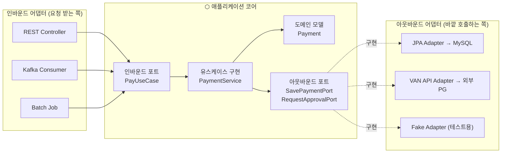
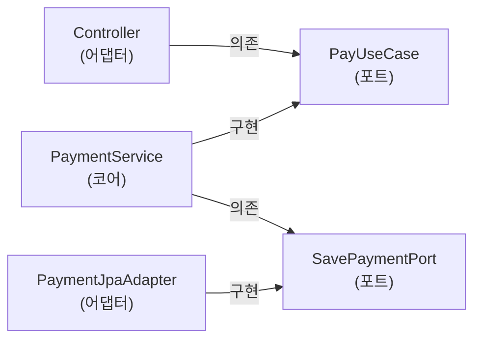

# [Architecture] 헥사고날 아키텍처 (Ports & Adapters) 쉽게 이해하기

> **한 줄 요약**: 비즈니스 로직(핵심)을 가운데 두고, DB·웹·외부 API 같은 "바깥 기술"은 **교체 가능한 플러그인(어댑터)** 으로 취급하는 설계.

---

## 1. 왜 필요한가? (기존 구조의 문제)

흔한 계층형(Controller → Service → Repository) 구조에서는 이런 일이 생긴다.

```java
@Service
public class PaymentService {
    private final PaymentJpaRepository repo;      // JPA에 직접 의존
    private final RestTemplate restTemplate;      // 외부 PG 호출 기술에 직접 의존

    public void pay(...) {
        // 비즈니스 규칙 + JPA 코드 + HTTP 호출 코드가 뒤섞임
    }
}
```

| 문제 | 결과 |
| :--- | :--- |
| 비즈니스 로직이 JPA·HTTP 같은 **기술에 오염**됨 | 단위 테스트에 DB/네트워크가 필요해짐 |
| 의존 방향이 **위 → 아래(DB 쪽)** 로 고정됨 | DB를 바꾸거나 PG사를 교체하면 Service까지 수정 |
| "무엇을 하는가"와 "어떻게 하는가"가 섞임 | 코드가 커질수록 이해·수정이 어려움 |

헥사고날 아키텍처는 이 문제를 **의존 방향을 뒤집어서** 해결한다.

---

## 2. 비유로 이해하기: 노트북과 충전기 🔌

* **노트북(핵심 도메인)** 은 "전원이 필요하다"는 **콘센트 규격(포트)** 만 정의한다.
* **충전기·보조배터리·멀티탭(어댑터)** 는 그 규격에 맞춰 끼워지는 부품이다.
* 한국 콘센트든 미국 콘센트든 **노트북 본체는 안 바뀐다.** 어댑터만 바꾸면 된다.

| 비유 | 헥사고날 용어 |
| :--- | :--- |
| 노트북 본체 | **도메인 / 애플리케이션 코어** |
| 콘센트 규격(구멍 모양) | **포트 (Port)** = 인터페이스 |
| 충전기·변환 플러그 | **어댑터 (Adapter)** = 구현체 |

---

## 3. 핵심 개념 3가지

### 3.1 코어 (Core / Hexagon)
* 도메인 모델(엔티티, 규칙) + 유스케이스(서비스)가 있는 **가장 안쪽**.
* **Spring, JPA, HTTP 등 어떤 프레임워크/기술도 import 하지 않는다.**

### 3.2 포트 (Port) — "코어가 정한 규격"
코어의 경계에 있는 **인터페이스**. 방향에 따라 두 종류다.

| 종류 | 별칭 | 의미 | 예시 |
| :--- | :--- | :--- | :--- |
| **인바운드 포트** | Driving / Primary | "코어를 **사용하는** 입구" | `PayUseCase` |
| **아웃바운드 포트** | Driven / Secondary | "코어가 **바깥에 부탁하는** 출구" | `SavePaymentPort`, `RequestApprovalPort` |

### 3.3 어댑터 (Adapter) — "규격에 맞춘 구현체"
포트와 바깥 기술을 **연결·변환**하는 코드.

| 종류 | 역할 | 예시 |
| :--- | :--- | :--- |
| **인바운드 어댑터** | 외부 요청 → 포트 호출 | `PaymentController`(REST), Kafka Consumer, 배치, CLI |
| **아웃바운드 어댑터** | 포트 구현 → 외부 시스템 호출 | `PaymentJpaAdapter`(DB), `VanApiAdapter`(외부 PG) |

---

## 4. 전체 구조 한눈에 보기



> 이름이 "헥사고날(육각형)"인 이유: 입구/출구가 여러 개라는 것을 **육각형의 여러 변**으로 표현한 것뿐, 6이라는 숫자에 의미는 없다.

---

## 5. 가장 중요한 원칙: 의존성은 항상 "안쪽"을 향한다



* 코어는 어댑터를 **모른다.** 오직 포트(인터페이스)만 안다.
* 어댑터가 코어의 포트를 **바라보고 구현**한다. → 이것이 **DIP(의존성 역전 원칙)** 의 실전 적용.
* 그래서 DB를 MySQL → MongoDB로 바꿔도 **코어 코드는 0줄 수정**.

---

## 6. Spring 코드 예제 (결제 승인)

### 6.1 패키지 구조

```text
payment/
├─ domain/                       # 순수 도메인
│   └─ Payment.java
├─ application/                  # 코어: 유스케이스 + 포트
│   ├─ port/
│   │   ├─ in/
│   │   │   └─ PayUseCase.java
│   │   └─ out/
│   │       ├─ SavePaymentPort.java
│   │       └─ RequestApprovalPort.java
│   └─ PaymentService.java
└─ adapter/                      # 바깥 기술
    ├─ in/web/
    │   └─ PaymentController.java
    └─ out/
        ├─ persistence/
        │   ├─ PaymentJpaAdapter.java
        │   ├─ PaymentEntity.java
        │   └─ PaymentJpaRepository.java
        └─ van/
            └─ VanApiAdapter.java
```

### 6.2 도메인 (기술 의존 없음)

```java
public class Payment {
    private final Long amount;
    private PaymentStatus status = PaymentStatus.READY;

    public Payment(Long amount) {
        if (amount <= 0) throw new IllegalArgumentException("금액은 0보다 커야 합니다");
        this.amount = amount;
    }

    public void approve() { this.status = PaymentStatus.APPROVED; }
    public void fail()    { this.status = PaymentStatus.FAILED; }
}
```

### 6.3 포트 (코어가 정한 규격)

```java
// 인바운드 포트: "결제를 요청할 수 있다"
public interface PayUseCase {
    Payment pay(Long amount);
}

// 아웃바운드 포트: "결제를 저장해줘" / "승인을 요청해줘"
public interface SavePaymentPort {
    void save(Payment payment);
}

public interface RequestApprovalPort {
    boolean approve(Payment payment);
}
```

### 6.4 유스케이스 (코어 로직)

```java
@Service // Spring 어노테이션 정도는 실무에서 허용하는 편 (순수주의 시 제거 후 Config에서 Bean 등록)
@RequiredArgsConstructor
public class PaymentService implements PayUseCase {

    private final RequestApprovalPort requestApprovalPort; // 인터페이스만 안다
    private final SavePaymentPort savePaymentPort;         // 인터페이스만 안다

    @Override
    public Payment pay(Long amount) {
        Payment payment = new Payment(amount);

        if (requestApprovalPort.approve(payment)) payment.approve();
        else payment.fail();

        savePaymentPort.save(payment);
        return payment;
    }
}
```

### 6.5 어댑터 (기술 담당)

```java
// 인바운드 어댑터: HTTP → 유스케이스 호출
@RestController
@RequiredArgsConstructor
public class PaymentController {
    private final PayUseCase payUseCase;   // 구현체(Service)가 아닌 포트에 의존

    @PostMapping("/payments")
    public PaymentResponse pay(@RequestBody PaymentRequest req) {
        return PaymentResponse.from(payUseCase.pay(req.amount()));
    }
}

// 아웃바운드 어댑터: 포트 구현 → JPA 사용
@Component
@RequiredArgsConstructor
public class PaymentJpaAdapter implements SavePaymentPort {
    private final PaymentJpaRepository repository;

    @Override
    public void save(Payment payment) {
        repository.save(PaymentEntity.from(payment)); // 도메인 ↔ 엔티티 변환
    }
}

// 아웃바운드 어댑터: 포트 구현 → 외부 VAN 호출
@Component
@RequiredArgsConstructor
public class VanApiAdapter implements RequestApprovalPort {
    private final RestClient restClient;

    @Override
    public boolean approve(Payment payment) {
        // 외부 API 호출 + 응답 변환
        return true;
    }
}
```

### 6.6 테스트가 얼마나 쉬워지나

```java
class PaymentServiceTest {
    @Test
    void 승인_성공시_APPROVED() {
        // DB, 네트워크, Spring 컨텍스트 전부 불필요 — 람다로 가짜 어댑터를 만든다
        PayUseCase useCase = new PaymentService(p -> true, p -> {});

        Payment result = useCase.pay(10_000L);

        assertThat(result.getStatus()).isEqualTo(PaymentStatus.APPROVED);
    }
}
```

---

## 7. 계층형 아키텍처와 비교

| 구분 | 전통 계층형 | 헥사고날 |
| :--- | :--- | :--- |
| 의존 방향 | Controller → Service → Repository(DB) | **모든 어댑터 → 코어(포트)** |
| 비즈니스 로직 위치 | Service (기술과 섞이기 쉬움) | 코어 (기술과 분리) |
| DB/외부 API 교체 | Service까지 영향 | **어댑터만 교체** |
| 단위 테스트 | DB·Mock 설정 무거움 | 가짜 어댑터로 가볍게 |
| 진입점 추가 (REST+Kafka+Batch) | 로직 중복 위험 | 같은 포트 재사용 |
| 코드량 | 적음 | **많음** (인터페이스·변환 코드 증가) |

---

## 8. 장단점과 도입 기준

### 👍 장점
* 비즈니스 로직이 기술 변화에 **독립적**이다.
* 단위 테스트가 빠르고 쉽다.
* 진입점(REST, MQ, 배치)이 늘어나도 **유스케이스는 하나**.
* 외부 시스템(PG, 스토리지)을 어댑터로 갈아 끼우기 쉽다. (이 노트의 [Strategy 패턴 사례](개발%20실무/아키텍처·설계/설계%20패턴/[Design%20Pattern]%20실무%20프로젝트%20및%20오픈소스로%20체득하는%20GoF%20핵심%20디자인%20패턴%2010선%20%28Proxy,%20Decorator,%20Strategy,%20Chain,%20Template,%20SPI,%20Visitor,%20Facade%29.md)의 `StorageProvider`가 사실상 아웃바운드 포트/어댑터)

### 👎 단점
* 파일·인터페이스·변환(Mapper) 코드가 **눈에 띄게 늘어난다.**
* 단순 CRUD에는 과한 설계(오버엔지니어링)가 되기 쉽다.
* 팀이 개념을 공유하지 않으면 오히려 혼란스럽다.

### ✅ 언제 쓰면 좋은가?

| 상황 | 추천 |
| :--- | :--- |
| 결제·정산처럼 **규칙이 복잡**하고 오래 유지될 도메인 | ✅ 적극 추천 |
| 외부 연동(PG, VAN, 스토리지)이 **자주 바뀌거나 여러 개** | ✅ 추천 |
| REST + 메시지 + 배치 등 **진입점이 다양** | ✅ 추천 |
| 단순 CRUD, 관리자 화면, 단기 프로토타입 | ❌ 계층형으로 충분 |

---

## 9. 관련 개념 정리 (헷갈리는 것들)

| 이름 | 관계 |
| :--- | :--- |
| **Ports & Adapters** | 헥사고날의 **다른 이름** (Alistair Cockburn이 제안) |
| **Clean Architecture** (Uncle Bob) | 같은 철학. 원형 계층으로 표현, 용어만 다름 (Entity / Use Case / Interface Adapter) |
| **Onion Architecture** | 같은 철학. 양파 껍질 모양으로 표현 |
| **DIP (의존성 역전 원칙)** | 이 아키텍처를 가능하게 하는 **핵심 원리** |

> 셋 다 "**도메인을 중심에 두고 의존성은 안쪽으로**"라는 같은 결론. 이름과 그림만 다르다.

---

## 10. 정리

1. **코어**는 순수한 비즈니스 로직만 가진다. (기술 import 금지)
2. **포트**는 코어가 정한 인터페이스다. (들어오는 문 / 나가는 문)
3. **어댑터**는 포트에 맞춰 REST·DB·외부 API를 연결하는 플러그인이다.
4. **의존성은 항상 바깥 → 안쪽**. 코어는 바깥을 모른다.
5. 복잡한 도메인엔 강력하지만, 단순 CRUD엔 과하다. **필요한 곳에만** 쓰자.
