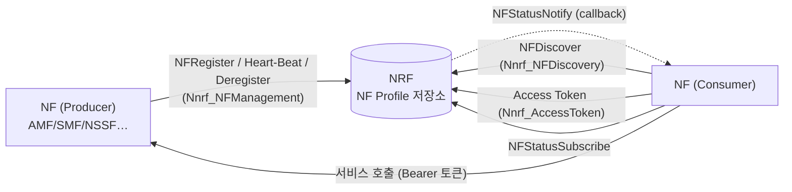
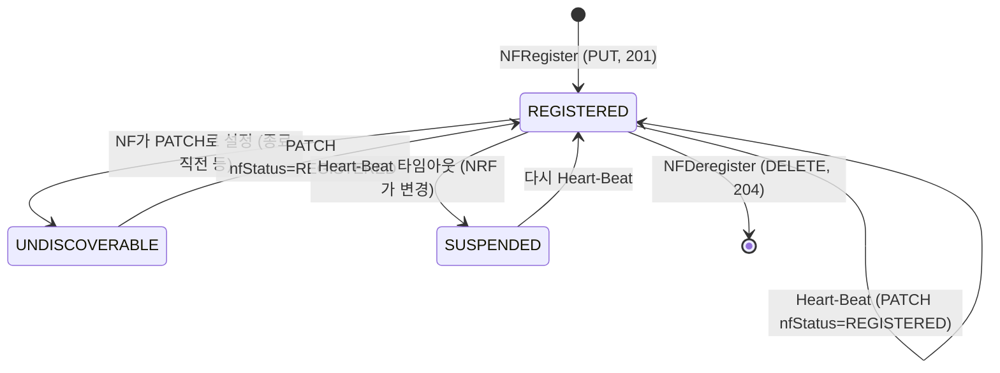

# 3GPP NRF 정리 (TS 29.510 Rel-15)

> **기준**: 3GPP TS 29.510 **V15.8.0** (Release 15의 마지막 버전, 원문 대조). 이 버전에 없는 Rel-16 이후 항목(예: `nssfInfo`)은 넣지 않았다.
> 자매 노트: [[3GPP NSSF 정리 (TS 29.531 Rel-15)]] — NSSF가 응답으로 돌려주는 **NRF 주소**(`nrfId`, `nrfAmfSet*`)가 이 노트의 서비스를 가리킨다.

---

## 0. 30초 요약

- **NRF = Network Function Repository Function.** 5G Core의 **NF 전화번호부 + 서비스 디렉터리**. NF Profile을 저장하고, 다른 NF가 찾아 쓰게 해준다.
- 규격(§4)이 정의한 NRF의 3대 기능

| 기능 | 서비스 | 한 줄 |
|---|---|---|
| NF Profile 유지 | **Nnrf_NFManagement** | NF가 자기 프로파일을 등록·갱신·해제, 상태 변경 구독/알림 |
| 서비스 탐색 | **Nnrf_NFDiscovery** | 조건(NF 타입·서비스명·S-NSSAI·DNN 등)에 맞는 NF 인스턴스 검색 |
| 인가 | **Nnrf_AccessToken** | OAuth2 Client Credentials로 서비스 접근 토큰 발급 |

- 로밍 시 vNRF ↔ hNRF 사이 기준점 이름은 **N27** (표현용이고 실제는 Nnrf SBI에 포함).
- NRF는 모든 NF와 상호작용하므로 아키텍처 그림에 기준점으로 그리지 않는다.



---

## 1. 서비스별 URI / 리소스 한눈에

| 서비스 | apiRoot 뒤 | apiName | apiVersion | OAuth2 scope |
|---|---|---|---|---|
| NFManagement | `/nnrf-nfm/v1/` | `nnrf-nfm` | v1 | `nnrf-nfm` |
| NFDiscovery | `/nnrf-disc/v1/` | `nnrf-disc` | v1 | `nnrf-disc` |
| AccessToken | `{nrfApiRoot}/oauth2/token` | (3GPP 패턴 아님, RFC 6749 재사용) | - | - |

- 공통: HTTP/2, JSON, 에러 `application/problem+json`, 부분 수정 `application/json-patch+json`. NFManagement에 전용 커스텀 헤더 없음. gzip 지원 권장.
- 두 서비스 모두 scope가 **서비스명 하나**뿐이고 리소스/오퍼레이션 단위 scope는 없다.

---

## 2. Nnrf_NFManagement

### 2.1 서비스 오퍼레이션 (§5.2.2) ↔ HTTP 매핑

| 오퍼레이션 | HTTP | 리소스 | 성공 | 요약 |
|---|---|---|---|---|
| **NFRegister** | **PUT** | `/nf-instances/{nfInstanceID}` | **201 Created** (+`Location`) | NF 프로파일 등록 (생성) |
| **NFUpdate** (전체 교체) | **PUT** | `/nf-instances/{nfInstanceID}` | **200 OK** | 이미 있는 프로파일 완전 교체 |
| **NFUpdate** (부분) | **PATCH** | `/nf-instances/{nfInstanceID}` | 200 OK / 204 | JSON Patch로 일부 속성·서비스 add/replace/remove |
| **NF Heart-Beat** | PATCH | `/nf-instances/{nfInstanceID}` | 204 (또는 200+프로파일) | NFUpdate로 수행하는 생존 신고 |
| **NFDeregister** | **DELETE** | `/nf-instances/{nfInstanceID}` | 204 | 등록 해제 |
| **NFListRetrieval** | GET | `/nf-instances?nf-type=&limit=` | 200 (`UriList`) | 등록된 NF 목록(각 NF의 URI) |
| **NFProfileRetrieval** | GET | `/nf-instances/{nfInstanceID}` | 200 (`NFProfile`) | 특정 NF 프로파일 조회 |
| **NFStatusSubscribe** | **POST** | `/subscriptions` | **201 Created** (+`Location`) | NF 상태 변경 구독 |
| (구독 갱신) | PATCH | `/subscriptions/{subscriptionID}` | 204 / 200 | `validityTime` 연장만 |
| **NFStatusUnSubscribe** | **DELETE** | `/subscriptions/{subscriptionID}` | 204 | 구독 해제 |
| **NFStatusNotify** | **POST** | `{nfStatusNotificationUri}` (콜백) | 204 | NRF → 구독자 알림 |

- ⚠️ **PUT = 등록(NFRegister)**, PATCH ≠ 등록. 또한 **GET은 NFProfile 조회/목록 조회로 나뉘고**, **구독 PATCH(validityTime 연장)** 도 있다.
- 다른 PLMN의 NRF는 **NFRegister / NFUpdate / NFDeregister / 목록·프로파일 조회를 호출할 수 없다.** (구독/알림/구독해제만 PLMN 간 허용)
- NRF 자신도 같은 오퍼레이션으로 **다른 NRF에 등록**할 수 있다(`nfType=NRF`, `nfServices`에 `nnrf-disc`·`nnrf-nfm`, 선택적으로 `nrfInfo`). 등록받은 NRF는 이 정보를 discovery **forwarding/redirecting** 대상 선택에 쓴다.

### 2.2 NF 생명주기



| `nfStatus` | 의미 | 발견(Discovery) 가능 |
|---|---|:-:|
| **REGISTERED** | 등록되어 있고 정상 | ✅ |
| **SUSPENDED** | 등록은 되어 있으나 **동작하지 않음**. Heart-Beat 실패 또는 NF 장애 | ❌ |
| **UNDISCOVERABLE** | 동작은 하지만 **새 요청은 받지 않음** (종료 시나리오 등, 기존 세션은 처리 가능) | ❌ |

(`NFService`에도 같은 3값의 `nfServiceStatus`가 있어 서비스 단위로 제어된다.)

### 2.3 NFRegister 세부

1. NF가 `PUT /nnrf-nfm/v1/nf-instances/{nfInstanceID}` + body `NFProfile`.
   - `{nfInstanceID}`는 **NF가 정한 UUID v4**, PLMN 내 전역 유일. (예: `4947a69a-f61b-4bc1-b9da-47c9c5d14b64`)
2. 성공 **201 Created** + `Location` 헤더 + 생성된 프로파일. 응답 body는 **전체 프로파일**이거나 **필수 속성 + NRF가 추가/변경한 속성만**일 수 있다 (Annex B).
3. 응답에 **`heartBeatTimer`** 가 담긴다(NRF가 정한 Heart-Beat 간격, 초). NF가 요청에 제안값을 넣을 수 있고, NRF가 수용 가능하면 같은 값을 쓴다.
4. 실패: JSON 인코딩 오류 → **400** + `ProblemDetails`, NRF 내부 오류 → **500**.
5. 3GPP에 없는 **커스텀 NF 타입** 등록 가능(`CUSTOM_` 접두 권장, 전용 데이터는 `customInfo`). **벤더 특정 속성**(TS 29.500 §6.6.3)도 모르는 타입이라도 **그대로 저장**해야 한다.

### 2.4 NFUpdate / Heart-Beat 세부

- **전체 교체**: `PUT` → **200 OK**.
- **부분 수정**: `PATCH` (JSON Patch). **모든 operation은 원자적으로 실행**(전부 성공 or 전부 실패). 속성뿐 아니라 `nfServices` 항목 단위 추가/삭제/교체도 가능. 대상 `nfInstanceID` 없으면 **404**.
- **Heart-Beat = NFUpdate(PATCH)의 특수 용법**
  ```
  PATCH .../nf-instances/4947a69a-f61b-4bc1-b9da-47c9c5d14b64
  Content-Type: application/json-patch+json
  [
    { "op": "replace", "path": "/nfStatus", "value": "REGISTERED" },
    { "op": "replace", "path": "/load",     "value": 50 }
  ]
  → HTTP/2 204 No Content   (Content-Location: .../nf-instances/4947a69a-…)
  ```
  - body: `nfStatus`를 `REGISTERED`(또는 `UNDISCOVERABLE`)로 **replace**. 선택적으로 `load` 등 부하 정보 동봉.
  - 응답: 보통 **204**. 프로파일이 크게 바뀌었다고 NRF가 판단하면 **200 + 전체 프로파일**도 가능(시그널링 증가).
  - **NRF 측 타임아웃**: heart-beat 간격보다 긴, **설정 가능한** 시간 동안 갱신이 없으면 `nfStatus=SUSPENDED`로 바꾸고 → Discovery에서 제외 → 구독자에게 알림.
  - NRF가 간격을 바꾸면(OAM 등) **다음 heart-beat 응답에 새 값**을 담아 돌려주고, 그 전까지는 **원래 간격**으로 검사한다.

### 2.5 NFDeregister 세부

- `DELETE /nf-instances/{nfInstanceID}`, body 없음 → **204**. 없으면 **404**.
- NF 프로파일과 그 NF가 제공하던 **서비스 전체**가 삭제된다.

### 2.6 NFStatusSubscribe / Notify / UnSubscribe

**구독 `POST /subscriptions`** — `SubscriptionData`

| 속성 | P | 설명 |
|---|:-:|---|
| nfStatusNotificationUri | **M** | 알림 받을 콜백 URI |
| subscrCond | O | 감시할 NF 집합의 조건. **없으면 "모든 NF"** (자원 부담이 커서 엄격한 정책으로만 허용 권장) |
| subscriptionId | C | **응답에서 NRF가 부여** (요청에는 없음) |
| validityTime | C | 구독 만료 시각. 요청은 힌트, **응답에는 항상 포함** |
| reqNotifEvents | O | 받을 이벤트 목록. 없으면 전체 이벤트 |
| reqNfType / reqNfFqdn / reqSnssais | O | 요청 NF 정보. **NRF가 구독 인가 판단**에 사용(Discovery의 `requester-*`와 동일 방식) |
| plmnId | O | 감시 대상 NF의 PLMN (타 PLMN 구독) |
| notifCondition | O | `NF_PROFILE_CHANGED` 구독 시, 어떤 속성 변경에 알림을 줄지/뺄지 (모니터링 대상/제외 속성) |

- `subscrCond` 종류: `NfInstanceCond`(특정 인스턴스) · `NfTypeCond` · `ServiceNameCond` · `AmfCond` · `GuamiListCond` · `NetworkSliceCond` · `NfGroupCond`.
- 인가: `reqNfType`/`reqNfFqdn` 등을 대상 NF 프로파일의 `allowedNfTypes`/`allowedNfDomains`/`allowedPlmns`/`allowedNssais`와 대조. 집합 구독에서 일부만 인가되면 **구독은 수락하되 인가 안 된 NF의 이벤트는 알림이 가지 않는다.**
- 성공 **201 Created** + `Location`(구독 리소스 URI). 만료되면 계속 받으려면 **새로 구독**하거나 PATCH로 연장.
- **구독 연장**: `PATCH /subscriptions/{id}` body는 `replace /validityTime` 하나만. 제안값 수락 시 **204**, NRF가 다른 값을 부여하면 **200 + 새 리소스 표현**.
- **PLMN 간 구독**: 서빙 PLMN의 NRF가 홈 PLMN NRF에 구독을 대신 만들고, 서빙 NRF가 NF에게 주는 `subscriptionId`는 `<MCC><MNC>-<원래ID>` 형식(예: `123456-subs987654`). 서빙 NRF는 상태를 보관하지 않는 게 권장되고, 갱신/해제 때 이 prefix로 홈 PLMN을 식별한다. **알림은 홈 NRF가 서빙 PLMN의 NF에 직접** 보낸다 (서빙 NRF 경유 안 함).
- **중간 NRF**(forwarding/redirecting 307)로 다른 NRF 소속 NF를 구독하는 시나리오도 있다. 알림은 대상 NRF가 구독 NF에게 직접.

**알림 `POST {nfStatusNotificationUri}`** — `NotificationData`

| 속성 | P | 설명 |
|---|:-:|---|
| event | M | `NF_REGISTERED` / `NF_DEREGISTERED` / `NF_PROFILE_CHANGED` |
| nfInstanceUri | M | 대상 NF Instance URI |
| nfProfile | C | `NF_REGISTERED`·`NF_PROFILE_CHANGED`일 때 새/갱신 프로파일 |
| profileChanges | C | `NF_PROFILE_CHANGED`일 때 변경 목록 (**`nfProfile`과 둘 중 하나만**) |

- 수신 NF는 성공 시 **204**. 자기 구독에 없는 콜백 URI면 **404**.
- 배열형 속성(`nfServices` 등)의 변경은 **배열 전체 교체**로 통지.
- 구독 집합에서 어떤 NF가 속성 변경으로 새로 조건에 부합하게 되면(예: `nfServices`에 서비스를 추가) 이벤트는 **`NF_PROFILE_CHANGED`**.

**해제 `DELETE /subscriptions/{subscriptionID}`** → 204 / 없으면 404.

### 2.7 NFProfile 데이터 모델 (§6.1.6.2.2) — Rel-15 주요 속성

| 속성 | P | 설명 |
|---|:-:|---|
| **nfInstanceId** | M | NF 인스턴스 UUID |
| **nfType** | M | `NFType` enum |
| **nfStatus** | M | `REGISTERED` / `SUSPENDED` / `UNDISCOVERABLE` |
| heartBeatTimer | C | Heart-Beat 간격(초). 요청=제안, 응답=NRF 확정 |
| plmnList | C | NF가 속한 PLMN들. 없으면 NRF의 PLMN으로 간주 |
| sNssais | O | NF가 지원하는 S-NSSAI. 없으면 **모든 S-NSSAI 서비스 가능** |
| perPlmnSnssaiList | O | PLMN마다 S-NSSAI가 다를 때 |
| nsiList | O | NSI 식별자 목록 |
| fqdn / interPlmnFqdn | O | NF FQDN / PLMN 간 통신용 FQDN |
| ipv4Addresses / ipv6Addresses | O | NF 주소 |
| allowedPlmns / allowedNfTypes / allowedNfDomains / allowedNssais | O | **접근 인가 속성** — 어떤 소비자가 이 NF를 발견/사용할 수 있나 |
| priority / capacity / load | O | 선택 가중치 / 용량 / 현재 부하(0~100) |
| locality | O | 운영자 정의 위치 (예: 데이터센터) |
| **udrInfo / udmInfo / ausfInfo / amfInfo / smfInfo / upfInfo / pcfInfo / bsfInfo / chfInfo / nrfInfo** | O | NF 타입별 전용 정보. **Rel-15에는 `nssfInfo`가 없다** (NSSF는 일반 속성 + `nfServices`로 등록) |
| customInfo | O | 커스텀 NF 타입 전용 데이터 |
| recoveryTime | O | NF 마지막 재기동 시각 |
| nfServicePersistence | O | 인스턴스 내 서비스 상태 영속 여부 |
| **nfServices** | O | 제공 서비스 목록 (`NFService[]`) |
| nfProfileChangesSupportInd / nfProfileChangesInd | O | `profileChanges` 방식 알림 지원 표시 |
| defaultNotificationSubscriptions | O | 기본 알림 구독 (AMF가 UDM 등의 콜백 등) |

**`NFService`** (§6.1.6.2.3)

| 속성 | P | 설명 |
|---|:-:|---|
| serviceInstanceId | M | NF 내 서비스 인스턴스 ID |
| **serviceName** | M | 예: `nudm-sdm`, `namf-comm`, **`nnssf-nsselection`**, **`nnssf-nssaiavailability`**, `nnrf-nfm`, `nnrf-disc` |
| **versions** | M | `NFServiceVersion[]` — `apiVersionInUri`(M, 예 "v1"), `apiFullVersion`(M), `expiry`(O) |
| scheme | M | `http` / `https` |
| nfServiceStatus | M | 서비스 단위 상태 |
| fqdn / interPlmnFqdn / ipEndPoints / apiPrefix | O | 서비스 접근 주소 (`ipEndPoints`: ipv4/ipv6/transport(TCP)/port) |
| allowed* / priority / capacity / load / recoveryTime | O | NFProfile과 같은 의미를 서비스 단위로 |
| supportedFeatures | O | 선택 기능 |

**`NFType` (Rel-15.8)**: `NRF, UDM, AMF, SMF, AUSF, NEF, PCF, SMSF, NSSF, UDR, LMF, GMLC, 5G_EIR, SEPP, UPF, N3IWF, AF, UDSF, BSF, CHF, NWDAF`
**`NotificationEventType`**: `NF_REGISTERED, NF_DEREGISTERED, NF_PROFILE_CHANGED`

---

## 3. Nnrf_NFDiscovery

### 3.1 요청 — `GET {apiRoot}/nnrf-disc/v1/nf-instances?{query}`

- **필수(M)는 둘뿐**: `target-nf-type`(찾는 NF 종류), `requester-nf-type`(요청 NF 종류).
- 나머지는 모두 선택/조건부 필터. 주요 파라미터

| 분류 | 파라미터 |
|---|---|
| 서비스/식별 | `service-names`, `target-nf-instance-id`, `target-nf-fqdn`, `requester-nf-instance-fqdn` |
| PLMN | `target-plmn-list`, `requester-plmn-list`, **`hnrf-uri`**(홈 NRF의 NFDiscovery API URI — 예: **홈 PLMN의 NSSF가 알려준 값**) |
| 슬라이스 | `snssais`, `requester-snssais`, `plmn-specific-snssai-list`, `nsi-list` |
| 세션 | `dnn`, `smf-serving-area`, `pdu-session-types`, `access-type` |
| 위치/AMF | `tai`, `amf-region-id`, `amf-set-id`, `guami` |
| 가입자 | `supi`, `gpsi`, `external-group-identity`, `routing-indicator`, `group-id-list` |
| UP/IP | `ue-ipv4-address`, `ue-ipv6-prefix`, `ip-domain`, `dnai-list`, `pgw`, `pgw-ind`, `upf-iwk-eps-ind` |
| 데이터 | `data-set`, `chf-supported-plmn` |
| 선택 | `preferred-locality`, `limit`, `max-payload-size`, `complex-query`, `supported-features`, `required-features` |

> ※ 파라미터 총수가 많다. 위 표는 구분용이고 **정확한 필수/조건 의미는 TS 29.510 Table 6.2.3.2.3.1-1** 에서 확인할 것.

### 3.2 응답 — `SearchResult` (200 OK)

| 속성 | P | 설명 |
|---|:-:|---|
| validityPeriod | M | 결과를 **캐시해도 되는 시간(초)**. `Cache-Control: max-age`와 같은 값 |
| nfInstances | M (0..N) | 조건에 맞는 `NFProfile[]` (빈 배열 = 일치 없음) |
| nrfSupportedFeatures | C | NRF의 선택 기능 |

- 헤더: `Cache-Control`(max-age 필수 포함, should), `ETag`(should) → 소비자는 `If-None-Match`로 재검증 가능.
- **소비자는 결과 재사용을 먼저 고려해야 한다**: 쿼리 조건이 같고 `validityPeriod`가 안 지났으면 재사용 권장.
- 응답의 `NFProfile`에는 일반 데이터 + (타입별) `udrInfo` 등 + 커스텀 NF는 `customInfo`, 벤더 속성이 그대로 들어간다.
- 오류: 소비자가 해당 NF 타입을 발견할 권한이 없으면 **403**, 쿼리 오류 **400**, 내부 오류 **500**.

### 3.3 PLMN 간 / 다중 NRF

| 상황 | 동작 |
|---|---|
| **다른 PLMN** | 서빙 PLMN NRF가 쿼리에 홈 NRF PLMN을 담아 **홈 PLMN NRF에 대신 질의**. 서빙 NRF는 홈 NRF의 **telescopic FQDN**(TS 23.003)로 설정 — SEPP가 TLS 종단하는 구조 때문 |
| **다중 NRF – forwarding** | NRF-1 → 사전 설정 NRF-2 → (supi 등으로 다음 NRF 판단) NRF-3에 **대리 질의** 후 결과 중계 |
| **다중 NRF – redirecting** | NRF-2가 **307 Temporary Redirect** + `Location`(NRF-3)로 돌려보내고, NRF-1이 NRF-3에 직접 질의. 정보가 없으면 **404** |

---

## 4. Nnrf_AccessToken (OAuth2)

- `POST {nrfApiRoot}/oauth2/token`, `Content-Type: application/x-www-form-urlencoded`. **client_credentials** grant (TS 33.501).
- 요청 `AccessTokenReq` (JSON 객체가 아니라 key-value 폼)

| 속성 | P | 설명 |
|---|:-:|---|
| grant_type | M | `client_credentials` |
| nfInstanceId | M | 소비자 NF 인스턴스 ID |
| **scope** | M | 접근할 **서비스명(공백 구분)** — 3GPP에서는 필수 |
| nfType / targetNfType | C | **NF 타입 단위** 토큰일 때 (특정 인스턴스가 아닐 때) |
| targetNfInstanceId | C | **특정 생산자 인스턴스** 토큰일 때 |
| requesterPlmn / targetPlmn | C | PLMN 간(로밍) 요청 |
| targetSnssaiList / targetNsiList | O | NF 타입 단위 토큰에서 생산자 S-NSSAI/NSI |

- 응답 `AccessTokenRsp` (200): `access_token`(JWS Compact 직렬화 **JWT**), `token_type`=`Bearer`, `expires_in`(C), `scope`(C — 요청 scope와 다를 때 필수).
- 토큰 **claims**: `iss`(NRF 인스턴스 ID), `sub`(소비자 NF), `aud`(생산자 ID 또는 NF 타입), `scope`, `exp`…
- 소비자↔NRF는 TLS 상호 인증(또는 NDS/물리적 보안). 실패 시 **400** + 오류 JSON.
- 생산자 NF는 이 토큰을 `Authorization: Bearer`로 받아 **서명·aud·scope 검증**. NSSF에서 "OAuth2는 선택"이라고 한 것은 29.531 쪽 표현이고, 실제 적용 여부는 PLMN 보안 정책(TS 33.501)에 달렸다.

---

## 5. NSSF/AMF와의 연결고리 (3GPP NSSF 노트와 맞물리는 지점)

| 지점 | 내용 |
|---|---|
| NSSF 등록 | NSSF도 일반 NF처럼 `PUT /nf-instances/{id}` — `nfType=NSSF`, `nfServices`에 **`nnssf-nsselection`**, **`nnssf-nssaiavailability`**, Heart-Beat 필요 |
| `nsiInformation.nrfId` | NSSF가 PDU 세션 설립 응답으로 주는 값 = **NFDiscovery API URI**(`…/nnrf-disc/v1`). AMF는 여기에 `target-nf-type=SMF&snssais=…&dnn=…` (+NSI) 질의 |
| `nrfAmfSet` / `nrfAmfSetNfMgtUri` / `nrfAmfSetAccessTokenUri` | AMF 재할당 시 AMF Set의 후보 AMF를 찾을 NRF의 **Discovery / NFManagement / AccessToken** 각 서비스 URI (NSSF 노트 4.4). 후보 AMF 탐색은 `amf-set-id`/`amf-region-id` 쿼리 |
| 홈 라우티드 로밍 | H-NSSF가 hNRF를 알려주면 AMF가 vNRF에 질의, vNRF가 hNRF로 **대리 Discovery**. 직접 질의 시엔 `hnrf-uri`(홈 NSSF가 알려준 홈 NRF API URI) 사용 |
| 슬라이스 필터 | `sNssais`가 없는 NF는 모든 슬라이스 서비스 가능으로 간주 → Discovery의 `snssais` 매칭 규칙에 영향 |

---

## 6. NRF 구현·점검 체크리스트

- [ ] **NFRegister**: UUID v4 검증, 필수 `nfInstanceId/nfType/nfStatus`, **201 vs 200 분기**(신규 vs 교체), `Location` 헤더, 응답에 `heartBeatTimer`.
- [ ] **Heart-Beat**: PATCH `replace /nfStatus` 처리 → `last_heartbeat_time` 갱신, 204 반환, **타임아웃 → SUSPENDED + 구독자 알림**. 간격 변경은 다음 heart-beat 응답에 반영(그 전엔 원래 간격 적용).
- [ ] **PATCH 원자성**: JSON Patch 일부 실패 시 전체 롤백 (모든 op 원자 실행).
- [ ] **DELETE**: 프로파일 + 서비스 전체 제거 후 `NF_DEREGISTERED` 통지.
- [ ] **알림 트리거**: `NF_REGISTERED` / `NF_PROFILE_CHANGED`(배열은 전체 교체 통지) / `NF_DEREGISTERED`. `notifCondition`, `subscrCond`, **구독 인가(allowed*)** 필터링.
- [ ] **Discovery 인가**: `requester-nf-type` 등을 대상 프로파일의 `allowedNfTypes/Domains/Plmns/Nssais`와 대조 → 불허 **403**. `nfStatus != REGISTERED` NF는 결과에서 제외.
- [ ] **캐시 헤더**: `Cache-Control: max-age`와 `validityPeriod` 일치, `ETag`.
- [ ] **알 수 없는 속성 보존**: 벤더 특정 속성/커스텀 NF 타입은 모르는 필드여도 **저장하고 그대로 반환**.
- [ ] **PLMN 간**: `subscriptionId` prefix(`MCC+MNC-`) 처리, 홈 NRF 직접 알림.
- [ ] **저장소**: NFProfile·구독·heart-beat 시각을 어디에 두는지, 만료 스캔 타이머 주기.
- [ ] 보안: AccessToken 서명 키 관리, 토큰 `exp`/`aud`/`scope`.

---

## 7. 예상 Q&A

| Q | A |
|---|---|
| NF 등록은 POST인가? | **PUT**. `{nfInstanceID}`를 NF가 직접 정하는(UUID v4) 리소스라서 생성도 PUT. 구독만 POST로 서버가 ID 부여. |
| 201과 200 차이? | PUT 응답: 신규 등록 201 + Location, 기존 교체 200. PATCH 성공은 200(프로파일) 또는 204(heart-beat 등). |
| Heart-Beat는 별도 API인가? | 아니다. **NFUpdate(PATCH)** 에 `replace /nfStatus`를 쓰는 용법. |
| SUSPENDED와 UNDISCOVERABLE 차이? | SUSPENDED = 동작 안 함(장애/heart-beat 실패, NRF가 변경). UNDISCOVERABLE = 동작은 하지만 새 요청 불가(NF가 스스로 설정, 종료 시나리오). 둘 다 Discovery 제외. |
| 구독 알림은 변경된 부분만 오나? | `NF_PROFILE_CHANGED`는 `nfProfile`(전체) **또는** `profileChanges`(변경 목록) 중 하나. 배열형은 전체 교체 형태. |
| 구독 만료 연장은? | PATCH `/subscriptions/{id}` `replace /validityTime`. NRF가 값을 바꾸면 200+본문. |
| Discovery 결과를 매번 조회해야 하나? | 아니다. `validityPeriod`(= max-age) 내에서 같은 조건이면 **재사용 권장**. |
| NSSF를 NRF에서 찾나? | NSSF도 NRF에 등록되는 일반 NF이지만, 29.531 §5.2.1은 소비자가 NSSF를 "로컬 설정으로 발견"하고, 다른 PLMN NSSF는 TS 23.003의 자체 구성 FQDN으로 찾는다고 적고 있다. |
| NSSF 전용 NFProfile 정보 객체는? | Rel-15(29.510 V15.8.0)에는 `nssfInfo`가 없다. |

---

## 8. 규격 읽기 가이드

| 알고 싶은 것 | 위치 |
|---|---|
| NRF 기능 개요 | TS 29.510 §4, TS 23.501 §6.2.6 (NRF), TS 23.502 §4.17 (NF 서비스 절차: 등록/해제/탐색) |
| 서비스 오퍼레이션 | **TS 29.510 §5.2** (NFManagement), §5.3 (NFDiscovery), §5.4 (AccessToken) |
| API 정의 | §6.1 NFManagement (리소스 6.1.3, NFProfile 6.1.6.2.2, SubscriptionData 6.1.6.2.16), §6.2 NFDiscovery (쿼리 6.2.3.2.3.1, SearchResult 6.2.6.2.2), §6.3 AccessToken |
| 보안 | TS 33.501 §13.3~13.4 (OAuth2) |
| 공통 SBI | TS 29.500 / 29.501 / 29.571 |
| OpenAPI | 3GPP 규격 첨부 OpenAPI: `TS29510_Nnrf_NFManagement.yaml`, `…_NFDiscovery.yaml`, `…_AccessToken.yaml` |
