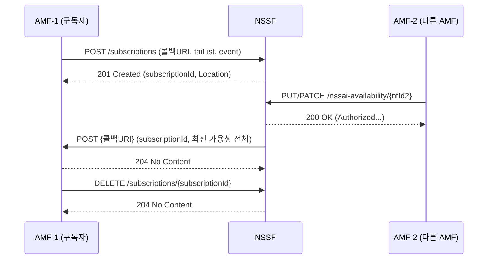
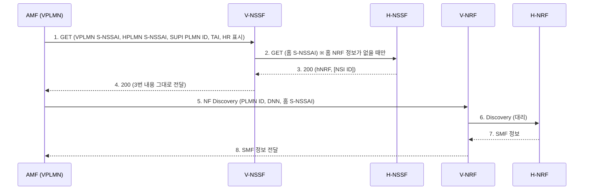
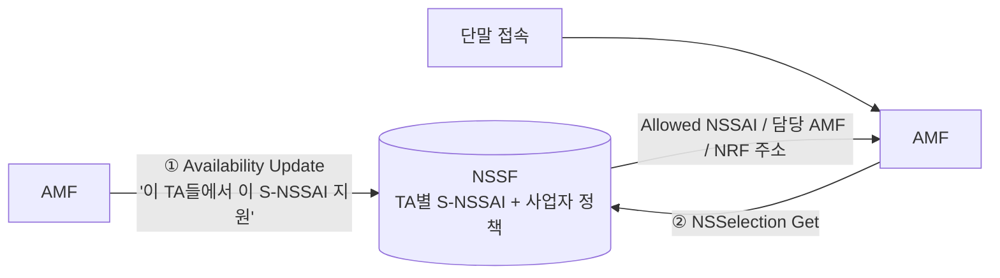

# 3GPP NSSF 정리 (TS 29.531 Rel-15)

> **기준**: 3GPP TS 29.531 **V15.4.0** (Release 15). 규격 근거가 확인된 내용만 정리했다.
> 자매 노트: [[3GPP NRF 정리 (TS 29.510 Rel-15)]] — NSSF가 응답으로 "NRF 주소"를 돌려주므로 같이 보면 좋다.

---

## 0. 30초 요약

- **NSSF = Network Slice Selection Function.** "이 단말이, 지금 이 위치(TA)에서, 어떤 슬라이스를 쓸 수 있고, 어느 AMF / 어느 NRF로 가야 하는지"를 판단해 안내하는 5G Core의 **내비게이션**.
- 제공 서비스는 **딱 2개**.

| 서비스 | 역할 | 비유 | Operation |
|---|---|---|---|
| **Nnssf_NSSAIAvailability** | AMF가 올려준 **TA별 지원 S-NSSAI**를 NSSF에 채우고 관리 | 지도를 채우는 일 (쓰기) | Update(PUT/PATCH), Delete, Subscribe, Unsubscribe, Notify |
| **Nnssf_NSSelection** | 단말 접속 시 **Allowed NSSAI / 담당 AMF / NRF 주소**를 조회·안내 | 길을 안내하는 일 (읽기) | Get (GET 1개) |

- 한 줄 흐름: **AMF → (Availability Update) → NSSF가 저장 → 단말 접속 → AMF → (NSSelection Get) → NSSF가 안내 응답**
- 인터페이스: **N22** (AMF ↔ NSSF), **N31** (로밍: V-NSSF ↔ H-NSSF)

---

## 1. 배경지식

### 1.1 Network Slice

- 규격 정의(TS 23.501 §3.1): *특정 네트워크 능력과 특성을 제공하는 논리적 네트워크.*
- 하나의 물리 망 위에 서비스별로 논리 망을 나눠 쓰는 것. 버스 전용차로처럼 **도로를 새로 깐 게 아니라 규칙으로 용도를 나눈 것**이라는 비유로 이해하면 쉽다.
- 서비스(스마트폰/자율주행/IoT)가 한 망을 섞어 쓰면 서로 영향을 주므로(기능·성능·격리 요구가 다름) 슬라이스로 분리한다.

### 1.2 표준 슬라이스 3종 (SST)

| SST | 이름 | 한 줄 | 쉬운 예(규격엔 예시 없음, 설명용) |
|:-:|---|---|---|
| 1 | **eMBB** (enhanced Mobile Broadband) | 5G 광대역 처리에 적합 | 영상 스트리밍, 대용량 데이터 |
| 2 | **URLLC** (ultra-reliable low latency) | 초고신뢰 저지연 | 자율주행, 원격 제어 |
| 3 | **MIoT** (massive IoT) | 대규모 사물인터넷 | 센서, 검침기 |

- 근거: TS 23.501 §5.15.2.2 Table 5.15.2.2-1. SST 값 범위는 0~255 정수(TS 29.571 `Snssai`).
- **모든 PLMN이 3종을 다 지원할 필요는 없다.** 표준값 외에 사업자 정의 값도 가능하고, 같은 SST 안에서 **SD**로 더 나눌 수 있다.

### 1.3 논리 vs 실제 배치 — Slice vs Slice instance

| 구분 | 의미 | 식별 |
|---|---|---|
| **Network Slice** | 논리적 네트워크 (이름표·선택 기준) | **S-NSSAI** |
| **Network Slice instance (NSI)** | 슬라이스를 실제로 이룬 **NF 인스턴스 + 자원(컴퓨트/스토리지/네트워크)** 집합 | NSI ID |

- 슬라이스 ↔ NSI는 **1:1이 아니다.** 한 NSI가 여러 S-NSSAI에 연결될 수도, 한 S-NSSAI에 여러 NSI가 있을 수도, 같은 S-NSSAI의 NSI가 TA별로 따로 있을 수도 있다 (TS 23.501 §5.15.2.1).
- **PDU 세션은 정확히 하나의 NSI에 속하고, NSI끼리 PDU 세션을 공유하지 않는다** (§5.15.1).
- 단말을 서비스하는 **AMF는 그 단말의 모든 NSI에 공통**이다 (§5.15.1). 슬라이스마다 AMF를 그린 그림은 "해당 슬라이스를 지원하는 AMF Set"을 쉽게 표현한 것.
- 물리적으로 따로 두는지 SW로 나누는지는 규격이 정하지 않음 → **사업자 배치 선택**.
- NSSF의 역할 중 하나: *단말을 서비스할 NSI 집합을 고르는 것* (TS 23.501 §6.2.14).

### 1.4 핵심 용어

| 용어 | 설명 |
|---|---|
| **SST** | Slice/Service Type. 슬라이스 서비스 특성 (0~255, 표준: 1/2/3) |
| **SD** | Slice Differentiator. 같은 SST 내 세부 구분 (선택, 3 octet hex 6자리) |
| **S-NSSAI** | 슬라이스 **하나**의 식별자 = SST + (SD) |
| **NSSAI** | S-NSSAI들의 **목록** |
| **Subscribed S-NSSAI** | 가입 정보(UDM)에 있는 S-NSSAI |
| **Requested NSSAI** | 단말이 등록 시 요청한 NSSAI |
| **Allowed NSSAI** | 서빙 PLMN이 정해준, 현재 등록 영역에서 **쓸 수 있는** S-NSSAI 목록 |
| **Configured NSSAI** | 단말에 미리 설정해 두는 S-NSSAI 목록 (하나 이상의 PLMN에 적용) |
| **PLMN ID** | MCC(3자리) + MNC(2~3자리). 사업자 식별 |
| **TAC / TAI** | TAC = Tracking Area 코드, **TAI = PLMN ID + TAC**. NSSF는 이 TA 단위로 슬라이스 지원 여부를 판단 |
| **AMF Set** | 같은 지역·슬라이스를 서비스하는 AMF 그룹. `amfSetId` = PLMN ID + AMF Region ID(8bit) + AMF Set ID(10bit) |
| **NF Type** | AMF/NSSF/NRF/UDM 등 NF 종류 (NRF가 관리하는 타입 식별자) |

---

## 2. NSSF가 "슬라이스 정보를 어떻게 아는가" — 가용성(Availability)

슬라이스가 TA에서 **사용 가능**하다 = 관련 NF들이 그 S-NSSAI를 지원한다 (TS 23.501 §5.15.8). 세 가지를 합쳐 정해진다.

| # | 출처 | 비고 |
|:-:|---|---|
| ① | **기지국(5G-AN)** 이 TA별로 지원하는 S-NSSAI | N2 연결 수립/갱신 시 AMF가 알게 됨 (TS 38.413, 29.531 범위 밖) |
| ② | **AMF** 가 지원하는 S-NSSAI | **AMF가 NSSF에 등록/갱신 → 이게 29.531 Nnssf_NSSAIAvailability** |
| ③ | **NSSF에 설정된 사업자 정책** | TA별·HPLMN별로 S-NSSAI를 제한. 설정 방법은 29.531 범위 밖 |

→ NSSF는 스스로 알아내는 게 아니라 **현장이 올려주는 정보 + 사업자 정책**을 합쳐서 안다. AMF Set 내 **하나 또는 전체** AMF가 올린다.

---

## 3. Nnssf_NSSAIAvailability (쓰기·관리)

### 3.1 오퍼레이션 5개 (TS 29.531 §5.3.2.1)

| Operation | HTTP | 방향 | 성공 응답 | 요약 |
|---|---|---|---|---|
| **Update** | PUT / PATCH | AMF → NSSF | 200 OK | TA별 지원 S-NSSAI 등록·교체(PUT) / 부분 수정(PATCH) |
| **Delete** | DELETE | AMF → NSSF | 204 | 그 AMF가 등록한 가용성 정보 **전체** 삭제 |
| **Subscribe** | POST | AMF → NSSF | 201 | 가용성 변경 알림 구독 생성 |
| **Unsubscribe** | DELETE | AMF → NSSF | 204 | 구독 해제 |
| **Notify** | POST | **NSSF → AMF** | 204 | 변경 알림 콜백 (유일한 NSSF→AMF 방향) |

- **GET(조회)은 없다.** 저장된 정보를 꺼내 안내하는 것은 NSSelection의 몫.
- **Create(POST)도 없다.** AMF가 이미 가진 `nfId`로 PUT 하면 생성/교체가 된다.

### 3.2 리소스 / URI

`{apiRoot}/nnssf-nssaiavailability/v1/...` (apiVersion v1)

| 리소스 | URI | Method |
|---|---|---|
| NSSAI Availability Store | `/nssai-availability` | OPTIONS |
| NSSAI Availability Document | `/nssai-availability/{nfId}` | PUT, PATCH, DELETE |
| Subscriptions Collection | `/nssai-availability/subscriptions` | POST |
| Individual Subscription | `/nssai-availability/subscriptions/{subscriptionId}` | DELETE |
| Notification Callback | `{nfNssaiAvailabilityUri}` (AMF가 구독 때 제공) | POST |

> 규격 표에서 PUT과 PATCH의 Description 문구는 **원문 그대로 동일**하다. 실제 차이는 Request Body 타입(`NssaiAvailabilityInfo` vs `PatchDocument`)으로만 구분된다.
> 또 Store 리소스만 `{apiVersion}` 대신 `v1`이 하드코딩돼 있는데 이것도 원문 그대로다.

### 3.3 Update — PUT (전체 교체/생성)

- 요청 `NssaiAvailabilityInfo`

| 속성 | 타입 | P | 개수 | 역할 |
|---|---|:-:|:-:|---|
| supportedNssaiAvailabilityData | array(SupportedNssaiAvailabilityData) | M | 1..N | AMF·5G-AN이 **TA별로** 지원하는 S-NSSAI |
| supportedFeatures | SupportedFeatures | O | 0..1 | 선택 기능 협상 (이 버전은 정의된 기능 없음) |
| amfSetId | string | O | 0..1 | 특정 AMF Set 정보일 때 |

- 응답 `AuthorizedNssaiAvailabilityInfo` (200 OK) — **NSSF가 인정한 현재 최종 상태**. 사업자 정책 결과가 여기 담긴다.
- 실패: 403(`SNSSAI_NOT_SUPPORTED`), 4xx/5xx + `ProblemDetails`.

### 3.4 Update — PATCH (부분 수정, JSON Patch)

- 요청 `PatchDocument` = `PatchItem[]` (RFC 6902)

| PatchItem | 타입 | P | 설명 |
|---|---|:-:|---|
| op | PatchOperation | M | add / remove / replace / move / copy / test |
| path | string | M | JSON Pointer (RFC 6901). 바꿀 위치 |
| from | string | C | move/copy일 때만 |
| value | any | C | add/replace/test일 때만 |

- **왜 JSON Patch?** TS 29.501 §4.6.1.1.3.2: 부분 교체는 PATCH, **배열의 개별 요소를 고쳐야 하면 JSON Patch(RFC 6902) shall**. Availability 정보는 `TA 배열 → S-NSSAI 배열` 구조라 한 TA의 S-NSSAI 하나만 바꾸려면 JSON Patch가 필요하다 (이 "이유"는 규격 직접 문장이 아니라 29.501 규칙을 적용한 해석).
- **무엇을 기준으로 값이 정해지나**

| 질문 | 담는 곳 |
|---|---|
| 어느 정보를? | 요청 URI의 `{nfId}` (그 AMF가 등록한 정보) |
| 어느 위치를? | `path` (끝 숫자 = 0부터 세는 배열 인덱스) |
| 어떻게? | `op` (+ `from`, `value`) |

- 예시 (설명용, 규격 예제 아님)
  ```json
  [ { "op": "add",
      "path": "/supportedNssaiAvailabilityData/0/supportedSnssaiList/1",
      "value": { "sst": 1, "sd": "000001" } } ]
  ```
  → 첫 번째(0번) TA의 S-NSSAI 목록 1번 자리에 삽입, 기존 요소는 한 칸씩 밀림. `-` 를 쓰면 맨 끝에 덧붙임. 인덱스는 현재 배열 개수보다 클 수 없음.
- **PatchItem은 배열**이라 여러 건을 한 번의 PATCH에 담을 수 있다.
- **path의 `0`은 TAC가 아니다.** 순번이다. 규격은 배열 요소를 어떻게 가리키는지 따로 정하지 않았다.

### 3.5 데이터 구조 (요청 vs 응답)

```
nfId (AMF 1개)
 └─ supportedNssaiAvailabilityData[]   ← TA 1..N
     ├─ tai
     └─ supportedSnssaiList[]          ← S-NSSAI 1..N
```
**nfId 1 : TA N : S-NSSAI M** (nfId와 S-NSSAI는 1:1이 아님)

| 타입 | 방향 | 속성 |
|---|---|---|
| `SupportedNssaiAvailabilityData` | AMF→NSSF | `tai`(M), `supportedSnssaiList`(M, 1..N) — "AMF가 **주장**하는 것" |
| `AuthorizedNssaiAvailabilityData` | NSSF→AMF | `tai`(M), `supportedSnssaiList`(M), **`restrictedSnssaiList`**(O, **NSSF만 포함**) — "NSSF가 **인정**한 것" |
| `RestrictedSnssai` | NSSF→AMF | `homePlmnId`(M), `sNssaiList`(M, 1..N) — 사업자 정책으로 제한된 S-NSSAI (HPLMN별) |

### 3.6 Delete

- `DELETE /nssai-availability/{nfId}`, body 없음, 성공 204.
- 지워지는 것은 **그 AMF가 등록한 가용성 정보 전체**. S-NSSAI 정의나 다른 AMF 정보는 영향 없음.
- 쓰임: AMF scale-in, graceful shutdown 등.

### 3.7 Subscribe / Unsubscribe / Notify (Pub/Sub)

**왜 구독?** AMF Set의 다른 AMF가 정보를 바꾸거나 정책 제한이 바뀔 수 있는데, 구독하지 않으면 내가 올린 시점의 응답만 알고, 그 뒤 변경은 PUT/PATCH를 다시 보내 응답으로 보기 전엔 알 수 없다.

**Subscribe** — `POST /nssai-availability/subscriptions`

| 속성 (`NssfEventSubscriptionCreateData`) | P | 역할 |
|---|:-:|---|
| nfNssaiAvailabilityUri | M | 알림 받을 **AMF 콜백 주소** |
| taiList | M | 알림 받을 TA 목록 |
| event | M | `NssfEventType` — 이 버전은 `S-NSSAI_STATUS_CHANGE_REPORT` **하나뿐** (TA별 가용 S-NSSAI / PLMN별 제한 S-NSSAI 상태 변경) |
| expiry | O | 구독 유지 희망 시각(힌트) |
| amfSetId | O | 특정 AMF Set 변경만 |

- 응답 201 `NssfEventSubscriptionCreatedData`: `subscriptionId`(M), `expiry`(C, NSSF가 정한 만료), `authorizedNssaiAvailabilityData`(O, 구독 시점 정보). **Location 헤더**에 구독 리소스 URI.
- **구독 수정/연장 오퍼레이션은 없다** (POST/DELETE만). 만료되면 **새로 구독**해야 한다. NSSF는 같은 만료 시각을 여러 구독에 주지 않아야 한다(동시 재구독 몰림 방지). 응답에 expiry가 없으면 만료 없는 구독으로 간주.
- 콜백 주소를 넣는 이유: 알림은 **NSSF가 HTTP 클라이언트, AMF가 서버**가 되는 방향이라 NSSF가 어디로 보낼지 알아야 한다 (TS 29.501 §4.6.2.1).

**Unsubscribe** — `DELETE .../subscriptions/{subscriptionId}`, body 없음, 204.
- Delete(대상 `nfId`, 가용성 정보 삭제)와 달리 **알림 약속만 끊고 정보는 그대로**.

**Notify** — `POST {nfNssaiAvailabilityUri}` (NSSF → AMF), 성공 204

| 속성 (`NssfEventNotification`) | P | 역할 |
|---|:-:|---|
| subscriptionId | M | 어느 구독 때문에 온 알림인지 (구독 여러 개 + 같은 콜백 주소 대비) |
| authorizedNssaiAvailabilityData | M | 구독한 **모든 TA의 최신** 가용성 |

- ⚠️ 배열은 **"바뀐 것만"이 아니다.** AMF는 이전에 받은 값을 이번 값으로 **통째로 교체**해야 한다.

### 3.8 시퀀스 한 장



---

## 4. Nnssf_NSSelection (읽기·안내)

### 4.1 무엇을 돌려주나 (결과 3가지)

| # | 결과 | 필드 |
|:-:|---|---|
| 1 | **쓸 수 있는 슬라이스** | Allowed NSSAI / Configured NSSAI |
| 2 | **담당 AMF** (지금 AMF가 처리 못할 때) | targetAmfSet / candidateAmfList |
| 3 | **NRF 주소** (+ 선택 NSI ID) | nsiInformation(nrfId, nsiId) |

- 저장값을 그대로 꺼내 주는 게 아니다. AMF가 보낸 **단말 위치(TAI) + 가입/요청 S-NSSAI**를 NSSF가 가진 정보와 맞춰 **검증·선택·결정**한다 (TS 23.501 §5.15.5.2.1 (B)).
  - 가입 정보에 맞는 요청 S-NSSAI 가려냄 → NSI 선택 → target AMF Set/후보 AMF 결정 → **2장의 가용성 반영**해 Allowed NSSAI 결정 → 설정에 따라 NRF 결정.
- **AMF가 항상 NSSF를 부르는 건 아니다.** 등록 때 AMF 설정으로 직접 판단 가능하면 묻지 않고, 처리 불가일 때 묻는다. PDU 세션도 AMF가 NRF를 스스로 정할 수 없을 때만 묻는다.

### 4.2 호출되는 세 상황 (요청은 GET 하나)

`GET {apiRoot}/nnssf-nsselection/v2/network-slice-information?{query}`  (apiVersion **v2**, OpenAPI 기준)

| 상황 | 언제 | 구분 쿼리 파라미터 | 핵심 응답 |
|---|---|---|---|
| ① **단말 등록** (AMF 재할당 포함) | AMF가 혼자 판단 못할 때 | `slice-info-request-for-registration` | Allowed/Configured NSSAI, targetAmfSet/candidateAmfList |
| ② **PDU 세션 설립** (SMF 선택) | AMF가 NRF를 정할 수 없을 때 | `slice-info-request-for-pdu-session` | `nsiInformation` (NRF 주소, NSI ID) |
| ③ **UE 구성 업데이트** | 네트워크 사정으로 슬라이스 구성 변경 | `slice-info-request-for-ue-cu` | 새 Allowed/Configured NSSAI |

> 규격은 이 목록이 **전부는 아니다(not exhaustive)** 라고 NOTE에 적었다.

### 4.3 요청 쿼리 파라미터 (전체, §6.1.3.2.3.1)

| 이름 | 타입 | P | 설명 |
|---|---|:-:|---|
| nf-type | NfType | **M** | 요청 NF 종류 (AMF 등) |
| nf-id | NfInstanceId | **M** | 요청 NF 인스턴스 ID |
| slice-info-request-for-registration | sliceInfoForRegistration | C | 등록 절차용 |
| slice-info-request-for-pdu-session | sliceInfoForPDUSession | C | PDU 세션용 |
| slice-info-request-for-ue-cu | sliceInfoForUEConfigurationUpdate | C | UE 구성 업데이트용 |
| home-plmn-id | PlmnId | C | 로밍 가입자일 때 홈 PLMN |
| tai | Tai | C | 단말 현재 TAI |
| supported-features | SupportedFeatures | C | 선택 기능 협상 |

- **GET에는 body가 없다.** 구조체(`sliceInfoFor...`, `tai`, `home-plmn-id`)는 **JSON을 URL 인코딩해 쿼리 값으로** 보낸다 (TS 29.501 §5.3.13, OpenAPI `content: application/json`).
  ```
  ?nf-type=AMF&tai={"plmnId":{"mcc":"450","mnc":"05"},"tac":"000001"}   (실제론 URL 인코딩)
  ```
- 세 상황용 파라미터는 "그 절차 중에 포함한다"로 서술돼, 실제로는 **상황에 맞는 하나**가 붙는다고 읽는다.
- 상황별 구조체 핵심

| 구조체 | 핵심 필드 |
|---|---|
| `SliceInfoForRegistration` | subscribedNssai(C), requestedNssai(O), allowedNssaiCurrentAccess/OtherAccess(C), mappingOfNssai(O), defaultConfiguredSnssaiInd(C), requestMapping(O) |
| `SliceInfoForPDUSession` | sNssai(M), **roamingIndication(M)**, homeSnssai(C, HR 로밍 시) |
| `SliceInfoForUEConfigurationUpdate` | 등록용과 거의 동일, 대부분 O |

### 4.4 응답 `AuthorizedNetworkSliceInfo` (하나의 구조, 상황별로 채워지는 칸이 다름)

| 필드 | P | 의미 | 주로 쓰이는 상황 |
|---|:-:|---|---|
| allowedNssaiList | C | 쓸 수 있는 슬라이스 | 등록, UE-CU |
| configuredNssai | C | 단말에 설정해 둘 슬라이스 | 등록, UE-CU |
| rejectedNssaiInPlmn | O | PLMN에서 거절된 S-NSSAI | 등록 |
| rejectedNssaiInTa | O | 현재 TA에서 거절된 S-NSSAI | 등록 |
| targetAmfSet | O | 넘겨줄 AMF Set | 등록(재할당) |
| candidateAmfList | O | 넘겨줄 후보 AMF 목록 | 등록(재할당) |
| nrfAmfSet | O | AMF Set의 후보 AMF를 찾을 **NRF Discovery** URI | 등록(재할당) |
| nrfAmfSetNfMgtUri | C | 같은 NRF의 **NFManagement** URI (nrfAmfSet이 있으면 포함 권장) | 등록(재할당) |
| nrfAmfSetAccessTokenUri | O | 같은 NRF의 **AccessToken** URI | 등록(재할당) |
| nsiInformation | C | **NRF 주소 + NSI ID** | PDU 세션 |
| supportedFeatures | C | 선택 기능 | - |

- **Configured NSSAI를 같이 주는 조건**: 요청에 Requested NSSAI가 없었거나 / 서빙 PLMN에서 유효하지 않은 값이 있었거나 / `defaultConfiguredSnssaiInd`가 true.
- **재할당 방법 2가지**: ⓐ `candidateAmfList` 직접 제공, ⓑ `targetAmfSet`만 주고 AMF가 NRF(NFDiscovery)에 AMF Set으로 질의해 후보 획득. 새 AMF로는 등록 요청을 **redirect** (후보 리스트일 땐 AMF 간 direct signalling만).
- **`nsiInformation`**: `nrfId`(M) = **NRF NFDiscovery의 API URI**, `nsiId`(O).
  → **NSSF는 SMF를 알려주는 게 아니라 NRF를 알려준다.** 이후 AMF가 그 NRF에 S-NSSAI + DNN (+ nsiId)로 SMF를 질의한다. (→ [[3GPP NRF 정리 (TS 29.510 Rel-15)]] NFDiscovery)
- `nrfAmfSetNfMgtUri`를 AMF가 **어디에 쓰는지** 규격에 명시된 문장은 찾지 못했다 (NFManagement가 NF 상태 구독을 제공하므로 "후보 AMF 상태 구독용"일 수 있다는 추정뿐). 단정 금지.

### 4.5 응답 코드

| 코드 | 의미 |
|---|---|
| **200 OK** | 정상. **조건에 맞는 슬라이스 정보가 없어도 200 + 빈 `AuthorizedNetworkSliceInfo`** (에러 아님!) |
| **403 Forbidden** | 요청 S-NSSAI를 PLMN에서 허용하지 않고 기본값도 없음 → `ProblemDetails.cause = SNSSAI_NOT_SUPPORTED` |
| 4xx/5xx | 공통 `ProblemDetails` |

> 수신 측(AMF) 필드가 비어 있다고 오류로 보면 안 된다. 각 필드는 C(조건부)/O(선택)다.

### 4.6 로밍 (V-NSSF ↔ H-NSSF)

- 로밍 가입자의 요청은 **어느 절차든 먼저 방문망(VPLMN) NSSF가 받는다.**
- **등록 / UE 구성 업데이트**: V-NSSF가 홈망과 주고받지 **않고** 방문망 안에서 Allowed/Configured NSSAI와 **홈 S-NSSAI 매핑(`mappedHomeSnssai`)** 을 정한다 (매핑 값은 사업자 SLA 기반으로 V-NSSF에 관리자가 설정. 29.531은 설정 방법까지 다루지 않음).
- **PDU 세션** — `roamingIndication`으로 구분

| roamingIndication | 의미 | V-NSSF → H-NSSF 조회 |
|---|---|---|
| NON_ROAMING | 로밍 아님 | 해당 없음 |
| LOCAL_BREAKOUT | 로밍, 방문망에서 PDU 세션 종단 | **없음** (방문망 NSSF만 호출) |
| HOME_ROUTED_ROAMING | 로밍, 홈망 경유 | **있음** (옵션 1, V-NSSF에 홈 NRF 정보가 없을 때만) |

- **왜 H-NSSF에 묻나?** HR에서는 SMF가 홈망에 있어서, 방문망 AMF가 SMF를 찾으려면 **홈망 NRF(hNRF)** 를 알아야 한다. 홈 S-NSSAI는 질의에 넣는 값일 뿐, 받아오는 건 매핑이 아니라 **hNRF(+NSI ID)**.
- 홈망 SMF 선택 방법 2가지는 사업자 SLA로 결정 (TS 23.502 §4.3.2.2.3.3): **옵션 1** = 양쪽 NSSF 사용, **옵션 2** = NSSF 없이 NRF끼리 (홈망에 NSSF가 없을 땐 AMF가 설정으로 hNRF를 알거나 옵션 2 사용).
- 다른 PLMN의 NSSF는 TS 23.003 규칙으로 **자체 구성한 FQDN**으로 찾는다 (29.531 §5.2.1).

**HR PDU 세션 옵션 1 콜플로우 (TS 23.502 §4.3.2.2.3.3)**


→ 1~4가 NSSF, **5~8은 NRF의 일**. NSSF는 hNRF를 알려주는 데까지.

---

## 5. 두 서비스를 한 흐름으로



- NSSF의 답은 **Availability 하나만으로 만들지 않는다.** 단말 요청·가입 정보·로컬 설정·RAN 능력·NWDAF 부하 정보 등 가용한 정보를 함께 쓴다 (TS 23.501 §5.15.5.2.1 (B)). 다만 Availability가 어긋나면 안내도 어긋나므로 구독/알림으로 최신화한다.
- 요약: *NSSelection = 읽어서 답하는 서비스, NSSAIAvailability = 채우고 관리하는 서비스.*

### 서비스 / 상호작용 NF

| Service | 설명 | Operation | 상호작용 NF |
|---|---|---|---|
| Nnssf_NSSelection | 슬라이스 선택 조회 (서빙 PLMN·HPLMN 모두) | Get | AMF, 다른 PLMN의 NSSF |
| Nnssf_NSSAIAvailability | AMF 가용 슬라이스 정보 수정·관리 | Update, Subscribe, Unsubscribe, Notify, Delete | AMF |

---

## 6. 개발 시 주의사항 체크리스트

- [ ] **200 + 빈 `{}`** 는 정상 응답이다 (매칭 슬라이스 없음). 403 `SNSSAI_NOT_SUPPORTED`와 구분.
- [ ] 응답의 C/O 필드가 **없어도 오류가 아님**. 파서는 존재 플래그로 처리.
- [ ] GET 쿼리의 구조체 파라미터는 **JSON 문자열 + URL 인코딩**. URL 길이 한도는 규격 미확인 (requestedNssai가 많은 등록에서 인프라 확인 필요).
- [ ] Notify의 `authorizedNssaiAvailabilityData`는 **전체 최신값** → 수신측은 **전체 교체**.
- [ ] 구독은 **수정 불가**, 만료 시 재구독. expiry 분산.
- [ ] Notify 수신 방향에서는 NSSF가 **HTTP 클라이언트** (콜백 호출 실패/타임아웃 처리 필요).
- [ ] PATCH `path` 숫자는 **배열 인덱스**이며 규격은 요소를 가리키는 방식을 따로 정하지 않았다. 구현이 인덱스를 어떻게 해석하는지(예: 저장 순서 의존) 반드시 확인.
- [ ] OAuth2(NRF AccessToken)는 규격상 선택 사항. NSSF 응답에 `nrfAmfSetAccessTokenUri` 등이 있는 경우만 연계.
- [ ] HTTP/2, JSON, 에러는 `application/problem+json`, 부분 수정은 `application/json-patch+json`. NSSF 전용 커스텀 헤더 없음.

---

## 7. 예상 Q&A

| Q | A |
|---|---|
| nfId 하나에 S-NSSAI 하나가 대응되나? | 아니다. nfId(AMF) 1 → TA 1..N → TA당 S-NSSAI 1..N. |
| PATCH path의 `0`은 TAC인가? | 아니다. RFC 6901의 0-based 배열 순번. |
| AMF는 NSSF를 항상 호출하나? | 아니다. 설정으로 직접 판단 가능하면 호출 안 함. PDU 세션은 NRF를 스스로 못 정할 때 호출. |
| 슬라이스마다 AMF가 따로 있나? | 단말을 서비스하는 AMF는 그 단말의 모든 NSI에 공통. 다른 AMF로 보내야 하면 **AMF 재할당**(NSSF가 targetAmfSet/candidateAmfList 제공). |
| 구독이 만료되면 NSSF가 알려주나? | 규격에 만료 알림은 없다. 만료 후 이벤트 보고가 멈추고 AMF가 새로 구독해야 한다. |
| 구조체인데 왜 쿼리 파라미터인가? | GET에는 body가 없어서 JSON을 URL 인코딩해 쿼리로 보낸다 (TS 29.501 §5.3.13). |
| PLMN은 3종을 다 지원해야 하나? | 아니다 (23.501 §5.15.2.2 NOTE). 사업자 정의 SST도 가능, SD로 세분화 가능. |
| 슬라이스 나누면 우선 처리되나? / 슬라이스별 무선 대역을 나누나? | 슬라이스 선택은 어느 NF·자원으로 처리할지 정하는 것. 우선순위/QoS는 PCF 정책, 5QI/ARP 등 별도. 슬라이스별 대역 예약 규정은 23.501에 없음. |
| NSSF가 SMF를 알려주나? | 아니다. **NRF 주소(+NSI ID)** 까지. SMF 탐색은 NRF(NFDiscovery)의 몫. |

---

## 8. 규격 읽기 가이드 (어디를 보면 되나)

| 알고 싶은 것 | 위치 |
|---|---|
| NSSF 기능·절차 (Stage 2) | TS 23.501 §5.15 (슬라이싱), §6.2.14 (NSSF 기능) · TS 23.502 §4.2.2.2.3 (등록·AMF 재할당), §4.3.2.2.3 (PDU 세션, HR 로밍) |
| Nnssf 서비스·API (Stage 3) | **TS 29.531** — §5 서비스(5.2 NSSelection, 5.3 NSSAIAvailability), §6.1 NSSelection API, §6.2 NSSAIAvailability API |
| 공통 데이터 타입 | TS 29.571 (`Snssai` §5.4.4.2, `PlmnId`, `Tai`, `PatchItem` §5.2.4.3) |
| SBI 공통 규칙 | TS 29.500 (HTTP/2, 헤더, 에러), TS 29.501 (URI, PATCH, 콜백) |
| NRF | TS 29.510 → [[3GPP NRF 정리 (TS 29.510 Rel-15)]] |

표 읽는 법: **P** = Presence (**M** 필수 / **C** 조건부 필수 / **O** 선택), **개수** = Cardinality (`1`, `0..1`, `1..N`).
